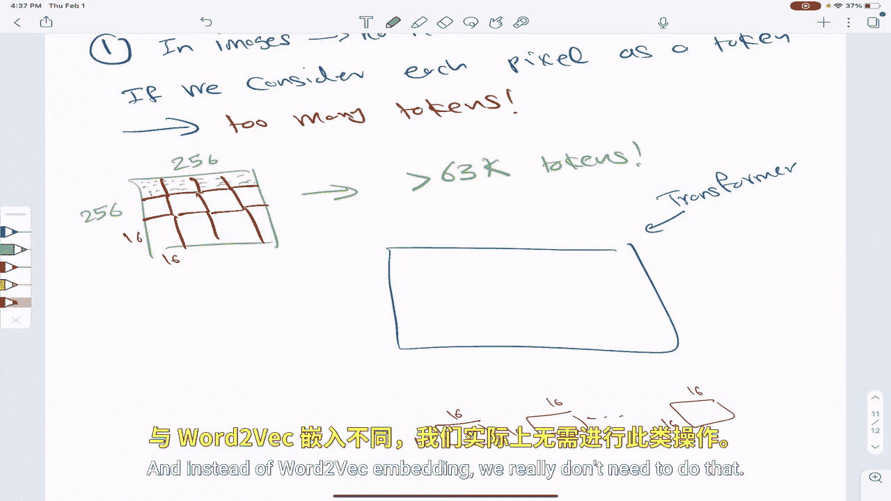

# 042：视觉变换器

## 概述
在本节课中，我们将学习如何将原本为自然语言处理设计的Transformer模型应用于计算机视觉任务，即视觉变换器。我们将探讨其核心思想、面临的挑战以及具体的实现方法。

---

## 从NLP到视觉的挑战

上一节我们介绍了Transformer在NLP领域的成功应用。本节中我们来看看如何将其用于图像处理。

Transformer的编码器部分在翻译等NLP任务上表现优异。那么，我们能否将Transformer用于图像分类、分割、检测等视觉应用呢？

首先需要明确的是，Transformer最初并非为图像设计，其输入处理方式是为NLP任务量身定制的。因此，将Transformer应用于图像时，我们需要处理两个领域之间的关键差异。

### 核心差异分析

以下是NLP与视觉领域在应用Transformer时的主要差异：

1.  **输入性质**：在NLP中，输入是离散的单词或子词单元。我们需要通过词嵌入（如Word2Vec）将其向量化。而在视觉中，图像的像素值是连续的实数。从这一点看，图像输入似乎更直接，因为每个像素本身就是一个具有实数值的“单元”，无需经过复杂的词向量化过程。
2.  **输入规模**：这是主要挑战。在NLP中，一个句子的令牌数量是有限的。但如果将图像的每个像素视为一个令牌，其数量将极其庞大。例如，对于一个256x256分辨率的图像，你将拥有超过60，000个令牌。若处理1080x1920的高清图像，令牌数量将超过200万。这会导致巨大的计算开销。

---

## 视觉变换器的核心思想：图像分块

既然直接将每个像素作为令牌会导致计算困难，我们该如何解决这个问题？

核心思路是：不要以像素级分辨率看待图像，而是将像素分组处理。这类似于在NLP中处理子词或短语，而非单个字符。

### 实现方法：图像分块

如何对像素进行分组？最简单直接的方法是**将图像切割成块**。

以下是实现步骤：

1.  **分块**：将输入图像切割成固定大小的非重叠块。在原始论文中，作者选择的块大小是16x16像素，这也是论文标题“An Image is Worth 16x16 Words”的由来。
2.  **向量化**：将每个图像块展平成一个向量。例如，一个16x16的RGB图像块展平后的向量长度为 `16 * 16 * 3 = 768`。
3.  **线性投影（可选）**：由于展平后的向量可能维度较高，可以通过一个线性投影层来降低其维度。这与NLP中的词嵌入层作用类似，但这里处理的是连续值而非离散令牌。

通过这种方式，我们将一幅图像转换为一系列图像块向量的序列。这个序列就可以作为标准Transformer编码器的输入。每个图像块向量就相当于NLP中的一个“词向量”。

---

## 总结

本节课中我们一起学习了视觉变换器的基本原理。我们了解到，将Transformer应用于视觉任务的主要障碍在于图像的高分辨率会导致令牌数量爆炸。解决这一问题的核心创新是**图像分块**策略，即将图像切割成小块（如16x16像素），并将每个块视为一个令牌输入Transformer。这种方法成功地将Transformer的强大能力扩展到了计算机视觉领域。