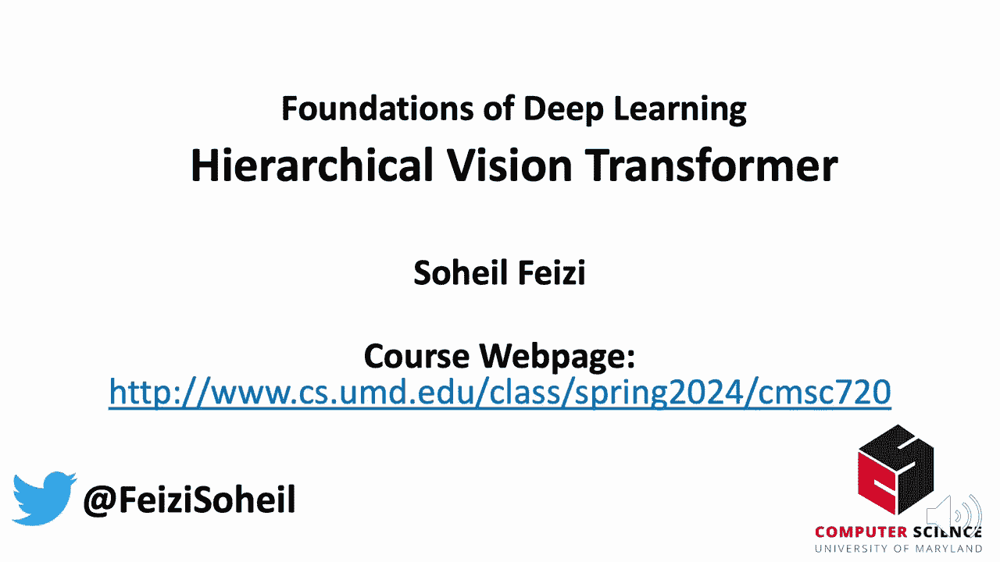
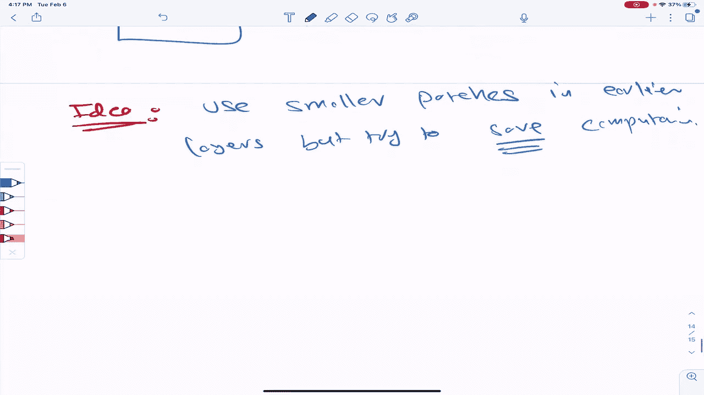

# 043：分层视觉变换器

在本节课中，我们将探讨视觉变换器（Vision Transformers）面临的一个关键问题：**分辨率限制**。我们将分析这个问题产生的原因，并介绍一种解决方案——**分层视觉变换器**（Hierarchical Vision Transformers）的核心思想。

上一节我们讨论了视觉变换器缺乏归纳偏置和层级结构的问题。本节中，我们来看看第三个主要问题：**模型性能受限于图像块（patch）的分辨率**。

在视觉变换器中，每个图像块被视为一个独立的元素进行处理。这类似于语言模型中，每个单词被当作一个独立单元。然而，在图像领域，这可能带来问题。

## 分辨率限制的问题

以下是高分辨率视觉任务中，使用大尺寸图像块（如16x16）可能遇到的问题：

1.  **图像分割困难**：图像分割任务需要为每个像素分配一个分割值。如果输入是16x16的图像块，模型无法输出像素级的分割结果，因为信息在初始阶段就被聚合了。
2.  **小物体检测失败**：如果一个图像块内包含多个小物体（如多个人或物体），模型无法检测出这些独立的个体，因为它只处理整个块的信息，而非块内的细节。
3.  **像素级理解缺失**：对于需要在像素级别理解图像的任务，使用大尺寸图像块会丢失必要的细节信息。

问题的核心在于，一旦图像被分割成较大的块并转换为向量，块内部的精细信息就难以在后续处理中恢复。

## 解决方案的思路

那么，如何解决这个问题呢？一个直观的想法是：**在模型的早期层使用更高分辨率的图像块（即更小的块尺寸）**。

例如，我们可以从4x4甚至1x1（单个像素）的块开始。这样，模型在初始阶段就能接触到更精细的图像信息。

然而，这立即带来了一个挑战：**计算量剧增**。如果一张1920x1080的图像被分割成1x1的块，将产生超过200万个令牌（tokens），这对Transformer的自注意力机制来说是巨大的计算负担。

因此，解决方案需要兼顾两点：
1.  在早期层使用小尺寸图像块以保留细节。
2.  在模型架构内部设法**减少计算开销**。

## 分层视觉变换器的核心思想

分层视觉变换器采纳了上述思路。其核心策略是：**在早期层使用高分辨率（小尺寸）的图像块，然后通过模型深层的某种设计，逐步降低分辨率并节省计算**。

这就像管理预算，我们需要审视计算开销的“订阅项”，在架构设计中只保留最重要的部分，以高效的方式处理高分辨率输入。

具体而言，该论文提出的方法是从**4x4的图像块**开始。

本节课中我们一起学习了视觉变换器在处理高分辨率任务时面临的分辨率限制问题。我们分析了该问题的成因，并引出了分层视觉变换器的基本思想：在模型早期使用小尺寸图像块以捕获细节，同时通过架构创新来管理随之增加的计算复杂度。下一节，我们将深入探讨这种分层结构的具体实现方式。