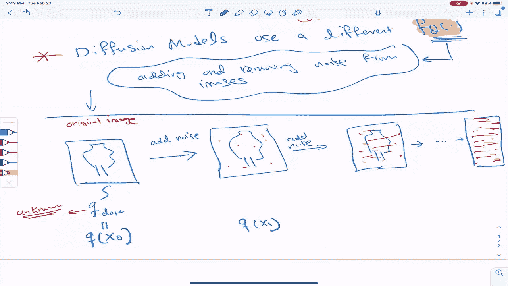

# 044：扩散模型

在本节课中，我们将要学习扩散模型。扩散模型是一种生成模型。我们已经讨论过变分自编码器、生成对抗网络和标准化流模型。扩散模型在问题设定上大致相似。

## 概述

我们的问题设定如下：给定一个训练集。从最简单的情况开始，稍后我们会讨论更复杂的、可以接受额外输入（而不仅仅是图像）的生成模型。训练集包含 N 张图像。

我们假设这些图像来自一个我们未知的底层分布，我们称这个分布为 **Q_data(x)**。

我们的目标是学习一个生成模型 **P_θ(x)**，使得 **P_θ(x)** 在分布上与底层数据分布相似。这个假设确保了我们生成的样本是逼真的。此外，我们还希望能够轻松地从 **P_θ** 中生成样本。

这与我们讨论变分自编码器、生成对抗网络和标准化流模型时的问题设定相同。在这些模型中，我们将 x 表述为一个函数，例如 **x = f_θ(z)**，其中 z 是噪声或潜在变量。通常，我们根据高斯分布生成 z，然后将其通过我们的 **f_θ** 函数。在 GAN 中，这被称为生成器；在 VAE 中，被称为解码器；在标准化流中，被称为流函数。

扩散模型在目标上并无不同。我们同样希望学习一个从噪声到真实图像的函数 **x = f_θ(z)**，使得输出的分布与真实图像的底层分布相匹配，尽管我们并不知道那个分布。设定和目标是一样的。

唯一的区别在于，扩散模型中使用的函数 **f_θ** 会比 GAN、VAE 或标准化流中的函数更复杂一些。

## 扩散模型的核心思想

扩散模型使用的生成函数 **f_θ** 不同。你将看到，这个函数涉及对图像进行**添加**和**去除**噪声的操作。我们将考虑一系列递归地添加和去除噪声的函数，并展示这些函数如何能够生成逼真的样本。

但从高层次看，其问题设定与 GAN、VAE 和标准化流相同。事实上，我们构建这个函数的方式，与我们最初思考 VAE、GAN 和标准化流问题时的方式极为相似。

## 扩散过程详解

在扩散模型中，如前所述，我们使用的函数族涉及对图像进行添加和去除噪声。

其工作原理如下：在训练期间，你有一些原始的真实图像。我们称其中一个样本为 **x_0**，它是数据集中的一个样本。这个样本来自一个分布，如前所述，这个分布称为 **Q_data**。问题在于我们不知道这个底层分布，这正是我们在讨论生成模型时试图处理的核心问题。

在扩散过程中，我们将递归地向训练集中的样本**添加噪声**。这被称为**前向过程**。你将看到为什么这在生成过程中会变得有用。

我们递归地添加噪声。从你的原始图像 **x_0** 开始，添加一些噪声，得到一个带噪版本 **x_1**。然后，在这个带噪版本上添加更多噪声，得到一个噪声更重的版本 **x_2**。如此反复，直到你基本上**破坏**了原始样本中的所有信息。当你添加越来越多的噪声后，最终的图像基本上就是一张纯噪声图像，你无法从中看到原始内容。

让我们为每个部分命名。这里展示的是你训练集中的一个样本。我假设该样本来自你的分布，所以你的训练样本有一个分布，这些是无噪声的原始样本，我们称这个分布为 **Q(x_0)**。

当我们添加噪声时，每一步，每个样本都会变成前一个时间步样本的更嘈杂版本。你实际上是在改变整个分布。在这一步，你将得到分布 **Q(x_1)**。因此，每个样本都变得稍微嘈杂一些。

## 总结

本节课中，我们一起学习了扩散模型的基本概念。我们了解到扩散模型是一种生成模型，其目标与变分自编码器、生成对抗网络和标准化流模型相同：学习一个生成模型来匹配未知的底层数据分布，并实现轻松采样。

扩散模型的独特之处在于其生成函数 **f_θ** 涉及递归的**添加噪声**（前向过程）和**去除噪声**（反向生成过程）操作。我们从高层次概述了前向过程如何逐步将原始清晰图像转化为纯噪声，为后续学习如何从噪声中重建图像奠定了基础。下一节我们将深入探讨反向生成过程的具体实现。