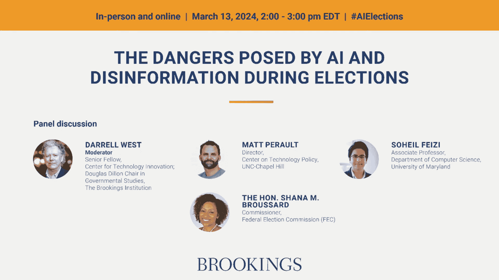
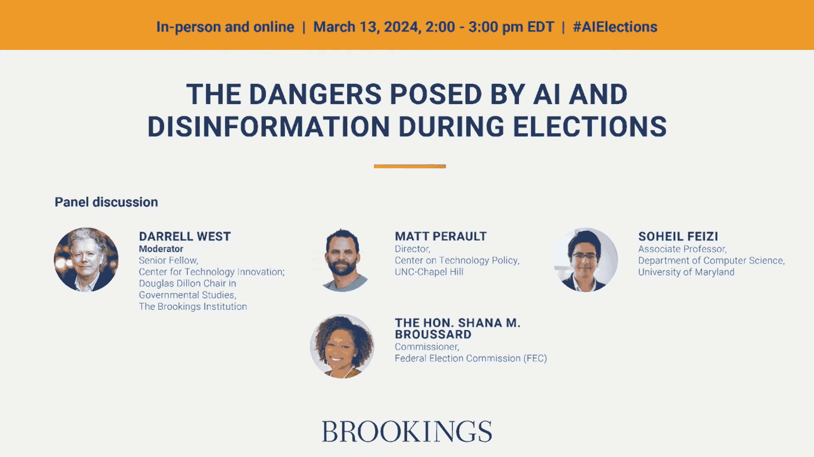
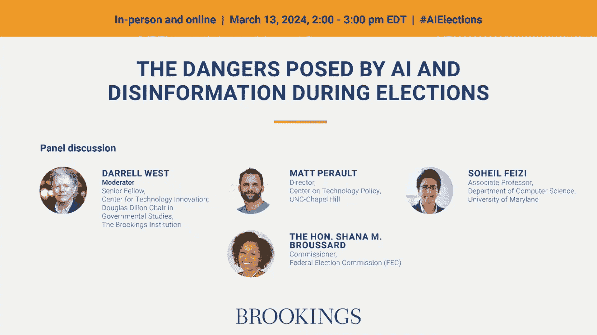

# 046：AI与虚假信息在选举中的风险

## 概述

在本节课中，我们将探讨人工智能与虚假信息在选举期间可能带来的风险。我们将分析2024年选举面临的独特挑战，了解生成式AI工具如何被用于制造虚假内容，并讨论政策制定者、研究人员和技术专家为解决这些问题所提出的方案。

---

## 选举背景与AI挑战

2024年的竞选活动正成为近年来最具影响力的美国选举之一。不同候选人提出的愿景存在巨大差异，全世界的人们都在密切关注美国大选。

与此同时，旨在创造虚假内容、视频和音频的新型生成式AI工具已经出现。这对2024年而言是一个特殊的挑战，因为全球约有一半人口将在今年参与投票。美国、印度、印度尼西亚、墨西哥、巴基斯坦、欧盟及其他许多国家都将举行重要选举。

全球许多人都在担忧这些选举，担心它们可能最终基于虚假叙事而决定。所有这些发展都引发了关于我们自身2024年选举可能面临的风险，以及虚假信息在竞选活动中可能扮演角色的有趣问题。

---

## 专家观点：政策应对与监管

上一节我们介绍了选举面临的宏观挑战，本节中我们来看看政策层面的应对措施。

达雷尔·韦斯特与他的布鲁金斯学会同事合著了一本关于虚假信息的书，他们认为必须认真对待虚假信息，它确实对我们的选举构成了潜在威胁。书中分析了虚假信息背后的有组织网络，并概述了虚假信息的逐利本质。存在庞大的生态系统，它们发现传播虚假叙事非常有利可图。因此，他们提出了一系列建议，并指出要真正解决问题，必须同时考虑有组织网络以及人们传播此类信息的财务和政治动机。

以下是关于监管与立法的具体讨论：

联邦选举委员会专员肖娜·布朗萨德指出，当前应对虚假信息的一种方式是通过州立法。已有14个州在如何为内容添加免责声明或提高透明度方面进行了立法尝试。最近由两党参议员提出的一项立法，触及了通过免责声明努力来对抗并告知公众关于AI错误信息的核心方法。在处理言论，特别是政治言论时，免责声明涉及第一修正案权利的巨大争议，但法院已裁定，涉及披露时，免责声明仍然是可行的。因此，她对州和联邦层面正在推进的免责声明努力抱有最大希望。

关于联邦选举委员会可能出台的2024年AI使用指南，这是一个正在进行的规则制定过程。一个公共监督组织提交了一份请愿书，旨在通过现有关于欺诈性虚假陈述或招揽的法规来监管AI。该请愿书进入了公示阶段，委员会收到了非常多的公众意见，总计2400条，这表明每个人都对这个话题感兴趣。收到的意见来自双方，但绝大多数意见都支持推进某种形式的人工智能监管。

---

## 专家观点：技术风险与可信AI

上一节我们讨论了政策监管，本节中我们将从技术角度审视AI带来的具体风险。

马里兰大学的索希尔·费教授致力于开发可信AI。他认为，AI可能带来的最大风险之一是使用生成式AI模型制造错误信息和虚假信息。在过去几年中，用于文本、图像、视频和音频的生成式AI模型质量有了显著提升。它们不仅能生成逼真的样本，而且在许多情况下不会在内容上留下可见或不可见的签名，这使得我们日后难以对这些内容进行事实核查。

以下是生成式AI带来的三大风险扩展：

1.  **规模、速度和灵活性**：这些生成模型可用于生成成千上万个样本，速度极快。它们可以针对特定选民群体生成内容，以最大化影响，从而进行选民操纵。
2.  **内容真实性难以甄别**：模型生成的内容高度逼真，缺乏可靠的数字指纹，使得检测和溯源变得异常困难。
3.  **AI检测工具本身的风险**：用于对抗此问题的AI检测器本身可能带来风险。大量研究表明，针对文本、图像、视频和音频的AI检测器并不可靠，具有很高的误报率。这意味着，如果在选举前出现了关于候选人的真实图像或视频内容，这些真实证据若被检测器错误地标记为AI生成，则可能被用来伪造事实。这个风险在政策领域较少被研究和强调。

---

## 专家观点：政策评估与跨领域合作

北卡罗来纳大学的马特·佩罗特教授长期观察科技政策。在评估公共政策问题时，他最近受到奈特基金会新投资的启发，该基金会正在投资于“转化性工作”。他们正与乔治城大学合作在华盛顿特区建立一个中心，专注于学术界和公共政策制定者之间的转化工作。他认为，在思考如何应对AI和选举的挑战时，这种连接研究与实际政策的桥梁工作至关重要。

---

## 总结

本节课中，我们一起学习了人工智能与虚假信息在2024年全球选举周期中构成的复杂风险。我们了解到，生成式AI工具使得制造和传播逼真虚假内容变得前所未有的容易，这对民主进程构成了严重威胁。我们从政策层面探讨了通过立法和监管（如免责声明）进行应对的努力，也从技术层面分析了AI在制造虚假信息、操纵选民以及检测工具自身不可靠性等方面的具体风险。最后，我们认识到，解决这一问题需要政策制定者、技术专家和学术界之间的紧密合作与“转化性工作”。保护选举的公正性需要多管齐下，既要发展更可靠的技术解决方案，也要建立更健全的法律和政策框架。