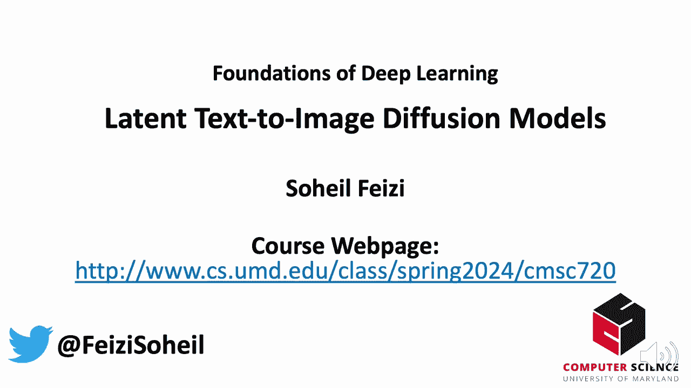
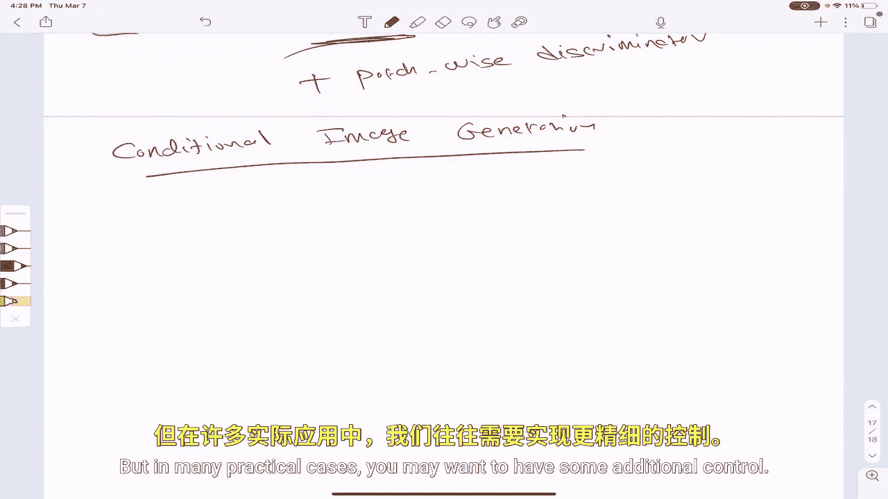

# 047：潜在扩散模型与条件图像生成

在本节课中，我们将要学习潜在扩散模型的核心思想，了解它如何解决高分辨率图像生成的计算难题。随后，我们将探讨条件图像生成的概念，看看如何为生成过程添加额外的控制。

## 潜在扩散模型

上一节我们介绍了基础的扩散模型。本节中我们来看看如何将其应用于高分辨率图像生成。

图像通常具有高分辨率，例如1024x1024像素，这意味着超过一百万个像素。在生成过程中，无论是考虑DDPM还是训练阶段，都需要处理维度极高的向量（数百万个数字）。这带来了可扩展性问题，训练这些模型非常困难，快速生成高分辨率图像也颇具挑战。

这里的解决方案是使用一个编码器-解码器结构。核心思想是压缩输入到一个更小的维度空间（潜在空间），在那个空间中进行扩散过程，然后再解码回来。

以下是具体步骤：
1.  **编码**：使用一个编码器将输入图像 `x` 映射到一个更小维度的潜在空间表示 `z`。
2.  **潜在空间扩散**：在潜在空间 `z` 中执行前向（加噪）和反向（去噪）扩散过程。
3.  **解码**：使用一个解码器将去噪后的潜在表示 `z` 映射回图像空间，得到输出 `x̂`。

这样，原本需要处理百万维向量的工作，被简化为处理维度低得多的潜在向量（例如从1024x1024压缩到32x32），计算效率得到极大提升。

## 编码器与解码器的选择

在原始论文中，编码器和解码器采用了一种与VQ-GAN非常相似的结构。需要强调的是，这个编码器-解码器是**固定不变**的，在扩散模型训练期间不进行优化。你可以使用任何现成的编码器-解码器。

以下简要说明VQ-GAN是如何被单独训练的（这是一个旁注，帮助你理解其原理）：
1.  输入 `x` 通过一个CNN编码器得到潜在表示。
2.  对该潜在表示进行**量化**。每个量化的数字对应一个码本中的向量。
3.  量化后的表示通过一个CNN解码器重建为图像 `x̂`。

其训练损失函数结合了以下几项：
*   **重建损失**：使用**LPIPS距离**而非简单的L2距离。LPIPS是一种基于预训练网络特征空间的感知距离，能更好地捕捉图像间的感知差异。
*   **对抗损失**：引入一个**基于Patch的判别器**，确保生成图像局部块的真实性。这与我们在GAN课程中提到的确保数据分布一致性的思想类似。
*   **量化**：通过码本实现，为潜在空间引入结构，使得微小变化不会显著改变潜在编码，这被认为能提升生成质量。

## 条件图像生成

到目前为止，我们讨论的生成模型是在广义上的：你有一些训练样本（例如猫或狗的照片），然后训练一个模型来生成类似的图像。

但在许多实际应用中，你可能希望拥有额外的控制。例如，根据文本描述生成图像，或者基于一张草图生成完整图片。这就是**条件图像生成**的目标：在给定某种条件 `c`（如文本、类别标签、另一张图像）的情况下，生成符合该条件的图像 `x`。

其核心是将条件信息融入到生成过程中。对于扩散模型，这通常意味着在去噪过程的每一步，模型不仅接收带噪图像 `z_t` 和时间步 `t`，还接收条件 `c`，从而预测噪声或干净图像。公式可以表示为：

`噪声预测网络：ε_θ(z_t, t, c)`
或
`数据预测网络：x_θ(z_t, t, c)`

通过这种方式，生成过程被引导至与给定条件相符的数据分布区域。

---

本节课中我们一起学习了：
1.  **潜在扩散模型**：通过编码器-解码器将高维图像扩散过程转移到低维潜在空间，大幅提升了高分辨率图像生成的效率和可扩展性。
2.  **VQ-GAN**：一种常用的固定编码器-解码器架构，其训练结合了感知重建损失和对抗损失。
3.  **条件图像生成**：扩展了生成模型的能力，使其能够根据额外的输入条件（如文本）生成可控的、符合特定要求的图像。