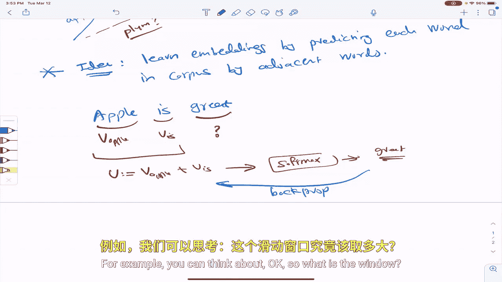

# 048：大型语言模型

## 概述
在本节课中，我们将要学习语言模型。语言模型是处理文本数据的模型，广泛应用于翻译、问答等任务。核心挑战在于如何将离散的单词或句子转换为数学模型可以处理的向量形式。我们将从经典的Word2Vec模型开始，探讨词嵌入的基本思想及其重要性。

---

## 从图像到文本：输入表示的挑战

在之前的课程中，我们讨论了图像模型。图像可以自然地表示为向量，这与模型的输入格式兼容。但在处理语言时，我们遇到了一个问题：单词本身并不是可以直接输入到数学模型中的数学对象。

为了应对这个问题，研究人员提出了词嵌入技术。接下来，我们将介绍一个具有里程碑意义的模型。

---

## Word2Vec：从词到向量的映射

Word2Vec是2014年提出的一篇极具影响力的论文。在深入探讨更复杂的现代语言模型（如GPT）之前，了解其历史背景和基本原理非常重要。

顾名思义，Word2Vec是一个模型，它接收单词或标记作为输入，并生成向量或嵌入作为输出。

你可能会想：为什么需要训练这样一个模型？难道不能简单地为每个单词分配一个唯一的随机向量吗？例如，对于句子“Apple is great”，我可以为“Apple”、“is”、“great”分别映射一组随机数字。

然而，这样做忽略了单词之间的语义关系。我们期望词嵌入能具备一些关键属性。

---

## 理想词嵌入的属性

以下是词嵌入应具备的两个重要属性：

1.  **语义相似性**：如果两个单词在语义上相似，那么它们的嵌入向量也应该相似。这使得数学模型更容易处理语义相近的单词。例如，“great”和“awesome”的向量应该接近。
2.  **关系可推理性**：嵌入空间应能编码单词之间的关系。例如，假设我们有代表“Apple”的向量和代表“purple”的向量。将这两个向量相加（`Apple + purple`），我们期望得到的向量能接近代表“plum”的向量，这体现了“苹果”加上“紫色”得到“李子”的某种关系。

---

## Word2Vec如何学习词嵌入

那么，如何学习具备上述属性的词嵌入呢？其核心思想是：**通过上下文预测目标词来学习嵌入**。

我们通过一个例子来解释。再次考虑句子“Apple is great”。

1.  首先，为词汇表中的每个单词（如“Apple”、“is”、“great”）随机初始化一个向量。
2.  假设我们想预测“great”这个词。我们可以取目标词“great”的相邻词（如“Apple”和“is”）的嵌入向量，将它们相加（或取平均）。
3.  得到一个上下文向量后，我们尝试让这个向量能够正确预测出目标词“great”。
4.  通过反向传播算法，更新所有相关单词的嵌入向量，使预测更准确。

本质上，可以将Word2Vec看作一个简单的神经网络。它聚合相邻词的嵌入，形成一个向量，并试图通过优化（如softmax）使其能够正确预测目标词。这个方法有许多变体，例如窗口大小的选择。

---

## 总结
本节课我们一起学习了语言模型的基础。我们认识到将文本转换为数学表示的挑战，并介绍了Word2Vec这一经典解决方案。Word2Vec通过“用上下文预测词”的方式，学习到的词嵌入不仅捕获了单词的语义相似性（如“great”与“awesome”接近），还能编码单词之间的关系（如“Apple” + “purple” ≈ “plum”）。这为后续更复杂的大型语言模型奠定了重要的基础。