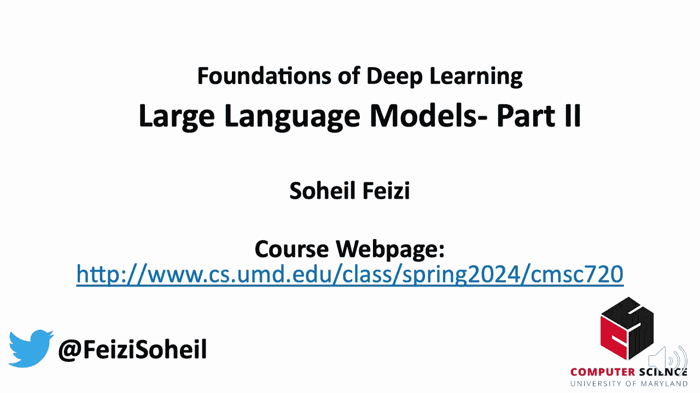
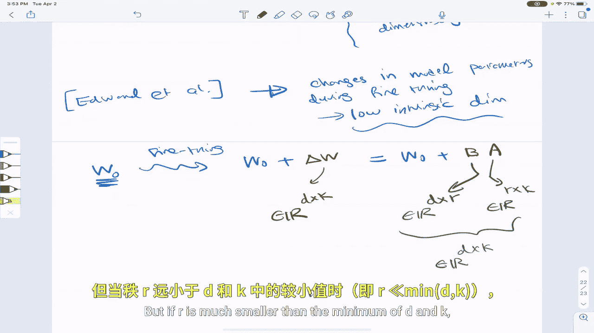

# 049：大语言模型微调方法

在本节课中，我们将探讨如何对大语言模型进行微调。由于这些模型参数量巨大，直接微调会面临存储和计算上的巨大挑战。因此，我们将介绍几种旨在降低微调成本的主流技术，特别是适配器方法和LoRA技术。

## 微调的挑战

上一节我们介绍了大语言模型的基本概念。本节中我们来看看对其进行微调时面临的实际问题。

大语言模型参数量非常庞大。例如，GPT-3拥有超过1750亿个参数，而像PaLM这样的模型参数更多。如今，人们甚至使用混合专家模型，规模更为巨大。这意味着，即使只是存储模型的权重，对单个GPU来说也极具挑战性，因为需要存储数千亿个数字。此外，为了针对特定应用调整模型，还需要在其基础上进行计算。因此，微调大模型存在存储和计算两方面的问题，需要大量的内存和算力。

为了解决这个问题，业界提出了多种方案，旨在为下游应用实现轻量化的存储和计算。我们将讨论文献中并非所有，但可能是实践中被广泛采用的最成功的几种解决方案。

## 适配器方法

以下是适配器方法的核心思想。

适配器的想法很简单。假设你有一个大型模型。在微调过程中，我们不改变模型的所有权重，而是专门设置一些特定的层，称为“适配器”。这些层可以在微调过程中被调整。模型的其余部分权重保持不变，与预训练模型相同。只有网络中的某些部分被允许适应特定的任务设置。这本质上就是适配器的思想。它的优势在于，可以根据适配层的数量，显著减少微调期间需要更新的参数量。

## 低秩自适应

一个特定的适配器家族被称为**LoRA**，即**低秩自适应**的缩写。适配器有不同的实现方式，这里我们介绍这个家族中最成功的实例。

为了提供背景，有一篇论文通过实证分析表明，如果你观察模型参数的分布，它们本质上是低秩的。最近还有一篇名为“扩散冗余”的论文指出，即使在经典的ResNet模型中，你也可以在倒数第二层随机采样特征，而模型性能依然保持良好。这表明模型权重中存在大量冗余，即使丢弃相当一部分，模型在基准测试上的性能也基本不受影响。

另一篇论文在此基础上提出了进一步的观点。他们认为，不仅模型参数本身具有较低的固有维度，而且在微调过程中，模型参数的变化量也具有较低的固有维度。这是他们基于观察得出的一个结论。

基于这一观察，他们提出了一个非常简单的想法。假设你的模型中有一组权重 **W**，你想在微调中更新这些权重。从初始权重 **W₀** 开始，权重变为 **W₀ + ΔW**，其中 **ΔW** 是微调期间对权重所做的更改。

他们提出的方法不是直接学习 **ΔW**，而是将其分解为两个低秩矩阵的乘积：
**ΔW = B × A**

我们确保这些矩阵是低秩的。假设你的 **ΔW** 矩阵维度是 **D × K**（其中D和K可能是很大的数字）。我们将矩阵 **B** 的维度设为 **D × r**，矩阵 **A** 的维度设为 **r × K**。显然，它们的乘积会得到一个 **D × K** 的矩阵。但如果 **r** 远小于 **D** 和 **K** 的最小值，那么需要存储和训练的参数总量（**B** 和 **A** 的元素之和）将远小于直接学习完整的 **D × K** 维 **ΔW** 矩阵。在微调期间，我们只训练这两个小矩阵 **B** 和 **A**，而保持原始的大型预训练权重 **W₀** 冻结不变。最终的前向传播使用组合权重 **W₀ + BA** 进行。

本节课中我们一起学习了微调大语言模型所面临的挑战，并重点介绍了一种高效的解决方案——低秩自适应。通过将权重更新分解为低秩矩阵的乘积，LoRA等方法显著减少了需要训练的参数数量，降低了计算和存储需求，使得在有限资源下微调超大模型成为可能。