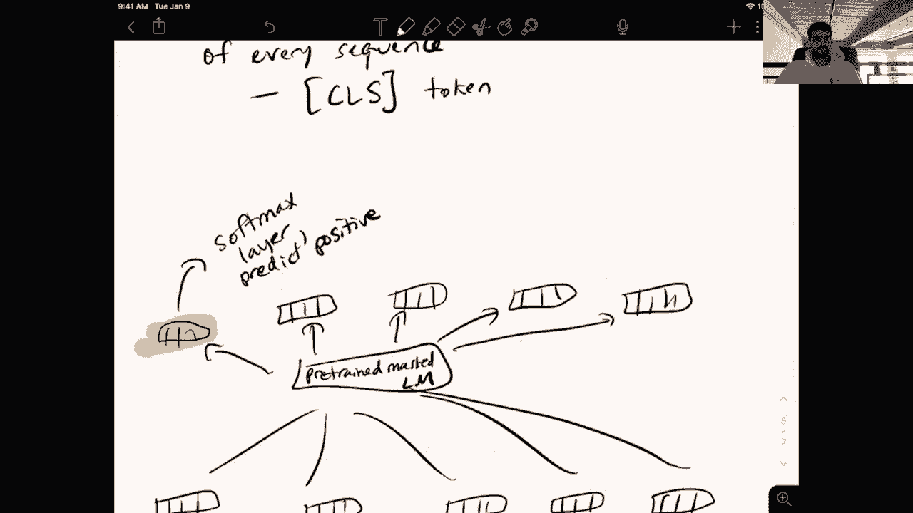
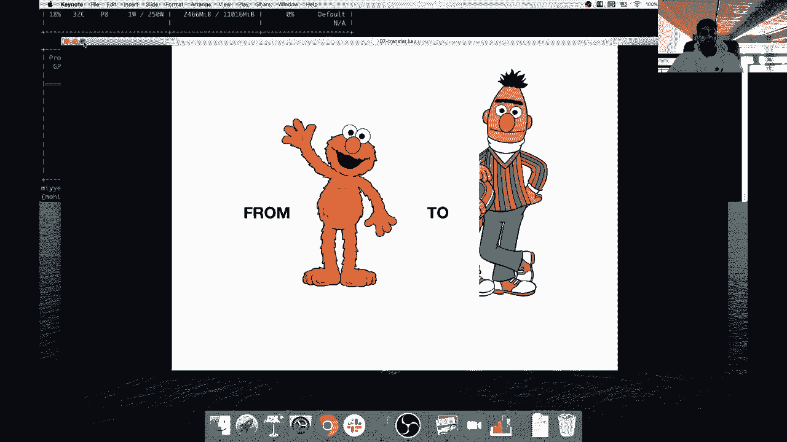
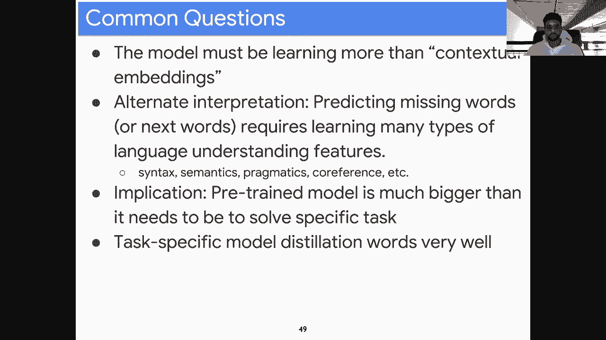
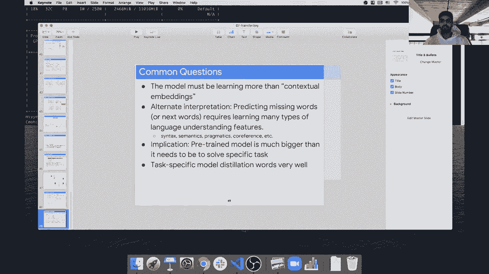

# 课程 P10：L7.2 - BERT 🧠

在本节课中，我们将学习从ELMo到BERT的演进，重点理解BERT的核心思想——掩码语言建模，并了解其如何作为强大的文本编码器应用于下游任务。

## 概述

上一节我们介绍了ELMo，它通过前向和后向两个单向语言模型来获取上下文信息。本节中，我们将看看BERT如何通过一个单一的模型和全新的预训练目标——掩码语言建模，来更优雅地解决上下文双向感知的问题。

## 从ELMo到BERT的转变

ELMo使用两个独立的单向语言模型（LSTM架构），然后将它们的隐藏状态拼接起来，以获得每个词的上下文表示。这种方法虽然有效，但略显繁琐。我们真正希望的是在一个单一模型中，让每个词的表示都能感知到句子中所有其他词的信息。

BERT实现了这一目标，它主要做了三个关键改变：
1.  从两个单向语言模型转变为一个**掩码语言模型**。
2.  从基于**循环神经网络**的架构转变为基于**Transformer**的架构。
3.  在**更大量**的数据上进行预训练。

## 掩码语言建模

掩码语言建模是BERT的核心预训练目标。它与标准语言建模的关键区别在于：

*   **输入**：我们获得一个完整的词序列，但其中一定比例（例如15%）的词被替换为一个特殊的 `[MASK]` 标记。
*   **任务**：模型的任务不是预测下一个词，而是**仅预测那些被掩码的词**。

通过这种方式，模型在预测被掩码的词时，可以同时利用该词左侧和右侧的上下文信息，从而在一个模型中实现了真正的双向理解。

以下是掩码语言建模的简化流程：

```python
# 输入句子
input_sentence = “学生们 [MASK] 他们的书本”
# 模型经过Transformer编码后，获得每个位置的上下文表示
contextualized_representations = transformer(input_sentence)
# 仅对[MASK]位置的表示进行预测
predicted_word = softmax(linear(contextualized_representations[mask_position]))
# 训练目标：使预测词与真实词“打开”一致
loss = cross_entropy_loss(predicted_word, “打开”)
```

## BERT的下游任务应用

与ELMo仅将预训练模型作为固定的词嵌入提供者不同，BERT在下游任务中的应用更加紧密和统一。






**关键机制：CLS标记**
BERT在每一个输入序列的开头添加一个特殊的 `[CLS]` 标记。经过Transformer编码后，这个标记的最终表示汇聚了整个序列的信息，可用于句子级别的分类任务。

**微调过程**
对于下游任务（如情感分析），我们只需在预训练的BERT模型顶部添加一个简单的任务特定输出层（例如一个softmax层），然后**对整个模型（包括BERT的参数）进行微调**。这意味着预训练模型和下游模型共享几乎相同的架构。

具体步骤如下：
1.  输入句子：`[CLS] 这部电影很棒`
2.  句子通过预训练的BERT模型，获得每个标记的上下文表示。
3.  取 `[CLS]` 标记的表示 `h_{[CLS]}`。
4.  将其输入一个新增的softmax分类器来预测情感（如“正面”）。
5.  通过下游任务的损失（如交叉熵）进行反向传播，**更新包括BERT参数在内的所有权重**。

这个过程被称为**微调**，它允许模型根据特定任务的数据调整其强大的通用语言理解能力。

## BERT的架构与训练细节

BERT的模型架构基于Transformer编码器堆叠而成。其输入由三种嵌入求和构成：
*   **词标记嵌入**：使用WordPiece子词分词，词汇表大小为30000。
*   **位置嵌入**：编码每个词在序列中的位置。
*   **段落嵌入**：用于区分输入中的两个句子（针对下一句预测任务）。

BERT最初发布了两个版本：
*   **BERT-Base**: 12层Transformer，隐藏层维度768，12个注意力头。
*   **BERT-Large**: 24层Transformer，隐藏层维度1024，16个注意力头。

BERT在超过33亿词的语料（英文维基百科和图书语料库）上进行预训练，使用了掩码语言建模和下一句预测两个任务。后续研究（如RoBERTa）表明，掩码语言建模是提升性能的主要驱动力。



## 总结



本节课中我们一起学习了BERT模型。我们从ELMo的双向语言模型拼接出发，探讨了其局限性，进而引入了BERT的掩码语言建模预训练目标。我们了解到，BERT通过让模型预测句子中被随机掩码的词，在一个统一的Transformer模型中实现了深度的双向上下文理解。此外，BERT通过引入 `[CLS]` 标记和端到端的微调策略，极大地简化了下游任务的应用流程，并在多项自然语言处理任务上取得了突破性的性能提升。BERT的成功标志着大规模预训练语言模型时代的到来。