# 📚 课程 P11：L8 - 问答系统

在本节课中，我们将学习问答系统。我们将首先回顾在BERT等模型出现之前，问答任务是如何被解决的。然后，我们将探讨在现代迁移学习范式下，如何使用BERT这类模型来处理这些任务。本课程将强调，从建模角度看，问答任务已经变得非常简单。我们只需要将问题和外部信息输入BERT，并在其顶部添加一个分类器来预测答案即可。课程后半部分，我们将讨论一些更复杂的、不完全符合此范式的问答任务，这将是后续几周学习更复杂模型的铺垫。

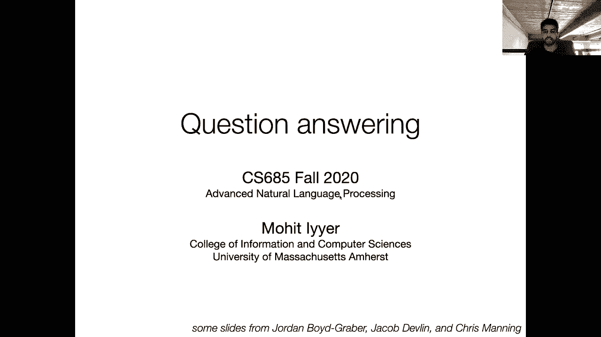

***

## 📝 课程概述与回顾

在开始之前，我们先回顾一下上次课程的内容。

我们终于发布了作业0的成绩。大家做得都很好，平均分非常高。作业1即将完成，这是一个涉及大量编码的作业。我们还在进行最后的调整，预计几天内会发布。作业1的内容严重依赖BERT以及下周一课程中的一些主题，因此我们可能会给大家两周或稍多一点的时间来完成。可以预见，作业1的编码强度将远高于作业0。

我们已经收到了大家的项目提案。我们的目标是在接下来几周内，为大家提供详细的反馈，并希望在十月初完成。届时，大家将收到我和助教关于如何改进项目或需要注意的事项的建议。

关于考试，我注意到日程表上安排在10月5日。根据我们目前的教学进度，这个时间点太早，无法涵盖接下来几周要讨论的更有趣的内容。因此，我决定将考试推迟到十月底。届时，我们将有更多潜在的主题和问题可以考察。我们也会在考试前安排复习课。此外，我将在接下来几天内，在Piazza上发布之前相关NLP课程的旧试卷供大家参考。但正如第一节课所说，由于远程考试的特殊性，我们这次的考试形式可能与以往有很大不同，我们会尽力减少作弊的可能性。更多细节将很快公布。

最后，感谢在匿名表单中提出改进Notability使用技巧的同学，我看到了这些建议，未来使用iPad时会尝试采纳。

和往常一样，如果大家对课程安排或本节课内容有任何问题，请在聊天框中提出。

***

## 🤔 问答系统概述

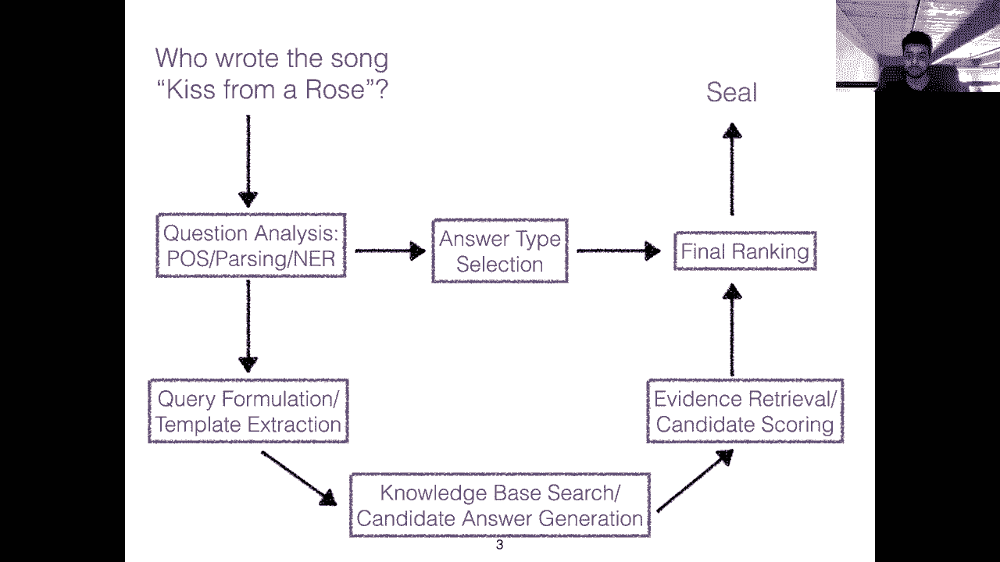

现在，让我们进入今天的主题：问答系统。

首先，我想从宏观层面回顾一下，在神经网络主导NLP之前，这类任务是如何被解决的。传统的方法是设计一系列不同的模块，每个模块负责整个任务中的一个小部分。

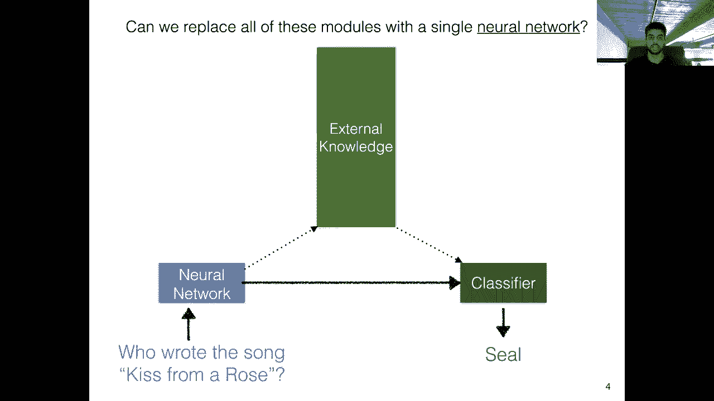

例如，对于问题“谁创作了歌曲《Kiss from a Rose》？”，我们首先会对问题进行一些低层次的分析。比如，将其转换为词性标注序列，获取句子的句法结构解析，检测句子中的所有命名实体（如“Kiss from a Rose”可能是一个命名实体，以便在外部知识库中查找）。完成这些低层次处理后，我们会进入查询构建阶段。假设我们可以访问某个外部数据库或文档源，我们希望用从问题中提取的表示来查询这个外部知识源。我们会有一个单独的模块，将文本问题转化为适合该任务的格式化查询。然后，使用这个查询在知识库（如维基百科）中进行搜索，通过字符串匹配或更复杂的方法找到一批候选答案。

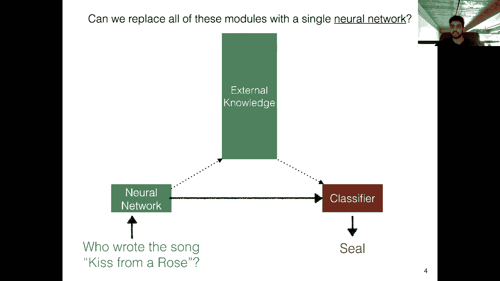

这个过程可能非常嘈杂，在此阶段后，我们可能会留下成百上千个候选答案。接下来，我们可能需要为每个候选答案检索证据。例如，如果候选答案是“The Beatles”，我们会重新构建查询，比如“歌曲《Kiss from a Rose》由The Beatles创作”，然后再次查询知识源，寻找支持该查询的文本片段。这是根据问题重新评估这些候选答案的一种方式。

第二种处理方式是确定这个问题的答案类型。例如，我们可能预测这个问题的答案类型是“乐队”或“音乐艺术家”。那么，在候选答案生成阶段产生的任何不符合该答案类型的内容都可以被过滤掉。

通过所有这些不同模块的协同工作，我们可以形成一个最终的排序，希望最终能产生正确答案。但需要强调的是，这里的每个模块（图中每个方框）都是一个独立的组件，需要单独调整和优化。其中一个模块的问题可能会影响整个流程。因此，调整这些问答系统是一个非常精细的过程。

这就是问答系统的早期状态，甚至在IBM Watson开发出来之后几年也是如此。它严重依赖于大量工程工作来分别优化所有模块，并将它们作为一个整体系统进行优化。

***

## 🧠 深度学习与端到端模型

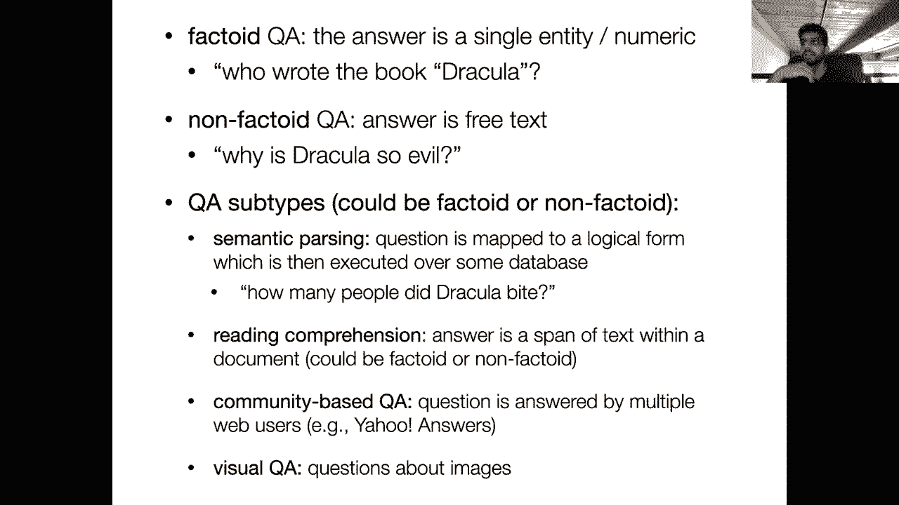

随着深度学习的兴起，研究人员开始思考，这些模块中有多少可以被神经网络替代。神经网络可以学习执行这些模块的功能，而无需被明确设计为具有特定功能。最终的目标是实现完全端到端的系统：输入一个问题，通过一个神经网络，直接输出一个答案。系统中没有其他外部模块。神经网络的参数通过损失函数来学习：当它预测的答案错误时，会得到一个误差信号，并通过反向传播来调整网络参数。

从概念上讲，这更容易维护。我们只有一个单一的神经网络，不需要去调整网络中的各个子组件，只需优化这个单一模型来提高问答性能。

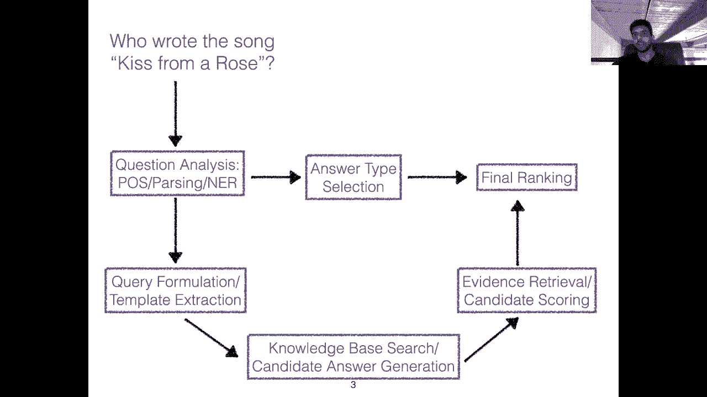

另一方面，神经网络的一个问题是可解释性不强。我们无法通过查看模型中数百万或数十亿的权重来理解它为何预测某个答案。而在传统方法中，每个阶段都有中间输出，可以用来解释模型为何决定预测某个答案。

这是一个权衡。但从实践角度看，神经网络模型开始产生比传统问答流水线好得多的结果。因此，在过去的五到十年里，人们一直沿着这个方向不断推进。

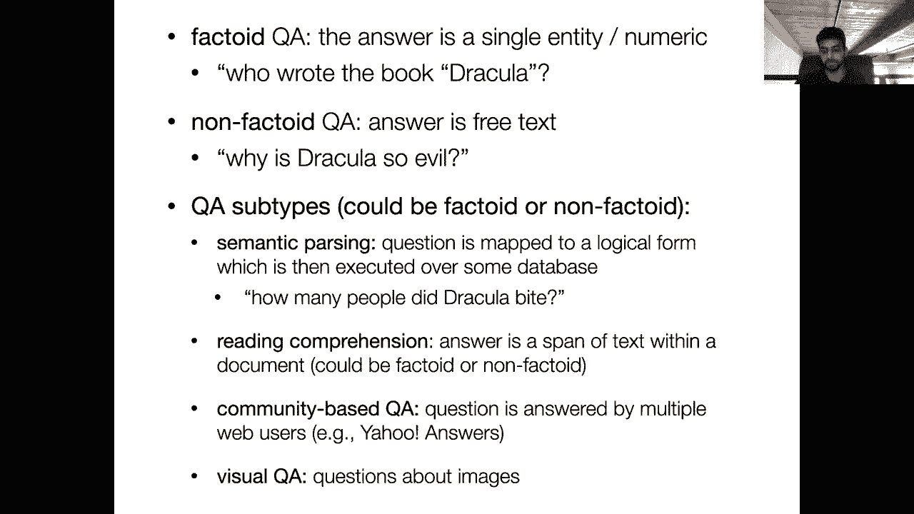

***

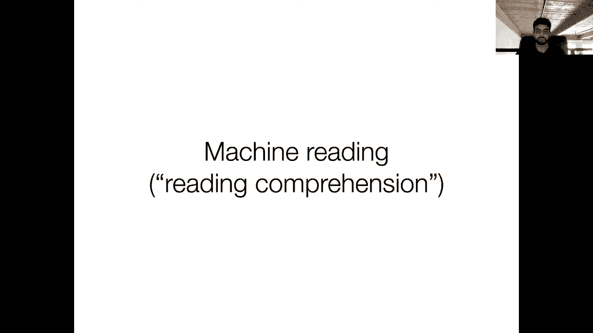

## 📊 问答任务的类型

到目前为止，我一直在相当笼统地讨论问答任务。但实际上，在问答这个大范畴下，有许多不同的子任务，它们需要不同的建模决策，甚至具有完全不同的格式。

我们刚才看到的“谁创作了歌曲《Kiss from a Rose》？”这类问题，是**事实型问答**的一个例子。这类问题的答案是一个单一的实体或数字。大多数“危险边缘”风格的问题或琐事问题都属于此类。在用户只想回忆事实或学习新知识的应用场景中，这类问题很重要。但它们不包含需要模型进行更复杂推理，或者答案可能是一个句子甚至多个句子的更复杂问题。

与事实型问答相对的是**非事实型问答**，其答案不是单一实体，而是自由文本。例如，“为什么德古拉如此邪恶？”。你不能只用一个实体来回答这个问题，可能需要用几个句子或一个段落来回答。因此，这种风格的问答要困难得多。我们将在几周后讨论这类任务的一些实例，以及目前用来处理它们的模型。

这是两种非常高层次的分类。但即使在某一类型内部，也存在许多问答子类型。

一种是**语义解析问答**。在这种任务中，你可能有一个包含事实或三元组的数据库（如SQL数据库），并希望询问关于该数据库的问题。例如，如果有一个关于人们及其咬了多少受害者的数据库，你可以问“德古拉咬了多少人？”。这个问题可能会被转换成某种SQL语句在数据库上执行，并返回答案。语义解析问答的建模框架与普通的事实型问答略有不同，特别是因为你不能像处理许多事实型问答实例那样，将其视为有监督的分类问题。在大多数情况下，你的训练数据中并没有关于真实逻辑形式或SQL语句的监督信息。因此，从研究角度看，语义解析背后的机器学习更有趣。

在本节课中，我们将相当详细地介绍**阅读理解问答**。这是过去几年主导NLP研究的问答子任务，它催生了许多建模进展，最终促成了BERT及其变体的出现。我们将在本讲座中回顾这些模型的历史。在阅读理解中，你会得到一篇文档，并被问及一个关于该文档的具体问题。这类任务假设答案是该文档中的一个文本片段。

还有其他类型的问答，例如**社区问答**（如Yahoo Answers或Quora），以及**视觉问答**（即关于图像的问题）。自那以后，研究社区还提出了许多其他类型的问答任务。

***

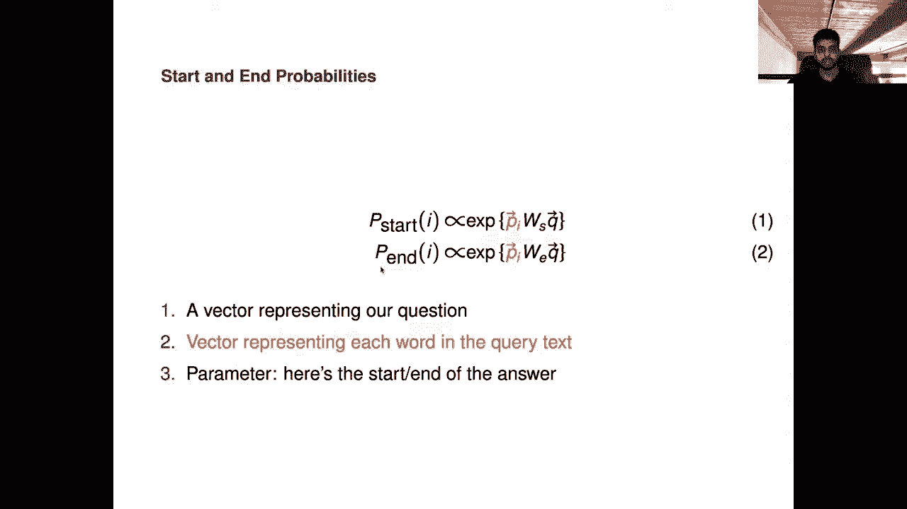

## ❓ 关于答案类型的问题

在深入阅读理解之前，我们先回答一些问题。

**问：不同的答案类型有哪些？这些是标准分类吗？由谁决定？**

这是一个很好的问题。这实际上取决于系统设计者以及他们拥有什么样的监督信息。在事实型问答的情况下，如果你知道许多答案将是实体，那么使用诸如人物、地点、组织、对象等实体分类是有意义的。但不同的数据集对这种分类有不同的层级和粒度。当我们讨论共指消解数据集以及命名实体识别数据集用于提供实体信息的分类时，我们会更详细地了解这一点。是的，这确实取决于系统设计者、他们拥有的资源以及他们愿意投入多少精力来标注答案。

**问：非事实型问答的目标函数会是什么样子？**

实际上，我们已经见过非事实型问答的常见目标函数。它本质上被视为一个语言建模问题。给定一个输入问题和一个作为答案的段落（或类似内容），我们将训练一个条件语言模型，类似于我们见过的机器翻译系统，来生成训练数据集中真实答案的每个词。当我们讲到开放域长形式问答时，会更多地讨论这种设置的局限性，但这就是基本的目标函数。你已经见过用于所有需要生成文本的任务的目标函数。

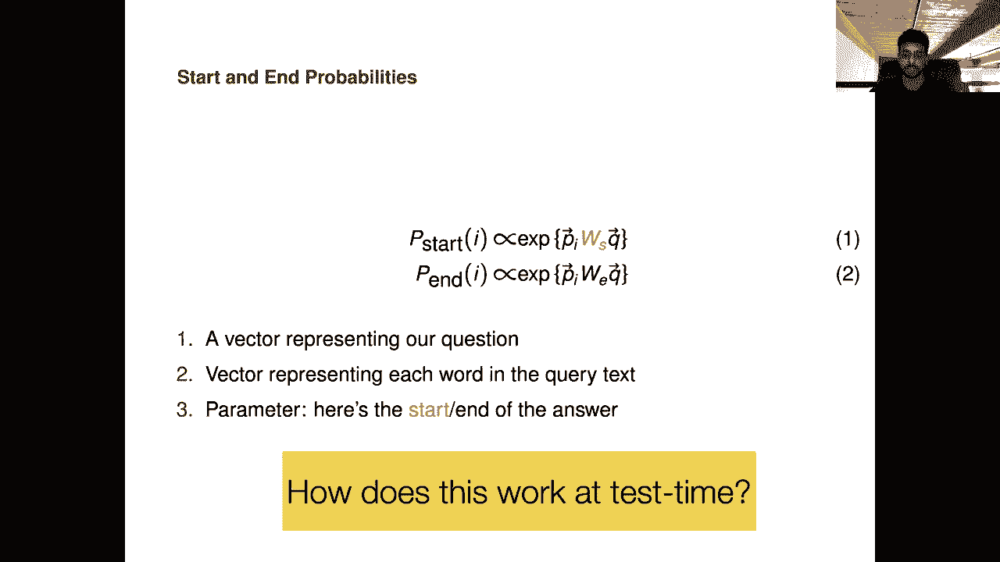

**问：语言模型在基于社区的问答中有什么用例？**

同样，如果你的任务需要生成答案，而不是从现有文本中选择答案（例如从文档中检索一个片段），或者只是训练一个分类器来从一大组实体中预测特定实体，那么如果你的模型需要生成文本，你就需要使用语言模型来实现。这可能是语言模型在这种设置下的主要用途。

***

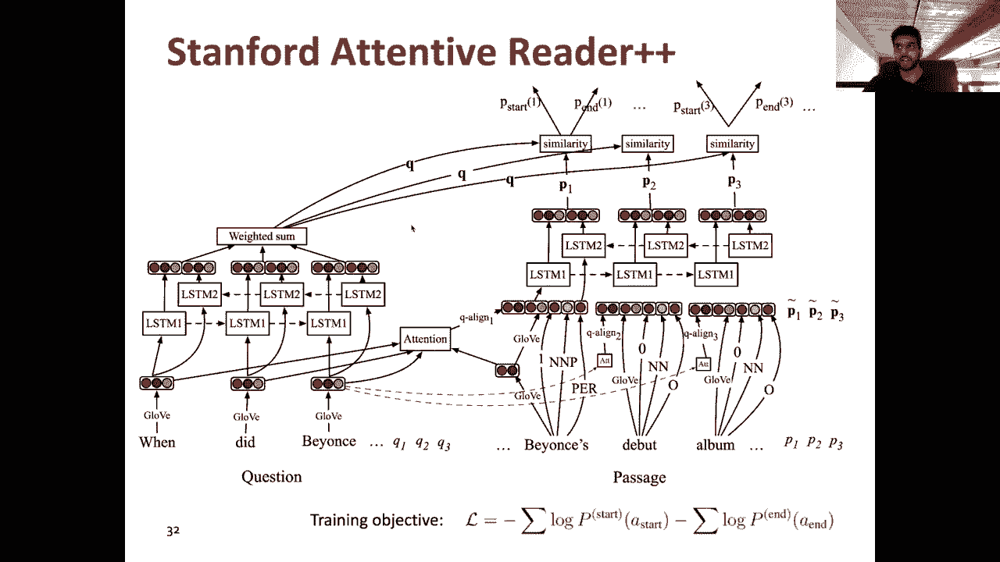

## 📖 阅读理解与SQuAD数据集

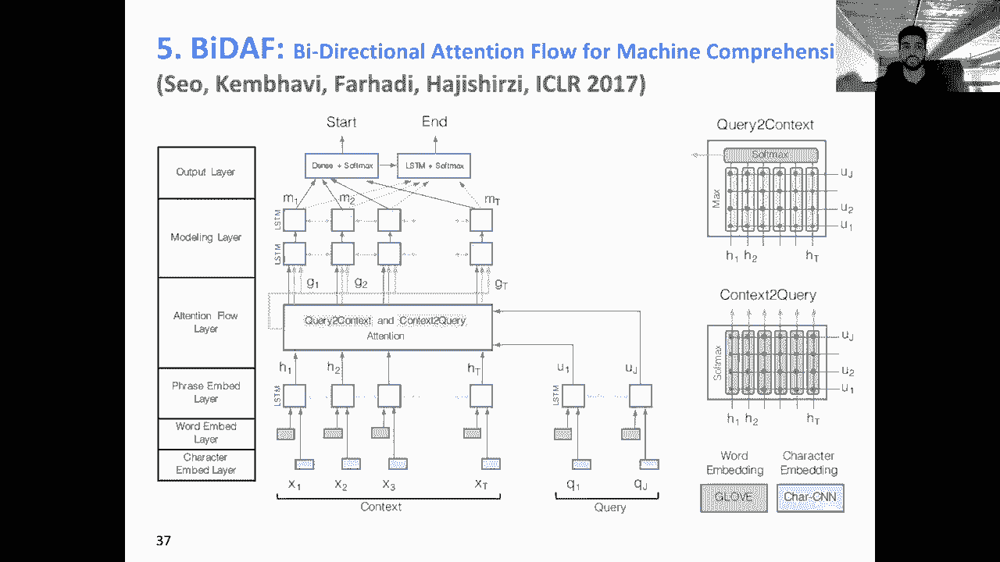

现在，让我们聚焦于阅读理解。如前所述，这在模型开发方面，甚至在NLP领域普及超越简单文本分类任务（如情感分析）的神经网络模型方面，都具有最大的影响力。

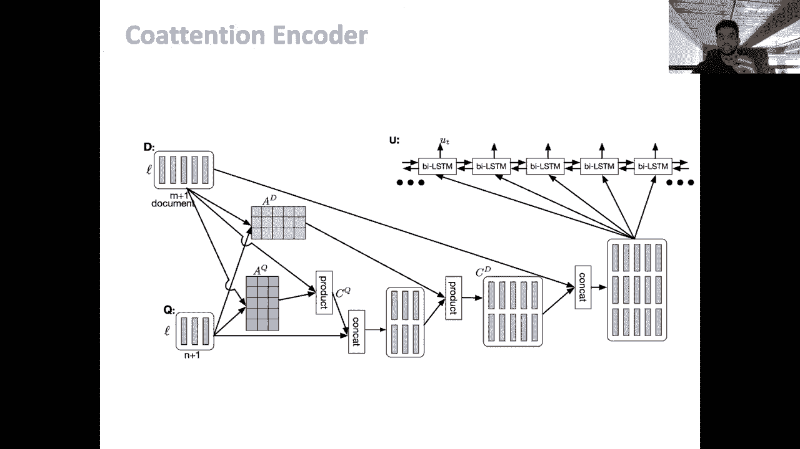

第一个真正引起研究社区广泛关注并吸引许多人参与构建问答模型的主要数据集是**SQuAD**。在这个数据集中，你有一段来自维基百科的短文，以及一个关于该段落的问题。它还有一个额外的假设：这个问题的答案是该段落中的一个文本片段。与一般情况相比，这是非常受限的。因为在一般情况下，如果没有这个段落，直接问这个问题对模型来说会困难得多，因为它可能需要检索一些证据文本，然后从证据中进行片段选择来生成答案，或者自己生成答案。但SQuAD数据集的真正重点是：给定一个小型证据文档，我们能否找出文档中与问题答案最相关的部分？它假设问题的答案出现在段落中，因此没有无法从段落中回答的问题实例。稍后我们会讨论SQuAD的第二版，它直接解决了这个担忧。

***

## 🧮 基于片段预测的建模方法

我想从高层次上介绍一个在BERT之前用于解决这个数据集的模型，以便让大家了解在这种基于片段的问答任务中，用于预测答案的建模设置是什么样的。因为我们将使用相同的设置，只是采用不同的架构和更多共享参数。

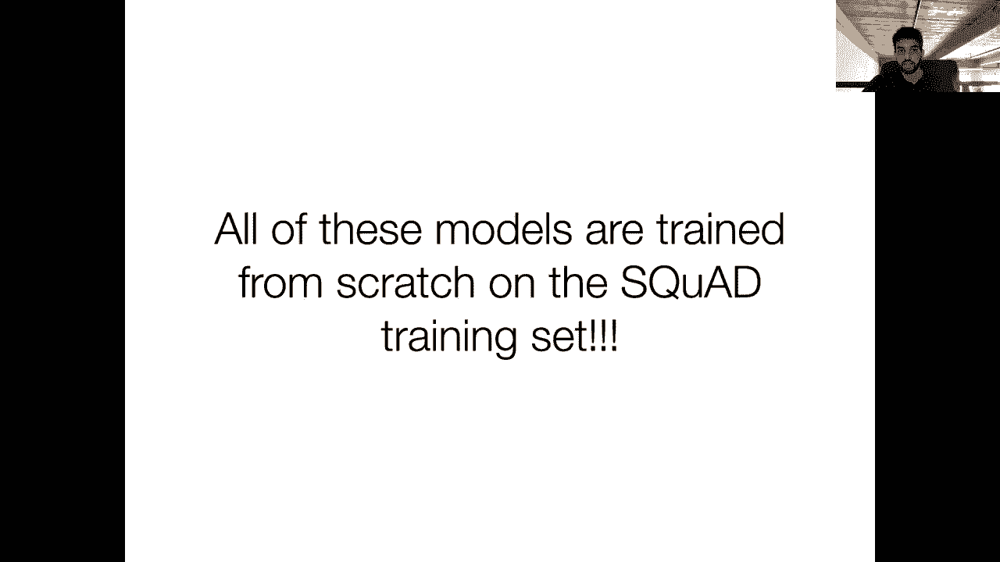

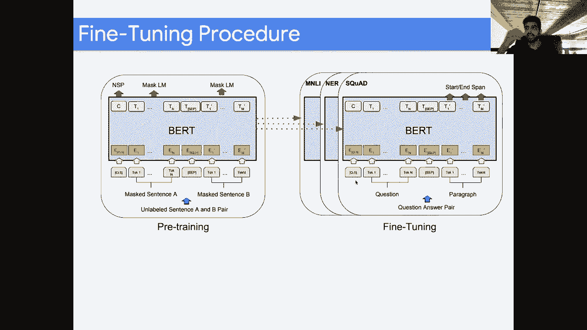

我们有一段文本和一个问题，答案是文本中的一个片段。从高层次看，我们要做的就是将段落中的所有可能标记视为答案片段的起点或终点。你可以将其理解为：对于段落中的每个单词，我将使用两个softmax层进行预测。一个是预测该单词是否为答案片段的起点，另一个分类器预测该单词是否为答案片段的终点。

对于训练数据中答案片段之外的所有单词，我们将预测“否”，即该标记既不是起点也不是终点。当我们遇到“Denver”时，我们的起点分类器将有监督信号来预测这是答案片段的起点。当我们遇到“Broncos”时，我们将预测这是答案片段的终点。

这就是训练的工作原理。从高层次思考如何实际估计这些概率：我们首先得到问题的向量表示。我们可以通过多种方式实现。例如，对于问题“Which NFL team represented the AFC at Super Bowl 50?”，我可以做很多事情：可以在问题上运行一个RNN，并将其最终隐藏状态作为问题的表示；可以简单地对问题中所有单词的词嵌入进行逐元素平均；可以通过ELMo运行这个问题并获取其标记级表示，然后以某种方式组合它们；当然，也可以通过BERT运行它，并查看`[CLS]`标记，那可能是问题的一个良好表示。我们已经见过许多获取给定文本表示的方法。在这个等式中，你可以使用其中任何一种来获得代表问题的向量Q。

接下来，我们有一个表示段落中每个单词的向量。这里称之为查询文本，用P_i表示。同样，我们可以有多种方式获取每个单词的表示：可以运行RNN遍历整个段落，并将RNN的每个隐藏状态作为该标记的表示；可以完全忽略RNN，只将这些单词的词嵌入视为P_i（当然，这有一个问题：段落没有被组合在一起，一个词嵌入会忽略段落中的所有其他单词，这就是为什么我们希望使用像RNN这样的东西）。但我们也见过如何超越仅从头训练RNN作为组合函数，我们可以使用像ELMo这样的东西来获取每个单词的上下文表示，或者使用像BERT这样的东西并查看其最终隐藏状态来获取这些单词的表示，等等。因此，获取P和Q向量的方法同样适用。

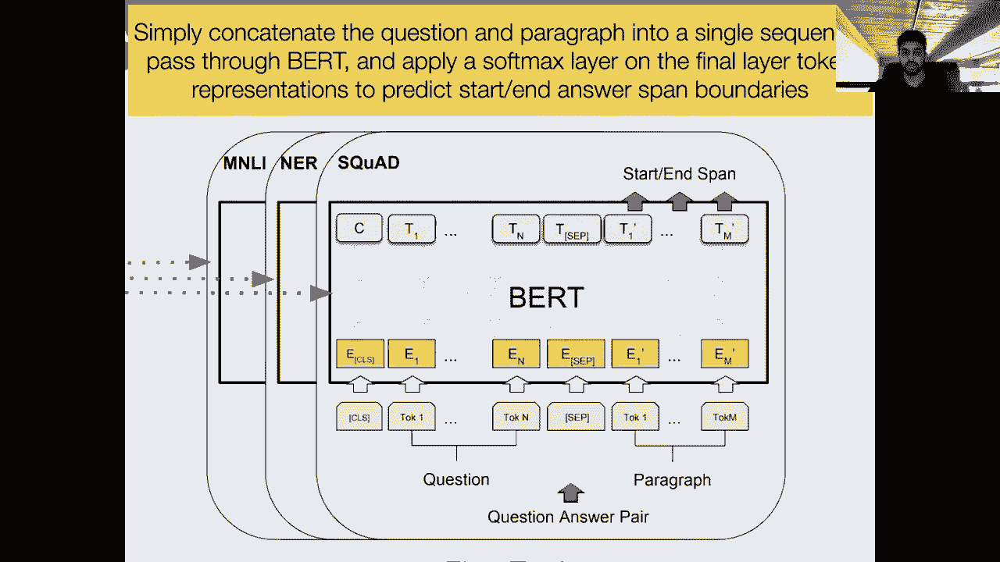

然后，他们只有一个权重矩阵W_s和W_e，你可以将其视为softmax层中的权重矩阵。它将段落单词和查询表示的某种组合（点积）投影到一个可以衡量它是否确实是答案片段起点的空间，从而为段落中的每个单词得到一个单一的标量分数。

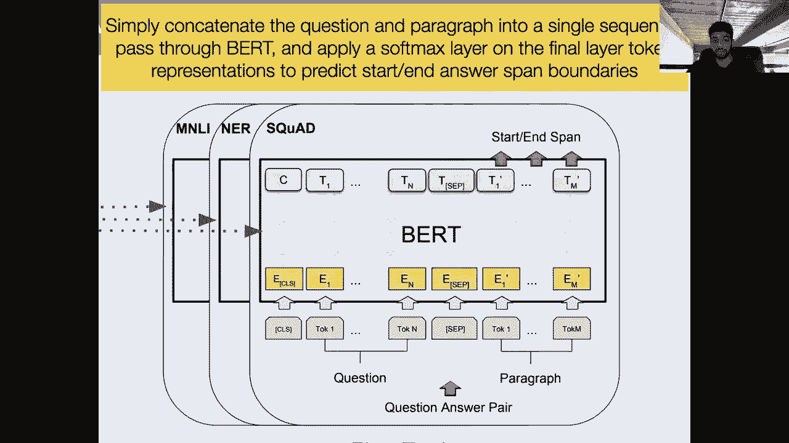

***

## 🧪 测试时的预测策略

此时，你可能想知道在测试时具体该怎么做。因为目前我设置的方式是，我有两个独立的分类器，它们的预测是相互独立的。在估计P_start时，没有任何依赖于答案结束位置的信息；同样，P_end也不依赖于答案片段的起始位置。

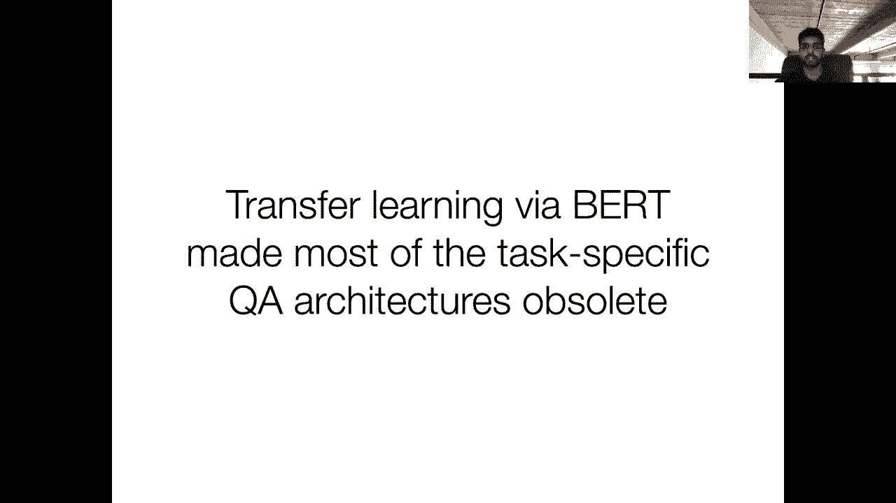

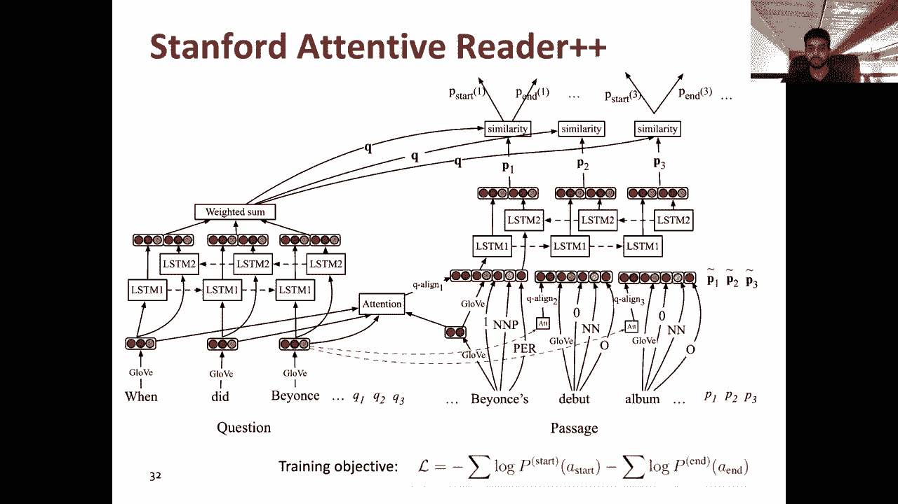

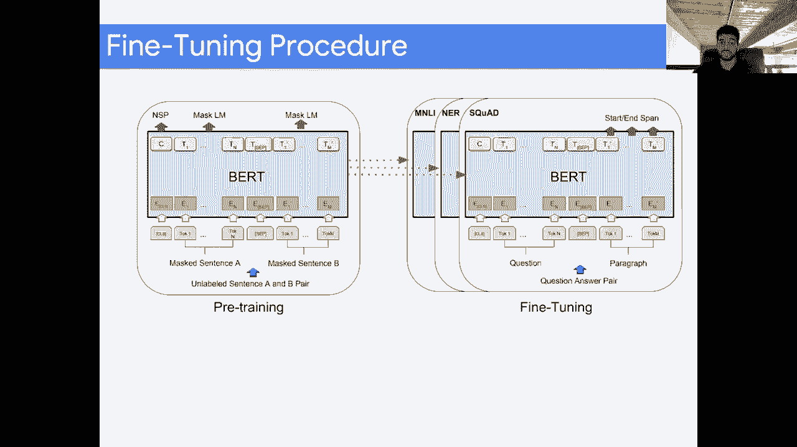

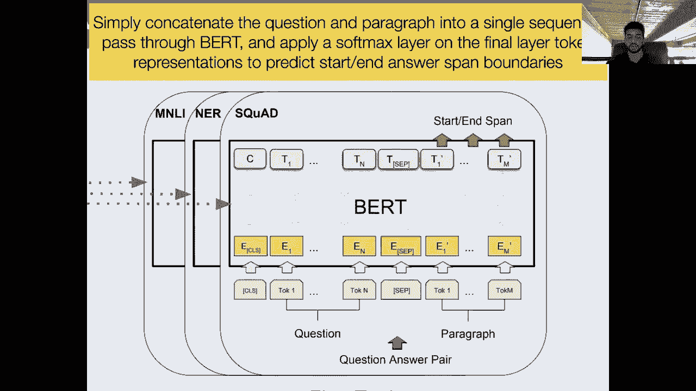

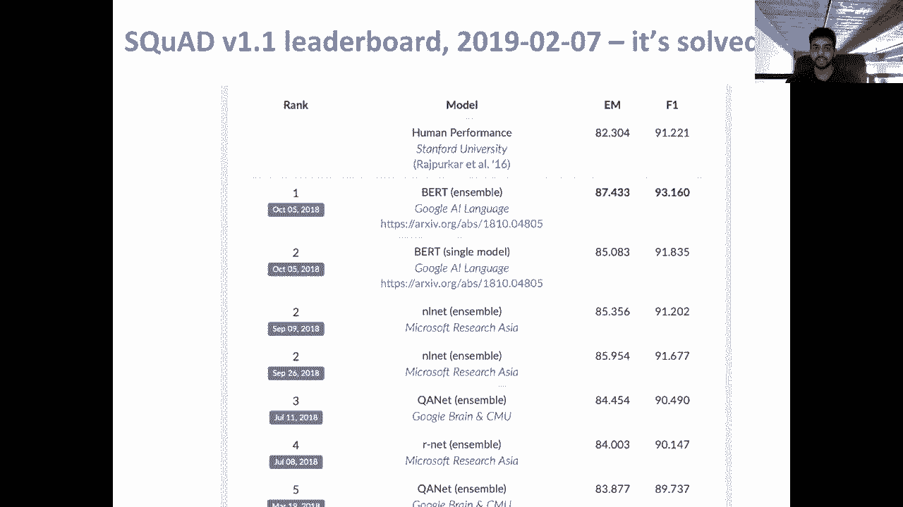

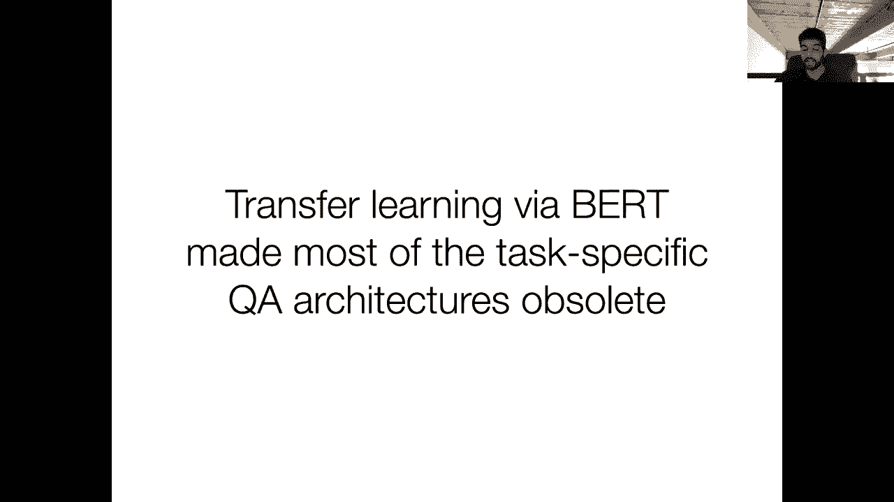

在测试时，一个简单的解决方法是分别处理概率。我可以对段落中的每个标记运行起点分类器，选择起点概率最高的标记作为答案片段的起点；然后对终点标记做同样的事情，查看段落中的所有标记，选择终点分类器预测概率最高的那个。

但这种方法存在重大问题。由于这两个预测完全独立，我可能会遇到预测的终点标记在预测的起点标记之前的情况，从而产生无效的答案片段。同一个标记可能同时具有最高的起点和终点概率，或者可能出现各种奇怪的问题。此外，我们可能有一些先验知识，比如答案通常很短，只有两三个词，是人名等，我们不希望有很长的答案片段。

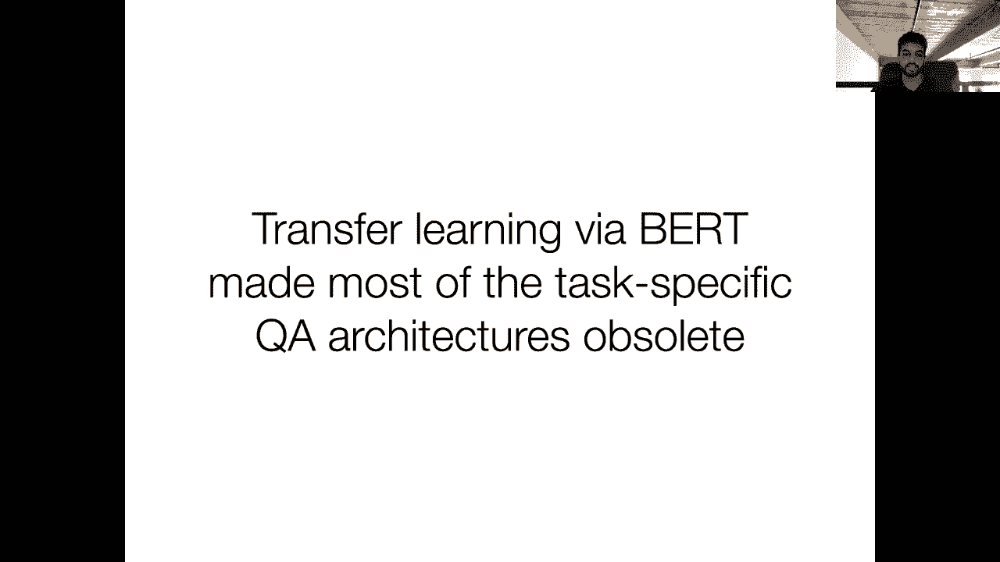

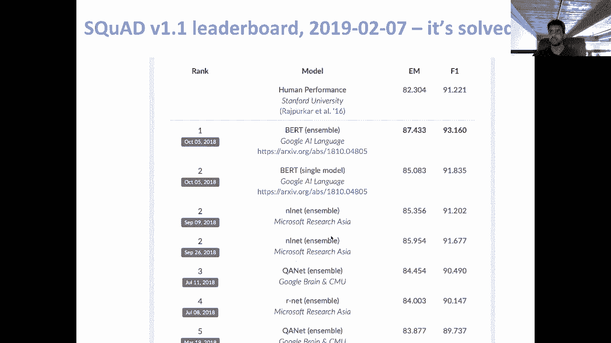

在实践中，我们通常的做法是：考虑段落中所有可能的片段（可以通过过滤掉那些你认为过长而不可能是答案的片段来加速，例如设置一个限制，答案片段不能超过一个句子的长度）。然后，对于每个片段，将其起点和终点位置对应的起点概率和终点概率相乘。在测试时，选择这个乘积最高的片段作为答案。

***

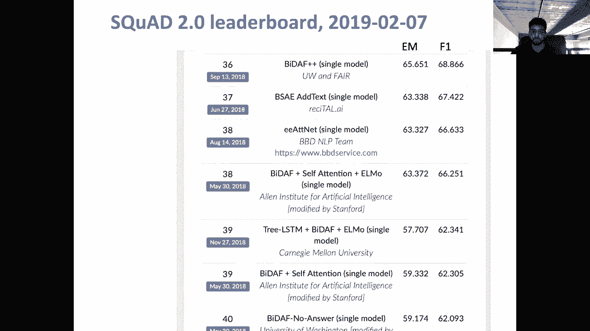

## 🚀 从传统模型到BERT

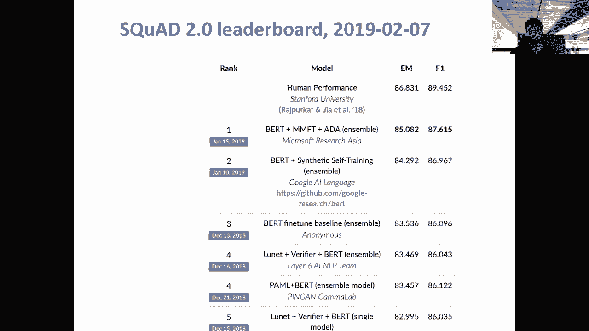

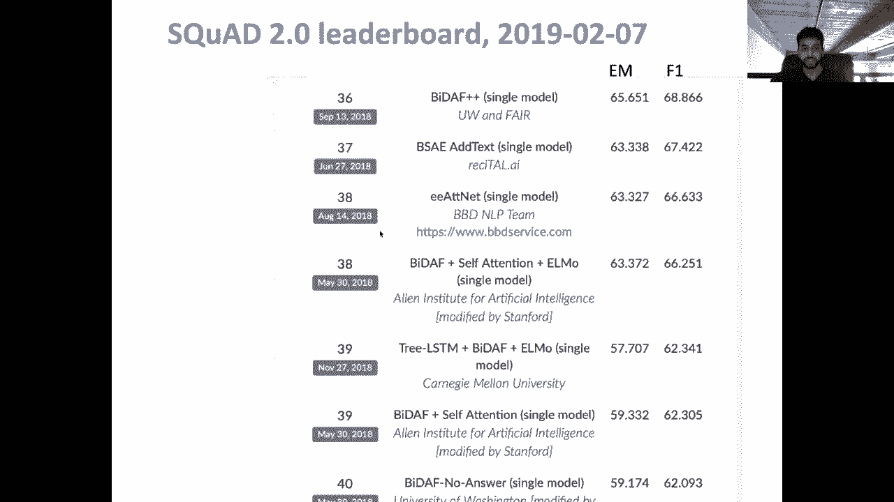

这种解决阅读理解问答任务的通用方法，在我们转向像BERT这样的模型时，将完全沿用。我们只是替换了获取段落和查询表示的方式，并且重要的是，我们不会像之前所有模型那样从头学习这些组合参数，而是像上一个视频讨论的那样，对BERT进行微调。

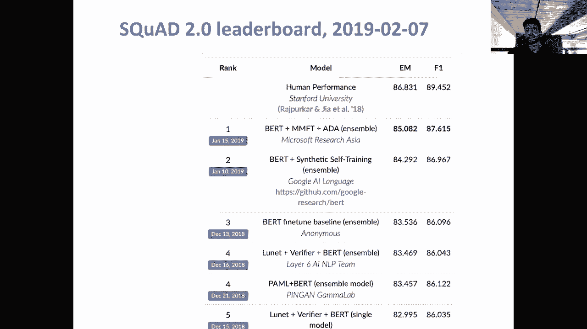

在深入BERT之前，我想展示几个在迁移学习出现之前提出的不同架构的概述，以便让大家感受一下这类建模子领域曾经有多复杂。

在这个模型（Stanford Attentive Reader）中，左边有一个用于获取问题表示的双向LSTM，我们通过对隐藏状态进行加权求和来得到一个单一向量。我们在这些LSTM和另一组用于编码段落的LSTM之间进行注意力计算。模型中还包含了许多低层次的语言学信息，如词性、命名实体（例如“Beyoncé”被标记为“PERSON”）。所有这些信息都被嵌入并通过RNN/LSTM传递，最后在顶部进行组合，并在每个标记上使用我们的起点和终点分类器。

这里的所有参数（除了用预训练词嵌入初始化的词嵌入外）都是从头开始训练的。整个组合过程都是通过这些LSTM和循环连接从头学习的。正如我们在之前的课程中讨论过的，我们通常希望尽可能避免从下游数据集中从头学习东西，因为下游数据集总是比我们拥有的未标记数据量要小。我们知道语言模型可以在没有任何额外标签的情况下学习到非常强大的文本表示，那么我们为什么要强迫我们的问答模型既要学习语言的所有这些通用属性，又要学习如何从这些段落中提取答案呢？

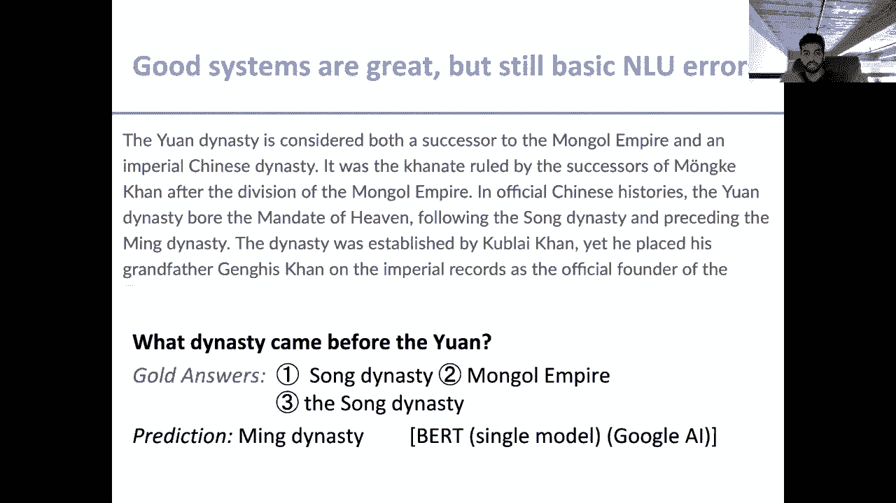

另一个常用于SQuAD风格问答的模型是**BiDAF**。这些模型主要侧重于在问题和段落之间添加尽可能多的注意力机制。这里可以看到两种注意力类型：我们使用问题表示来增强上下文（段落）的词嵌入；我们也使用段落中的向量来获得更上下文化的问题表示。然后，我们将其通过几个循环层，最后在每个标记上预测起点和终点片段。预测每个标记起点和终点的概念相同，我们只是改变了最终两个分类器下方模型的复杂性。

甚至还有更复杂的模型，比如提出的**Co-Attention Encoder**。在BERT之前的所有这些进展，主要都集中在如何开发最强大的注意力机制，以尽可能紧密地将问题和段落联系起来。

***

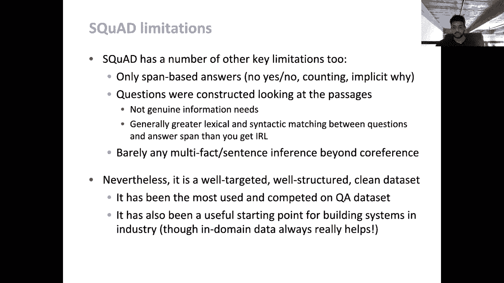

## 📈 SQuAD上的模型表现

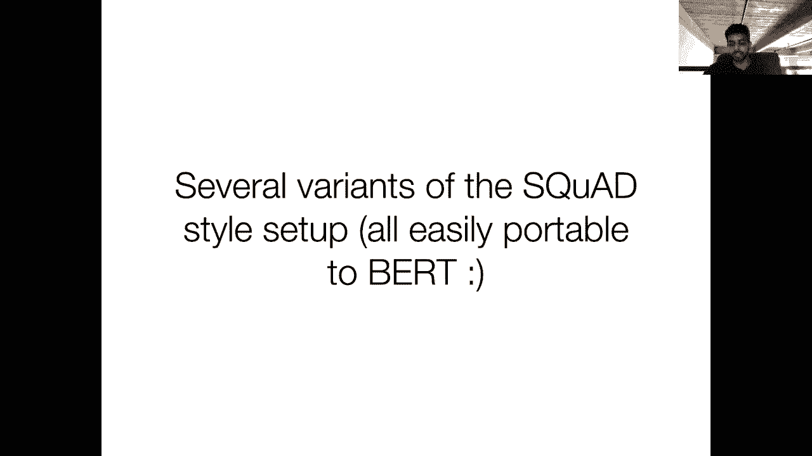

到2016年底，已经提出了几种不同的模型来解决SQuAD任务。这里需要提一下我们如何评估这些模型。假设我有一个模型，给定一个问题和一段文本，它会产生一个答案片段。同时，对于那个特定问题，我有一个真实答案。为了得到F1分数，我们会在单词级别上比较模型预测的答案和真实答案，计算F1值。直观地说，就是看预测答案中有多少单词出现在真实答案中。

你可以看到，人类在这个任务上的表现非常高。人类产生的答案几乎总是与真实答案完全相同或非常相似。EM列是“精确匹配”，即人类产生的答案与真实答案具有完全相同的标记（相同的片段）的频率，他们做到了82%的时间。

我们看到这些模型的表现并不出色。逻辑回归基线（在介绍SQuAD数据的原始论文中）没有任何神经网络组件，其F1分数约为51。所有后续模型都使用了越来越复杂的神经网络，F1分数达到了67、73等等。重要的是，所有这些模型都是在SQuAD数据上从头开始训练的。它们可能唯一迁移的是预训练的词嵌入，但所有组合函数参数（如RNN或LSTM的循环参数）都是使用SQuAD的误差信号从头开始训练的。

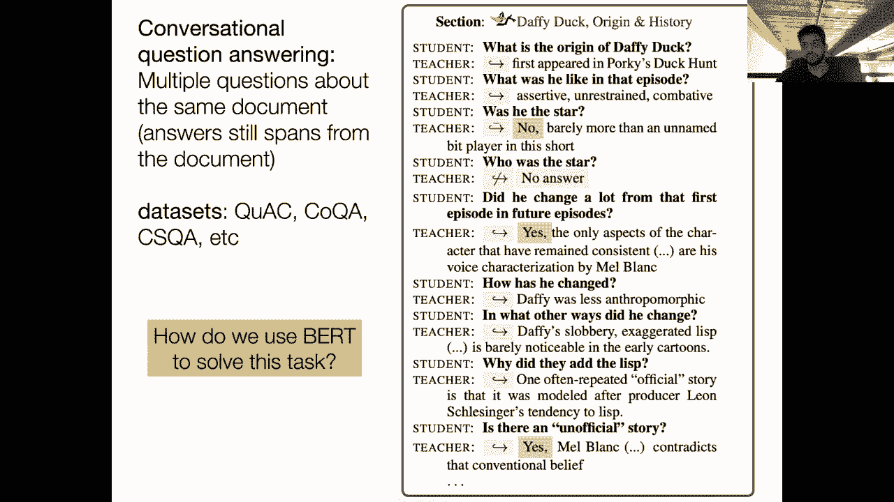

***

## 🔧 使用BERT解决SQuAD任务

现在，让我们看看如何使用BERT以非常简洁的方式解决这个任务，并尽可能减少需要随机初始化并从头训练的外部参数。这非常简单。

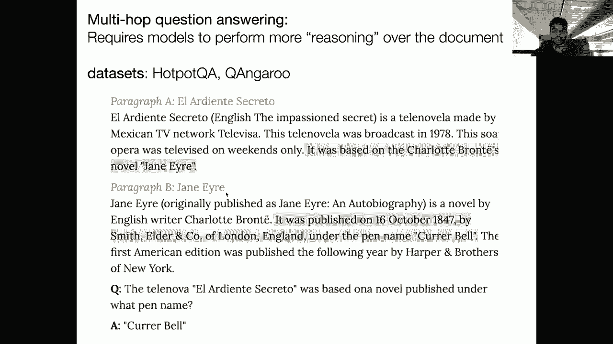

本质上，我们只需将问题和段落连接成一个单一的序列，并用一个特殊的分隔符标记将它们分开。如果你看下面的图示，Token 1到N来自问题，Token 1到M来自段落，中间有这个特殊的分隔符标记来帮助模型区分它们。

现在，我们将整个连接序列输入BERT。我们经过Transformer层（在黄色部分和绿色部分之间有12或24层），然后BERT的最后一层为我们提供连接序列中每个单词的单一表示。

我们只关心段落部分，因为我们知道问题的答案就在这个段落中的某个地方。因此，我们只需将起点和终点分类器放在BERT产生的、来自段落的每个最终标记表示之上。我们执行与之前模型完全相同的操作：预测每个标记是否是起点标记或终点标记。在测试时，我们执行完全相同的操作：选择起点和终点概率乘积最高的片段。

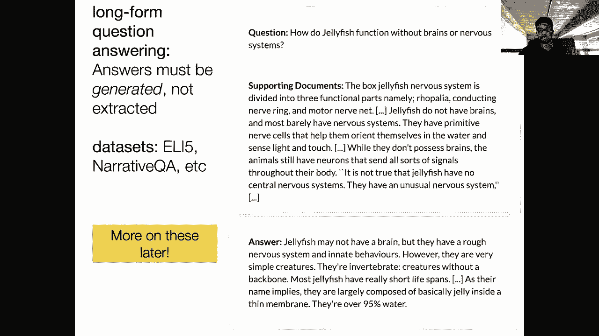

但在这里你可以看到，我们从预训练阶段实际迁移了什么？蓝色框里的所有东西，即所有BERT参数，都被迁移到了我们的SQuAD任务中。我们没有从头学习任何这些组合参数，唯一从头学习的是两个分类器（用于预测片段起点和终点的softmax层）。

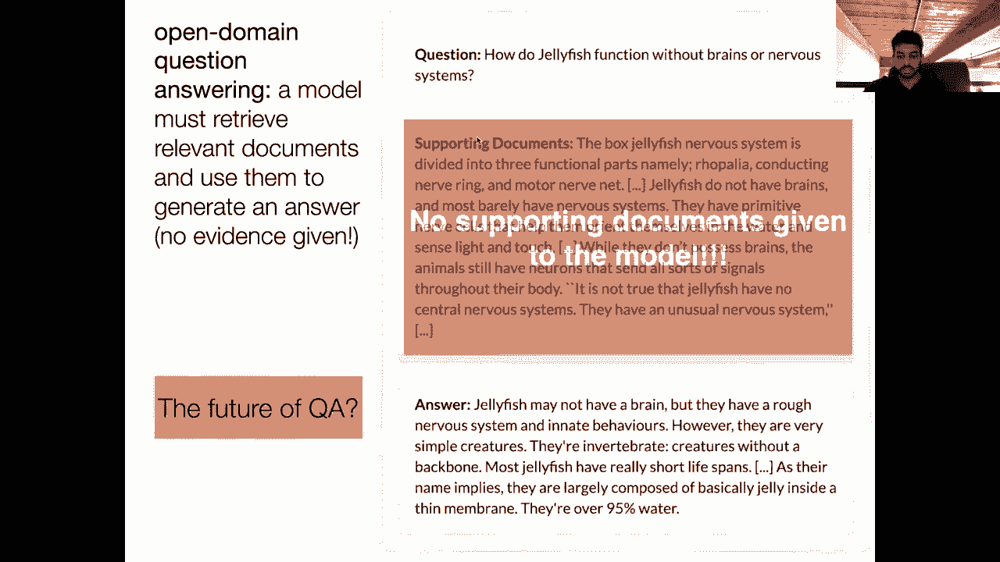

你可能会想，模型怎么知道问题是什么？它如何在问题和段落之间进行注意力计算？但BERT天然就能做到这一点。它是一个Transformer，使用自注意力。段落中的每个表示都会关注问题的每个标记，我们有多个注意力头，它们能够查看不同类型的信息，我们还有多个层，可以堆叠这种注意力。因此，BERT已经是一个非常强大的组合函数。这种简单的设置——仅仅将BERT应用于SQuAD任务——就在SQuAD上带来了巨大的性能提升。

***

## 🏆 BERT在SQuAD上的卓越表现

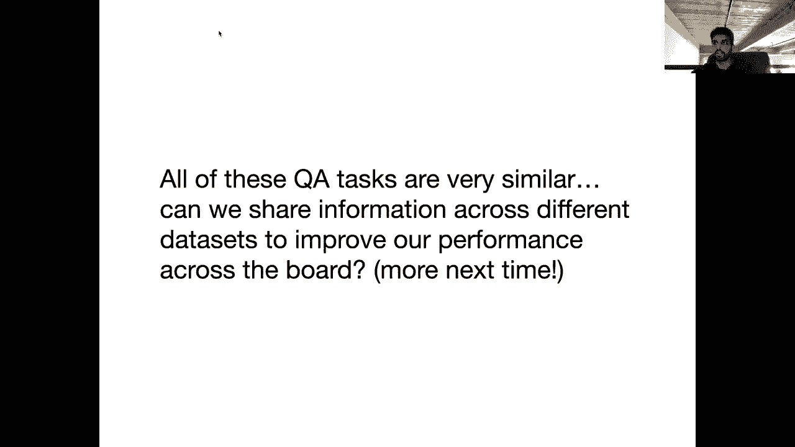

2019年，当BERT出现并被