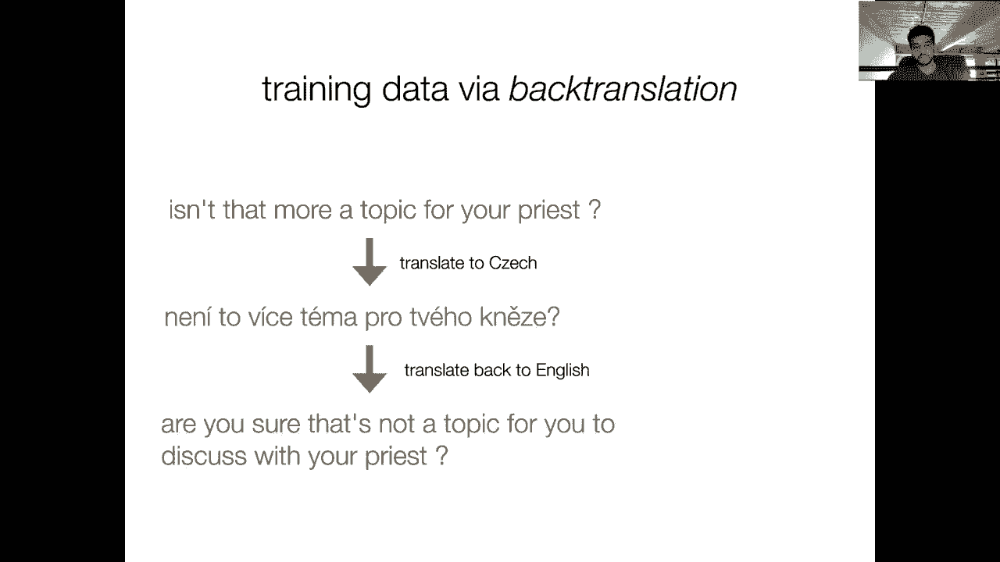
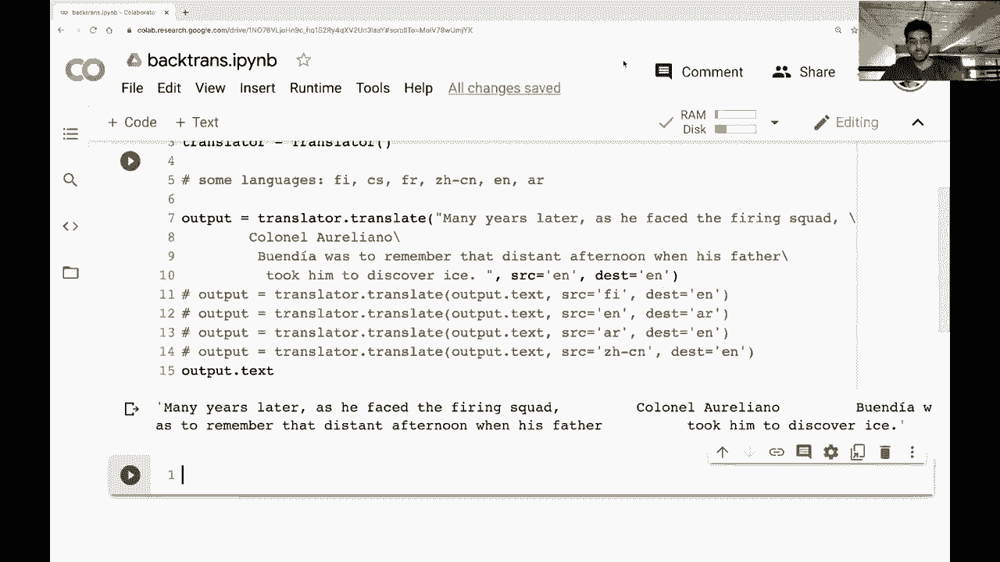
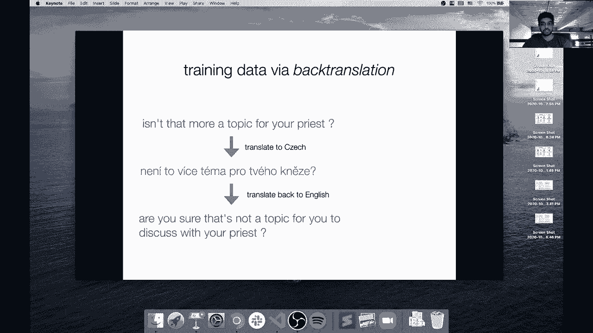
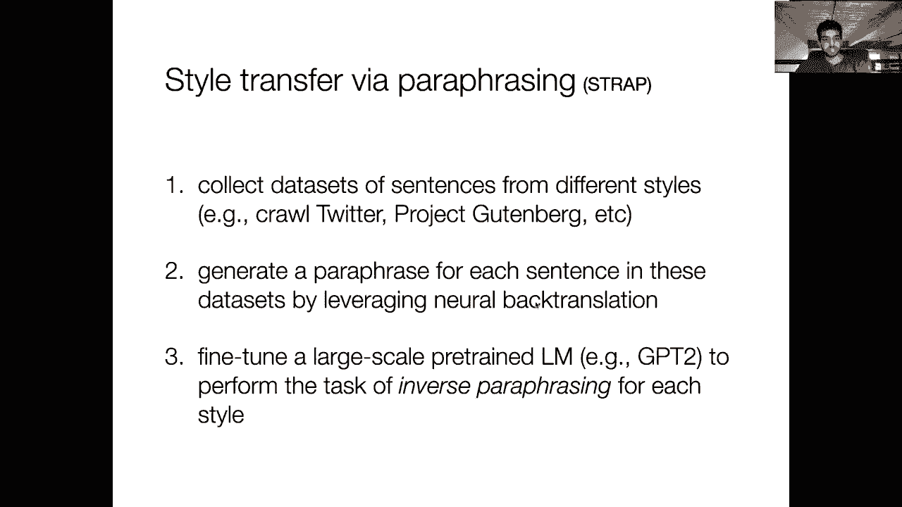
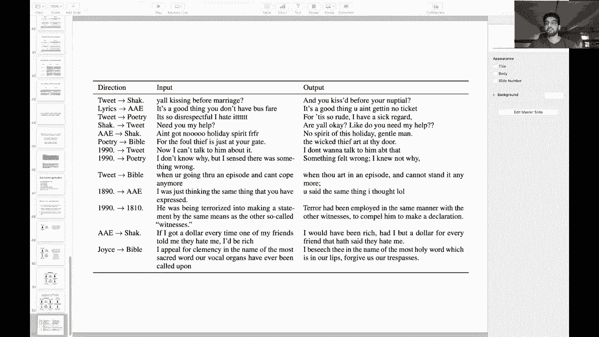

# 课程 P16：L13 - 释义生成 🧠

在本节课中，我们将要学习**释义生成**及其多种应用场景。我们将探讨如何使用释义来生成**对抗样本**，以及如何将其用于**数据增强**。此外，我们还会介绍如何利用释义进行**风格迁移**。释义生成是自然语言处理中一个非常有趣且新兴的研究领域，它与我们上周讨论的机器翻译和评估等内容紧密相关。

***

## 课程安排与作业

如果你对课程安排或内容有任何疑问，请在聊天框中提出。

作业一已经发布，我强烈建议你尽早开始。我们尽量减少了需要你手动实现的部分，提供了大量脚手架代码供你使用。虽然最初设计的实现部分更多，但目前的版本对于想在项目中尝试这些模型的同学来说，将非常有用，可以帮助你了解如何使用它们以及如何将其应用于不同任务。

作业的截止日期是10月28日。考试定于11月5日和6日举行，届时我们将发布试卷，你有48小时的时间完成。考试是开卷的，允许查阅资料，但禁止合作。

***

## 对抗样本简介

在深入今天的主题——对抗样本和释义之前，我们首先需要定义什么是对抗样本。

在计算机视觉中，图像分类是一个常见任务，对抗样本的概念便源于此，并已扩展到自然语言处理领域。诊断模型是否像人类一样对自然输入具有鲁棒性的一种方法是：首先，我们取一张熊猫图片，模型以60%的置信度预测出正确的标签。然后，经典的计算机视觉设置是，向原始图像添加非常微小的噪声，使得生成的图像在人眼看来与原始图像完全相同。然而，对于神经网络图像分类器，第二张图片却被以99%的置信度预测为“长臂猿”。显然，模型在这个对抗样本上失效了，尽管人类知道这张图片里仍然是一只熊猫。因此，我们希望设计出能够抵抗输入中这种微小、难以察觉的扰动的模型。

***

## NLP中的对抗样本

一个有趣的问题是：我们如何为文本创建对抗样本？图像由像素组成，具有数值，因此我们可以向每个像素添加少量噪声来得到新图像。但对于文本，我们不能简单地添加噪声。

为了说明NLP中对抗样本问题的存在性，即使是我们目前课程中见过的大规模模型，对抗样本也普遍存在。我想介绍一个我们本学期尚未深入讨论的任务——**文本蕴含**，因为它能很好地展示我们将要讨论的对抗样本类型。

文本蕴含是一个句子对任务，给定两个句子，我们需要判断第一个句子是否蕴含第二个句子。例如，前提是“两个女人正在岸边漫步，喝着冰茶”，假设是“两个女人坐在岩石附近的毯子上谈论政治”。我们需要判断第二个句子是否由第一个句子蕴含。显然，在这个例子中，第一个句子与第二个句子矛盾。

一个为这个任务微调过的RoBERTa分类器能够正确判断前提与假设矛盾。然而，这个模型并不完美。例如，给定前提“狗吃掉了所有的鸡”和假设“只是鸡”，模型判断前提蕴含假设，但这显然不合理。首先，假设甚至不是一个合理的句子；其次，它绝对无法从涉及狗和吃的前提中推导出来。

另一个例子，前提“红盒子在蓝盒子里”和假设“红色是蓝色”，RoBERTa模型判断前提蕴含假设。对人类而言，这些句子的语义完全不同，但模型却无法清晰判断。一个可能的原因是，模型没有经过训练来识别这类否定句或中性句。

总的来说，自2017年左右起，对抗样本在NLP中已成为一个热门话题。它源于计算机视觉的基础工作，现在已有专门研讨会致力于开发能破坏现有模型的对抗样本。你可以通过多种有趣的方式来实现，例如构建具有特定语言学特性的对抗样本，或者利用训练数据中未出现过的句法结构。

***

## 创建NLP对抗样本的方法

现在，让我们看看如何在NLP上下文中创建对抗样本。

可能最直接的方法是进行**同义词替换**。例如，我们可以使用同义词词典，选取输入句子中的一个词，然后用其同义词替换。在一个情感分析示例中，句子“正是那种每次灯光暗下时人们所期待的那种意想不到的喜悦”被模型预测为积极情感。但如果将短语“意想不到的喜悦”替换为“刺激”，情感模型则预测为消极情感。即使使用这种简单的同义词替换方法，模型也会被混淆。

另一类对抗样本称为**句法对抗样本**。在这种情况下，我们不优先进行词汇替换，而是改变句子的实际结构。例如，句子“美国戏剧没有比这更丰满、更有力的了”被模型预测为积极情感。但当你重新组织句子结构，变成“没有比这美国戏剧更丰满、更有力的了”时，情感模型则预测为消极情感。

我们可能希望做的是，针对任何给定模型，找出一组对抗样本，人类能轻松做出预测，但模型却会失败。一旦有了这组样本，你可以想象用这些对抗样本来增强你的训练数据集，然后重新训练或微调模型。这样，如果模型在训练中见过这些样本，那么在测试时就不会再出错。

你可以想象这是一个迭代过程：我们为给定模型创建对抗样本，用原始数据集加上对抗样本来重新训练模型，其鲁棒性将会提高，并且我们可以根据需要重复这个过程。

***

## 释义生成作为解决方案

如果我们想将词汇对抗和句法对抗结合起来，并且不想依赖外部规则或同义词词典，我们可能需要将这项任务重新定义为**释义生成**。

在释义生成中，我们取一个输入句子，希望生成一个输出句子，该句子与输入具有相同的语义含义，但在词汇或句法上（或两者兼有）具有多样性。

我们希望释义模型引入句法多样性，同时生成的句子在输入语言中语法正确、流畅。不仅如此，它们还应保留原始输入句子的语义含义。如果生成的句子与原始句子的含义完全偏离，那就不再是释义，我们也不能称其为对抗样本，因为我们无法保留该句子相关的标签。

我们还可能希望提高多样性，进行大量重新排序，因为模型可能对某些结构不鲁棒，它可能没有像看到更标准、简单的句子那样频繁地见过某些句法结构。

例如，对于句子“通常，你只有在计划出售资产时才需要存货”，我们可能希望得到多种释义，如“通常，如果你计划出售资产，你才需要存货”或“当你计划出售资产时，你通常需要存货”。这些句子语法正确，句法多样，并且都保留了输入的含义。

***

## 释义生成的历史方法

释义问题在自然语言处理中已经研究了数十年。早期的方法是基于规则模板和同义词词典的。你甚至可以使用基于规则的句法分析来进行句法释义，例如在解析树上编写规则来重新排序句子的各个部分。但这些方法存在局限性：首先，创建这些规则需要时间和精力，可能需要语言学专业知识；其次，只有当句子匹配你的规则时，你才能得到释义，因此输出多样性很低。

相比之下，我们现在要更多讨论的是**基于翻译的释义生成**。这建立在我们上周讨论的内容之上。机器翻译系统在进行翻译时，自然会编码一些语言变异，因此我们实际上可以从现有的机器翻译系统中获得大量不受控制的释义。

历史上，使用这种方法可以获得很多多样性，即同一句子的许多不同变体，它们在句法上差异很大。但在当前最先进的模型出现之前的传统机器翻译系统中，你得到的语法正确性较低，并且实际上无法控制输出的句法结构。

***

## 现代方法：句法控制释义网络

现在，我们将讨论基于翻译的方法，并将其与我们本学期见过的深度学习神经网络内容联系起来。

我将介绍一个用于此任务的模型，称为**句法控制释义网络**。当然，还有许多其他更近期的模型用于此任务。在课程最后，我还会讨论一种更简单的方法，利用我们最近见过的一些大规模语言模型（如GPT-3）来进一步改进这类任务。

在这个设置中，基本上有三个步骤：
1.  首先，我们创建一个释义对的平行数据集。
2.  其次，我们使用一种称为**回译**的过程来自动创建这个平行数据集。
3.  最后，利用这些回译对，我们可以开始为最终能够生成受控释义的模型创建标签。

我想花些时间解释回译过程，因为它不仅对于释义生成，而且作为一种通用的数据增强策略都越来越重要，并且也用于我们下周将讨论的无监督机器翻译中。

基本概念很简单：我取一个句子（比如英语句子），使用某个预训练的机器翻译系统将其翻译成另一种语言（例如捷克语），然后再将其翻译回英语。在这个过程中，我可能无法得到与输入完全相同的句子。可能会有一些词在翻译中丢失，或者翻译不完美，或者语言的句法结构差异很大。因此，在这个例子中，我可能得到一个看起来与输入句子非常不同的句子，从而通过回译过程获得了词汇和句法上的变异。

你的作业一包含了回译部分。直观上，你希望在保持句子语义基本不变的同时，最大化词汇和句法的多样性。

***

## 从非受控到受控释义

我刚才展示的回译过程是非受控释义生成的一个实例。在对抗样本的情况下，我们可能希望实现对句法形式的精确控制，以便告诉模型：“我希望你生成这种非常罕见的结构的实例”，因为我们可能怀疑模型对此不鲁棒。

假设我们通过回译构建了一个庞大的释义对语料库。一种创建受控释义生成系统的方法是为这些释义对标记它们之间转换的不同属性。例如，我可能有一个通过回译生成的释义对，标记了从主动语态到被动语态的转换。然后，我可以训练一个监督模型，在给定第一个句子和某个标签（如“被动”）的情况下，生成第二个句子。但问题是为这些规则收集大量数据很困难。

另一种方法是使用完整的句法解析作为模型的监督信号。例如，如果我有句子“Isn‘t that more a topic for your priest?”，我的回译系统产生了“Are you sure that’s not a topic for you to discuss with your priest?”，我可以为每个句子提取某种句法形式，然后告诉模型：给定句子1，我将以句子2的句法形式为条件生成句子2。

通过句法解析器，我可以为任何句子获取树状结构。我可以使用解析器的输出（所有这些小标签和结构）作为一种监督形式，告诉我的释义模型：我希望生成具有这种特定树状结构的释义。这就是这里的基本直觉。

因此，如果我提供句子“Isn‘t that more a topic for your priest?”以及第二个句子的句法解析，你可以想象这个模型受到更多约束，因为它有这个句法输入，因此更有可能生成这个句子。而在回译的情况下，我们无法指定希望得到这个句子作为输出。

这里的区别在于：回译产生非受控释义，而我们可以通过标记回译系统的输出来获得受控释义。

***

## 构建受控释义模型

如果我们有一个句子“The man is standing in the water at the base of a waterfall”和通过回译产生的句子“The man， at the base of the waterfall， is standing in the water”，我们解析了这两个句子。我们的目标是，给定第一个句子和第二个句子的句法，生成第二个句子。

利用你目前学到的所有知识，可以很容易地构建一个系统来实现这一点。使用你在作业一中使用的Hugging Face库，设置这个模型应该相当简单。

本质上，我们首先要编码输入句子。我们可以使用ELMo、BERT、RoBERTa等方法来编码第一个句子的含义。同时，我们也需要一种方法来编码解析形式。在我们的工作中，我们使用了循环模型，但你也可以想象直接在新的句法成分词汇表上微调BERT，以获得这些不同解析部分的表示。然后，你可以通过解码器将所有内容连接起来。

这本质上是一个序列到序列模型。我们有一个解码器，它生成第二个句子“The man at the base of the waterfall is standing in the water”。解码器同时以编码器和解析编码器为条件。

显然，我们有许多不同的解码方式，可以使用Transformer，也可以替换为预训练的语言模型并为此任务进行微调。将所有这些不同模块连接起来的方法有很多，这里只是给出了一些例子。

***

## 评估释义

我们如何评估释义？我们知道机器翻译有BLEU分数，但我们可能不想使用BLEU分数进行释义评估。任何释义系统都很可能产生与输入句子重叠的词或n-gram，但这并不一定意味着你输出的句子保留了原始句子的语义。

释义通常通过人工评估而非自动评估来进行。人们常用的一个量表是三点量表：
*   **0分**：输出句子与输入没有语义关系，语义完全扭曲。
*   **1分**：保留了语义，但释义不流畅、不合语法。
*   **2分**：释义既合乎语法，又保留了输入句子的语义（这是我们想要的）。

刚才描述的受控模型在大约60%的情况下能得到2分。回译方法的表现也类似。但值得注意的是，由于模型规模和训练数据量的进步（如GPT-2），如今获得2分的释义比例可能远高于65%。

更有趣的是，我们能否使用这些释义来观察有多少能“破坏”我们的模型，即在对抗样本的背景下？

所谓“破坏”，基本上是指：如果我有一个模型最初预测正确的样本，但我们生成的至少一个释义导致模型预测错误，那么我们就认为这个样本被破坏了。

我们在情感分析和文本蕴含任务上评估了这一点。例如，在情感分析中，句子“I‘d have to say the star and director are the big problems here”显然具有负面情感。将其输入受控释义模型后，得到“By the way， you know the star and director are the big problems”。句子的语义（或至少与情感相关的部分）没有发生有意义的改变，但模型对这个释义预测为积极，对原句预测为消极。因此，我们可以说这个释义是一个对抗样本。

类似地，在蕴含案例中，原句对“The man is standing in the water at the base of a waterfall”和“A man is standing in the water at the base of a waterfall”被标记为存在蕴含关系。但如果你重新表述第一个句子，将“at the base of the waterfall”这个从句移到句子中间，现在蕴含关系就不再被预测，而是一个中性句子。

这表明，我们的模型对于给定输入句子的所有释义并不鲁棒。你需要意识到训练数据的分布、句法形式的分布以及词汇的分布。这是探索哪种类型的数据增强最适合你的数据集的一个好途径。

***

## 数据增强与模型改进

退一步讲，如果你将NLP模型用于某项任务，并且它达到了一定的性能，你想尝试改进它，一个自然的方法是找出它在哪些类型的输入上会失败，然后将这些失败实例添加到你的数据集中，这样它就不会再犯这些错误了。

举一个简单的例子，如果你进行简单的数据增强，只是将这些对抗性释义添加到训练数据中并重新训练模型，那么能以这种方式被破坏的样本比例会下降，尽管仍然存在不可忽视的比例。

最后，展示一些例子以及一些失败案例。例如，对于句子“You seem to be an excellent burglar when the time comes”，你可以输入各种句法形式，模型会进行重新排序。你甚至可以将其扩展到更奇特的形式，例如要求模型将其变成问句。虽然这显然不是原句的释义，但模型做得不错。当然，也存在明显的失败案例，例如如果你提供的句法形式完全不适合输入句子。

以上是释义生成在SCPN框架中的一个具体实例。

***

## 释义生成的新应用：风格迁移

到目前为止，我们主要关注对抗样本生成和数据增强的角度。但我想讨论NLP研究中使用释义生成的不同用例。

在讨论之前，有一个问题：我们是否有通过释义生成的对抗样本的公共数据集来测试我们的模型？还是必须自己生成？这是一个好问题。最初提到的“构建它-破坏它”研讨会确实发布了一些破坏其模型的对抗样本示例。但拥有这种公共数据具有挑战性，因为许多对抗样本特定于某些模型、某些模型架构和某些下游数据集。随着模型持续快速改进，并在越来越大的数据集上训练，尚不清楚这些对抗样本是否能推广到不同的设置。因此，没有大型公开可用的对抗样本集合，如果你对此类分析感兴趣，应该自己生成。

另一个在过去两年受到NLP领域大量关注的任务是**风格迁移**，它与释义生成密切相关，是受控释义生成的另一个实例。我们被要求给定一个输入句子，基本上生成该句子的释义，但同时修改输出以包含某些特定的风格属性。

此时你可能想知道什么是风格属性，这是一个我无法回答的很好的问题。许多领域都研究过风格究竟是什么，有些领域甚至不区分句子的风格和其语义含义，这是社会语言学的常见观点。但在这里，我们通常将风格宽松地定义为与某些特定文档集合相关的词汇和句法模式。

虽然难以定义，但至少在我们看到极端例子时，我们能轻易识别。例如，莎士比亚的文本是一种明显的风格，其句法结构和词汇与现代文本不同。另一方面，推特推文则是另一种截然不同的风格，包含大量不完整的句子、缩写、省略标点以及俚语等。

风格迁移有许多与释义相关的应用，例如文本简化、写作辅助、作者匿名化等。机器在作者识别或欺骗检测等任务上实际上比人类更可靠。

***

## 利用释义模型进行风格迁移

我们如何将释义模型用于风格迁移？在这个项目中，我们还将整合我们之前见过的大规模语言模型。

首先，需要收集来自不同风格的句子数据集。例如，我可以爬取推特数据，下载莎士比亚的所有剧本，以获取风格迥异的文本数据集。

同样，与释义生成一样，风格迁移也存在相同的问题：没有人会坐下来将“Bron haters in shambles”翻译成莎士比亚风格的语言。因此，我无法获得公开可用的风格迁移平行数据，我需要再次利用我拥有的工具创建自己的平行数据，而**回译**再次成为人们目前创建这种伪平行数据的方法。

我可以收集推特数据，将我收集的所有推文通过回译系统处理。这样，即使这些模型没有在推文上训练，它们仍然可以对未训练过的内容输出合理的预测。

通过这个过程，我创建了释义后的风格化句子数据集。现在，我将微调一些现有的大规模语言模型来执行我们称之为**逆释义**的任务。

具体步骤如下：
1.  **第一步**：取一个句子（例如莎士比亚风格的“Why， uncle， ’tis a shame”），通过回译过程，得到输出“It‘s a shame， uncle”。
2.  **第二步**：训练一个模型执行逆释义。本质上，我们训练一个反向模型，从回译过程的输出回到原始句子。在这个过程中，逆释义模型将学习原始句子写作风格（如莎士比亚风格）的属性。
3.  **第三步**：对推特数据集重复此过程，训练另一个逆释义模型来学习推特风格。

在测试时，我可以混合搭配这些模型。例如，如果我有莎士比亚句子“Oh， wilt thou leave me so unsatisfied?”，我照常进行回译得到“Oh， you‘re going to leave me unsatisfied”。但现在，我不使用莎士比亚逆释义器，而是换用我在此处训练的推特逆释义器，从而实现从莎士比亚风格到推特风格的迁移，同时合理保留原句的语义，得到类似“Ooo， y’all will leave me unhappy lol”的输出。

***

## 总结

在本节课中，我们一起学习了**释义生成**的核心概念及其在自然语言处理中的多种重要应用。

我们首先探讨了**对抗样本**的概念，了解了如何通过同义词替换和句法重构等方法为NLP模型创建对抗样本，以测试模型的鲁棒性。接着，我们介绍了如何利用**回译**技术自动生成非受控的释义对，并进一步通过引入句法控制来生成受控释义，例如使用**