# 📚 课程 P2：L1 - 语言模型

在本节课中，我们将要学习语言模型。语言模型是自然语言处理（NLP）中的一项核心任务，近年来变得愈发重要。如今，几乎所有最先进的NLP下游任务模型都以某种方式使用了语言建模，这与我们在上一讲中讨论的迁移学习范式密切相关。语言建模常被用作该范式中自监督学习的一部分。因此，我们将详细探讨什么是语言建模，以及传统上如何实现它。本节课将作为语言模型基础概率和评估的入门介绍。

作为后续课程的路线图，我们将深入探讨神经语言模型，包括如何训练它们、反向传播算法等，这将是我们在背景单元的第二周内容。

---

## 📝 课程相关问题解答

在进入本节课主要内容之前，我想先回答一些同学们在Piazza匿名表单上提出的问题。

第一个问题关于期中考试的形式。我们计划采用开卷、开网络的带回家考试形式，从我们发布考试起，你有48小时的时间完成。有同学担心尽管这违反了荣誉准则，但可能仍会有人组队合作完成考试。我们想出了一些方法来降低这种情况发生的可能性，或者至少让这种行为对那些学生来说不那么“高效”。但在某种程度上，我们依赖于你们对荣誉准则的忠诚——不要作弊。远程考试确实很难完全杜绝此类行为，但请你们不要这样做。我们也会尽力增加作弊的难度，当然，你们仍应遵守荣誉准则。

另一个问题是关于期末项目的小组规模。由于本课程选课人数较多，与以往学期一样，期末项目将以小组形式进行，极少数例外情况除外（例如，正在进行NLP相关研究的博士生）。在绝大多数情况下，你们应该组成四人小组，这样我们大约会有30个小组。过去，这个规模非常合适，能让我们提供足够详细的反馈，以指导你们的项目并撰写最终报告。

如果你还没有查看Piazza，有一个关于如何组建团队的帖子。基本上，有一个讨论串可以让你发布信息并寻找队友。如果你对期末项目有具体的想法，写上几句话并看看是否有其他人对这个想法感兴趣，这通常很有成效。请注意，如果你不想自己组队或找不到合作伙伴，我们也会随机将你分配到一个四人小组中。如果你成功组建了自己的四人团队，需要提交一个谷歌表格，截止日期是9月4日。否则，我们将随机分配。

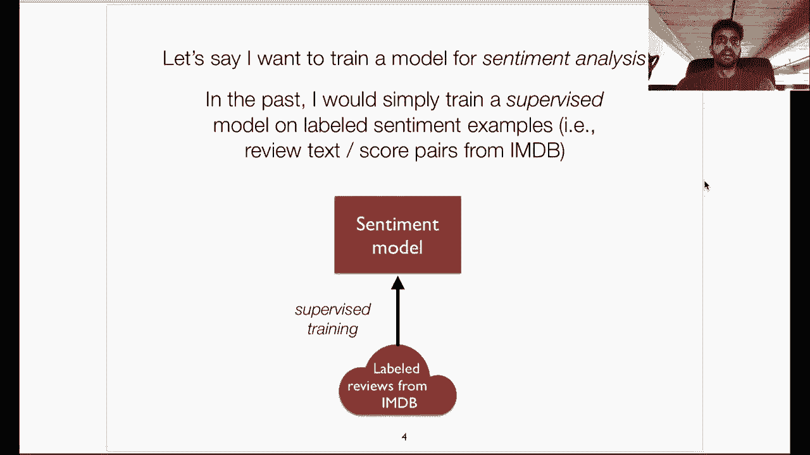

关于作业零：你们的第一次作业将于今天发布，同样在9月4日截止。这份作业旨在介绍基础的编程，特别是在PyTorch中的使用。如果你编程或数学背景有限（例如一些语言学专业的同学），我强烈建议你尽早开始。对于那些有NLP或机器学习经验的同学来说，这份作业可能相对简单，它的目的是让每个人在开始探索更高级的模型之前，都掌握实现的基本构建模块。

---

## 🎯 迁移学习与语言建模

现在，让我们切换到今天的主题。我想简要回顾一下迁移学习范式，以说明为什么语言建模是如此重要的任务。

假设我想训练一个情感分析模型。上一讲我们已经讨论过，情感分析是许多公司关心的任务，投入了大量资金来开发能更好预测人们对公司产品评价的模型。

过去，标准的做法是在一个有标签的训练数据集上训练一个监督模型。例如，我可以爬取IMDB上包含大量影评的数据，每篇影评对应一个1到10的评分。我可能会收集大约10万对这样的影评和评分，并以此作为监督信号来训练一个模型，使其能够根据影评预测评分。

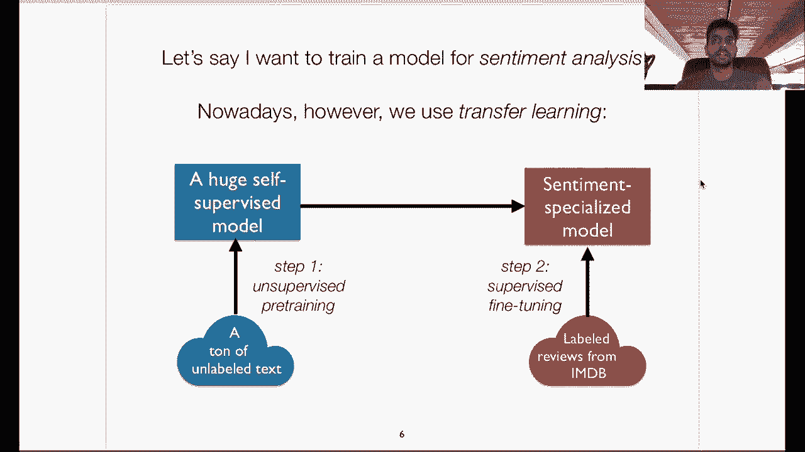

过去就是这样做的，模型只能访问监督训练集中的数据。

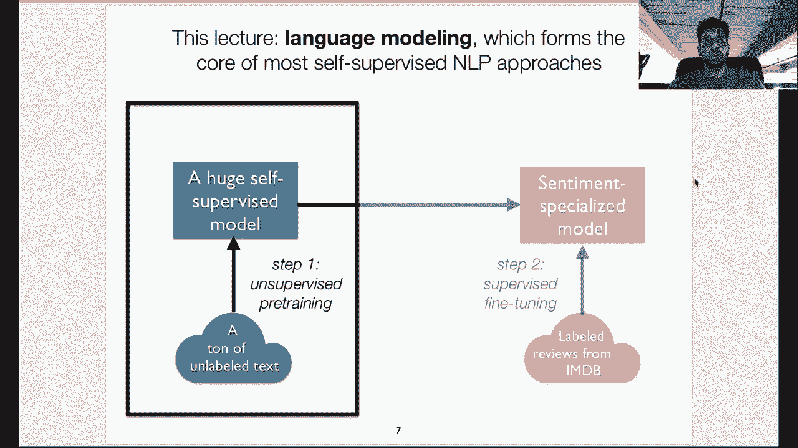

但最近，我们已经转向了迁移学习范式，这使我们能够利用比IMDB训练集多得多的数据。

迁移学习流程的第一步就是语言建模发挥作用的地方。我基本上会获取大量未标记的文本，正如我们之前讨论的，这类文本可以来自互联网的各个角落。例如，Common Crawl就是互联网上大量网页的转储，其中包含数万亿的单词。我们希望，如果一个模型能够访问所有这些词元，并能够学习这些未标记文档中语言的表示，那么它将学到许多有用的语言特性，这些特性将有助于它在执行情感分析这个下游任务时表现得更好。

想想情感分析，有些例子可能相当复杂。例如，我说：“我真的很喜欢表演，但情节超级糟糕。” 这篇影评整体上是相当负面的，但对表演传达了一些积极的情绪。因此，你可能需要一个能够意识到这种否定和对比连词的模型，这种连词否定了这部电影的优点，并将句子的焦点转移到情节有多么糟糕上。

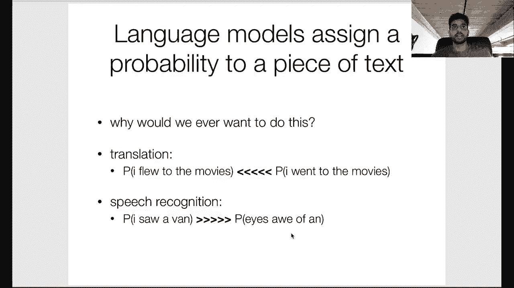

从像IMDB这样的小型文本集中学习否定这类复杂现象是非常具有挑战性的。但如果我们能访问数万亿的单词，也许我们会看到很多否定和对比连词的实例，也许我们能够学习诸如否定范围以及否定如何与更长的句子相互作用等知识。这就是迁移学习第一阶段背后的部分直觉：我们获取大量未标记数据，并进行这种无监督的预训练。我们实现这一点的方式是通过自监督学习。

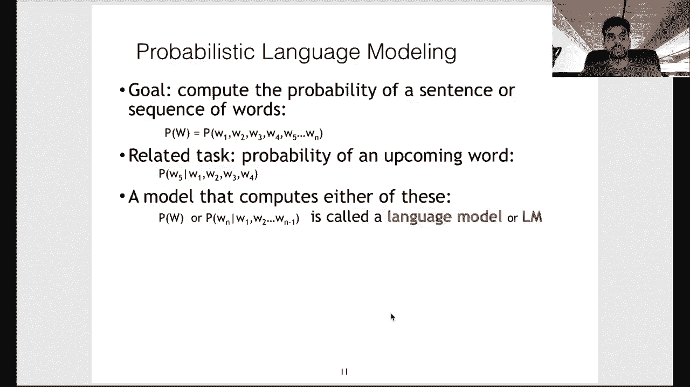

如果你还记得上次课，我们讨论了自监督学习作为一种从未标记数据中创建标记数据的方法，我们看过的具体例子就是语言建模和掩码语言建模。

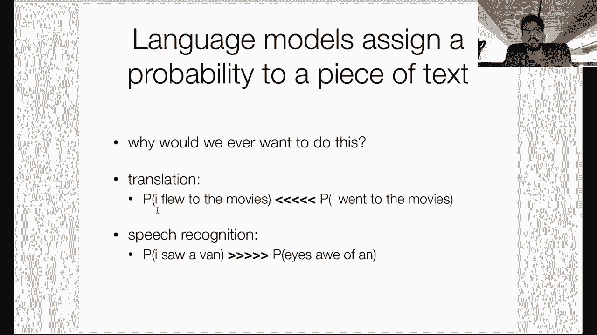

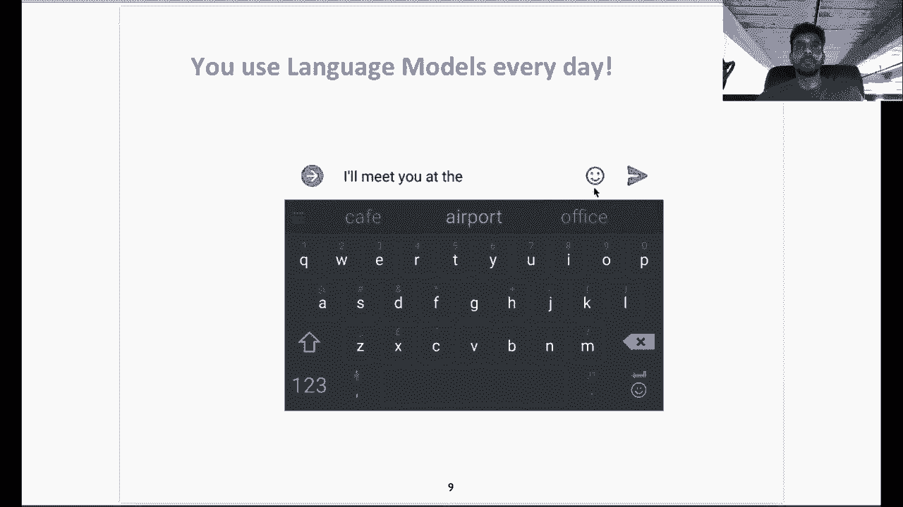

所以，今天我们将讨论语言建模。而下一步，我们今天不会讨论，是监督微调。我基本上会获取在预训练阶段输出的这个巨大的自监督模型，并在本例中从IMDB获得的小型标签数据上对其进行微调。这相当于利用了模型在第一阶段从尽可能多的文本中编码的所有语言知识，然后引导它专门完成情感分析这个特定任务。但重要的是，在迁移学习中，同一个基础模型——即从预训练阶段得到的模型——可以用于许多不同的下游任务。你只需要更改用于微调的数据集即可。它可以是本例中的情感分析，也可以是问答、词性标注，或任何其他任务。这个基础模型可以保持不变，真正改变它以适应特定下游任务的是微调阶段。

这就是动机所在，而语言建模是我们在NLP中用于自监督预训练的核心目标之一。

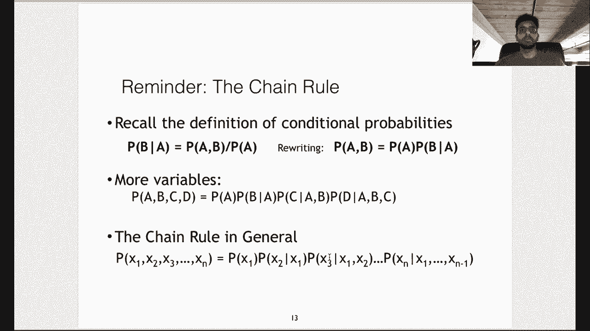

---

## 🤔 什么是语言模型？

语言模型为任何给定的输入文本分配一个概率。乍一想，这有点令人困惑：为什么我们需要一个能为一段文本提供概率的模型？但仔细想想，你会发现像翻译和语音识别这样的应用可以直接受益于将语言模型集成到它们的流程中。

例如，在翻译中，如果对于一个给定的源语言句子，我有两个候选翻译：“I flew to the movies” 和 “I went to the movies”，我当然可以使用语言模型来给第二个分配更高的概率，因为“飞去看电影”极其罕见（除非你非常富有）。

同样，在语音识别中，我可能有一段某人说话的音频文件，我想将这个音频文件转换成实际的文字转录。两个候选转录可能是 “I saw a van” 或 “I of an”。它们听起来很像，但语言模型会告诉我们第一个出现的概率显著高于第二个。

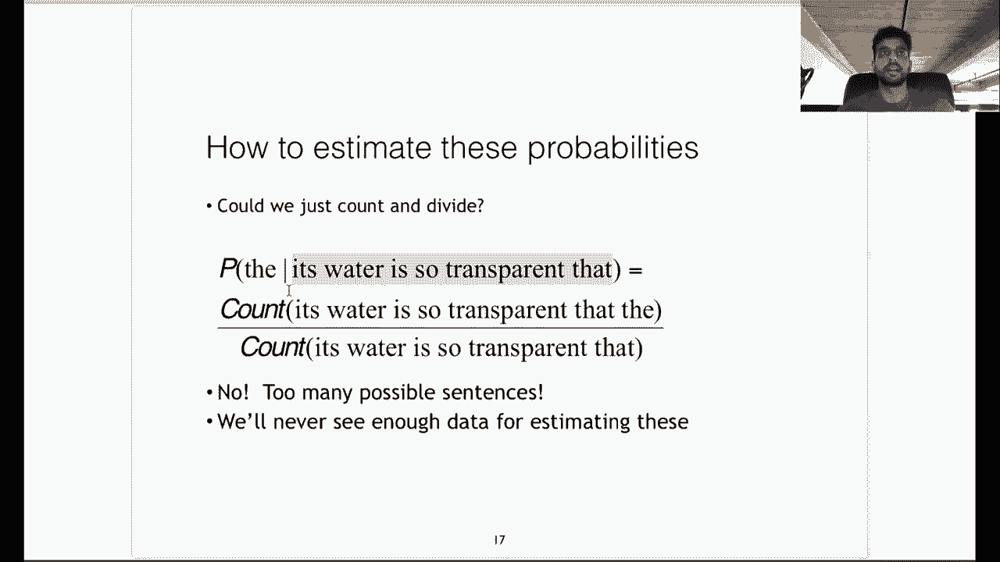

顺便说一下，我把这些视频发布在YouTube上，YouTube有自动字幕功能，你可能在第一讲视频中见过。它非常出色，我检查了一下，错误很少。是的，像基于文本的语言模型是YouTube字幕系统以及所有字幕系统的关键组成部分。

当然，这些都是语言模型的直接用例。本课程的整个主题是如何在迁移学习设置中使用它们，但我们今天不会完全深入探讨。

语言模型的另一个应用是自动补全，你可能在手机或谷歌搜索中使用过。它通常很有用，但在本课程中，我们将更多地关注其在迁移学习中的用途。

---

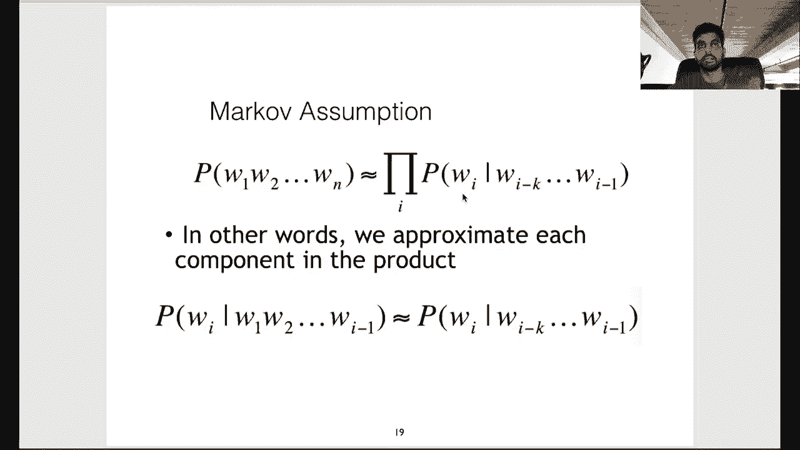

## 🔗 从句子概率到下一个词预测

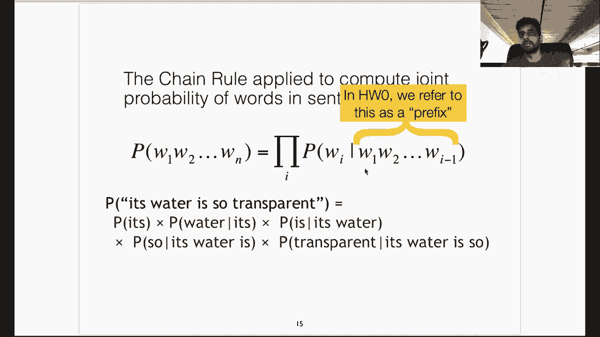

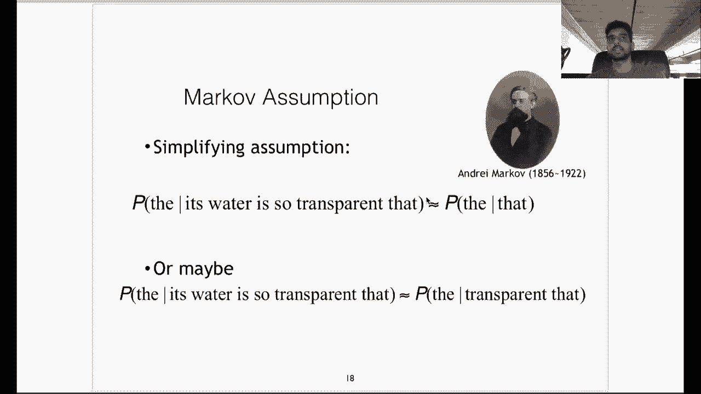

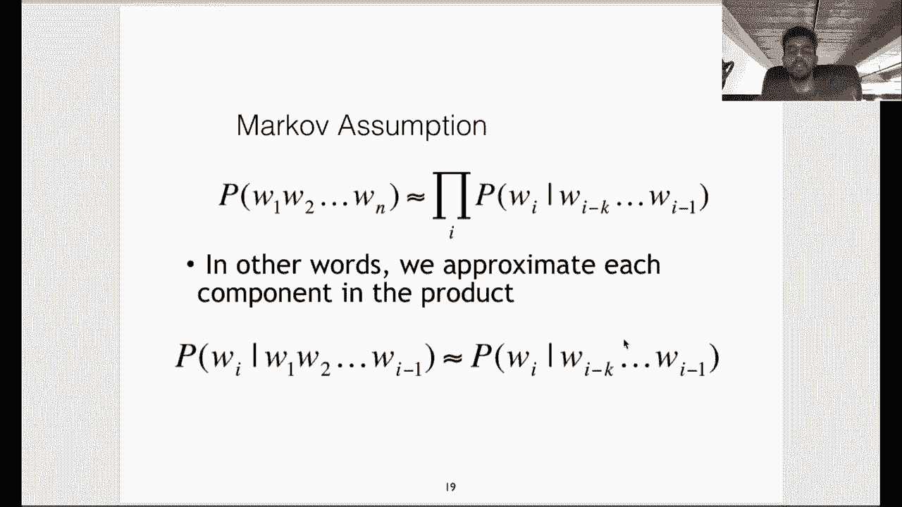

到目前为止我展示的这两个例子，首先我们有整个句子的概率，然后我们有给定前缀后下一个词的概率。这里，“Air”是语言模型在给定前缀 “I’ll meet you at the” 时预测的词。这两件事语言模型都能做。

如果我们的目标是计算给定句子的联合概率，假设我们的句子是 W1, W2, W3, ..., WN，这些是句子的词。

我可以将这个联合概率分解为多个条件概率的乘积。这里，如果我有一个能够计算词5的概率的模型，给定所有在它之前的词（即前缀），那么我也能够计算整个序列的联合概率。这是如何工作的呢？

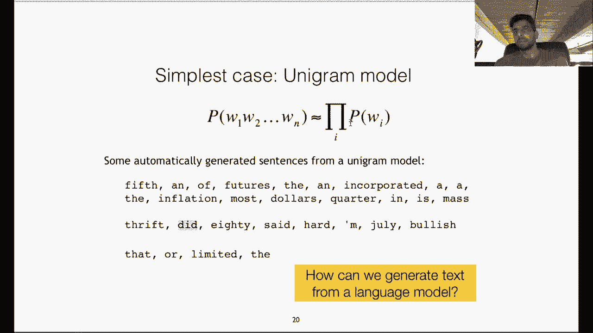

这只是基本的概率链式法则。如果我们看一个具体例子，我们有这个片段：“its water is so transparent that”，我们想计算这个片段出现的联合概率。

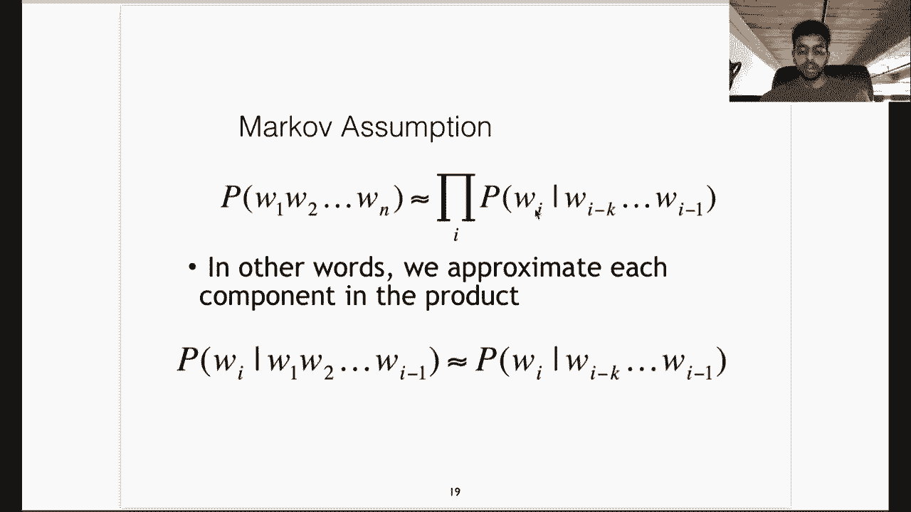

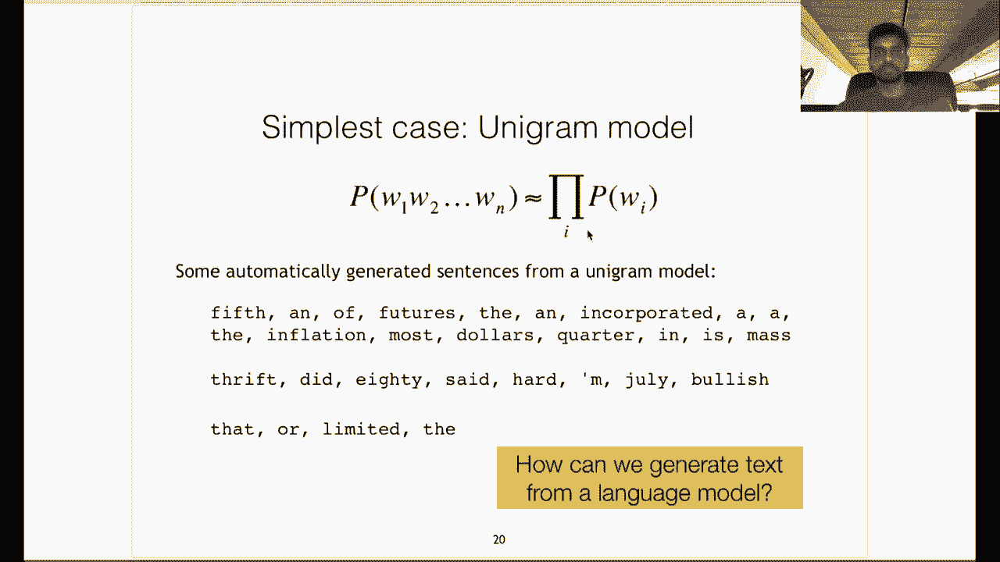

我们可以使用链式法则。如果你不记得链式法则，看最下面的要点，它基本上是说这个联合概率被分解为条件概率的乘积：x1的概率乘以给定x1时x2的概率，再乘以给定x1, x2时x3的概率，依此类推，直到最后一个词给定所有前面词的概率。

如果这对你来说完全陌生，你应该在课后自己复习一下基础概率，这对后续学习非常有用。

将其扩展到语言建模的情况，我们可以将序列W1, W2, ..., WN的联合概率分解为每个词给定其前面所有词的条件概率的乘积。所以，“its water is so transparent”的概率等于“its”的概率乘以给定“its”时“water”的概率，再乘以给定“its water”时“is”的概率，依此类推。希望你能理解这个思路。

你需要记住的高级要点是：如果我们建立一个语言模型，使其在给定一段文本的前缀时预测下一个词，那么这个模型通过链式法则允许我们计算任何文本的联合概率，因为我们只需将所有条件概率相乘。

在作业零中，我使用了“前缀”这个术语来指代模型在预测下一个词时所依赖的条件信息。

---

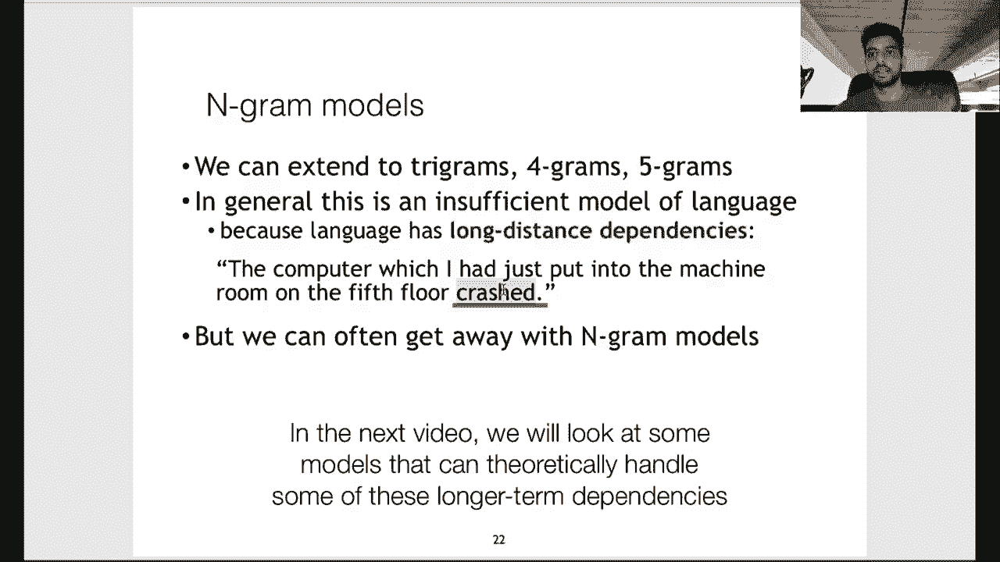

## 📊 基于计数的概率估计

有许多方法可以估计这些条件概率。下一讲我们将从机器学习的角度研究更复杂、更有趣的方法。但在本节课中，我们将看看如果我们只是在一个大型语料库中统计前缀及其后接词的出现次数，然后进行归一化，会发生什么。这种计数和归一化的方法尽管简单，但可能非常强大，尤其是在拥有巨大数据集的情况下。

当然，它也有根本性的限制。我们将在接下来的幻灯片中看到这种方法的近似形式。但你可以想象，如果我想预测在“its water is so transparent that”之后出现“the”这个词的概率，我必须在语料库中查找这个前缀的所有出现情况。这是一个相当长且可能相对不常见的前缀。你想象一下在文档集合中观察到这六个词的概率有多大？可能不多。如果这不是六个词，而是50个词，甚至是500个词呢？即使我拥有Common Crawl或某个包含数万亿词的语料库作为训练数据，我可能也永远不会观察到那个500词的片段超过一次。

因此，这里描述的方法是行不通的。我不可能仅仅统计所有前缀，因为随着前缀变长，我将永远无法获得足够的数据来估计所有可能跟随它的词。

---

## ⚙️ 马尔可夫假设与N元语法模型

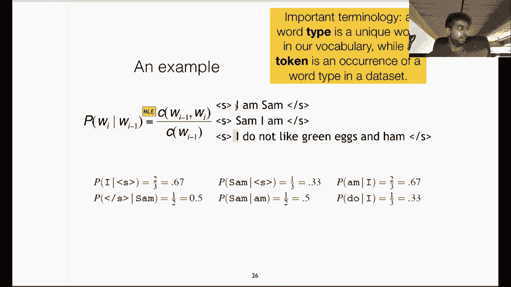

因此，我们依赖马尔可夫假设来简化问题。这里，我不再统计“its water is so transparent that”的出现次数，而是用给定前一个词“that”时下一个词的概率来近似。这样，我完全忽略了前缀“its water is so transparent”的其余部分。但这样做给了我一个固定大小的、相对较短的前缀。因此，我可以想象在语料库中会有很多“that”这个词的出现，这使我能够更准确地估计跟在它后面的词。

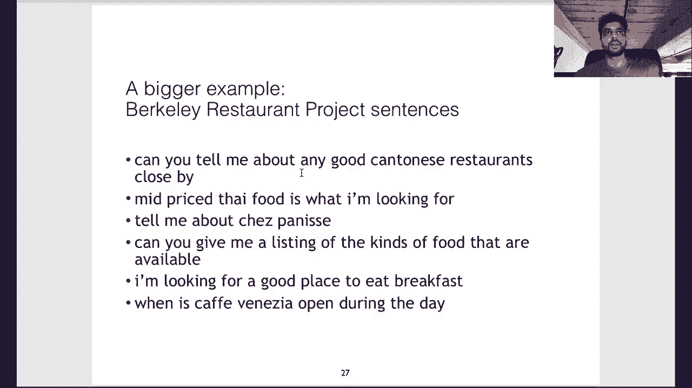

但是，只有一个词的上下文信息量并不大。在这个六词前缀中，有许多词比“that”更重要。也许“water”和“transparent”承载了这个六词前缀中最多的语义信息。如果我简化到只考虑紧邻的前一个词，我的上下文中就得不到这两个词。

也许更好的方法是取更多词作为我的前缀。在这个模型中，这被称为三元语法模型。我将最后两个词作为我的前缀，即“transparent that”。这样做的想法是，如果我现在有了“transparent”这个词，它对接下来可能出现的内容提供了更多的约束。

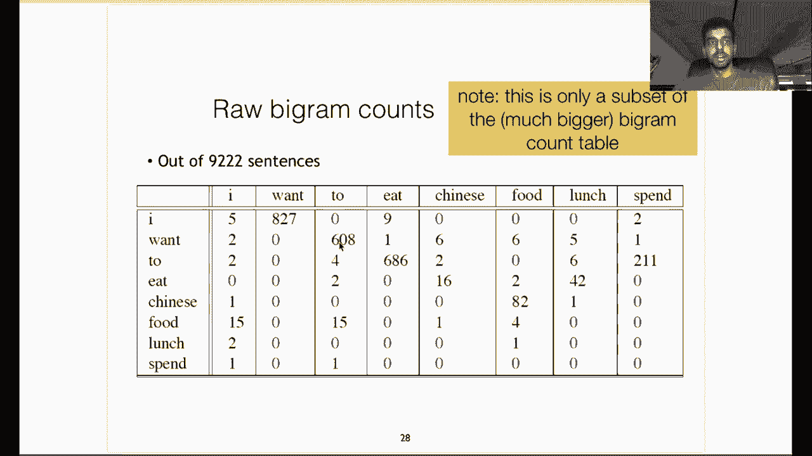

这里存在一个权衡。如果我不断扩展前缀大小，那么在某些时候它会变得过于具体。如果我将其扩展到整个六词短语，我将无法在上下文中观察到足够多的出现次数来准确估计概率。但是，如果我使用的上下文太小，我就会忽略许多对约束下一个词有用的信息。

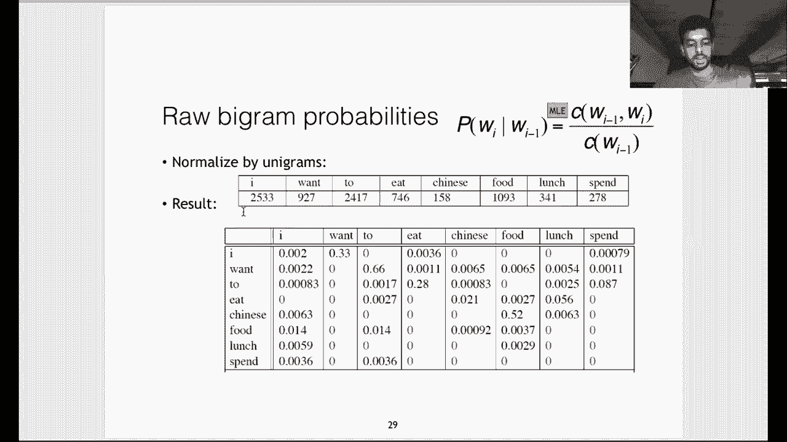

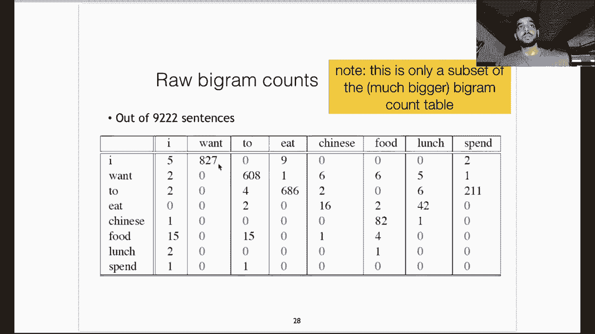

这就是N元语法语言建模的挑战。更正式地定义我刚才所说的：马尔可夫假设允许我们近似这个条件概率。我们不是使用整个前缀，而是取最后K个词作为上下文，忽略K个词之前的所有词。重要的是，这确保了我们为预测的每个词都有一个固定大小的前缀。我们希望，如果我们为数据集选择一个合理的K值，这将使我们能够相当准确地近似这些联合概率。

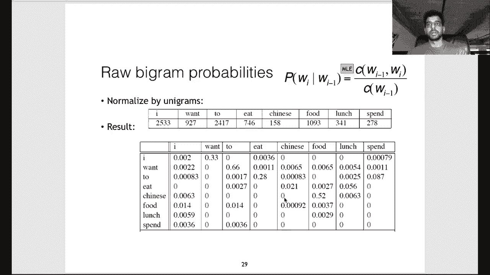

---

## 📈 N元语法模型示例

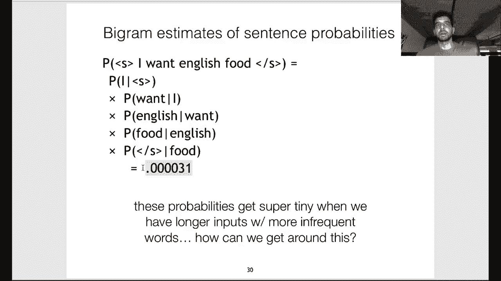

让我们看一些例子。N元语法模型最简单的形式是单元语法模型。这里我们完全没有上下文。如果我们看这个方程，词i的概率不以任何前面的词为条件。这是最简单的模型，它没有上下文。它最多只能学习特定数据中词的频率分布。你会在作业零中更多地了解这一点。基本上，如果没有上下文，我应该提高那些出现频率更高的词的权重，比如“the”、“a”或“and”。这些词不一定有太多语义含义，但它们出现得足够多，我应该比稀有词更重视它们。单元语法模型基本上就学这些。

这是一个可以从单元语法模型生成的文本示例。你会注意到它不合语法，但它确实有很多像“and”这样的高频词实例。

顺便说一下，语言模型的一个重要用例是生成文本。我们将在本课程后面一个为期三周的单元中更多地讨论这一点。但要理解的一个基本点是，我们如何使用语言模型来生成文本。如果我有一个像这样的模型，它基本上给了我一个概率分布。我可以给它一些上下文，然后从得到的下一个词的概率分布中进行采样，从而从这个模型生成文本。我们将在接下来的讲座中更多地讨论这一点，并在文本生成单元中详细探讨。但要知道，从这些分布中采样是相当直接的。有相当多的NLP研究致力于改进从这些模型中采样的方法，以确保多样性或对某些输入上下文的忠实性等，我们稍后会看这些论文。

---

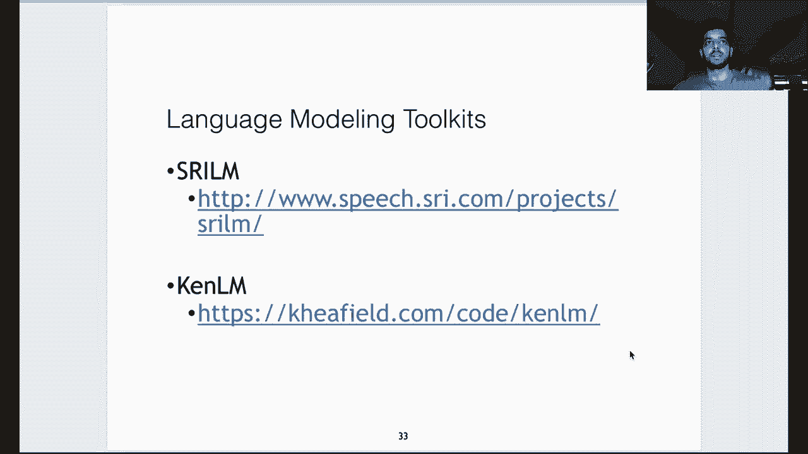

## 🔄 上下文长度的影响

我在前面的幻灯片中讨论过，随着我们添加上下文（即N元语法模型中K值增大），我们在近似这些概率方面会变得更好。但是，一旦N元语法模型的阶数增加到一定程度，我们无法准确估计概率，因为数据太稀疏了，我们无法在语料库中统计所有这些情况的发生次数。

如果你观察一个在莎士比亚作品上训练的语言模型，改变K值（1, 2, 3, 4），你会发现单元语法模型当然完全不语法。二元语法模型只以前一个词为条件，忽略其他所有词。你可以看到它更语法一些：“Why dost thou... Oh why dost stand forth thy canopy.” 虽然不完美，但肯定比单元语法模型好得多，后者生成的词后面可能直接跟句号。三元语法模型现在更好了：“fly and will rid me these news of price.” 这仍然没有意义，但至少比二元语法模型更语法一些。最后，四元语法模型……我无法判断它是否比三元语法模型更好，但它肯定比单元语法模型好。这就是增加N元语法模型阶数的效果。

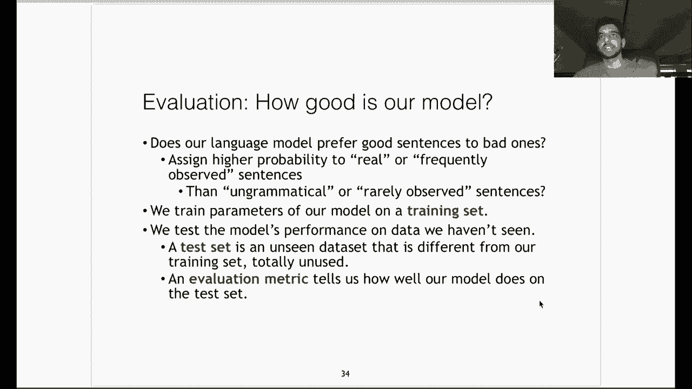

正如我所说，我们可以继续扩展前缀大小，但在某些时候我们必须停止，因为我们无法统计所有这些较长前缀的足够出现次数。事实上，我们必须在N元语法模型中的某个点截断前缀，这意味着我们从根本上无法建模长距离依赖关系。因此，如果下一个词的预测依赖于50或100个词之前发生的事情，这些模型在生成下一个词的概率时无法考虑到这一点。

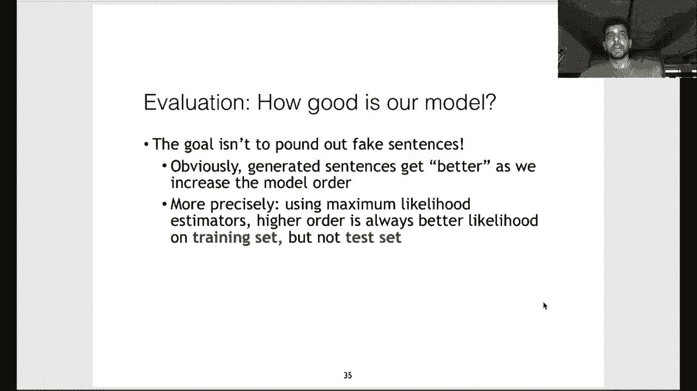

这里有一个例子：“The computer which I had just put into the machine room on the fifth floor crashed.” 我正在尝试预测“crashed”这个词。但如果我有一个三元语法模型，我只能得到“fifth floor”作为我的前缀，因此“crashed”在这个模型下的概率可能非常低。但如果我有一个能考虑更大上下文的模型，也许“crashed”的概率会更高。

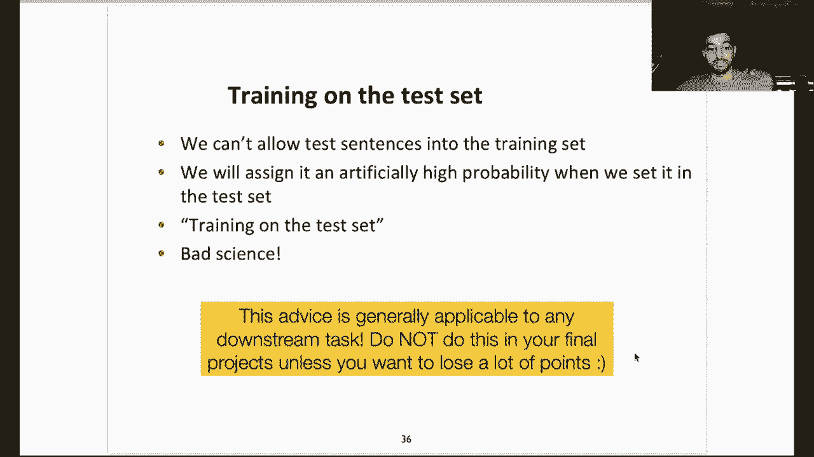

在下一个视频中，我们将开始研究一些模型，它们仍然存在这个问题，但不像N元语法模型那么严重。我们将看到上下文大小可以达到1024个词的模型。这肯定更好，但仍然无法对整个文档的依赖关系进行建模。你可以期待一下。但在本节课的剩余部分，我们将重点讨论如何实际训练这些N元语法模型。正如我之前提到的，它们非常简单，基本上只需要计数，然后除以其他计数。

---

## 🧮 训练N元语法模型：计数与归一化

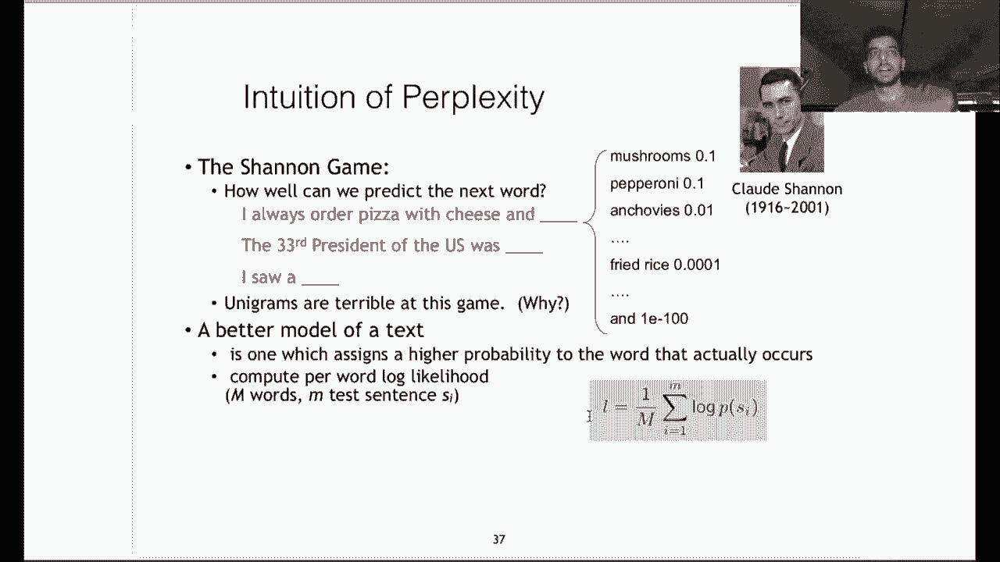

让我们看看这里的二元语法模型。记住，二元语法模型是预测词i，只给定前一个词i-1。

我将这样做：统计所有词i-1后接词i的出现次数（即这个二元词组），然后除以这个词组中第一个词（词i-1）的所有出现次数。

让我们看一个具体例子。我有三个句子构成了我这个语言模型的训练语料库：“I am Sam.”, “Sam I am.”, “I do not like green eggs and ham.” 你会注意到这些特殊的符号~~和~~。这是序列开始符号和序列结束符号。在语言建模中包含这些符号很重要，因为如果没有序列结束符号，当我从语言模型中生成序列时，我将永远无法终止一个序列。而且，我希望能够衡量句子何时终止的概率。因此，在进行语言建模时，包含这些符号很重要。

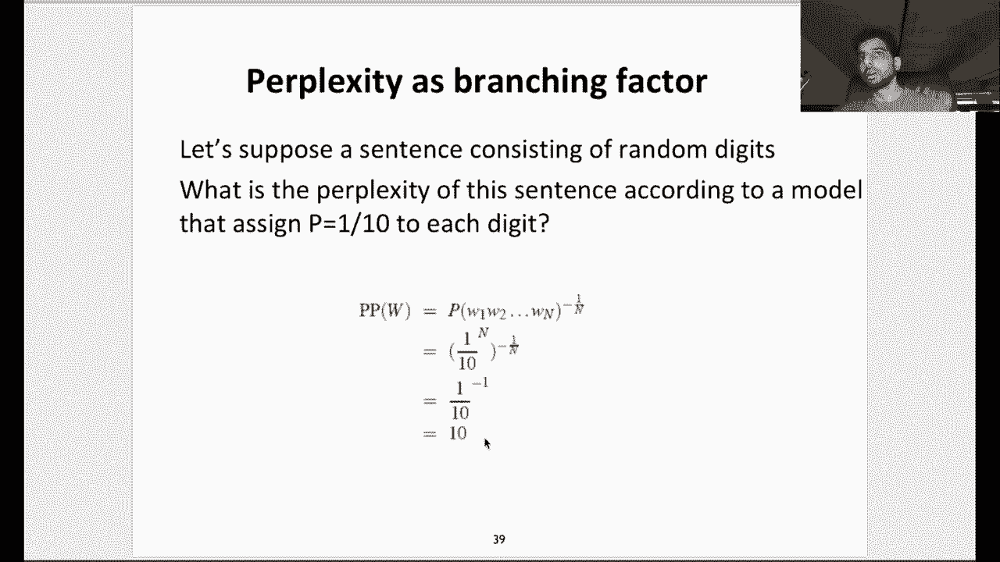

让我们看看如何计数和除法。这里，如果我对给定序列开始符号时“I”的二元语法概率感兴趣，这很简单。我查找所有序列开始符号的出现次数，这里有三个，这将是我的分母。然后我查找紧跟在序列开始符号后面的所有词。我看到“I”、“Sam”和“I”。在三个序列开始符号中，有两个后面跟着“I”。所以我的二元语法概率是三分之二。

让我们看一个目前是问号的例子。“Sam”给定“am”的概率是多少？和之前一样，我查找所有“am”的出现次数，我看到两个。在一种情况下，“am”后面跟着“Sam”；在另一种情况下，“am”后面跟着序列结束符号。所以概率是二分之一，因为在这两次中，我看到一次“Sam”跟在“am”后面。

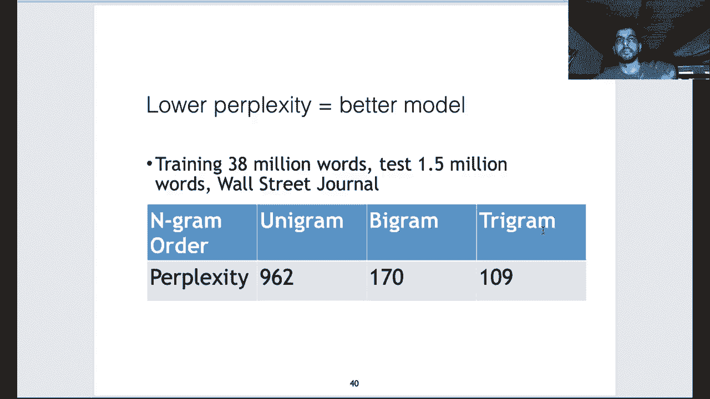

我可以对训练数据中所有可以估计的不同条件概率都这样做。在这一点上需要提到的是，当谈论文本数据时，我们经常提到词类型和词例。词类型是训练数据词汇表中唯一的词。这里我的词类型是：I, am, Sam, do, not, like, green, eggs, and, ham,~~,~~。这基本上是我的词汇表，这些是唯一的词。词例是这些词类型在训练数据中的任何一次出现。这个“I”的出现是一个词例，那个“I”的出现是另一个词例，另一个“I”的出现又是一个词例。所以这些是词类型的非唯一出现。基本上，类型指的是你词汇表中唯一的东西，而词例指的是训练数据集中这些类型的所有出现。

---

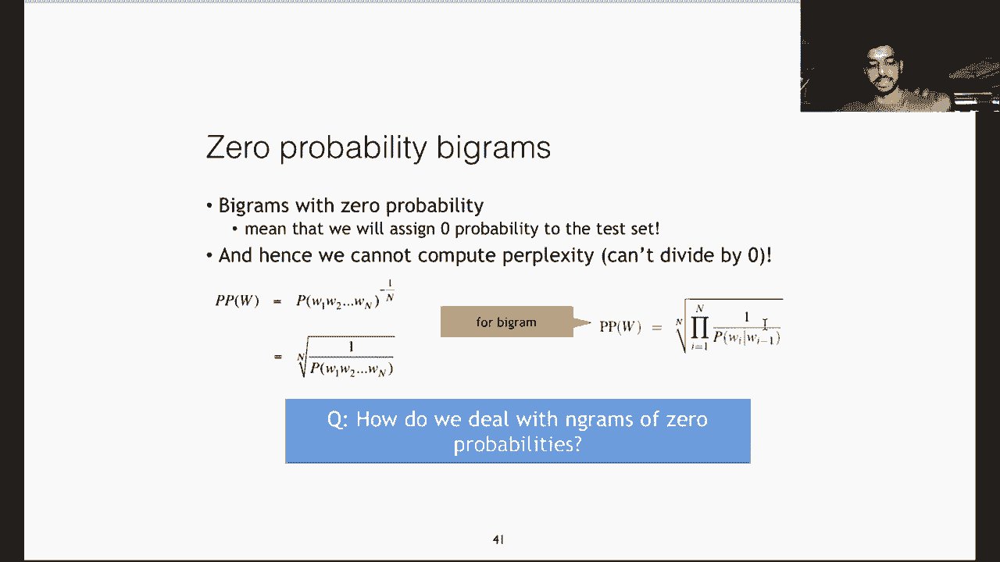

## 📊 真实数据示例：餐厅评论

让我们超越这个苏斯博士的例子，来看一个更大的研究，你在阅读材料中也见过这个伯克利餐厅项目句子数据集。这些是关于餐厅的真实句子，人们询问在哪里吃饭的建议。

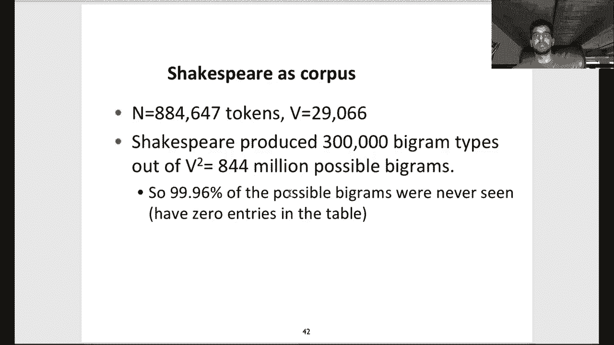

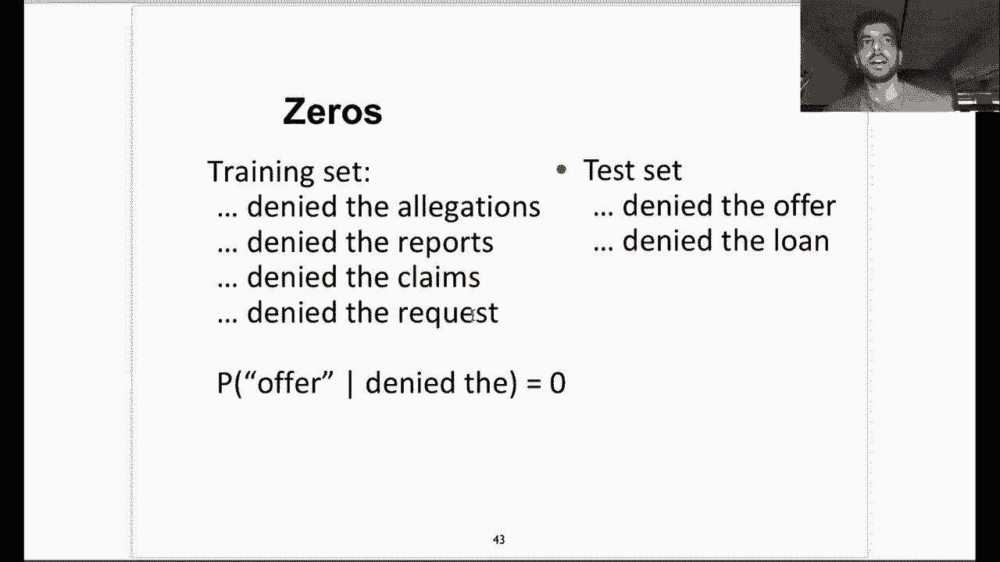

假设我想在这个数据集上估计一个二元语法模型。这里我只展示了这个二元语法表的一个子集，因为这是一个真实数据集，词汇量远大于八个词类型。这只是我们展示的一小部分。你可以这样解释这个表格：列是我们预测的词i，行是上下文词i-1。例如，我在数据中看到了827次“I want”的出现。

我通过简单地统计数据中的所有二元语法来形成这些计数。你会注意到有很多零。短语“want want”出现了零次，当然你永远不会说“want want”。我们将在讲座末尾更多地讨论如何处理这些零。这是一个需要专门方法处理的问题，因为否则，当我们在使用链式法则时将这些概率相乘，这些零将导致零概率，这可能使测试时未见过的句子的概率为零，我们不希望这种情况发生。

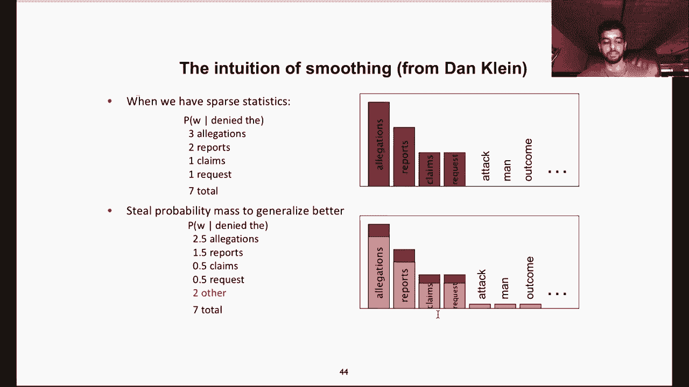

我统计了所有这些二元语法，现在只需除以分母，即这个词组中