# 📚 课程 P22：考试复习课

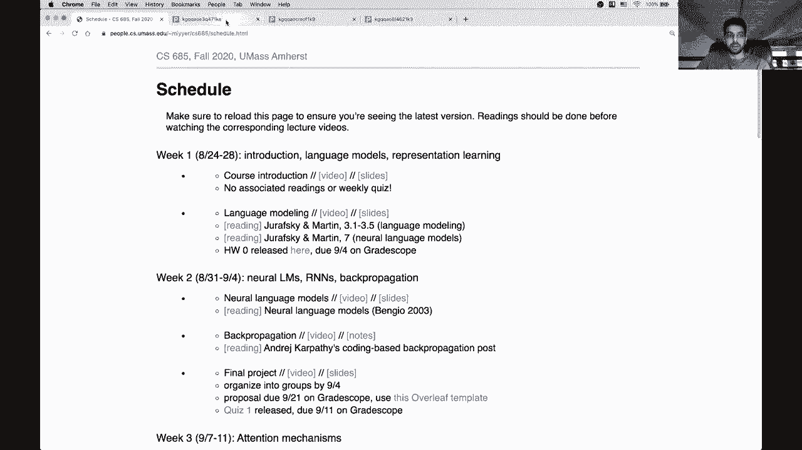

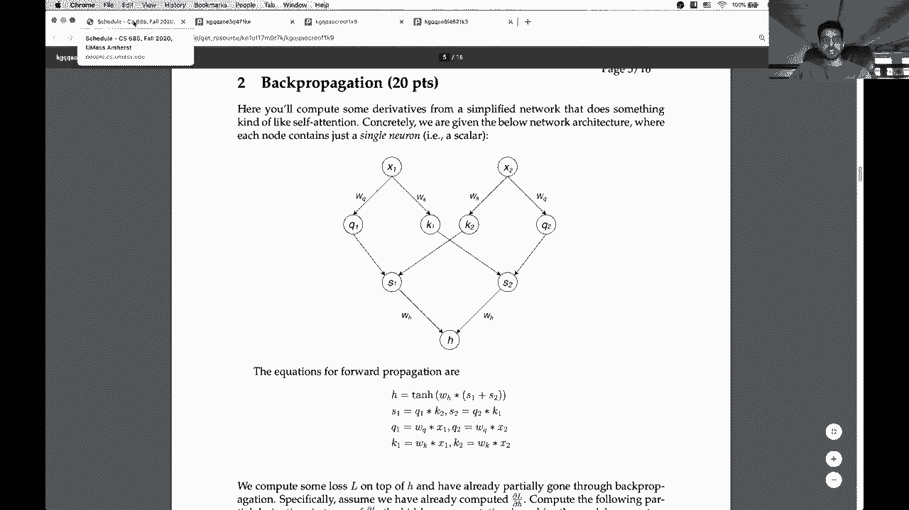

在本节课中，我们将回顾本学期学过的核心概念，包括之前的测验、作业和考试题目。我们将重点关注考试中可能出现的题型，并帮助你更有针对性地进行复习。

***

## 🎯 考试概览

考试将包含大约5个问题，每个问题可能有多个部分。其长度和形式与之前的模拟考试类似，预计可在2小时内完成。两天的考试窗口期是为了让你灵活安排时间，但考试本身不会占用整整两天。

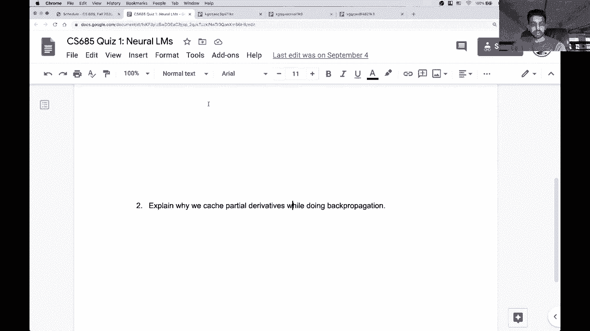

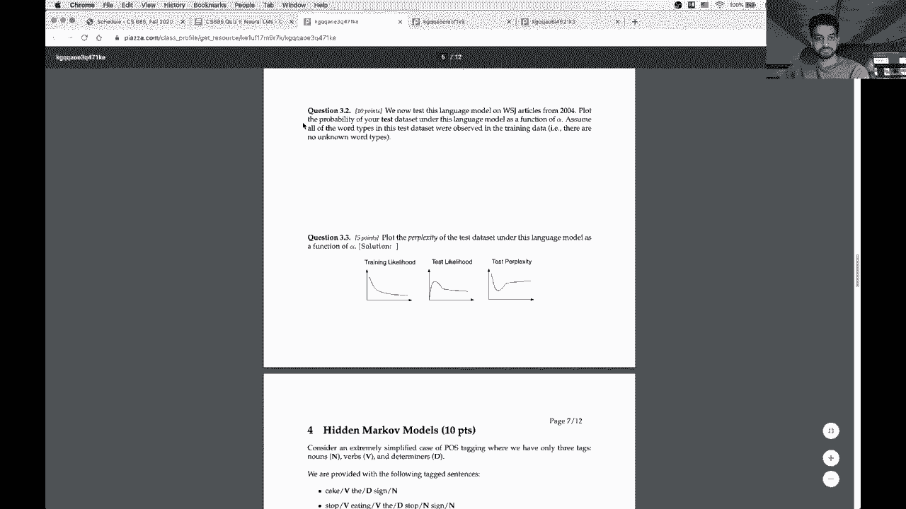

考试将包含一个综合性问题，要求你为一个新任务从头到尾地设计一个模型，包括从数据预处理到模型构建、训练和测试的完整流程。此外，还将有一个与Colab笔记本相关的分析性问题，但不需要你编写大量代码。

***

## 📝 测验回顾

以下是本学期五次测验的核心内容回顾，这些内容与考试主题密切相关。

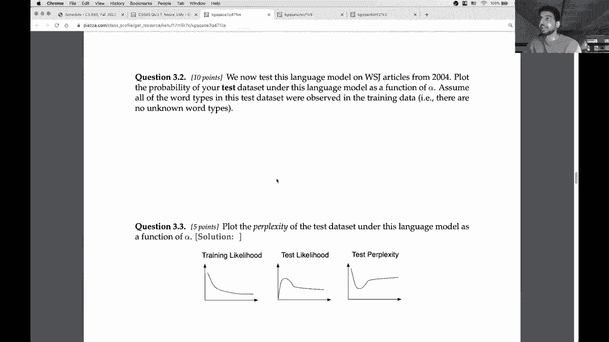

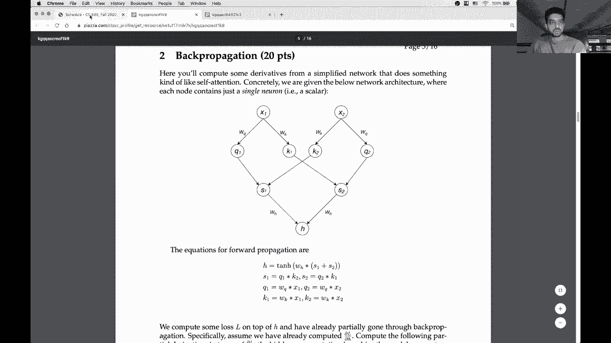

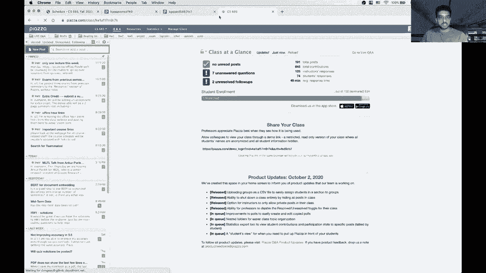

### 测验一：语言模型基础

测验一主要比较了N元语法模型和神经语言模型。

*   **N元语法模型的平滑问题**：未平滑的N元语法模型会给训练集中未出现过的N元序列分配零概率。例如，对于前缀“rabbits flap their wings”，一个未平滑的五元语法模型可能从未见过此序列，因此会给出零概率，这并非合理的估计。
*   **神经语言模型的优势**：固定窗口的神经语言模型通过词嵌入可以处理未见过的前缀，因为它能捕捉词语之间的语义相似性。
*   **反向传播中的缓存**：在反向传播算法中，缓存部分导数可以避免重复计算，这是该算法的基本特性。

### 测验二：注意力机制

测验二探讨了注意力机制，特别是循环神经网络中的瓶颈问题和Transformer中的查询/键投影。

*   **RNN的瓶颈**：RNN的隐藏状态需要编码整个前缀的信息，这可能导致信息压缩和近期偏置。注意力机制通过允许访问所有过去的隐藏状态来缓解这个问题。
*   **Transformer中的查询与键投影**：使用不同的投影矩阵允许注意力得分在查询和键角色互换时不对称，这提供了更大的灵活性。如果使用相同的投影，模型可能会过度关注词语自身。

### 测验三：模型并行化与参数效率

测验三涉及RNN的序列依赖性和在小数据集上的参数效率。

*   **RNN的序列依赖性**：RNN在时间步t的隐藏状态计算依赖于时间步t-1的隐藏状态，这阻碍了训练时的序列并行化。Transformer则没有这种依赖，可以通过掩码实现并行计算，这是其训练速度更快的主要原因。
*   **小数据集下的参数效率**：当下游标注数据极少时（例如只有10个样本），应尽可能减少需要从头训练的参数量。在这种情况下，仅微调预训练语言模型顶部的简单分类器（如平均池化+Softmax）比微调一个深度RNN更可能避免过拟合。

### 测验四：预训练模型演进

测验四聚焦于ELECTRA等预训练模型的改进。

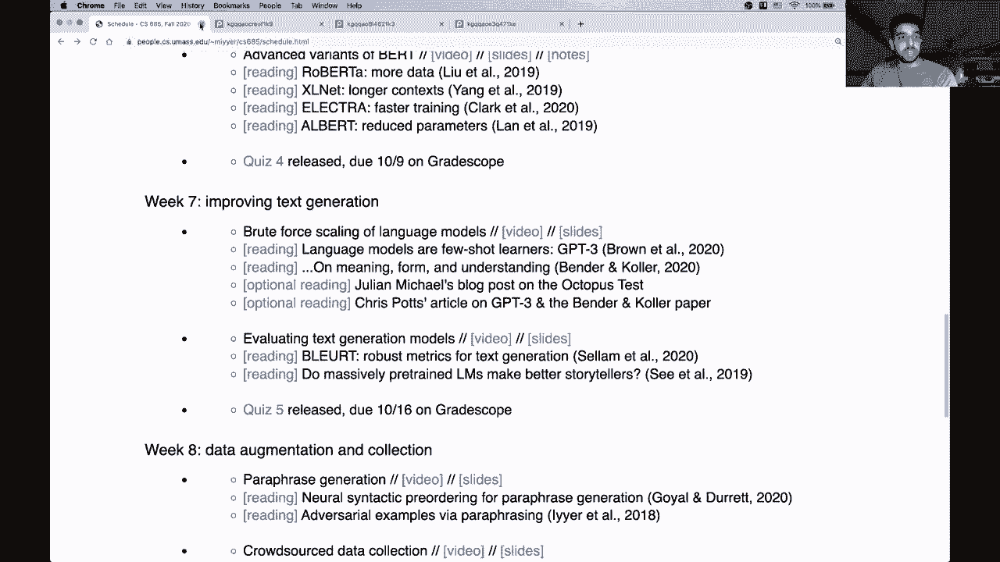

*   **ELECTRA的替换词检测**：ELECTRA使用生成器模型产生“逼真”的替换词，然后让判别器区分原始词和替换词。如果随机从词表中采样替换词，任务会变得过于简单，因为随机词通常在语法和语义上都不合理，这不利于模型学习深层的语言知识。
*   **中间任务微调**：在预训练和下游任务微调之间加入中间任务微调可能提升性能，但需要谨慎选择。连续在多个不相关的中间任务上微调可能导致模型遗忘预训练阶段学到的通用语言知识，反而损害下游任务性能。

### 测验五：文本生成策略

测验五讨论了文本生成中的解码策略。

*   **Few-shot学习与数据污染**：对于GPT-3在算术问题上的few-shot学习能力，仅通过简单正则表达式在训练数据中搜索完全匹配的模板可能低估了数据中存在的、多种不同表述的同类问题。
*   **采样解码与束搜索的适用场景**：在生成释义的任务中，多样性很重要。束搜索倾向于生成高概率但可能与输入句子高度相似的输出。采样解码因其随机性能产生更多样化的输出，这在数据增强等需要多样性的场景中更有用。

***

## 📖 模拟考试重点题目解析

现在，我们来看一些往期模拟考试中的代表性题目，这些题目类型可能在你的考试中出现。

### 问题类型一：为新任务设计流程

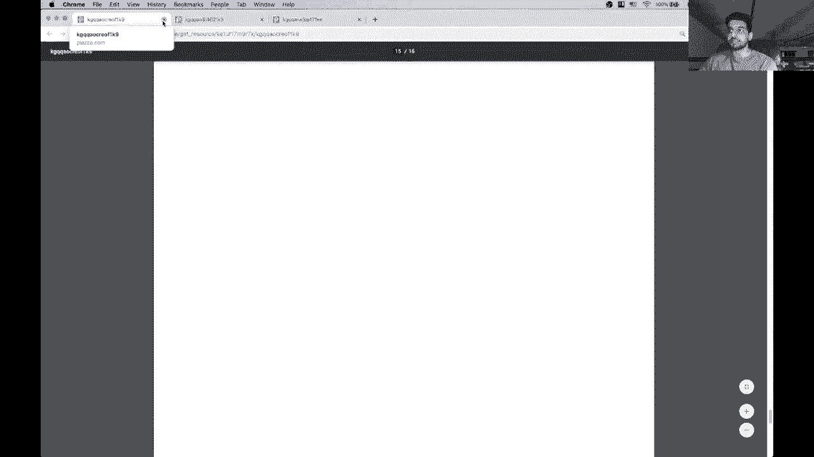

你可能会遇到一个全新的任务（如“文本填空”），并要求你描述如何使用给定的模型（如从左到右的语言模型）来解决它。关键点包括：
*   如果要求找到**概率最高**的补全序列，并且不计计算成本，可能需要**枚举所有可能的补全组合**并计算其概率。
*   如果使用像BERT这样的掩码语言模型进行填空，直接预测所有`[MASK]`位置会忽略掩码词之间的依赖关系。更好的策略是**逐个预测**，并将已预测的词反馈回模型，以保持内部一致性。

### 问题类型二：模型行为分析与调试

考试可能给出一个模型在训练或部署中出现的“异常”现象，要求你解释原因并提出解决方案。
*   **示例1**：LSTM语言模型训练困惑度每轮迭代后都上升。这可能是因为**学习率设置过高**，导致优化过程在损失平面上震荡，无法收敛到最小值。
*   **示例2**：一个简单的词向量平均模型在单个训练样本上无法收敛。检查发现，由于初始化值全为负，经过ReLU激活函数后梯度消失，导致参数无法更新。解决方案可以是**调整初始化**，使词向量初始值为正。

### 问题类型三：深入理解注意力与掩码

对Transformer解码器掩码机制的理解至关重要。
*   **标准掩码**：解码器使用下三角掩码，确保在预测当前位置时只能看到之前的位置，这是自回归生成的核心。
*   **变体掩码的影响**：如果修改掩码，使得解码器在预测连续两个词时都基于相同的上文（看不到前一个预测词），这会**破坏词序依赖**，可能降低生成质量（如翻译连贯性），但**可以并行预测多个词**，从而**加速解码过程**。

***

## 💡 复习与考试建议

*   **理解而非死记**：重点理解模型背后的直觉、优缺点及适用场景，而不是记忆公式。
*   **关注设计决策**：对于综合性设计问题，清晰列出每一步（数据清洗、分词、模型选择、损失函数、训练/测试流程等）并**合理论证**你的选择。
*   **利用所有资源**：复习课程视频、讲义、作业和模拟考题及其解答。
*   **考试期间提问**：如有问题，请在Piazza上以**私密帖子**形式提出。如果问题具有普遍性（如笔误），我们会公开回复。

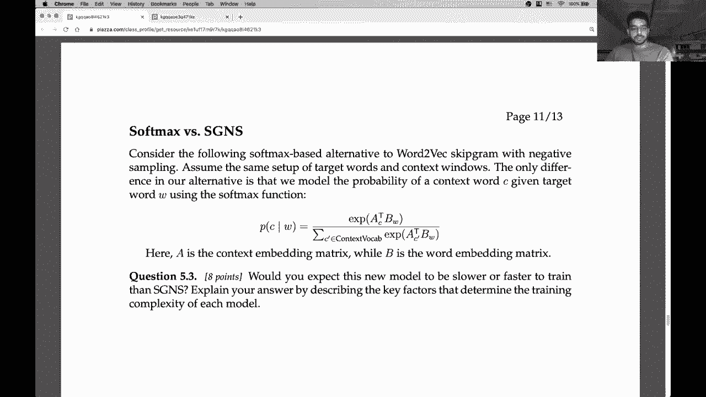

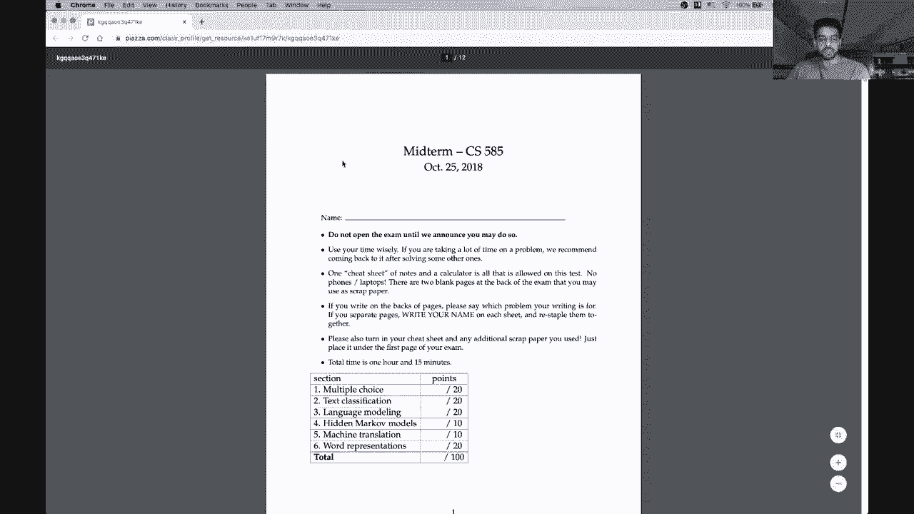

***

## 🎓 课程总结

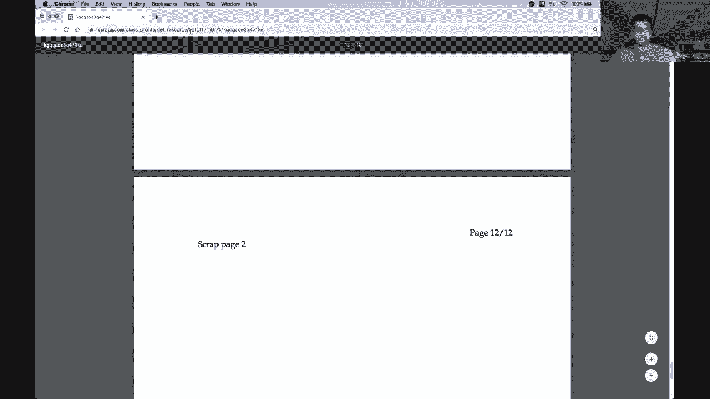

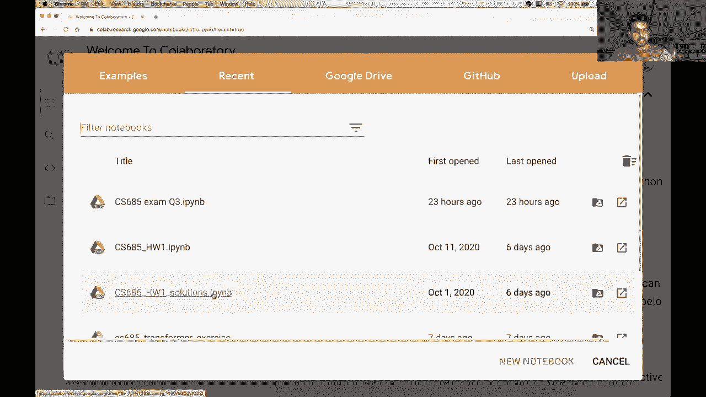

本节课我们一起回顾了本学期NLP课程的核心知识点，涵盖了从基础语言模型、注意力机制到现代预训练模型和文本生成的广泛内容。我们分析了典型考题，并强调了理解模型原理、设计决策和调试能力的重要性。

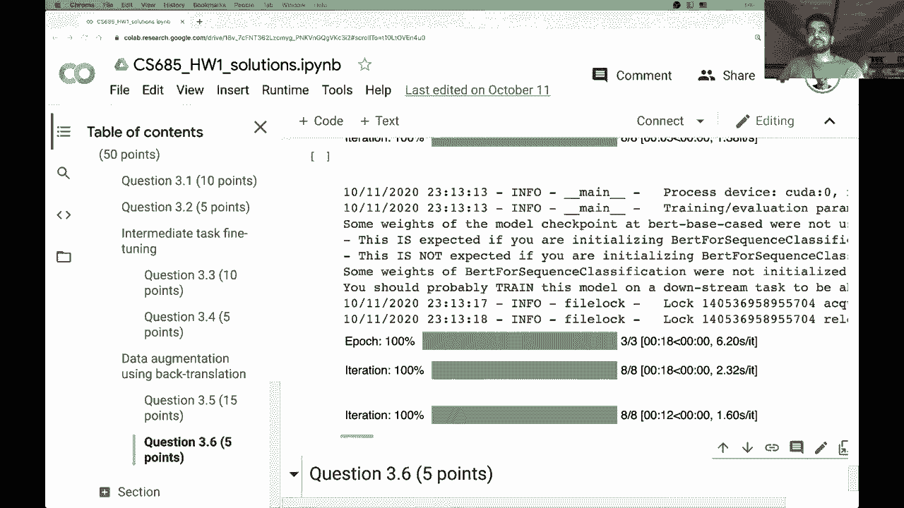

祝大家考试顺利！