# 📚 课程 P23：L18 - NLP 伦理学

在本节课中，我们将学习自然语言处理中的伦理问题。随着NLP系统变得越来越强大，并被应用到更多样化的任务中，伦理考量变得日益重要。我们将探讨数据偏见、模型偏见、以及部署强大模型（如GPT-3）可能带来的社会影响。

---

## 📝 期中考试答案回顾

在开始讨论伦理问题之前，我们先简要回顾一下期中考试部分题目的答案。

### 问题一：解码器掩码

这个问题比预期的要困难。关键在于，这是一个多层Transformer模型，共有16层。如果掩码只在第一层设置，并且这是一个单层模型，那么它会完美工作，每个时间步的预测只会关注前两个词。

问题在于多层结构。当掩码应用于前一层的输出表示时，信息会泄露。在第二层，即使掩码只允许看到前两个词的表示，但该表示已经包含了前两个词的信息。随着网络层数的增加，模型的感受野会逐渐扩大。到了第16层，模型可能已经看到了上下文中的许多甚至所有词元，而不仅仅是最后两个。

因此，这个模型并不像Sarah预期的那样糟糕，因为它可以访问的上下文词元远不止最后两个。

以下是两种可接受的解决方案：
1.  **重塑输入数据**：将每个序列限制为仅三个词元，并且只在最后一个时间步进行预测。这样，语言模型就无法“作弊”查看两个词元以外的信息。
2.  **修改掩码**：在第一层使用Sarah的正常掩码，但在第2到16层使用单位矩阵，只在当前时间步取消掩码，其他位置均为零。注意，这与第一种方法不同，因为上层的Transformer并没有在三个词的窗口上进行自注意力计算，而是在一个表示窗口上。

### 问题二：训练时间

这个问题取决于你对上一个问题的回答。
*   如果你采用**数据修改**方法（将输入序列截断为三个词），那么训练样本数量会大幅增加。虽然序列变短减少了自注意力计算量，但样本数量的增加通常主导了训练时间的变化。
*   如果你采用**掩码修改**方法，训练时间将大致相同。

我们将接受提及这两个主要影响因素的回答。

### 问题三：建模方法

这是一个非常开放的问题。最合理的做法是将其视为**文本生成问题**，因为这些提问非常独特，在常规数据中很少见。

如果选择将其视为**检索问题**，则需要充分论证你的检索数据集是什么样的，因为有些问题过于奇怪和复杂，即使在Common Crawl这样的数据集中也可能找不到相关回答。

任何在此数据上训练的序列到序列模型都是可行的。如果在解码器中融入预训练，效果会更好。你还可以考虑其他方面，例如如何处理同一问题的多个回答（可能基于点赞数等进行过滤预处理）。

如果将其视为类似SQuAD的**抽取式问答任务**，则不合理，会被扣分。

### 问题四：评估方法

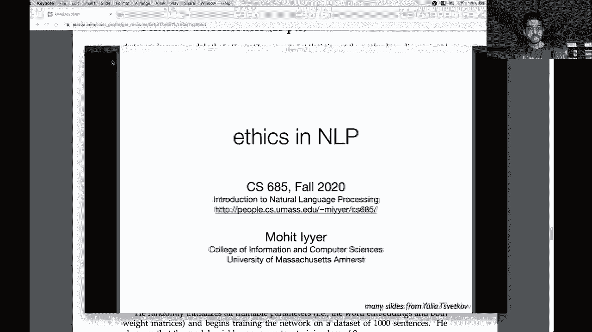

对于此类开放性的任务，我们主要期望你讨论**人工评估**。

如果你提到了BLEU或ROUGE等指标，通常不适合此任务，因为任务约束性很低。单个真实答案的n-gram重叠度不是一个可行的指标。即使你使用了多参考评估，也只能获得部分分数。

真正评估此类任务的唯一可靠方法是通过人工评估，你可以设计多种不同的人工评估方案。

我们将根据具体情况对答案进行评分。

### 问题五：自编码器问题

这个问题测试你对反向传播梯度下降优化的理解。关键在于，词嵌入是作为模型的一部分进行训练的。

这意味着损失函数存在一个**平凡解**：如果将所有词嵌入都设为零，那么损失函数就变为零，而模型并没有学到任何有用的任务表示。事实上，当你设置这种自编码器并使模型的所有部分都可训练时，除非你以更巧妙的方式设计损失函数来避免此类退化解，否则就会出现这种情况。

一些同学回答“词嵌入会变得相同”，这基本接近答案。另一些同学提到了激活函数饱和的问题，但这不是主要问题，因为无论参数如何初始化，平凡解的问题都会出现。我们会根据情况给予部分分数。

### 问题六：BERT掩码问题

这个设置存在许多问题。但问题4.1的主要问题在于，无论BERT是否能记住社会安全号码，这个号码都会被BERT的分词器分割成多个**子词词元**。因此，模型永远无法仅用一个`[MASK]`标记就生成整个号码。

可能的解决方案包括修改BERT的掩码策略，使其只掩码数字和连续的子词片段等。

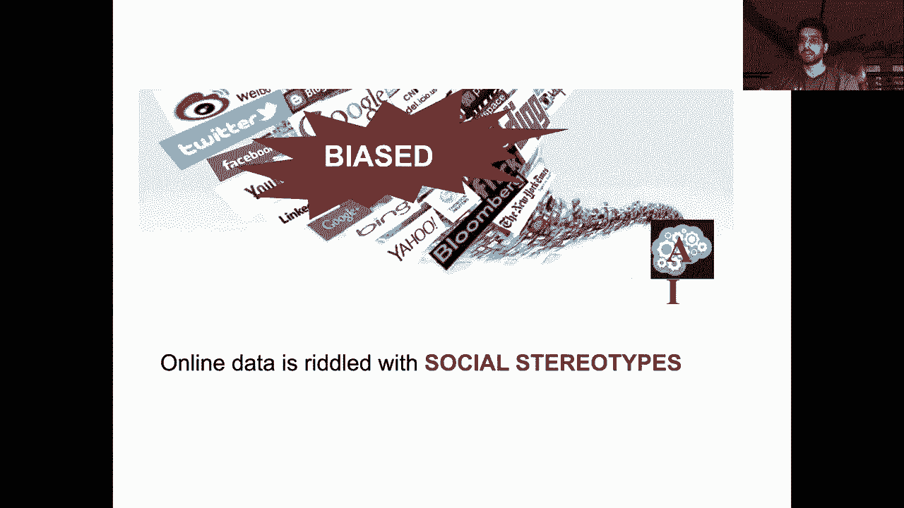

关于模型无法泛化的原因有很多。如果你提到模型只是记住了这个特定序列，而没有泛化到句子的语义含义，这是完全可以接受的。或许可以通过基于释义的数据增强来解决，但也不一定。

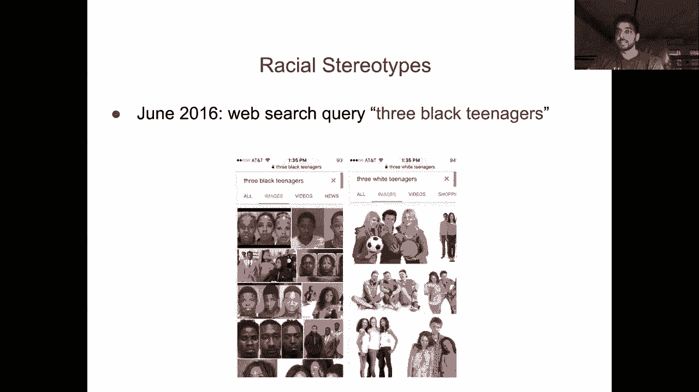

我们会确保对指出的各种潜在问题给予相应的分数。

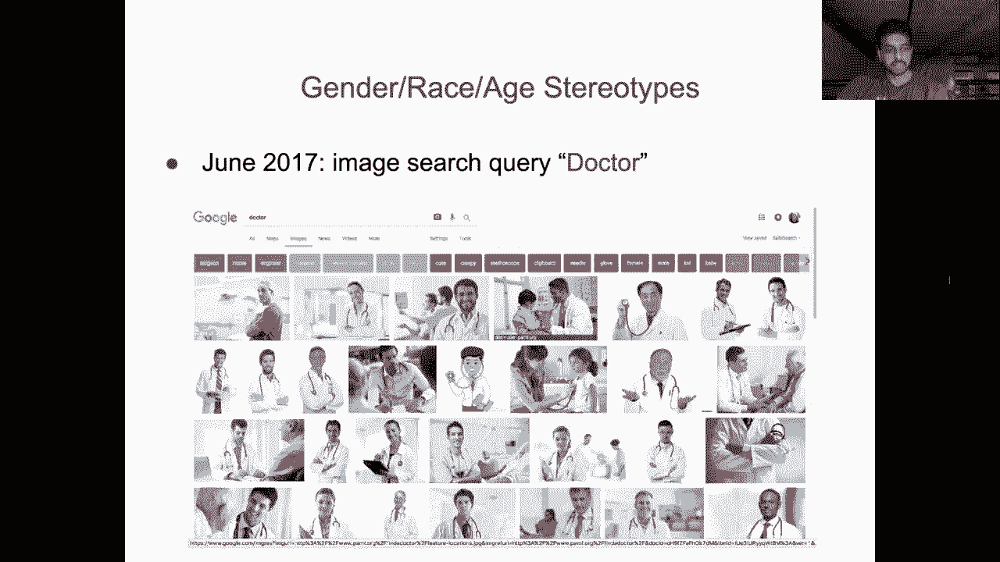

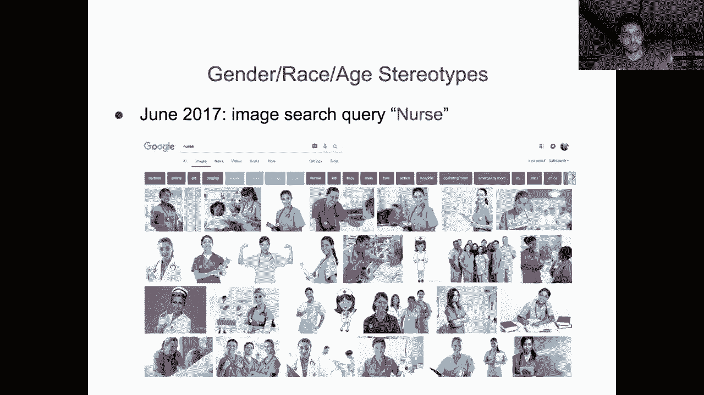

---

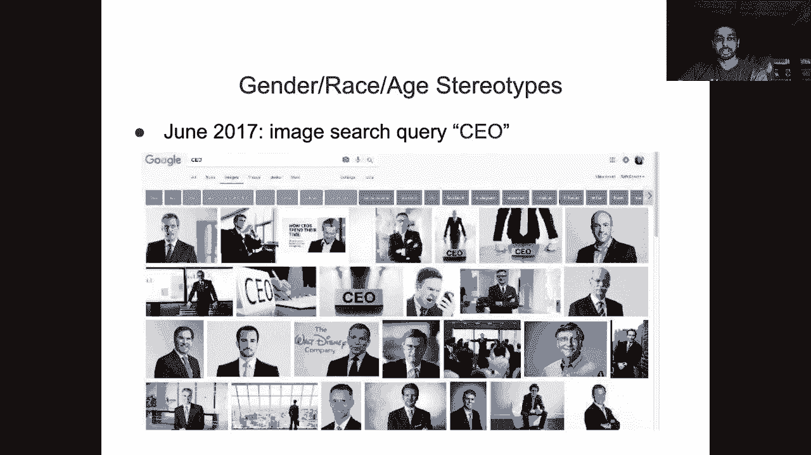

## ⚖️ NLP中的伦理考量

现在，我们转向现代NLP中的伦理议题。这与之前的技术主题有所不同，但随着像GPT-3这样的模型出现，其使用方式、潜在用途以及对现实世界各种情境的影响尚不明确，伦理问题变得至关重要。

十年前，这可能不是一个大问题，因为当时的NLP系统能力有限，只能解决一些合成任务或远离实际应用的任务。但现在，我们有作为对话代理部署的真实系统，机器学习方法也被整合到影响人们生活的决策系统中，例如司法系统、招聘决策或移民审核。NLP和机器学习影响我们的方式多种多样，伦理问题日益凸显。

事实上，在CMU有一门关于NLP伦理问题的完整课程，本课的许多幻灯片材料都来自那门课程。

### 🤖 案例：GPT-3在Reddit上的失控

几周前发生了一个例子：有人让一个基于GPT-3的机器人在Reddit上自由发言，结果并不理想。

OpenAI发布GPT-3的方式是选择几个应用程序，并允许这些应用程序访问GPT-3 API。这意味着它们可以向GPT-3输入上下文并生成输出。其中一个应用叫做“哲学家机器人”，用于生成哲学文本。

问题是，人们开始将这个哲学家机器人（基于GPT-3）的输出发布到Reddit上。表面上这似乎无害，但有些子版块讨论的话题非常严肃。例如，有一个帖子来自“Ask Reddit”版块，问题是：“对于那些有过自杀念头的人，是什么帮助你变得更好？”而其中一个回复是由GPT-3生成的。

这引发了许多问题：我们是否希望这些我们知道在理解上存在局限的模型，向那些以为用户名背后是真人而非某个不理解自己在说什么的大型语言模型的人提供建议？哲学家机器人的创造者可能从未预见到他们的机器人会在Reddit上向抑郁的人发布建议。

总的来说，目前这类仅能根据输入词语生成文本的无条件语言模型，其**收益与风险比可能并不值得**，因为模型仍然存在缺陷，在没有任何检查的情况下将其部署到现实世界中可能会造成很大伤害。这可能也是为什么GPT-3论文被定位为少样本学习的进展，因为那确实很酷且前景广阔，但GPT-3也是一个极其强大的语言模型，其风险与回报的权衡可能尚未达到理想状态。

### 📊 数据偏见

NLP中伦理问题的一个主要来源是用于训练模型的**数据**。在整个学期中，我们已经看到，我们确实从海量训练数据中受益匪浅。许多情况下，我们几乎不需要改变模型，只需将数据量增加一个数量级就能获得巨大提升。

这些数据通常来自Common Crawl或社交媒体论坛。我们需要意识到：是谁在发布或撰写这些页面内容？如果我们将这些数据作为某种语言（如英语）的一般性代表，那是不准确的。互联网上的数据是那些有能力花时间在互联网上创作内容的人群的产物。

**计算机视觉中的例子**：
*   在Google图片搜索中，搜索“三个黑人青少年”和“三个白人青少年”会显示出明显的差异。白人青少年的图片多是微笑和运动，而黑人青少年的图片中微笑和活动较少。如果你使用Google图片搜索创建图像标注数据集，可能会遇到这种偏见，你的模型将从你提供的数据中学习，可能学会将不微笑的脸与黑人关联起来。
*   2017年，搜索“医生”图片，结果大多是白人男性；搜索“护士”图片，结果大多是女性。搜索“CEO”也会得到类似结果。

如果数据存在偏见，你的模型也会存在偏见。人们已经提出了一些方法来缓解这些问题，例如词嵌入去偏见、过滤或清除有问题的数据等。但关于去偏见的目标、程度以及是否可能完全消除数据中的所有刻板印象，仍然存在许多开放性问题。

网络（包括Common Crawl和Reddit）上确实存在性别和种族偏见，在部署基于这些数据训练的模型之前，至少需要意识到这些问题。

### 🔗 指代消解中的性别偏见

这是一个性别偏见在指代消解系统中的例子。指代消解的任务是：给定一个代词，找出它所指代的实体。

例句：“The physician hired the secretary because he was overwhelmed with clients.”（医生雇佣了秘书，因为他被客户淹没了。）这里的“he”指代“physician”。

如果将代词改为“she”：“The physician hired the secretary because she was overwhelmed with clients.” 模型现在会预测“she”指代“secretary”，而不是“physician”，尽管句子的其他部分没有任何改变。

这是因为我们输入模型的数据可能包含大量男性医生的例子，这覆盖了做出正确连接所需的世界知识。

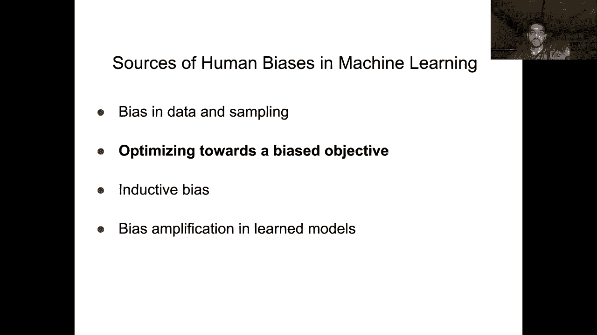

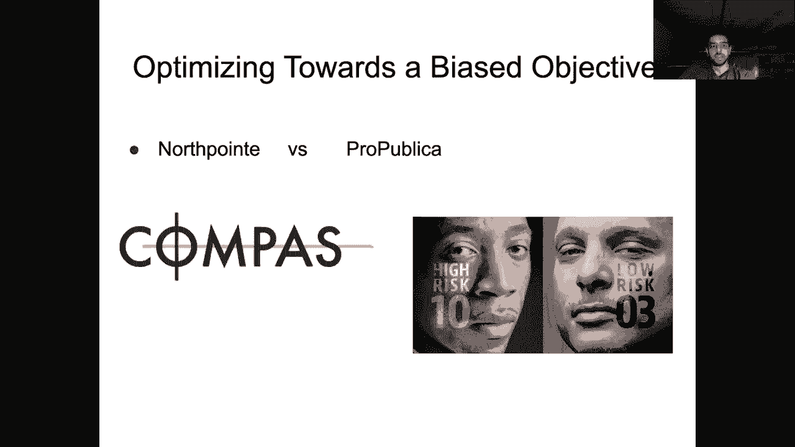

### 🎯 其他数据偏见类型

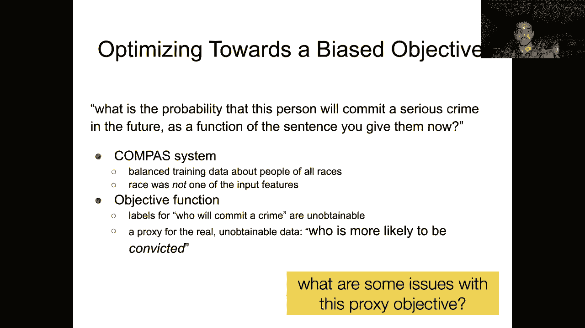

*   **抽样偏见**：即使在为情感分析等任务创建标注数据集时也存在。例如，如果从Yelp爬取评论创建情感数据集，需要了解在Yelp上发帖的人群 demographics（人口统计特征）。美国Yelp用户中，60%受过大学教育，50%年收入超过10万美元。在基于Yelp训练模型时，应该意识到这一点。
*   **报告偏见**：对于常识等现象很重要。人们不会总是陈述“如果我放下杯子，它会掉到地上”这样显而易见的事情。我们更可能谈论令人惊讶、有争议或有趣的事情。这可能影响我们收集的数据类型。
*   **系统偏见**：来自维护在线社交媒体网站或网络论坛的各方，以及各种搜索功能中使用的算法。在某些时候，我们甚至无法知道后台发生了什么，我们只能信任服务提供商。
*   **语言与经济影响**：不同语言社区中存在方言和社会经济影响。英语在Common Crawl等数据集中以及研究社区中占主导地位。我们构建的某些方法可能无法扩展到其他语言，因为那些语言的数据量不足。例如，维基百科文章数量与语言使用者数量的对比图显示，英语的文章数量远远超过其他语言，即使像印地语这样使用人数众多的语言，其维基百科文章数量也少得多。

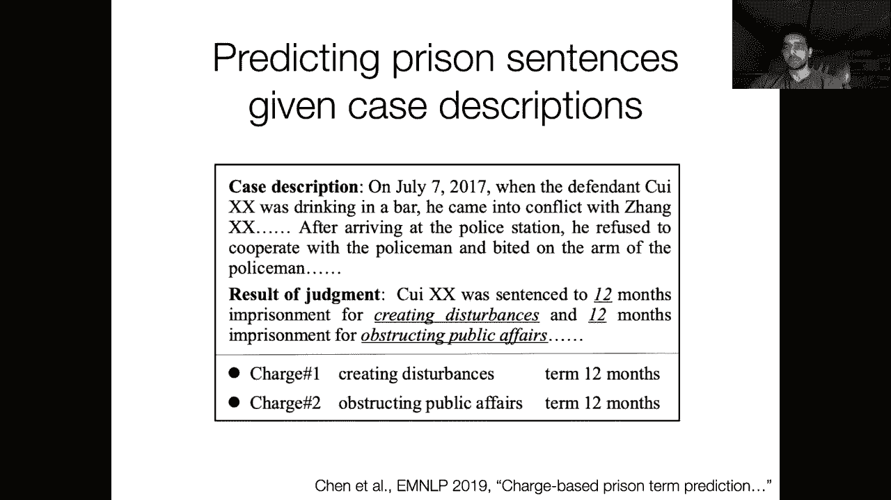

### ⚙️ 目标函数与任务伦理

问题的另一个来源是所使用的**目标函数**。

**COMPAS系统案例**：这是一个试图预测一个人未来是否会犯下严重罪行的机器学习模型。问题在于，你永远无法获得这个任务的真实标签，因为这是未来会发生的事件。他们使用“定罪”作为“犯罪”的代理标签。但司法系统在定罪率上存在种族偏见，因此即使他们试图平衡训练数据，标签本身也与他们试图达成的目标不匹配。这个系统最终被部署并遭到了很多反对。

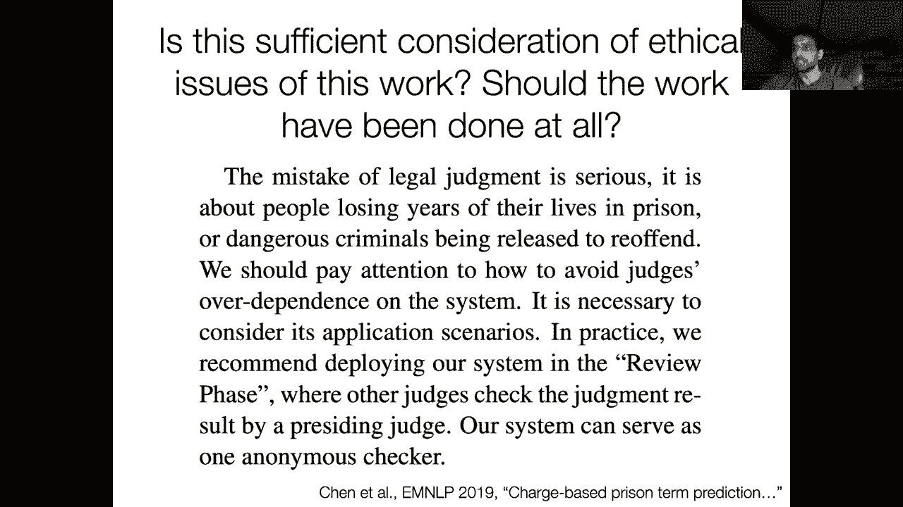

**NLP示例（预测案件指控与刑期）**：去年EMNLP上发表的一篇论文，目标是给定案件描述，预测指控和刑期。作者构建了一个系统，发现它效果一般，但存在很多错误。论文最后有一段关于部署该系统伦理问题的简短段落，指出法律判决的错误是严重的，关乎人们失去多年的自由或危险罪犯被释放。他们建议系统仅作为检查工具在审查阶段使用。

这篇论文发表后引发了大量讨论：这类工作是否应该进行？是否充分考虑了伦理问题？如果系统错误率高达40%，实际部署后可能没人会依赖它。但如果它变得更好呢？法官依赖甚至可能取代法官，这似乎是不对的。

随着我们能够实际解决的任务范围扩大，这类在伦理上存疑的任务数量也在增加。

### 🔤 词嵌入中的偏见

过去几年有很多关于词嵌入偏见的研究。尽管像Word2Vec这样的方法已被BERT等上下文嵌入超越，但相关研究仍然重要。

研究发现，在大量数据上训练的词嵌入中存在类比偏见。例如，“man”的向量减去“woman”的向量，与“computer programmer”的向量减去“homemaker”的向量非常相似。这表明一些刻板印象已经融入了模型的词嵌入中。

观察与“she”和“he”嵌入最接近的职业，也能看到这些刻板印象。

**一种标准的去偏见方法**：
1.  首先识别一个**性别定义词子空间**（如“she”，“he”）。
2.  然后识别**应该性别中立的词**（如“computer programmer”，“doctor”）。
3.  目标是使这些应该性别中立的词远离性别定义子空间。
4.  同时，你希望这种去偏见转换不会过多改变嵌入的语义信息。

在BERT和ELMo等上下文模型中也有人研究去偏见策略。

### 📈 模型偏见放大

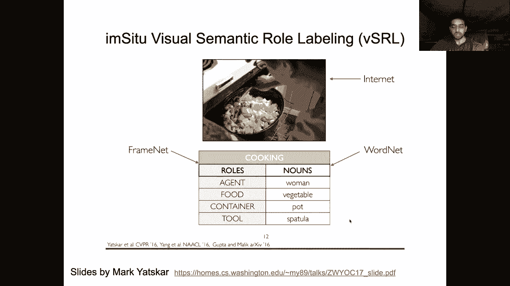

我们讨论了很多数据偏见，但**模型本身**也会对下游任务的偏见产生很大影响。许多模型会进行**偏见放大**：训练数据中可能存在一定程度的偏见，但模型在进行预测时会戏剧性地增加这种偏见。

**论文《Men Also Like Shopping》示例**：这是一个建立在视觉与语言任务上的研究。输入一张图片，需要先识别图片中的活动（如“cooking”），然后识别与该动作相关的各种角色（如谁在做饭、做什么、用什么容器、用什么工具）。

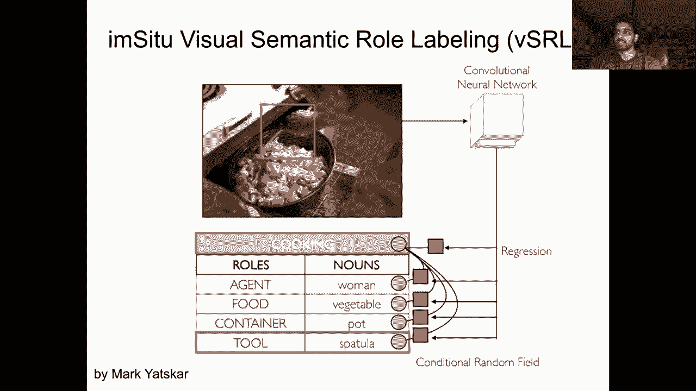

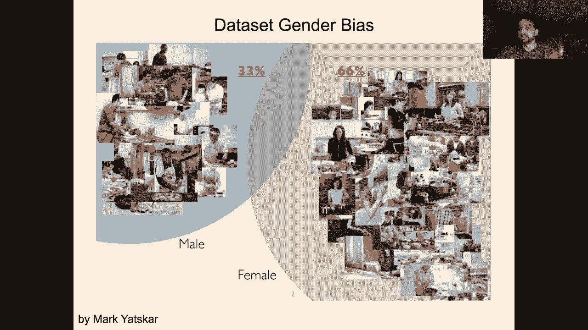

标准解决方案是使用卷积网络表示图像，然后从CNN的输出表示中预测这些内容。在实践中，这是一个结构化预测任务，使用了条件随机场。

**数据偏见**：在数据集中，与“cooking”活动相关的图片，33%涉及男性，66%涉及女性，数据本身存在偏向女性的偏差。

**模型偏见放大**：训练后的模型预测，只有16%的“cooking”例子与男性相关，84%与女性相关。模型学习并放大了数据中的偏见。

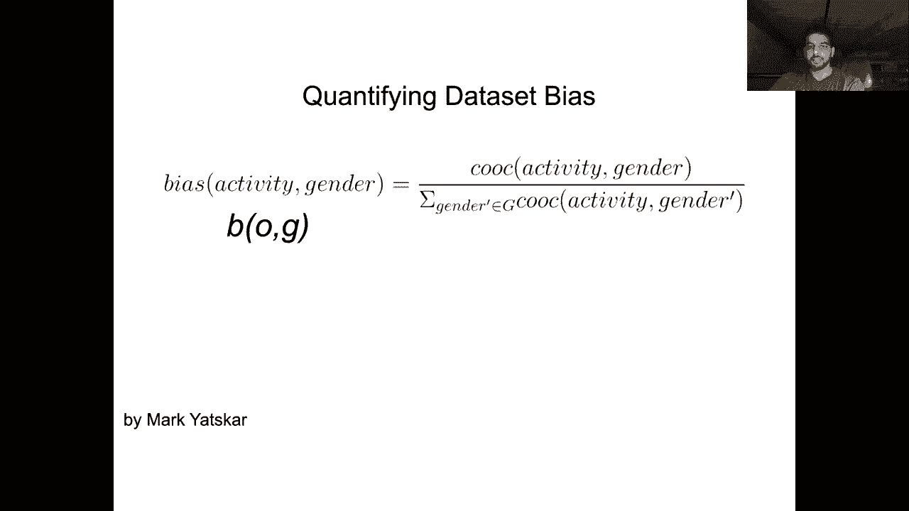

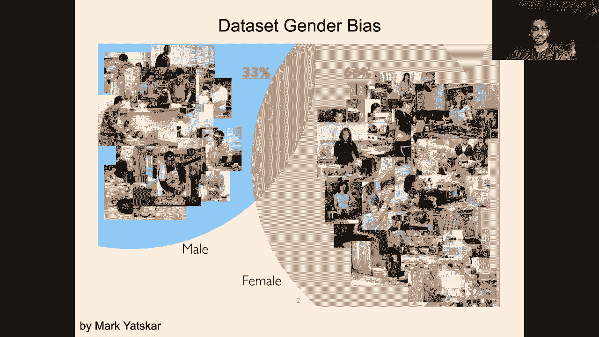

**原因分析**：有两张几乎相同的图片，一张是女孩洗手，另一张是男孩洗手。左边的模型预测是“女人在做饭”，右边的模型预测是“男人在修理水龙头”。除了人物的外观，其他什么都没变，却得到了完全不同的活动预测，而且两个预测都是错误的。这表明模型只是简单地拟合数据中的偏见，而没有真正建模图像的语义。

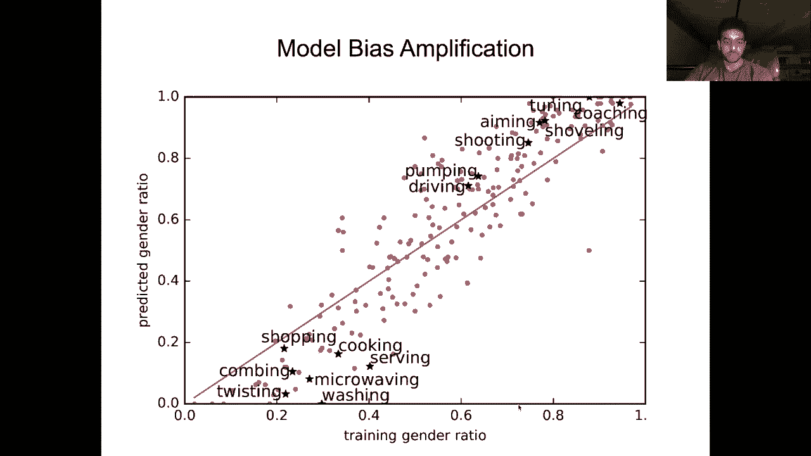

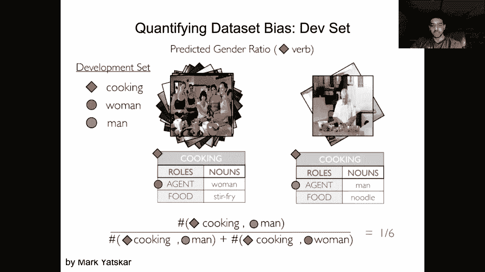

在存在偏见的数据集中，模型可以通过抓住这些简单的偏见而轻易地最小化其目标函数，忽略其他可能相关的信息。

**量化偏见放大**：可以计算特定活动在训练数据中的性别比例（如与烹饪相关的男性数量/总数），以及模型预测中的性别比例。如果预测比例严重偏离训练比例，则说明模型放大了偏见。该论文提出了一种方法来识别并纠正那些严重违反训练性别比例的情况。

---

## 🎯 总结

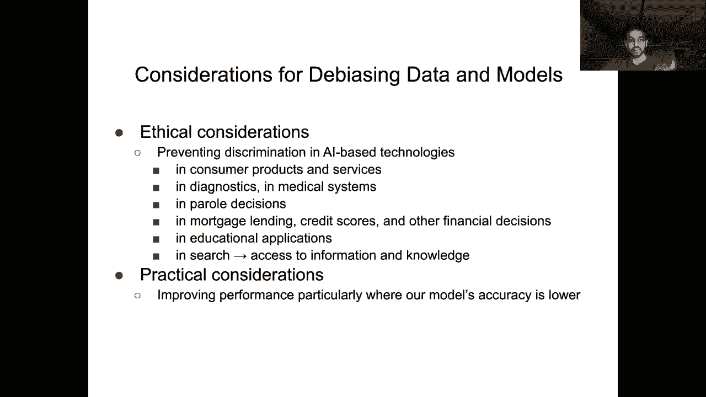

本节课我们一起探讨了NLP中的伦理问题。我们了解到：

1.  **数据**可能包含刻板印象和偏见，其来源（如互联网文本）并不能代表全体人群。
2.  **模型**不仅会学习数据中的偏见，还可能放大这些偏见。
3.  **研究人员和业界人士**可能没有充分考虑构建新模型、解决新任务或将模型部署到不同人群中的所有潜在后果。
4.  我们当然应该继续改进语言模型，但需要谨慎考虑其部署方式。例如，让一个不完全理解语言的模型在Reddit上发帖或提供建议，可能存在风险，因为它们可能只是在进行复杂的模式匹配，其决策过程难以解释，且可能包含随机性。

在现实场景中应用这些模型时，有许多重要的问题需要思考。