# 📝 课程 P5：最终项目指南

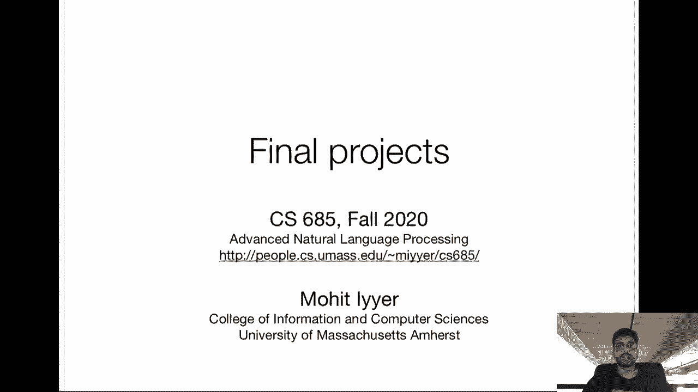

在本节课中，我们将详细介绍自然语言处理课程的最终项目要求。我们将涵盖项目的时间安排、主题选择、评估标准以及如何构思和规划一个成功的项目。

---

## 📅 项目时间线与交付物

上一节我们介绍了课程的整体安排，本节中我们来看看最终项目的具体时间线和需要提交的成果。

首先，项目包含一个组队阶段。如果你想自行组队，必须在 **9月4日** 前提交组队表格。对于其他同学，我们将在 **9月7日** 前通知分组结果。

项目共有两个主要交付物：
1.  **项目提案**：一份2到4页的报告，需使用我们将在Overleaf上提供的模板。提案将于 **9月21日** 截止提交。
2.  **最终报告**：一份至少12页的报告，将于 **12月4日** 截止提交。

本学期我们简化了流程，取消了中期里程碑报告。但请注意，不要将所有工作拖延到期末。从最终报告中，我们能轻易分辨出哪些小组投入了持续努力，哪些小组临时抱佛脚。报告要求至少12页，如果内容空洞、堆砌字数，会非常明显。

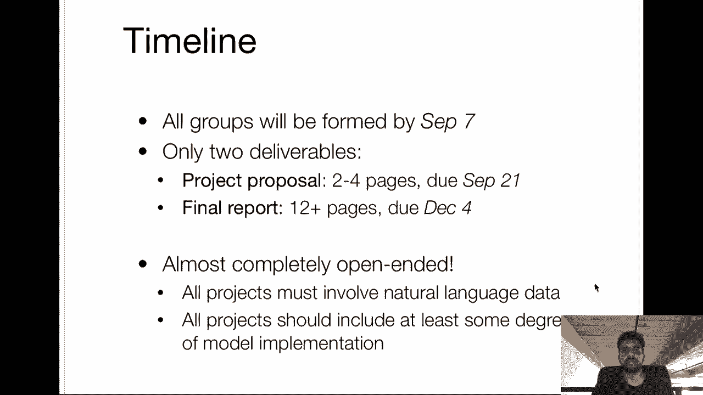

---

## 🎯 项目主题与核心要求

了解了时间线后，我们来看看项目主题的选择范围和核心要求。

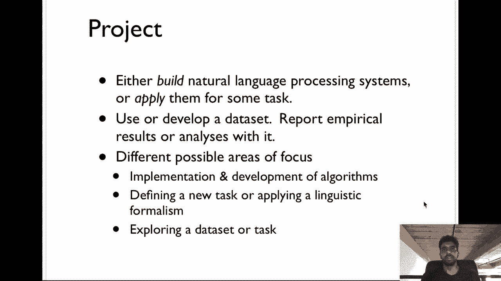

项目主题几乎是完全开放的，但必须满足两个基本条件：
1.  所有项目都必须以某种方式涉及**自然语言数据**。
2.  所有项目都必须包含**一定程度的模型实现或实验**。

这并不是说项目的大部分精力都必须放在建模上。你可以提议收集新数据、复现现有研究或分析现有模型。但无论如何，你都需要进行一些建模工作。

以下是几个例子，说明如何将建模融入不同类型的项目：
*   **如果你收集了新数据集**：需要在你的数据上运行一些模型，以展示当前NLP系统的表现。
*   **如果你要复现现有模型**：需要自己实现它们。
*   **如果你要分析现有模型**：至少需要运行现有模型，并可能编写一些探测任务来理解模型的内部机制。

我们鼓励任何有创意的项目，包括那些以标注或人工分析为主的工作。在当前的学术环境下，这类研究可能与基于建模的研究同等甚至更为重要。因此，不要觉得必须选择实现密集型项目，只需记住，你需要在数据上展示一些模型的结果。

---

## 💡 如何构思与规划项目

对于研究经验有限，尤其是没有NLP背景的同学来说，提出项目想法可能具有挑战性。

通常，开始一个新研究项目时，你需要了解该领域已有的工作。这是一个进行文献综述的好时机。你可以查阅第一次作业中链接的会议论文集，使用Google Scholar进行搜索，全面了解你感兴趣领域的当前研究水平、面临的挑战，以及你的项目将如何应对这些挑战。

确定研究问题和现有工作后，你需要规划小组将进行的实验，以回答这个研究问题或应对已识别的挑战。进行实验当然需要评估方法。

以下是规划实验时需要考虑的评估方式：
*   **对于建模类项目**：你可能会使用准确率（`accuracy`）或困惑度（`perplexity`）等自动指标。
*   **对于自动指标不适用或不可靠的项目**：你需要设计一套人工评估实验。
*   **对于收集新数据集的项目**：你需要向读者证明数据集的高质量，例如展示标注者间一致性，或对数据进行细粒度分析，以显示其包含了现有数据集中未出现的有趣新现象。

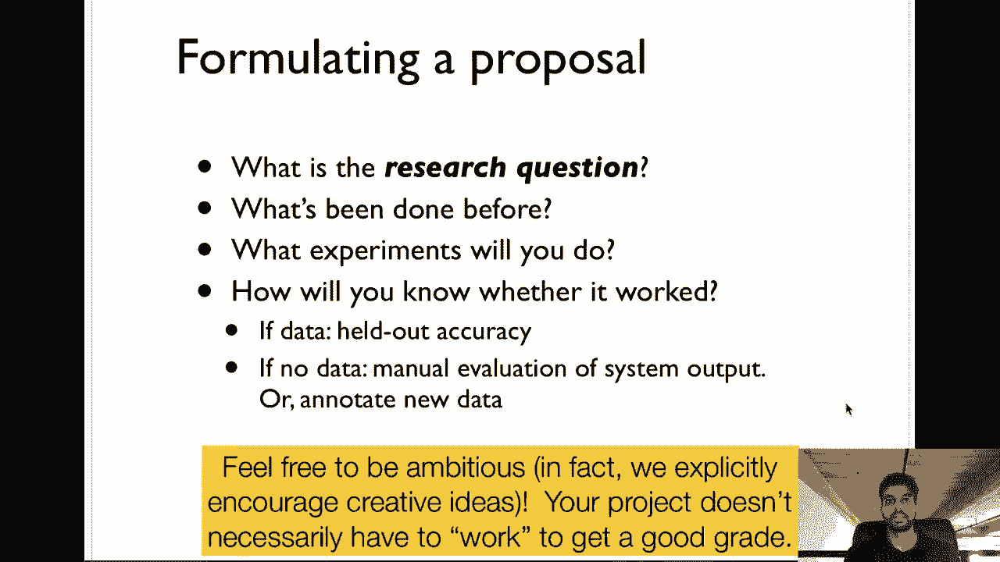

这些深入的思考都应体现在你的项目提案中，以表明你对想法进行了充分的考量。

请自由地设定雄心勃勃的目标。我们明确鼓励那些并非对现有工作进行无聊扩展的项目。一个重要原则是：**项目不一定要成功才能获得好成绩**。评分更多基于你投入的努力程度。当然，如果你投入了大量精力但误在测试集上训练，也不会获得好成绩。然而，在研究中，提出新模型但效果不佳的情况时有发生，这并非获得A等的先决条件。

我们真正看重的是：你投入了大量时间和精力；仔细分析了数据；密切检查了模型输出以了解其错误类型；并且即使项目未达预期，也对未来的改进方向有清晰的认识。

---

## ❓ 项目提案自检清单

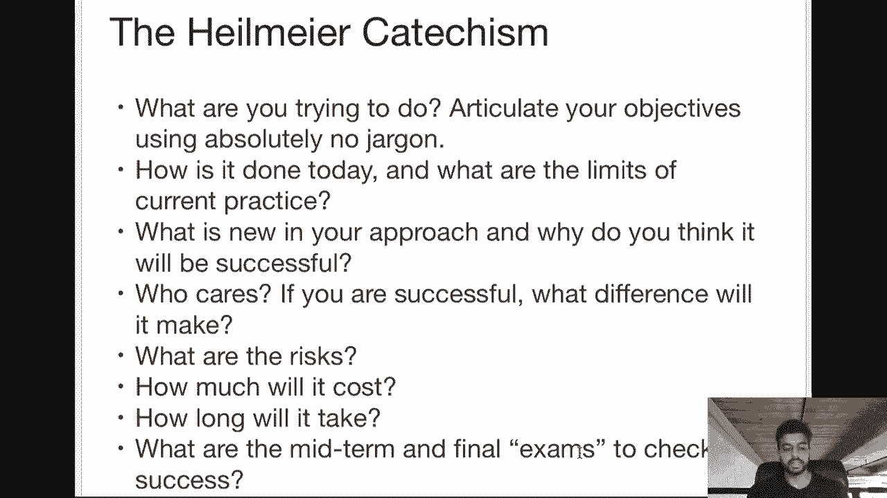

为了帮助大家更好地构思和规划项目，我们可以参考“海迈耶教义问答”。这是一系列在构思项目提案时值得自问的问题，也是组织提案结构的绝佳提示。

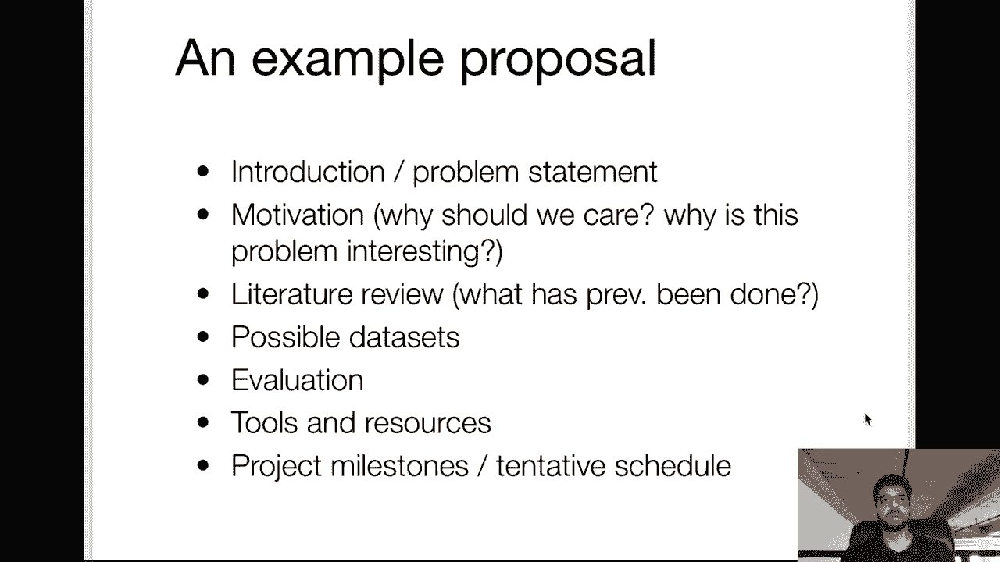

以下是提案中应涵盖的几个核心部分，对应着需要回答的关键问题：
1.  **目标**：你试图做什么？请用通俗易懂的语言清晰阐述，避免专业术语。
2.  **背景与相关工作**：过去是如何解决这个问题的？现有方法的局限性是什么？
3.  **方法**：你的方法有什么新意？为什么你认为这是个好主意？
4.  **影响与风险**：如果成功，会产生什么影响？项目存在哪些明显风险？
5.  **可行性**：项目是否能在约三个月内合理完成？请设定一些中期里程碑来检查进展。
6.  **资源**：如果涉及标注（如使用Amazon Mechanical Turk），需说明预计成本。对于中等规模的数据收集，我们可以提供部分资金支持。

---

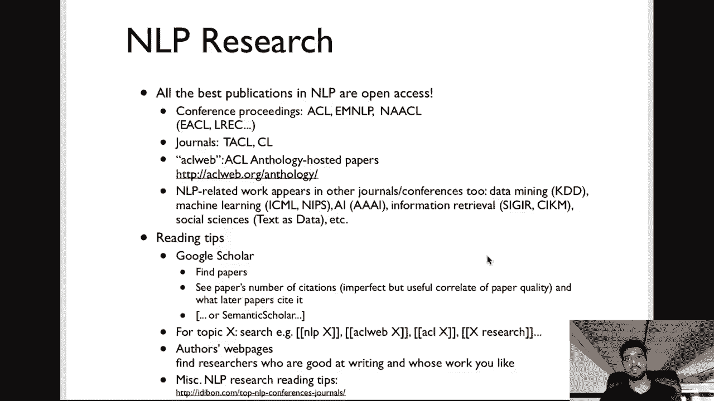

## 🔍 文献调研与资源

上一节我们介绍了提案的结构，本节中我们来看看如何寻找灵感和获取资源。

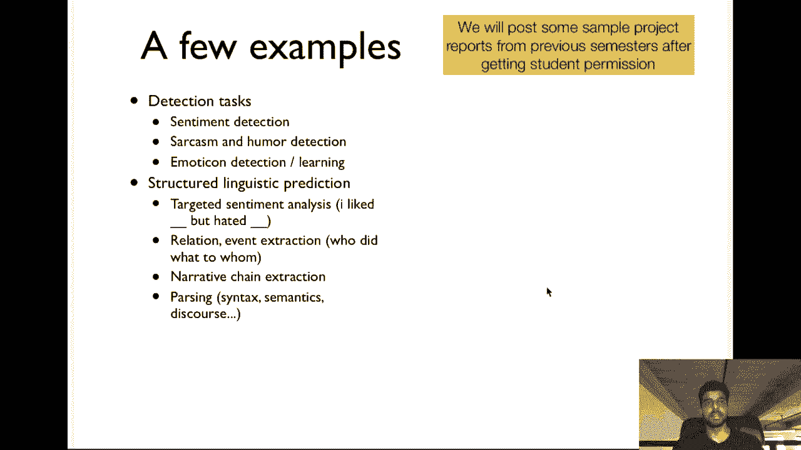

NLP研究主要发表在ACL、EMNLP、NAACL等会议上，这些论文都可以在ACL Anthology上免费公开获取，是进行文献调研的良好起点。此外，ICML、NeurIPS等机器学习会议也包含许多NLP相关研究，可以通过Google Scholar或Semantic Scholar搜索到。

对于具体的项目方向，以下是一些可能的研究问题类型（但绝不限于此）：
*   **检测任务**：如情感分析、讽刺检测、情绪识别。
*   **结构化预测任务**：如实体/事件抽取、关系抽取、句法解析（`syntactic parsing`）。
*   **文本生成任务**：如机器翻译、文本摘要、故事生成、风格迁移。
*   **问答与对话系统**：开发基于神经网络的问答或对话系统。
*   **数据探索与创建**：数据可视化、创建新数据集、甚至定义新任务。

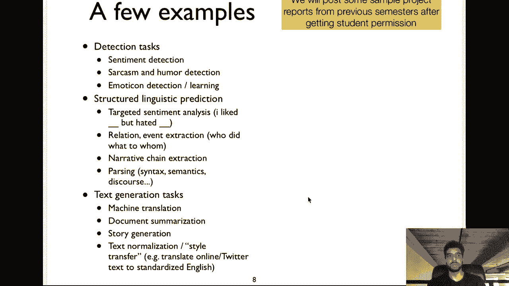

我们将争取获得往届优秀项目报告的许可，作为示例供大家参考，以明确我们的期望。

---

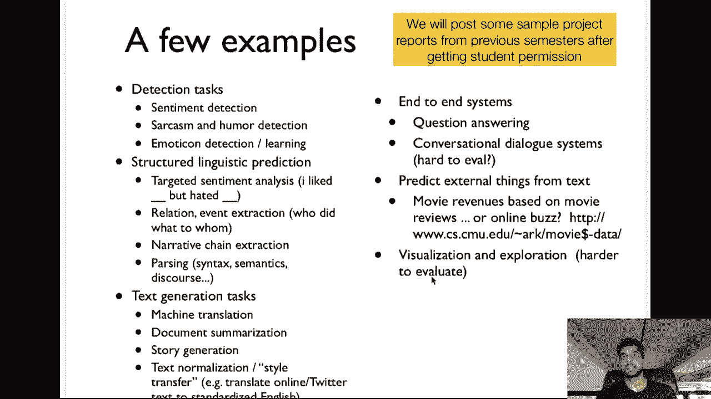

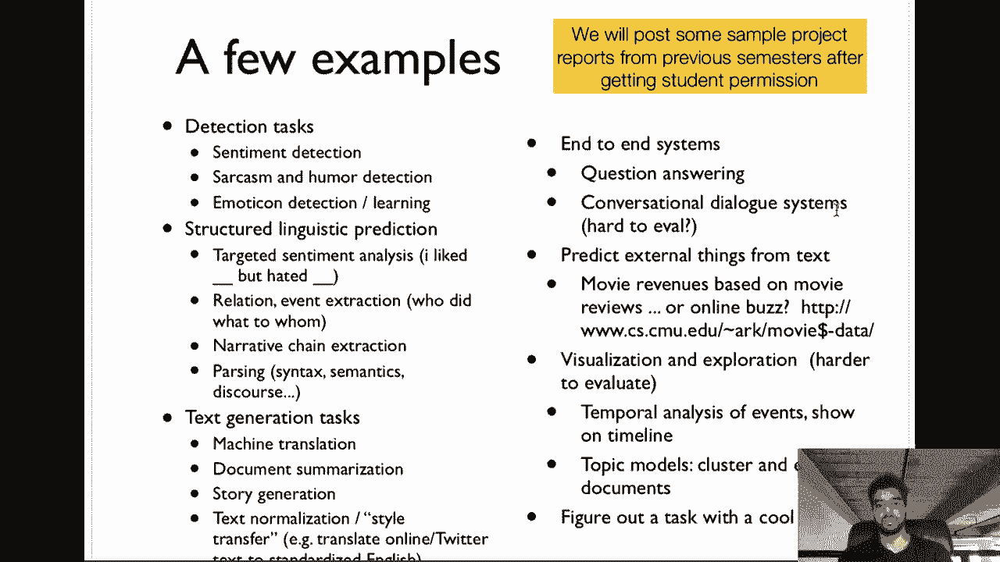

## 🛠️ 可用数据与工具

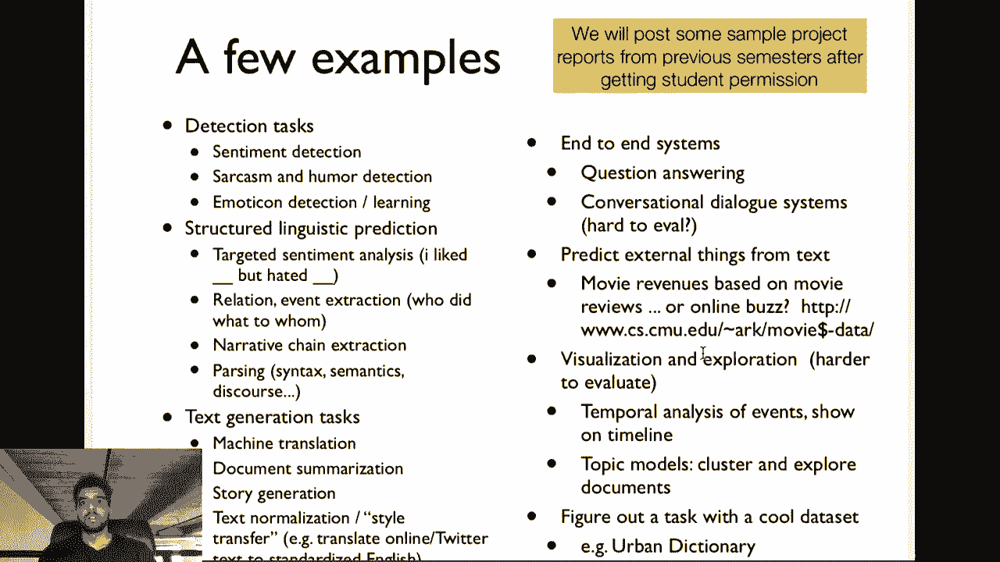

确定了方向后，你需要获取数据和工具来实现项目。

所有项目都必须使用文本数据。如果你不想自己创建数据，大多数NLP数据集都是公开可用的。例如，每年SemEval等评测任务会发布各种数据集；Project Gutenberg提供大量文学作品；还有电影评论、Yelp点评、Common Crawl网页文本、Reddit帖子或Twitter推文等。

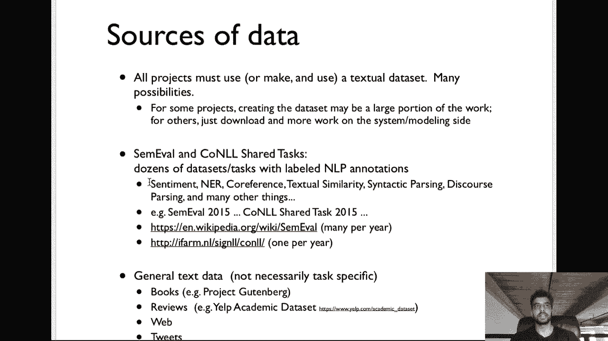

以下是常用的工具推荐：
*   **基础NLP处理**：对于英文，强烈推荐SpaCy。Stanford CoreNLP支持多种语言。
*   **领域特定工具**：对于Twitter等特定领域的数据，有专门优化的工具。
*   **神经网络框架**：课程中使用PyTorch。AllenNLP是一个针对NLP的便捷库。Google TensorFlow也可用，但研究用途上PyTorch更流行。
*   **开发环境**：Google Colab是训练模型的绝佳资源，虽然有12小时运行限制，但对于非大规模训练来说完全足够，往届许多小组都成功使用过。

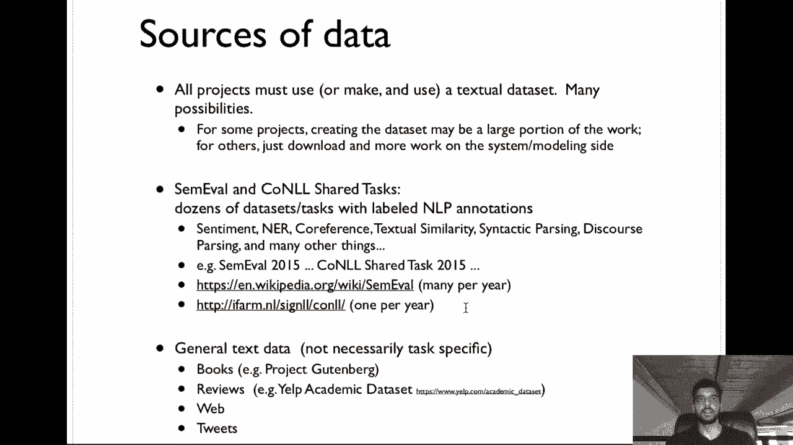

---

## 📚 总结

本节课中，我们一起学习了最终项目的完整指南。

我们明确了项目的时间线，包括组队、提案和最终报告的截止日期。我们讨论了项目的核心要求：必须涉及自然语言数据并包含模型实验，但鼓励各种创意形式。我们深入探讨了如何构思项目，从文献调研、定义研究问题到规划实验和评估方法。我们还介绍了用于自检提案的“海迈耶教义问答”框架，列举了潜在的项目方向，并提供了公开数据源和实用工具的建议。

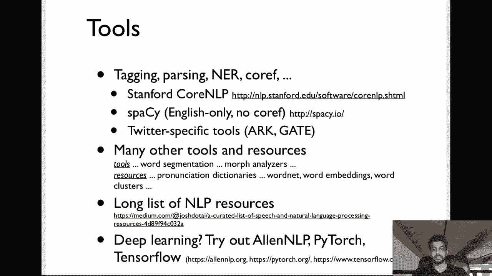

记住，成功的项目关键在于持续的投入、清晰的规划和深入的分析，而不仅仅是最终的结果。祝大家项目顺利！