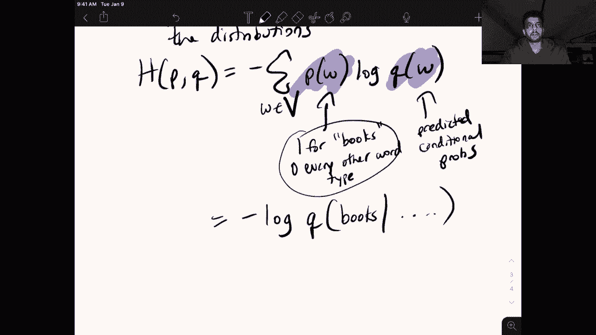
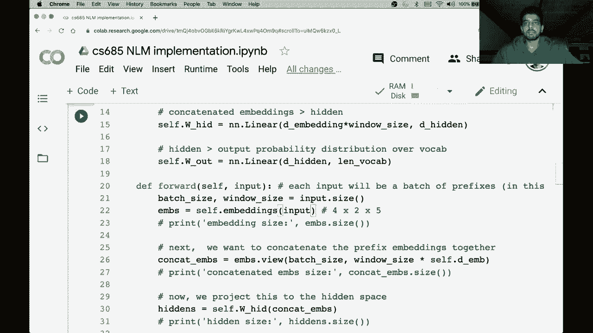

# P6：L4 - 在 PyTorch 中实现神经语言模型 🧠

在本节课中，我们将学习如何在 PyTorch 中实现一个神经语言模型。我们将从理解其核心的损失函数——交叉熵损失开始，然后逐步构建一个简单的固定窗口神经语言模型，并在一个微型数据集上进行训练和评估。

## 概述：神经语言模型与损失函数

神经语言模型将预测下一个单词的任务视为一个分类问题。给定一个前缀（如前两个词），模型需要从整个词汇表中预测出最可能的下一个词。这是一个大规模分类任务，因此我们需要一个合适的损失函数来衡量模型预测的好坏。我们将使用交叉熵损失函数。

上一节我们介绍了神经语言模型的基本概念，本节中我们来看看其核心的损失函数。

### 交叉熵损失函数

交叉熵损失函数衡量的是模型预测的概率分布与真实分布（即训练数据）之间的“距离”。在神经语言模型中，真实分布通常是一个“独热编码”向量，即正确单词的概率为1，其他单词的概率为0。

交叉熵损失的定义如下：

**公式：**
`CrossEntropy(P, Q) = - Σ (P(w) * log Q(w))`

其中：
*   `P` 是真实的概率分布（在我们的例子中是独热编码）。
*   `Q` 是模型预测的概率分布。
*   求和是针对词汇表中的所有单词 `w`。




由于真实分布 `P` 只在正确单词处为1，其他位置为0，因此上述求和实际上简化为：

**公式：**
`Loss = - log Q(w_correct)`

这正是我们希望最小化的**负对数似然**。我们希望模型对正确单词 `w_correct` 赋予的概率 `Q(w_correct)` 尽可能高，从而使负对数损失尽可能低。

## 实战：构建一个简单的神经语言模型

理解了损失函数后，我们现在转向代码实现。我们将在一个 Google Colab 笔记本中，使用 PyTorch 构建一个简单的固定窗口神经语言模型。

### 数据准备

首先，我们需要准备数据。这包括将文本句子进行分词，并将单词转换为模型可以处理的索引。

以下是数据预处理步骤：

1.  **定义示例句子**：我们使用几个简短的句子作为训练数据。
2.  **构建词汇表**：遍历所有句子，为每个独特的单词类型分配一个唯一的索引。
3.  **将句子转换为索引序列**：根据词汇表，将每个句子从单词列表转换为对应的索引列表。
4.  **创建输入（前缀）和输出（标签）**：对于每个句子，我们取前 `n-1` 个词作为输入前缀，最后一个词作为要预测的标签。
5.  **转换为 PyTorch 张量**：将列表转换为 PyTorch 的 `LongTensor` 类型，以便后续用于模型。

**代码：数据预处理**
```python
import torch

# 1. 示例数据
sentences = [
    “Bob likes sheep”,
    “Alice is fast”,
    “CS685 is fun”,
    “I love NLP”
]

# 2. & 3. 构建词汇表并将句子索引化
vocab = {}
inputs = []
for sent in sentences:
    sent_idxs = []
    for word in sent.split(): # 简单空格分词
        if word not in vocab:
            vocab[word] = len(vocab) # 分配新索引
        sent_idxs.append(vocab[word])
    inputs.append(sent_idxs)

print(“词汇表:”, vocab)
print(“索引化后的句子:”, inputs)

# 4. 创建前缀和标签
window_size = 2 # 假设使用前两个词预测第三个词
prefixes = [sent[:window_size] for sent in inputs]
labels = [sent[-1] for sent in inputs]

# 5. 转换为张量
prefixes = torch.LongTensor(prefixes)
labels = torch.LongTensor(labels)

print(“前缀张量:”, prefixes)
print(“标签张量:”, labels)
```

### 定义模型架构

接下来，我们定义模型本身。在 PyTorch 中，我们通过继承 `nn.Module` 类并实现 `__init__` 和 `forward` 方法来构建网络。

以下是模型的关键组件：

1.  **词嵌入层** (`nn.Embedding`)：将输入的单词索引映射为稠密的向量表示。
2.  **隐藏层** (`nn.Linear`)：将拼接后的词嵌入向量投影到一个隐藏表示空间。
3.  **输出层** (`nn.Linear`)：将隐藏表示投影到词汇表大小的空间，得到每个单词的“分数”（logits）。

**代码：定义神经语言模型类**
```python
import torch.nn as nn

class NeuralLanguageModel(nn.Module):
    def __init__(self, vocab_size, d_embedding, d_hidden, window_size):
        super(NeuralLanguageModel, self).__init__()
        self.embeddings = nn.Embedding(vocab_size, d_embedding)
        self.whi = nn.Linear(d_embedding * window_size, d_hidden) # 拼接后到隐藏层
        self.wout = nn.Linear(d_hidden, vocab_size) # 隐藏层到输出

    def forward(self, inputs):
        # inputs 形状: (batch_size, window_size)
        batch_size = inputs.size(0)

        # 1. 获取词嵌入
        embs = self.embeddings(inputs) # 形状: (batch_size, window_size, d_embedding)

        # 2. 拼接词嵌入
        concat_embs = embs.view(batch_size, -1) # 形状: (batch_size, window_size * d_embedding)

        # 3. 前向传播到隐藏层和输出层
        hidden = self.whi(concat_embs) # 形状: (batch_size, d_hidden)
        logits = self.wout(hidden)     # 形状: (batch_size, vocab_size)

        return logits # 返回未归一化的分数

# 实例化模型
vocab_size = len(vocab)
d_embedding = 5
d_hidden = 12
window_size = 2

model = NeuralLanguageModel(vocab_size, d_embedding, d_hidden, window_size)
print(model)
```

### 训练模型

现在，我们设置训练循环来优化模型参数。训练过程包括以下步骤：

1.  **定义超参数**：训练轮数（epochs）和学习率（learning rate）。
2.  **定义损失函数和优化器**：使用 `nn.CrossEntropyLoss`（它内部组合了 LogSoftmax 和 NLLLoss）和随机梯度下降优化器 `torch.optim.SGD`。
3.  **训练循环**：
    *   前向传播计算预测（logits）。
    *   计算损失（预测 logits 与真实标签）。
    *   反向传播计算梯度（`loss.backward()`）。
    *   优化器更新参数（`optimizer.step()`）。
    *   清空梯度，为下一轮做准备（`optimizer.zero_grad()`）。

**代码：训练循环**
```python
# 1. 超参数
epochs = 100
learning_rate = 0.1

# 2. 损失函数和优化器
criterion = nn.CrossEntropyLoss()
optimizer = torch.optim.SGD(model.parameters(), lr=learning_rate)

# 3. 训练循环
for epoch in range(epochs):
    # 前向传播
    logits = model(prefixes)

    # 计算损失
    loss = criterion(logits, labels)

    # 反向传播和优化
    optimizer.zero_grad() # 清空历史梯度
    loss.backward()       # 反向传播，计算当前梯度
    optimizer.step()      # 根据梯度更新参数

    # 打印训练信息
    if (epoch + 1) % 10 == 0:
        print(f‘Epoch [{epoch+1}/{epochs}], Loss: {loss.item():.4f}’)

print(‘训练完成！’)
```

### 评估模型

训练完成后，我们可以检查模型是否学会了预测。我们将一个前缀（例如“Bob likes”）输入模型，查看它预测的下一个单词及其概率。

**代码：使用模型进行预测**
```python
# 构建从索引回单词的映射
rev_vocab = {idx: word for word, idx in vocab.items()}

# 选择要测试的前缀，例如 “Bob likes”
test_prefix_idx = prefixes[0] # 对应 “Bob likes”
# 需要增加一个批次维度
test_input = test_prefix_idx.unsqueeze(0) # 形状从 (2) 变为 (1, 2)

# 模型预测
with torch.no_grad(): # 不计算梯度，节省内存
    logits = model(test_input)
    probabilities = torch.softmax(logits, dim=1) # 将 logits 转换为概率

# 获取预测结果
pred_prob, pred_idx = torch.max(probabilities, dim=1)
predicted_word = rev_vocab[pred_idx.item()]

print(f“给定前缀 ‘{‘ ‘.join([rev_vocab[idx.item()] for idx in test_prefix_idx])}’：“)
print(f“  模型预测下一个词是 ‘{predicted_word}’，概率为 {pred_prob.item():.4f}”)
# 期望输出：模型预测下一个词是 ‘sheep’，概率接近 1.0
```

## 总结

本节课中我们一起学习了神经语言模型在 PyTorch 中的完整实现流程。

1.  **核心概念**：我们首先理解了交叉熵损失函数，它是衡量模型预测概率分布与真实分布之间差异的标准方法，在分类任务中至关重要。
2.  **数据流程**：我们学会了如何将原始文本处理成模型可用的格式，包括构建词汇表、索引化以及创建输入输出对。
3.  **模型构建**：我们定义了一个简单的固定窗口前馈神经网络，它包含嵌入层、隐藏层和输出层。
4.  **训练过程**：我们设置了训练循环，利用交叉熵损失和梯度下降优化器，通过多次迭代来更新模型参数，使损失不断降低。
5.  **模型评估**：训练结束后，我们通过输入具体前缀来观察模型的预测结果，验证其是否学会了训练数据中的规律。



这个实现虽然简单，但它涵盖了现代神经语言模型的核心要素：从离散符号到连续向量的嵌入、通过神经网络进行组合、以及基于梯度下降的端到端训练。在接下来的课程中，我们将探讨更强大的模型架构，如循环神经网络和 Transformer，它们能够处理更长的序列并捕捉更复杂的语言模式。