# P7：L5- 注意力机制 🧠

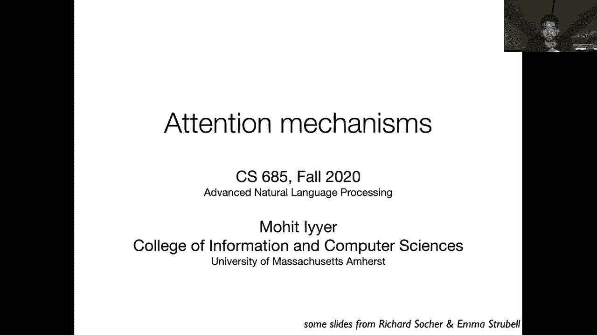

在本节课中，我们将学习注意力机制这一现代自然语言处理系统的核心构建模块，特别是驱动Transformer模型的自注意力机制。我们将从循环神经网络的背景引入注意力机制，然后转向自注意力机制，并解释其如何解决传统模型的一些关键问题。

## 课程安排与回顾

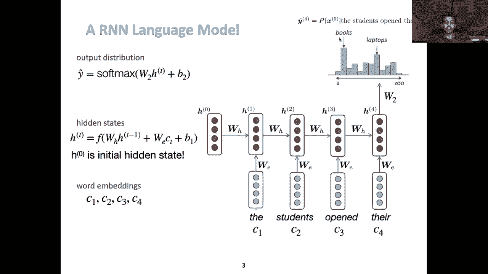

上一节我们介绍了循环神经网络语言模型。在深入新内容之前，先回顾一下课程安排。

*   作业0的提交现已截止，评分将于下周完成。
*   作业1将在未来几周内发布，其目的是让大家熟悉在迁移学习背景下使用神经语言模型，这是我们下周的主题。
*   所有最终项目的小组分配现已确定，项目提案截止日期为9月21日。如果你对当前想法或可行性有疑问，强烈建议参加答疑时间。

## 循环神经网络语言模型的回顾与局限

上一节我们介绍了循环神经网络语言模型，它作为固定窗口前馈网络的替代方案，能够从左到右逐词处理序列。每个隐藏状态（如 `H_4`）都包含了预测下一个词所需的所有上下文信息。

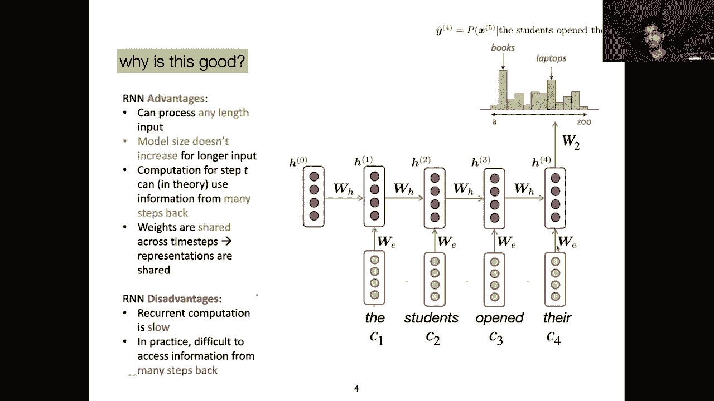

我们使用交叉熵损失来训练这些模型，通过最小化正确词（如“books”）的负对数似然来实现。

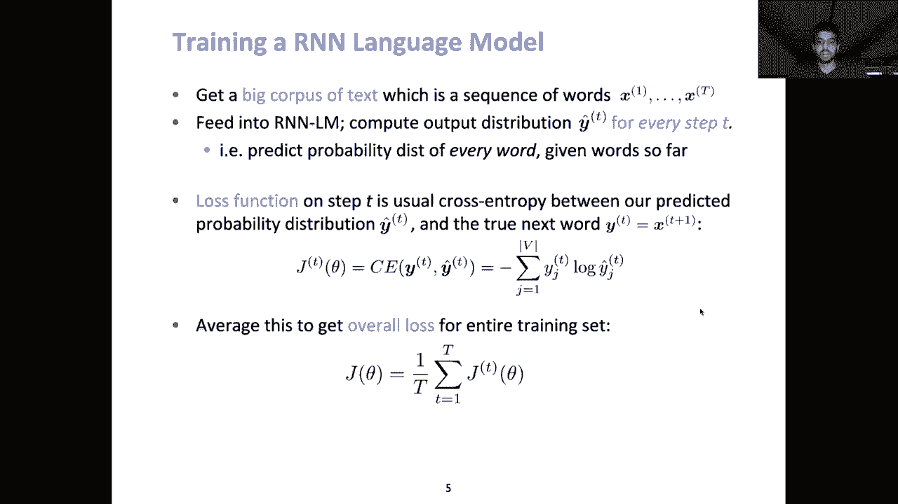

循环神经网络模型具有以下优势：
*   理论上能处理任意长度的上下文，没有窗口大小限制。
*   在所有时间步共享参数（如 `W_H` 和 `W_E`），不会因序列变长而增加参数量。

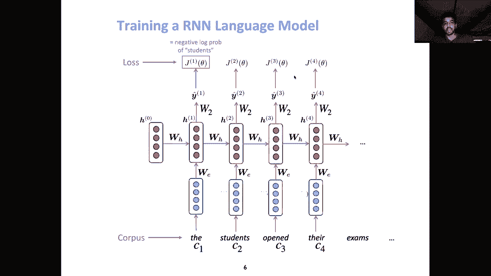

然而，循环神经网络如今已较少使用，主要原因有二：
1.  **训练速度慢**：由于循环计算的依赖性（`H_3` 的计算依赖于 `H_2`，依此类推），无法并行计算所有时间步的隐藏状态。
2.  **远程信息衰减**：尽管理论上能处理长上下文，但实践中模型会过度关注最近的词，而忽略远处的词。这主要是由于**梯度消失问题**——在反向传播中，距离当前预测越远的时间步，其梯度信号会因连续的矩阵乘法而急剧减弱，导致模型难以学习长距离依赖。

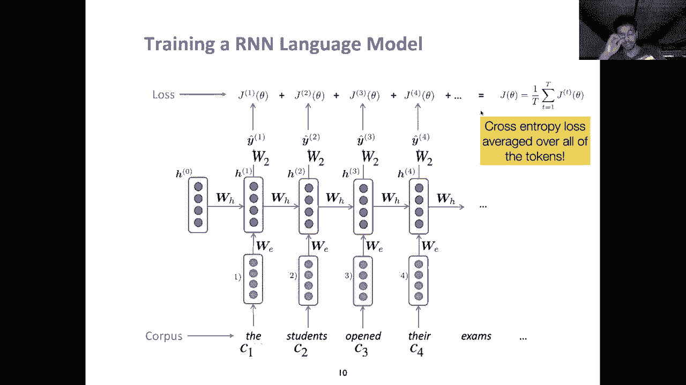

## 循环神经网络语言模型的训练

理解了模型的局限性后，我们来看看如何具体训练循环神经网络语言模型。其训练方式与我们之前学过的固定窗口模型在概念上一致。

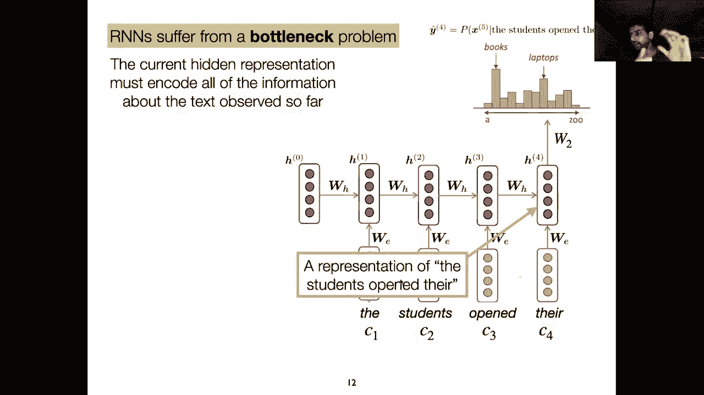

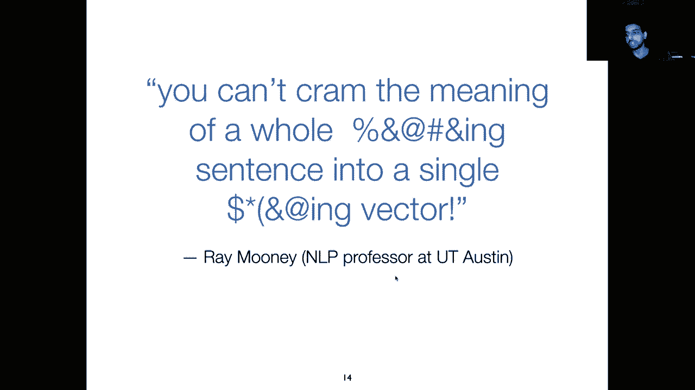

我们仍然使用交叉熵损失。具体而言，对于输入序列（如“the students opened their exams”），模型会在每个时间步（看到前一个词后）使用相同的Softmax层（共享权重 `W_2`）预测下一个词。每个时间步都会产生一个损失（`J_t`），衡量预测下一个真实词的错误程度。

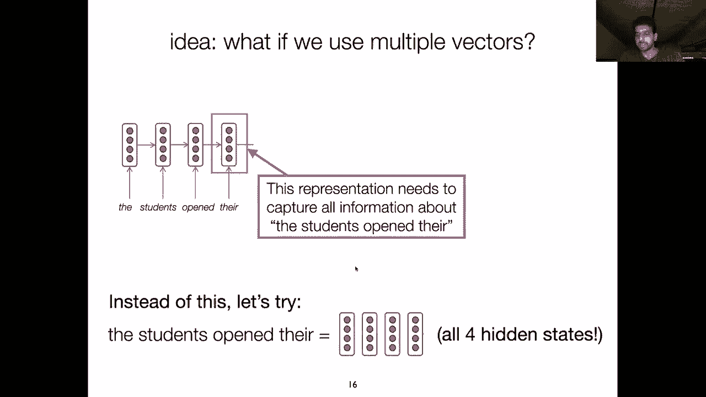

整个序列的总损失是**所有时间步上词级别交叉熵损失的平均值**。在批处理中，损失是批次内所有序列的所有词元损失的平均值。

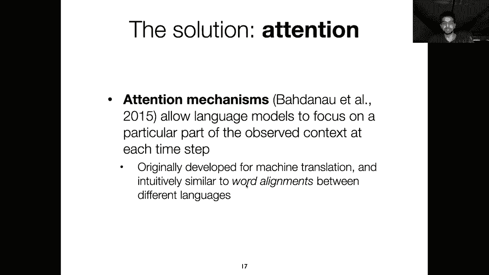

## 注意力机制的动机：解决信息瓶颈

循环神经网络的核心问题在于**信息瓶颈**：它迫使模型将截至当前时间步的**整个上下文信息压缩到单个向量**（即当前隐藏状态）中。对于长序列，这要求过高，模型难以将所有相关信息编码到一个低维向量中。

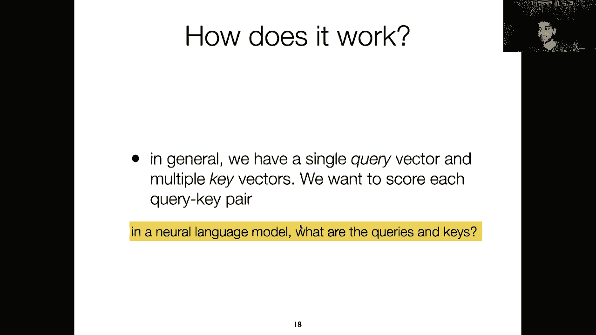

正如Ray Mooney教授那句著名的调侃：“你无法将整个句子的意思塞进一个向量里。”这成为了注意力机制发展的一个动机。

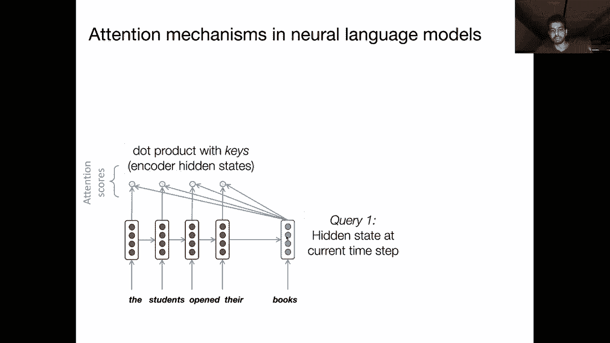

注意力机制的核心思想是：**不再用单个向量表示上下文，而是使用多个向量**。具体来说，我们用一个函数来表示整个短语，该函数以所有先前的隐藏状态为输入，并让它们都有机会为当前短语的表征做出贡献。

## 注意力机制的工作原理

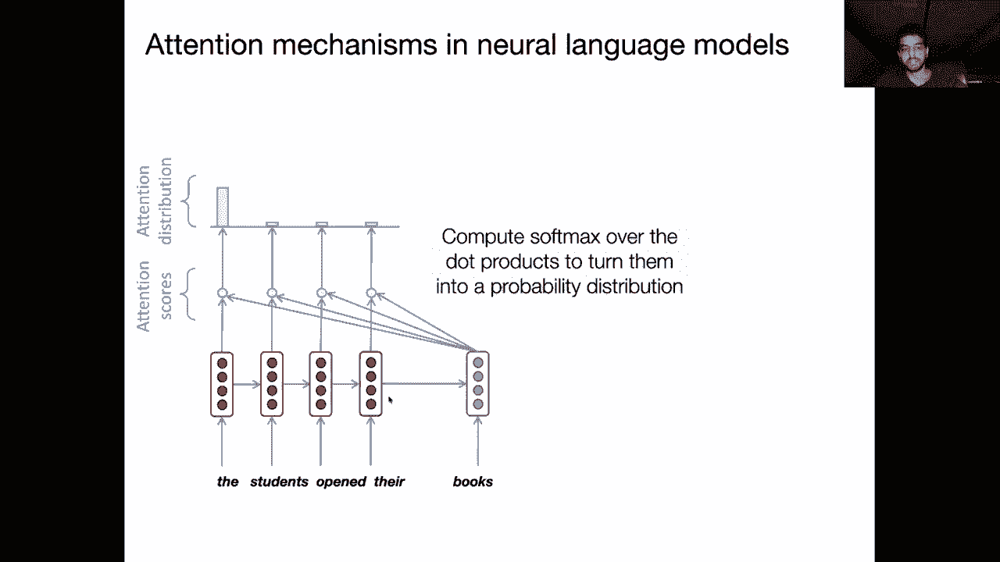

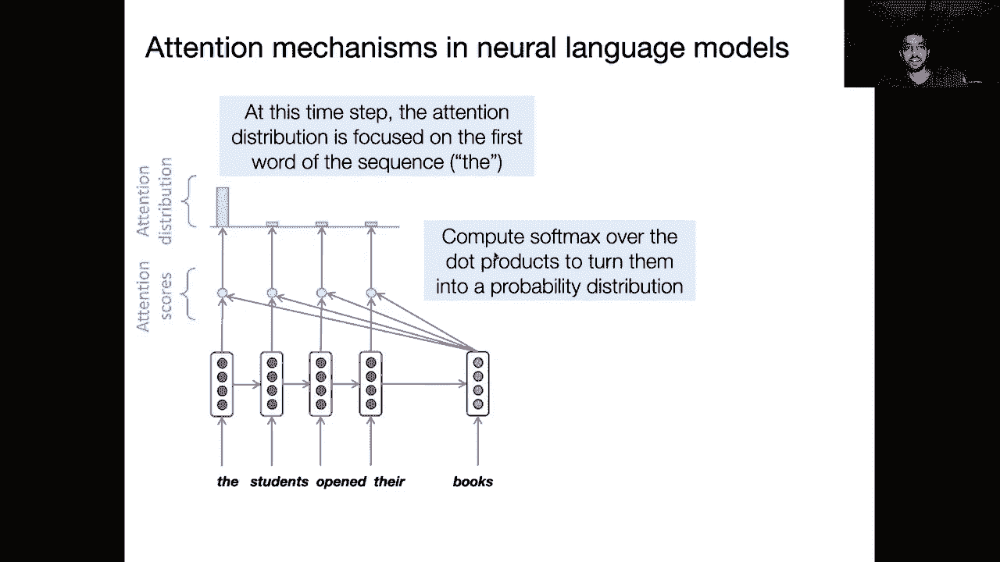

那么，注意力机制具体如何工作呢？它最初是为解决机器翻译中长序列和梯度消失问题而提出的，其直觉类似于词对齐。

以下是注意力机制在神经语言模型中的基本概念：
*   **查询**：当前隐藏状态（我们想基于它做预测的状态）。
*   **键**：所有先前的隐藏状态（我们拥有的上下文信息）。
*   **目标**：使用查询向量为这些键向量打分，以确定每个先前时间步对当前预测的重要性。

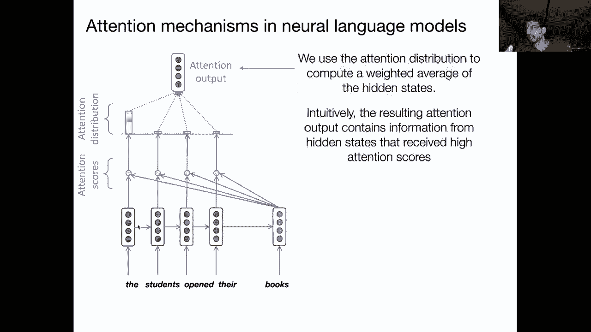

具体步骤如下：
1.  **计算注意力分数**：通过计算查询向量与每个键向量的点积，为每个键获得一个标量分数。这些分数表示每个过去时间步对于预测下一个词的重要性。
2.  **归一化分数**：对这些分数应用Softmax函数，将其转换为一个概率分布（注意力分布）。这使得分数更可解释，并确保权重之和为1。
3.  **计算上下文向量**：使用上一步得到的注意力分布作为权重，对所有的键向量（在自注意力中会演变为值向量）进行加权平均，得到一个新的表示，即**上下文向量**。

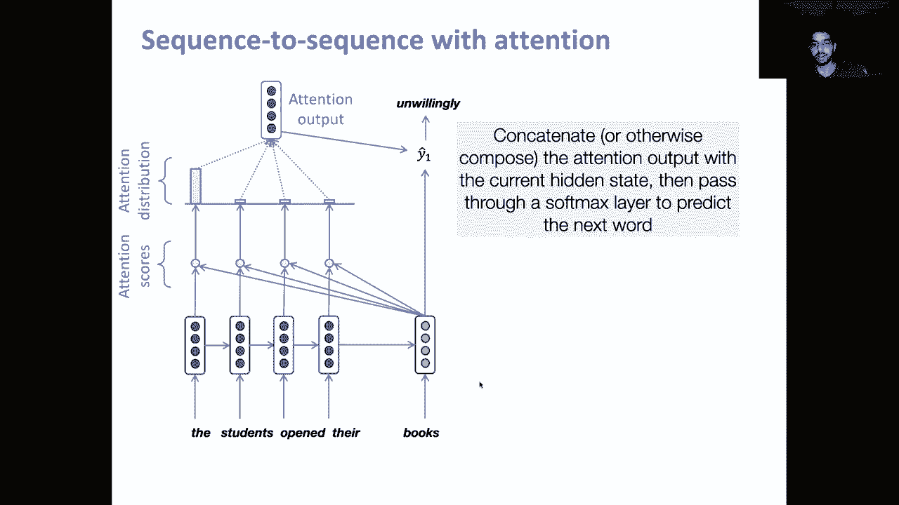

这个上下文向量包含了根据注意力机制筛选出的、与当前查询最相关的历史信息。

## 在RNN中集成注意力

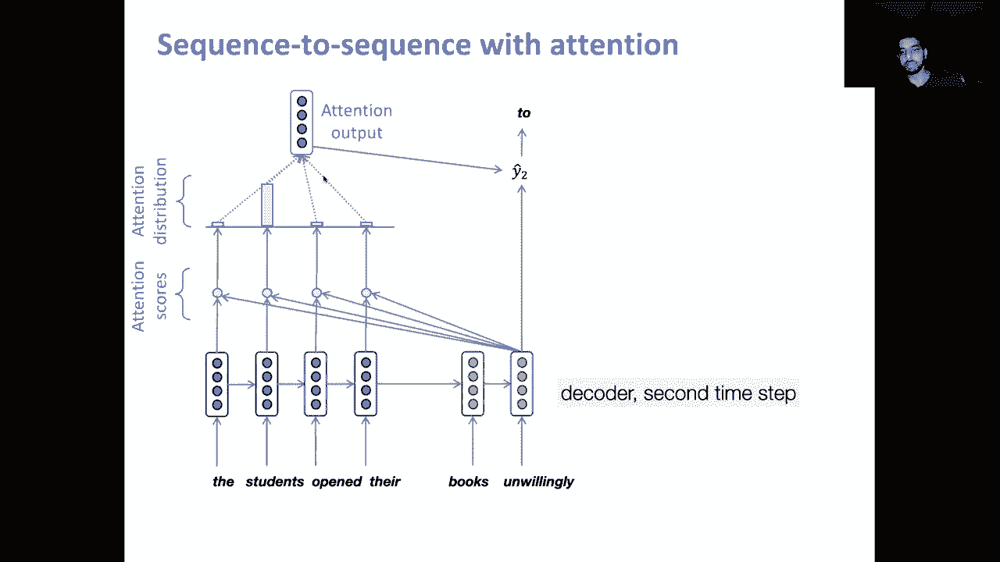

现在，我们有了通过常规循环计算得到的当前隐藏状态（绿色向量），以及通过注意力机制得到的上下文向量（红色向量）。如何将它们结合起来用于最终预测呢？

早期的方法很简单：**将这两个向量拼接起来**。然后将拼接后的向量输入Softmax层，以预测下一个词。预测完一个词后，模型计算下一个隐藏状态，并以这个新状态作为查询，重复上述注意力计算过程，如此循环。

这种设计引出了一个有趣的问题：既然注意力机制如此强大，**我们是否还需要循环计算步骤**？循环步骤导致无法并行计算。如果去掉循环，只依赖注意力，那么所有时间步的表示都可以并行计算。这正是Transformer模型的直觉起点。

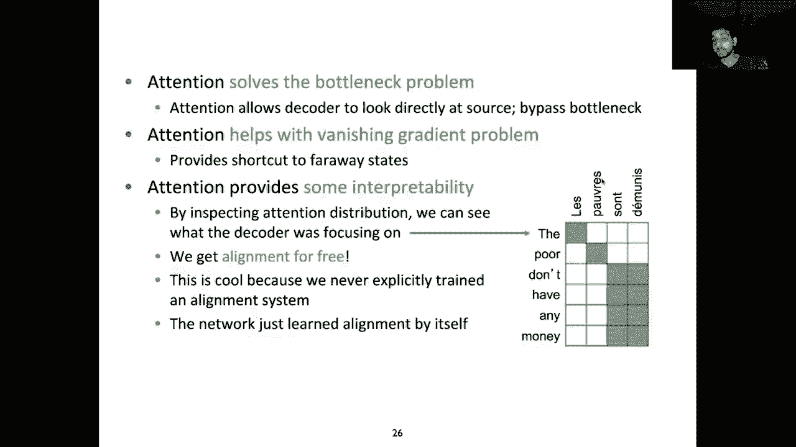

## 注意力机制的优势与变体

让我们总结一下注意力机制在循环神经网络语言模型中的优势：
*   **解决信息瓶颈**：允许模型查看所有先前的词，而不仅仅是压缩到一个向量中。
*   **缓解梯度消失**：当前预测通过注意力函数直接连接到所有先前的隐藏状态，而不仅仅是通过可能衰减的循环连接。
*   **提供一定可解释性**：注意力分布显示了模型在预测时关注了哪些先前的词。但需注意，近期研究表明注意力并不总是模型行为的可靠解释。
*   **捕捉对齐关系**：在机器翻译中，注意力分数可以反映源语言和目标语言之间的词对齐关系。

注意力评分函数有多种变体。原始公式使用一个小型前馈网络。更简单的变体包括：
*   **双线性乘积**：`score(q, k) = q^T W k`
*   **点积**：`score(q, k) = q^T k`
*   **缩放点积**：`score(q, k) = q^T k / sqrt(d_k)` （最常用，用于抵消向量维度对点积数值大小的影响）

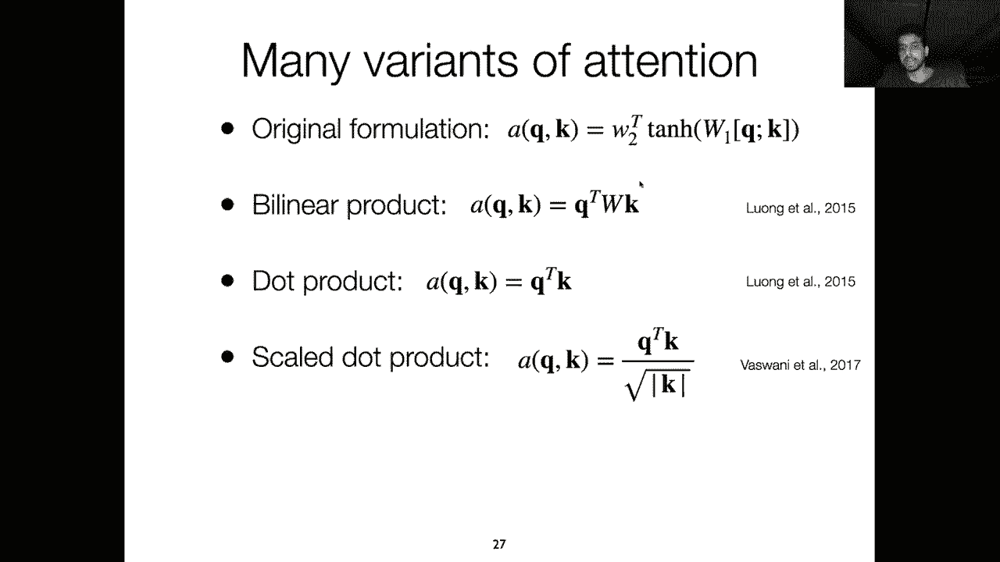

所有这些函数都可以包裹在Softmax中，以得到完整的注意力方程。

## 注意力机制的扩展应用：复制机制

注意力机制还有一个巧妙的应用：**复制机制**。在语言建模中，文档中已出现过的词很可能再次出现。

传统方法通过Softmax在整个词汇表上预测下一个词。对于罕见词（如特定人名“Yellen”），模型可能难以准确预测。复制机制利用注意力分布来“复制”上下文中出现过的词。

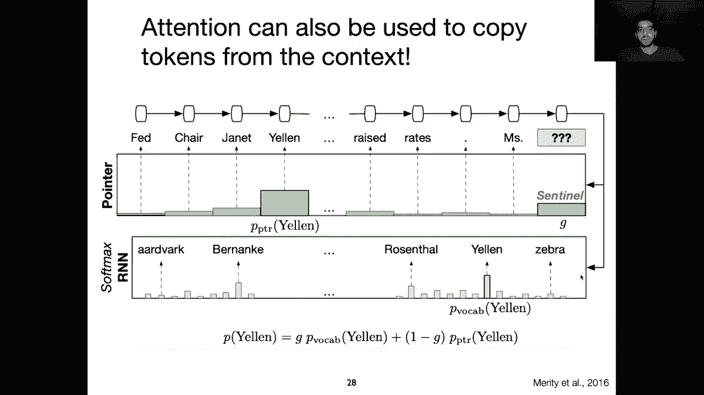

具体来说，模型同时拥有来自Softmax的词汇表分布和来自注意力机制的上下文词分布。复制机制将这两个分布结合起来（例如，通过加权平均），从而提高了模型输出上下文中已出现词语的概率。这使模型能够处理词汇表外的或低频词。

## 自注意力机制

既然注意力如此有效，我们能否完全摒弃循环步骤？**自注意力机制**正是基于这一思想。

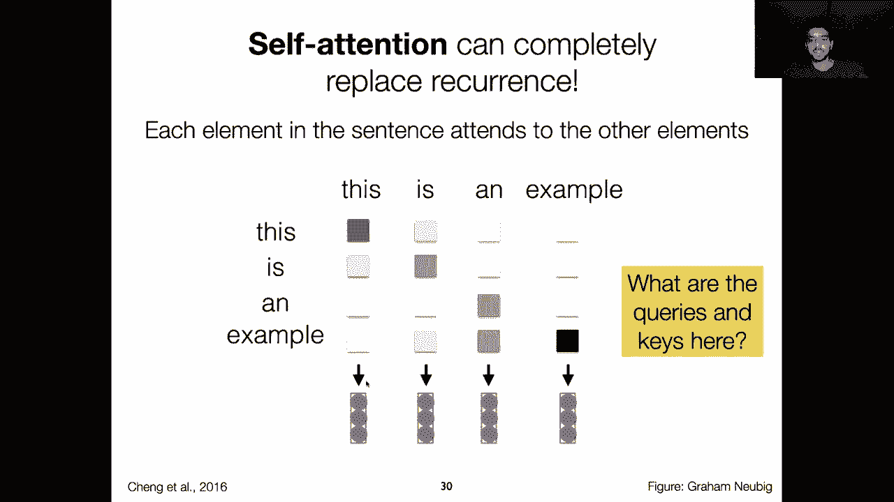

在自注意力中，我们不再有循环连接。句子中的**每个词**都同时作为查询、键和值。每个词的表示完全由它与其他所有词（包括自身）的注意力交互决定。

具体步骤（以Transformer中的缩放点积注意力为例）：
1.  **线性投影**：将每个词嵌入分别投影到三个不同的向量空间：查询向量、键向量和值向量（通过三个不同的权重矩阵）。
2.  **计算注意力分数**：对于每个词（作为查询），计算其查询向量与句子中所有词的键向量的点积（通常进行缩放）。
3.  **应用Softmax**：对每个查询对应的分数应用Softmax，得到该词相对于其他词的注意力分布。
4.  **加权求和**：使用该注意力分布作为权重，对所有词的值向量进行加权平均，得到该词的新的上下文感知表示。

这个过程为句子中的每个词并行地产生一个全新的表示，每个表示都包含了来自句子中所有其他词的信息。

## 多头注意力与Transformer架构

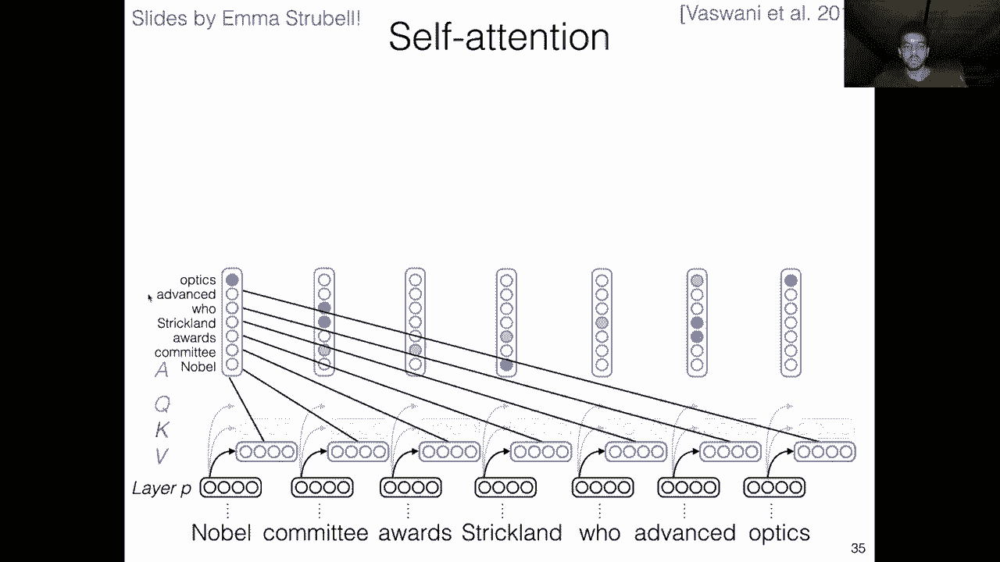

为了捕捉不同类型的依赖关系，Transformer使用了**多头注意力**。即使用多组不同的查询、键、值投影矩阵，并行执行多次上述的自注意力计算。每个“头”可能学习关注不同方面的信息（如语法结构、语义关系等）。

每个头产生一个输出向量，所有头的输出被拼接起来，然后通过一个前馈层投影回原始维度。

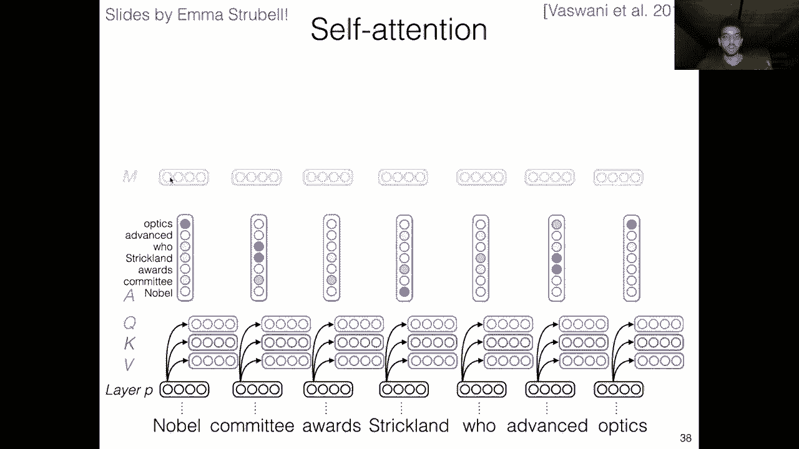

一个完整的自注意力层通常包含多头注意力加上前馈网络。Transformer模型就是由许多这样的层堆叠而成。通过堆叠多层，模型可以学习非常复杂的表示。

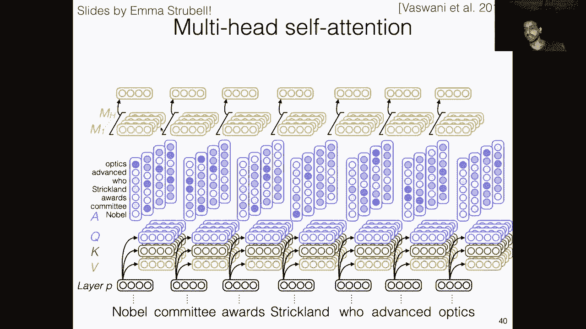

需要注意的是，纯粹的自注意力没有位置概念。为了解决这个问题，Transformer引入了**位置编码**，将词在序列中的位置信息注入到输入嵌入中。我们将在下一讲详细讨论Transformer架构。

## 总结与展望

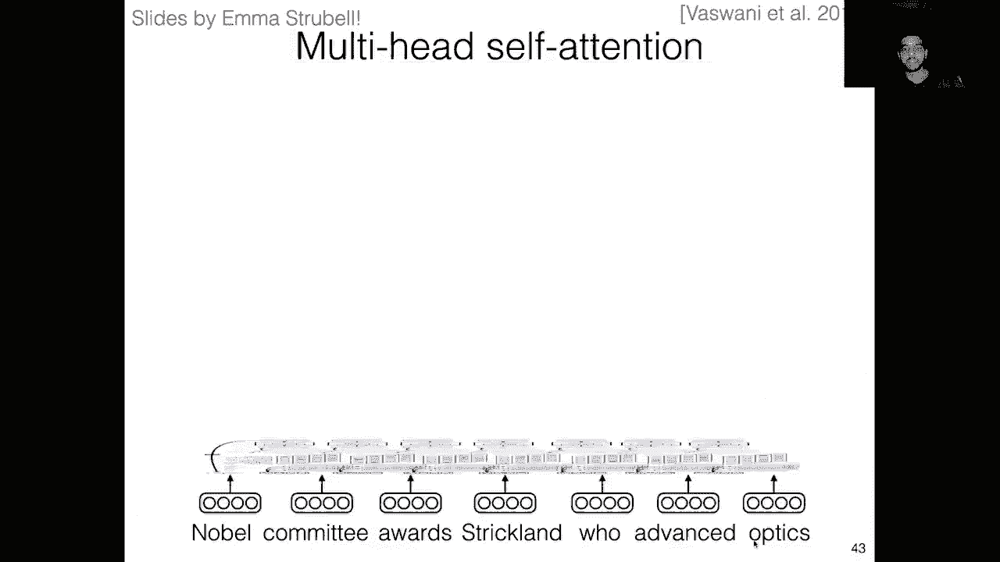

本节课我们一起学习了注意力机制的核心概念。我们从循环神经网络的局限性出发，引入了用于缓解信息瓶颈和梯度消失问题的注意力机制，并详细讲解了其在RNN语言模型中的工作原理。接着，我们探讨了注意力机制的变体及其扩展应用（如复制机制）。最后，我们介绍了更强大的自注意力机制，它是现代Transformer模型的基础，通过完全基于注意力的方式并行化地构建上下文感知的词表示。

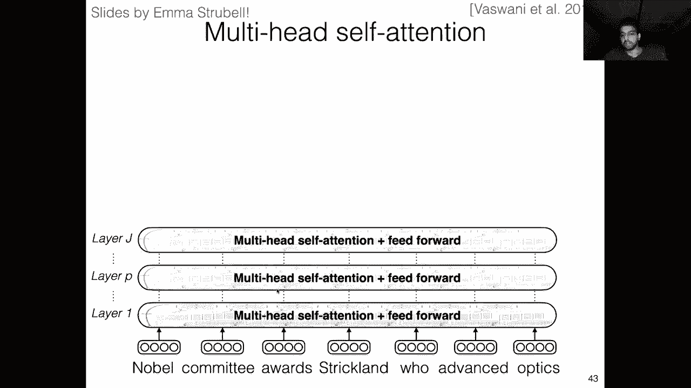

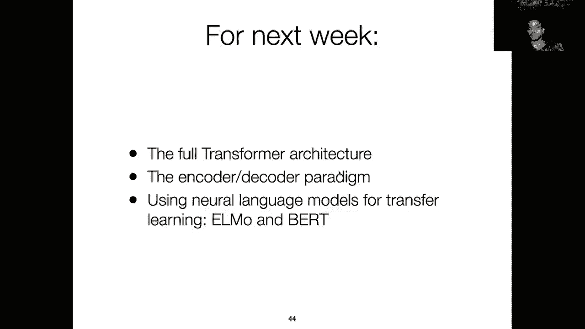

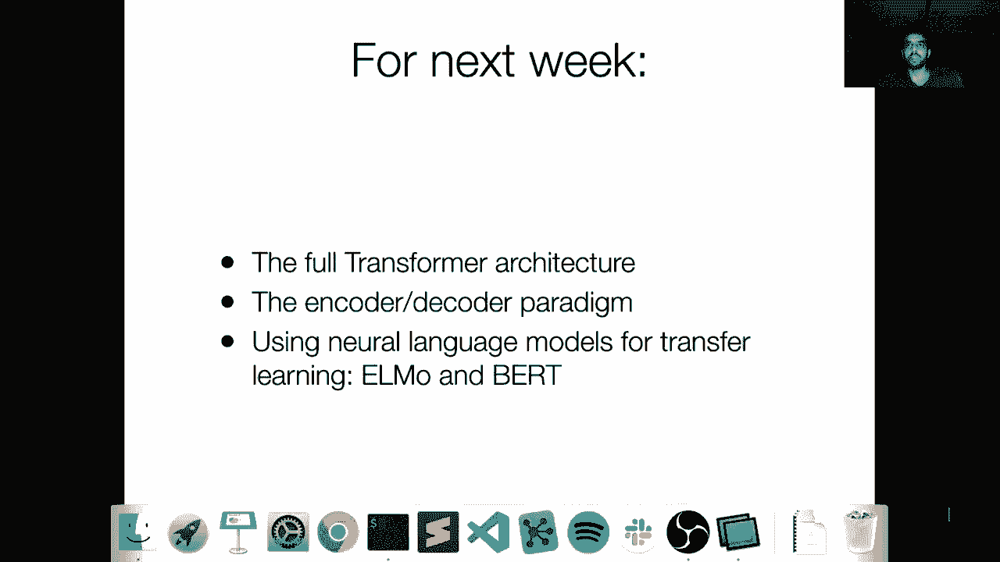

下一讲，我们将深入探讨**Transformer架构**，包括其完整的编码器-解码器结构以及位置编码等关键组件。在此之后，我们将进入**迁移学习**的主题，这些知识构成了如BERT等当前最先进NLP模型的基础。