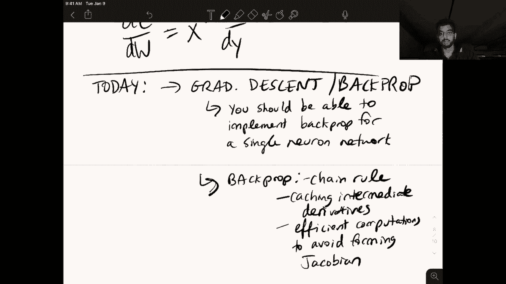

# 4：L3 - 反向传播算法详解 🧠

在本节课中，我们将学习神经网络训练的核心算法——反向传播。我们将从回顾神经网络语言模型开始，逐步理解梯度下降的原理，并深入探讨反向传播如何高效地计算梯度。课程内容将涵盖从单神经元到线性层的梯度计算，并解释现代深度学习框架背后的关键概念。

---

## 📚 1. 神经网络语言模型回顾

上一节我们介绍了前馈固定窗口语言模型。本节中，我们来看看该模型中的参数具体是什么。

我们有一个前缀序列，每个词对应一个词嵌入向量：`C₁`、`C₂`、`C₃`。这些词嵌入是低维实值向量，在训练开始时随机初始化。

模型的计算过程如下：
1.  将词嵌入向量拼接：`[C₁, C₂, C₃]`。
2.  通过一个隐藏层进行投影：`H = f(W₁ * [C₁, C₂, C₃])`。其中 `W₁` 是参数矩阵。
3.  通过一个Softmax层预测下一个词：`O = softmax(W₂ * H)`。其中 `W₂` 是另一个参数矩阵。

以下是模型的核心公式：
*   `H = f(W₁ * [C₁, C₂, C₃])`
*   `O = softmax(W₂ * H)`

在这个模型中，`H` 和 `O` 是中间变量，而不是模型参数。模型参数 `θ` 包括：
*   词嵌入矩阵：`C₁`, `C₂`, `C₃`, ... (对应词汇表中的所有词)
*   权重矩阵：`W₁`, `W₂`

我们的目标是调整这些参数，使模型能更准确地预测下一个词（例如，对“books”分配高概率）。

---

## 📉 2. 梯度下降算法概述

上一节我们明确了模型参数，本节中我们来看看如何训练它们以获得良好的预测效果。答案是使用梯度下降算法。

梯度下降是一种用于训练神经网络（以及许多其他机器学习模型）的优化算法。它通过迭代调整参数来最小化损失函数。以下是梯度下降的三个主要步骤：

### 步骤一：定义损失函数
首先，我们需要一种方法来衡量当前参数集在预测下一个词方面的表现好坏。我们通过定义一个损失函数 `L(θ)` 来实现，其中 `θ` 代表所有模型参数。损失函数输出一个标量值，用于量化模型当前的表现有多“差”。

### 步骤二：计算梯度
接下来，我们计算损失函数关于模型参数的梯度，记作 `dL/dθ`。梯度是一个向量，其直观含义是：
*   它告诉我们，当微调每个模型参数时，损失函数会如何变化。
*   它指明了损失函数值上升最陡峭的方向（即梯度方向）。

### 步骤三：沿负梯度方向更新参数
由于我们的目标是最小化损失函数，因此我们沿着梯度的反方向（即负梯度方向）更新参数。更新公式为：
`θ_new = θ_old - η * (dL/dθ)`
其中 `η` 称为学习率，它是一个超参数，用于控制每次更新的步长。

为了更直观地理解，假设损失函数 `L(θ)` 和参数 `θ` 都是标量。我们从随机初始化的 `θ₀` 开始，计算该点的梯度（即切线斜率），然后沿负梯度方向迈出一步，到达 `θ₁`。重复此过程，最终可能收敛到损失函数的（局部）最小值。

学习率 `η` 的选择至关重要：过大可能导致在最小值附近震荡甚至发散；过小则会导致收敛速度过慢。学习率是需要手动调整的超参数之一。

对于复杂的神经网络，损失函数通常是非凸的，没有闭式解，因此梯度下降及其变体（如Adam）是寻找近似最优解的标准方法。

---

## 🔍 3. 单神经元示例与反向传播直觉

上一节我们介绍了梯度下降的高层流程，本节中我们来看一个具体的单神经元例子，并引入反向传播的概念。

我们暂时离开语言模型框架，考虑一个更简单的回归问题：学习一个将标量输入 `x` 映射到标量输出 `y` 的函数。我们的训练数据是 `(x, y)` 对。

模型结构如下：
1.  输入 `x` 乘以权重 `w₁`，得到中间值 `b = w₁ * x`。
2.  对 `b` 应用激活函数（如tanh），得到隐藏表示 `h = tanh(b)`。
3.  `h` 乘以权重 `w₂`，得到中间值 `a = w₂ * h`。
4.  对 `a` 再次应用tanh，得到最终输出 `o = tanh(a)`。

模型参数是 `w₁` 和 `w₂`。我们使用平方损失函数来衡量预测 `o` 与目标 `y` 的差距：`L = 1/2 * (y - o)²`。

训练分为两步：
1.  **前向传播**：给定输入 `x`，按上述公式顺序计算 `h`、`o` 和损失 `L`。
2.  **反向传播（计算梯度）**：计算损失 `L` 对参数 `w₁` 和 `w₂` 的梯度 `dL/dw₁` 和 `dL/dw₂`，以便后续更新参数。

我们使用**链式法则**从输出向输入反向计算梯度。以计算 `dL/dw₂` 为例：
`dL/dw₂ = (dL/do) * (do/da) * (da/dw₂)`
*   `dL/do = -(y - o)`
*   `do/da = 1 - tanh²(a) = 1 - o²` (利用了tanh导数的性质)
*   `da/dw₂ = h`

因此，`dL/dw₂ = -(y - o) * (1 - o²) * h`。注意，我们在前向传播中已经计算了 `o` 和 `h`，因此这里可以直接复用。

接下来计算 `dL/dw₁`，它需要用到更长的链：
`dL/dw₁ = (dL/do) * (do/da) * (da/dh) * (dh/db) * (db/dw₁)`
*   前两项 `(dL/do) * (do/da)` 在计算 `dL/dw₂` 时已经算过了。
*   `da/dh = w₂`
*   `dh/db = 1 - tanh²(b) = 1 - h²`
*   `db/dw₁ = x`

因此，`dL/dw₁ = [-(y - o) * (1 - o²)] * w₂ * (1 - h²) * x`。

**反向传播的关键直觉**：在计算不同参数的梯度时，存在共享的中间梯度项（例如 `(dL/do) * (do/da)`）。反向传播通过从输出层向输入层反向计算，可以**缓存**这些共享的梯度，从而避免重复计算，极大地提高了计算效率。高层（靠近输出）参数的梯度计算出来后，其部分结果可直接用于计算低层（靠近输入）参数的梯度。

得到梯度后，即可按更新公式调整参数：
`w₁_new = w₁_old - η * (dL/dw₁)`
`w₂_new = w₂_old - η * (dL/dw₂)`

---

## 🧮 4. 线性层的梯度计算（矩阵形式）

上一节我们在标量设置下理解了反向传播，本节中我们将其扩展到更接近实际神经网络语言的矩阵向量形式，重点分析线性层（全连接层）的梯度计算。

线性层是神经网络中的基本组件，其操作定义为：`Y = f(X * W)`。在我们的语言模型中，它被用来将拼接后的词嵌入向量投影到隐藏空间。
*   `X` 是输入矩阵，维度为 `[批大小 (N), 输入维度 (D)]`。每一行是一个训练样本的特征向量。批量处理是现代深度学习的标准做法。
*   `W` 是权重矩阵，维度为 `[输入维度 (D), 输出维度 (M)]`，这是我们要学习的参数。
*   `f` 是激活函数，为简化起见，我们先假设 `f` 是恒等函数，即 `Y = X * W`。

假设我们已通过反向传播从更深的层得到了损失 `L` 对输出 `Y` 的梯度 `dL/dY`（维度为 `[N, M]`）。我们的目标是高效地计算损失对输入 `X` 的梯度 `dL/dX` 和对权重 `W` 的梯度 `dL/dW`。

根据链式法则，`dL/dX = (dL/dY) * (dY/dX)`。其中 `dY/dX` 是一个雅可比矩阵，其维度巨大（`[N*M, N*D]`），显式构造它非常低效且消耗内存。

通过一个具体的维度例子（`N=2, D=2, M=3`）进行展开计算，我们可以发现一个关键规律：**`dL/dX` 可以直接通过矩阵乘法高效计算，而无需构造雅可比矩阵**。

计算结果是：
`dL/dX = (dL/dY) * Wᵀ`
即，损失对输入的梯度，等于损失对输出的梯度乘以权重矩阵的转置。

类似地，可以推导出损失对权重的梯度：
`dL/dW = Xᵀ * (dL/dY)`

这些高效的矩阵运算正是像PyTorch这样的深度学习框架在背后自动为我们完成的梯度计算。理解其原理有助于我们更深入地理解模型的行为。

---

## 📝 总结

本节课我们一起学习了神经网络训练的核心内容：

1.  **梯度下降**：我们了解了如何使用梯度下降算法迭代更新模型参数以最小化损失函数。你应当理解其步骤和更新公式。
2.  **反向传播**：我们通过单神经元网络的例子，深入理解了反向传播算法。其核心是**链式法则**和**缓存中间梯度**以实现高效计算。你应该能够手动推导简单网络的梯度。
3.  **矩阵化计算**：我们探讨了在线性层等组件中，梯度计算如何从标量扩展到矩阵形式，并利用**高效的矩阵乘法**避免构造庞大的雅可比矩阵。这是现代深度学习框架的基石。

关键要点在于，反向传播通过智能地复用计算，使得训练包含数百万参数的深度神经网络成为可能。在接下来的课程中，我们将使用PyTorch实现这些概念，并介绍用于语言建模的损失函数，以及强大的Transformer模型。