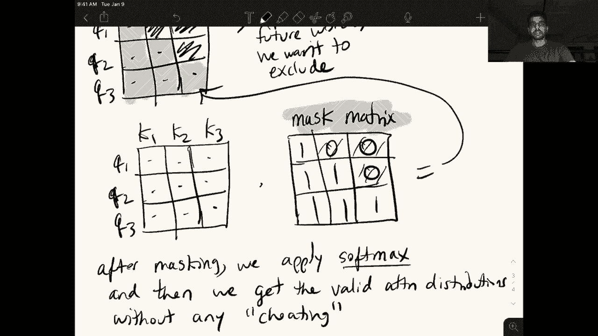
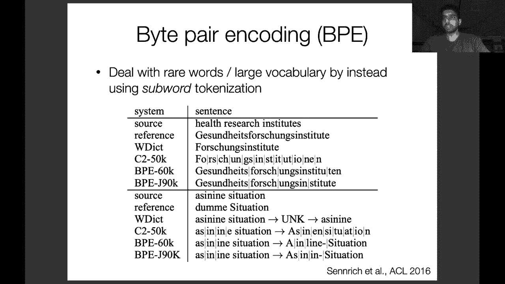

# 8：L6 - Transformer与序列到序列模型 🧠

在本节课中，我们将深入学习Transformer模型和序列到序列学习范式。我们将首先通过对比自注意力机制和循环神经网络，深入理解自注意力计算的可并行化优势。随后，我们将系统介绍Transformer架构的各个核心组件，并探讨其在序列到序列任务（如机器翻译）中的应用。

***

## 自注意力与RNN的对比 📊

上一节我们回顾了语言建模的基础。本节中，我们来看看自注意力机制与循环神经网络在计算方式上的核心区别。

循环神经网络通过顺序处理来建模词序。每个隐藏状态的计算都依赖于前一个隐藏状态，这形成了信息传递的链条。其核心公式为：

**`H_t = f(W * H_{t-1} + U * E_t)`**

这种顺序计算虽然能有效捕捉序列顺序，但也意味着无法同时计算所有时间步的隐藏状态，必须等待前一步计算完成，这在训练时会导致速度瓶颈。

相比之下，自注意力机制通过为每个词生成查询、键、值向量来计算其表示。对于序列中的每个位置，其表示是所有位置值的加权和，权重由该位置的查询与其他所有位置的键计算得出。关键在于，**每个位置的表示（如Z3）的计算不依赖于前一个位置的表示（如Z2）**。这意味着所有位置的表示可以独立、并行地计算。

以下是自注意力中计算注意力分数的核心步骤：

```python
# 假设 Q, K, V 分别是查询、键、值矩阵
attention_scores = torch.matmul(Q, K.transpose(-2, -1)) / sqrt(d_k)
attention_weights = softmax(attention_scores, dim=-1)
output = torch.matmul(attention_weights, V)
```

这种并行性，尤其是在训练时利用GPU进行大规模矩阵运算的能力，是Transformer模型训练速度远超RNN的主要原因。




***

## 序列到序列学习范式 🔄

上一节我们介绍了自注意力的并行计算。本节中，我们来看看如何将这种机制应用于输入和输出都是序列的任务，即序列到序列学习。

序列到序列模型，也称为编码器-解码器架构，广泛应用于机器翻译等任务。其目标是，给定源语言序列（如法语句子 `F`），生成目标语言序列（如英语句子 `E`），即最大化条件概率 **`P(E | F)`**。

该概率可以分解为链式条件概率的乘积：
**`P(E|F) = Π_t P(e_t | e_1, ..., e_{t-1}, F)`**

在基于RNN的模型中，编码器将整个源语句压缩成一个固定长度的上下文向量，解码器则基于该向量和已生成的历史词来预测下一个词。这种方法存在信息瓶颈，因为单个向量需要编码整个源句的所有信息。

引入注意力机制后，解码器在生成每个目标词时，可以动态地关注编码器输出的所有隐藏状态，从而更有效地利用源语句信息。

***

## Transformer架构详解 🏗️

上一节我们了解了序列到序列的框架。本节中，我们深入探讨实现这一框架的Transformer模型的具体构成。

Transformer完全基于自注意力机制，摒弃了循环结构。其完整架构包含编码器和解码器堆栈。除了核心的多头自注意力模块，还包括以下关键组件：

### 位置编码

自注意力本身不具备感知词序的能力。为了注入序列的顺序信息，Transformer为输入词嵌入添加了位置编码。原始论文使用正弦和余弦函数来生成绝对位置编码：

**`PE(pos, 2i) = sin(pos / 10000^{2i/d_model})`**
**`PE(pos, 2i+1) = cos(pos / 10000^{2i/d_model})`**

这种设计使模型能够轻松学习相对位置关系。如今，更常见的做法是使用可学习的位置嵌入向量。

### 残差连接与层归一化

在每个子层（自注意力层、前馈网络层）周围，Transformer使用了残差连接，并随后进行层归一化。这有助于缓解深层网络中的梯度消失问题，促进训练。其操作可概括为：**`LayerOutput = LayerNorm(x + Sublayer(x))`**。

### 前馈网络

每个编码器和解码器层中的自注意力层之后，都接有一个相同的前馈神经网络，它是一个两层的全连接层，中间包含ReLU激活函数：**`FFN(x) = max(0, xW1 + b1)W2 + b2`**。这为模型增加了非线性变换能力。

### 解码器的掩码自注意力与交叉注意力

解码器部分与编码器有三点主要不同：
1.  **掩码自注意力**：为确保训练时不会“偷看”未来信息（即要预测的词），解码器的自注意力层使用了掩码，将未来位置的注意力权重设置为负无穷（经softmax后变为0）。
2.  **交叉注意力**：这是连接编码器和解码器的关键。解码器中的这一层，其**查询（Q）** 来自解码器的上一层的输出，而**键（K）和值（V）** 则来自编码器的最终输出。这使得解码器在生成每个词时都能关注到源语句的全部相关信息。
3.  **输出偏移**：解码器的输入是目标序列向右移动一位（在开头添加`<start>`标记），输出则是要预测的原始目标序列。

***

## 训练技巧与细节 ⚙️

上一节我们剖析了Transformer的架构。本节中，我们来看看一些让Transformer工作得更好的实用技巧和细节。

### 优化器与学习率调度

Transformer不使用普通的SGD或Adam，而是采用了一种带预热（Warm-up）和逆平方根衰减（Inverse Square Root Decay）的学习率调度策略的Adam变体（AdamW）。学习率首先线性增加到一个峰值，然后随着训练步数增加而按比例衰减。

### 标签平滑

在计算交叉熵损失时，不对真实标签使用“独热”（one-hot）编码（即概率1），而是“偷走”一小部分概率（如0.1）均匀分配给词表中的其他词。这可以防止模型对预测变得过于自信，起到正则化作用，提升模型泛化能力。

### 子词分词

与传统的按空格分词不同，Transformer等现代模型通常使用子词分词算法，如字节对编码（BPE）。这种方法将单词拆分为更常见的子词单元（如前缀、后缀、词根），能有效处理未登录词、拼写变体和形态学变化，提升模型的泛化能力。

***

## 总结 📝



本节课中我们一起学习了Transformer模型的核心思想与架构。我们从自注意力机制与RNN的对比入手，理解了其可并行计算的训练优势。随后，我们介绍了序列到序列学习范式，并在此框架下详细拆解了Transformer的编码器-解码器结构，包括位置编码、残差连接、多头注意力、掩码机制以及交叉注意力等关键组件。最后，我们探讨了优化器、标签平滑和子词分词等使Transformer表现卓越的重要实践技巧。这些知识为我们接下来学习基于Transformer的预训练语言模型（如BERT）奠定了坚实的基础。