# 9：L7.1 - NLP 的迁移学习 📚

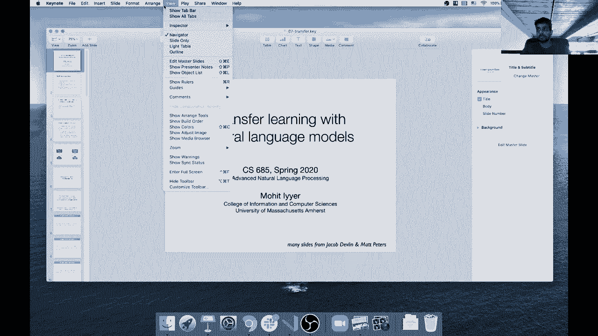

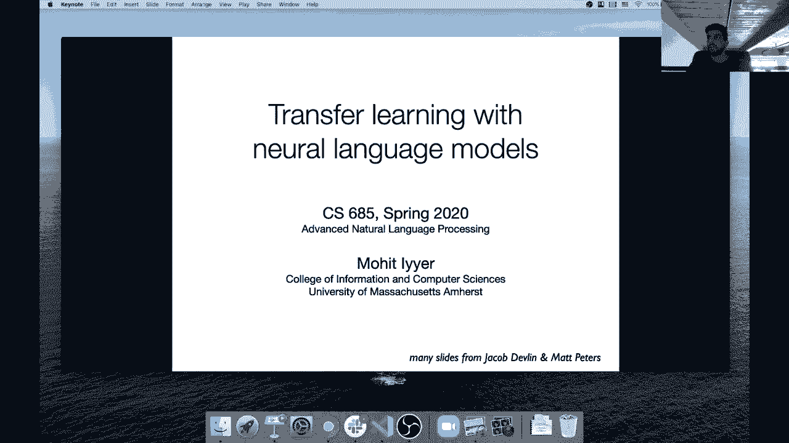

在本节课中，我们将要学习自然语言处理中的迁移学习概念。我们将从传统的静态词向量方法开始，逐步探讨如何利用大规模预训练语言模型来提升下游任务的性能，并介绍其中的核心思想与关键模型。

---

## 概述

迁移学习在NLP领域的核心思想是：利用一个在大量无标签数据上通过自监督任务（如语言建模）预训练好的模型，将其知识迁移到数据量有限的下游任务（如情感分析）中。这能有效解决标注数据稀缺的问题，并显著提升模型性能。

上一节我们介绍了语言建模的基础，本节中我们来看看如何将语言模型的知识迁移到其他NLP任务中。

---

## 从静态词向量到上下文词向量

在之前讨论的模型中，模型的输入是词索引序列，每个索引对应词汇表中的一个词类型，并通过查找表映射到一个静态的词向量。这意味着，像 `play`、`bank`、`run` 这样的词，无论其上下文如何，都仅由一个向量表示。

这种方法存在一个直观的问题：许多词具有多种含义和用法。例如，单词 `play` 可以表示“戏剧”、“玩耍”或“比赛”。如果仅使用一个静态向量，这些不同的含义就会被压缩在一起，无法根据具体语境进行区分。

以下是使用余弦相似度在词向量空间中查找 `play` 的近邻词示例：
```
playing, games, played, players, football, multiplayer...
```
可以看到，动词（playing, played）、名词（game, player）和形容词（multiplayer）混杂在一起。单词的真实含义高度依赖于其出现的上下文。

因此，我们希望有一种方法能够**上下文化**这些词表示，使得同一个词在不同句子中拥有不同的向量表示。例如，“open a bank account” 和 “on the river bank” 中的 `bank` 应该具有不同的向量。

这种上下文化词表示的思想，是后续迁移学习方法的关键基础。

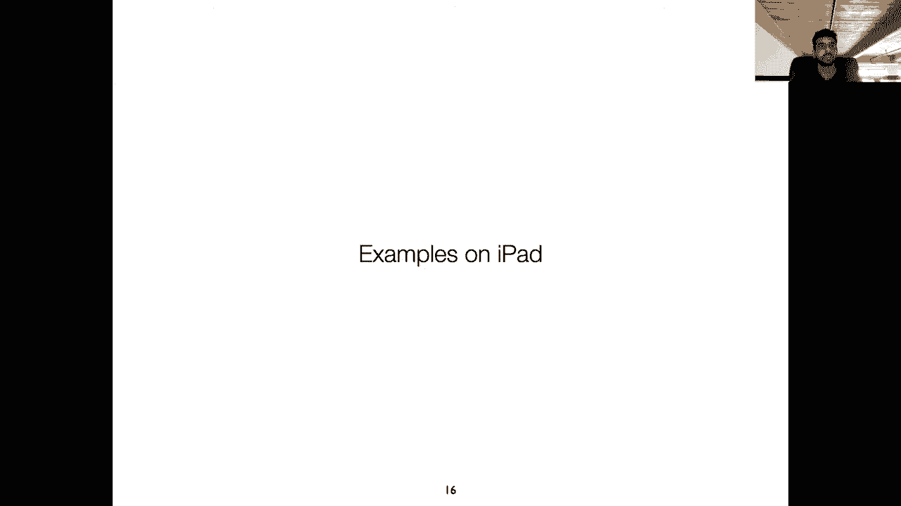

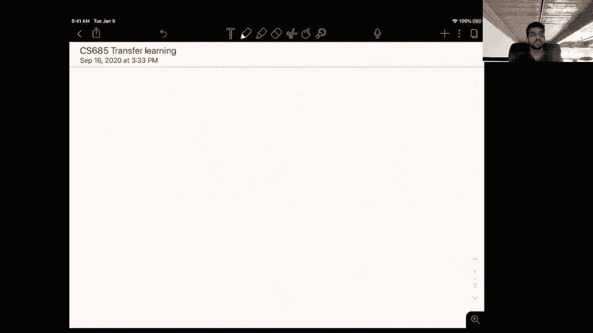

---

## NLP任务解决方法的演进

为了更好地理解迁移学习的价值，让我们回顾一下解决NLP任务（以情感分析为例）方法的演进历程。

### 阶段一：完全从零开始训练 🏗️

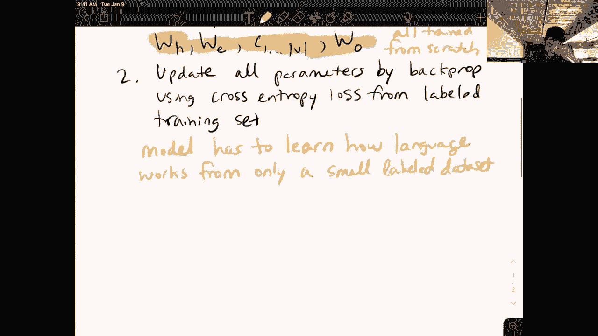

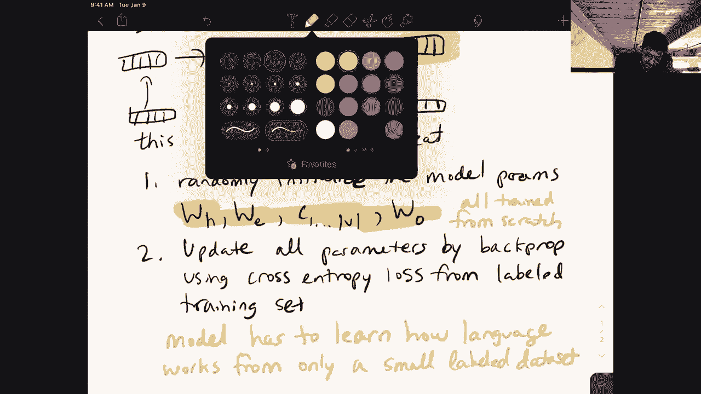

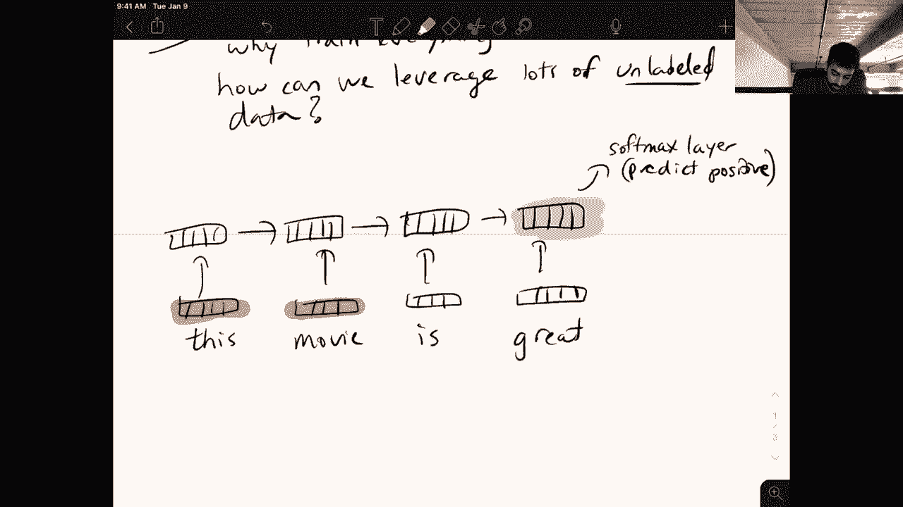

在这个阶段（大约2013年左右），我们使用一个循环神经网络来处理句子，例如 “this movie is great”。模型的输入是每个词的词向量，最终隐藏状态通过一个softmax层来预测情感标签（正面/负面）。

以下是该模型的关键步骤：
1.  **随机初始化**所有模型参数，包括词向量 `C_i`、RNN权重 `W_h`、`W_e` 和输出层权重 `W_o`。
2.  **使用标注训练集**，通过反向传播和交叉熵损失来更新所有参数。

这种方法的问题是，模型必须**仅从一个小的标注数据集中学习语言的所有重要属性**。如果标注数据集很小（例如只有1000条评论），模型很难学习到复杂的语言现象。

### 阶段二：使用预训练静态词向量 🔧

大约2014年至2017年，研究重点转向了词向量。人们提出，为何不从大量无标签文本中预训练词向量呢？

于是，解决方案变为：
1.  使用诸如 Word2Vec 或 GloVe 等自监督目标，在大量无标签数据上**预训练词向量** `C_i`。
2.  在下游任务模型中，使用这些预训练的词向量作为输入，而模型的其他参数（`W_h`, `W_e`, `W_o`）仍然**从零开始训练**。

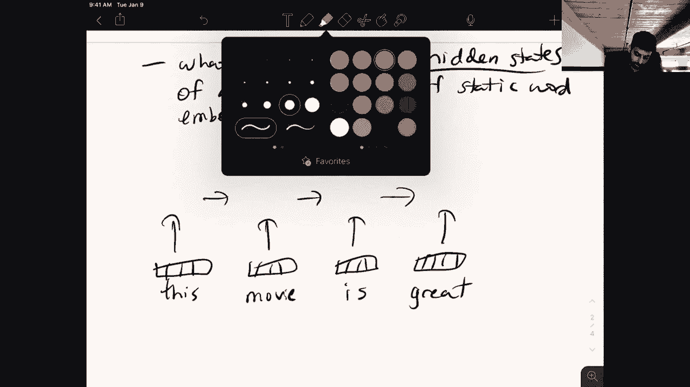

这种方法为模型提供了一些来自外部大规模语料库的语言知识。然而，它仍然存在显著缺陷：词向量是**静态**的，每个词类型只有一个向量，与上下文无关。模型的其他部分（如RNN）仍需从有限的标注数据中学习如何组合这些词向量，并承担起根据上下文消歧的重任。

### 阶段三：使用神经语言模型的隐藏状态（ELMo）🚀

接下来，我们考虑将神经语言模型整合到这个框架中。核心思想是：**使用神经语言模型的隐藏状态，而非静态词向量，作为下游任务的输入**。

假设我们有一个在大量文本上训练好的循环神经语言模型。对于句子 “this movie is great”，模型会生成一系列隐藏状态，每个状态都基于之前的所有词来预测下一个词。

这些蓝色的隐藏状态是**上下文化**的。例如，单词 `great` 对应的隐藏状态不仅包含了 `great` 本身的信息，还编码了前面所有词 “this movie is” 的上下文信息。这比单一的静态 `great` 词向量包含了更丰富的语义。

因此，在情感分析模型中，我们可以用这些来自预训练语言模型的上下文化隐藏状态，替换掉静态词向量作为输入。此时，模型需要从零开始训练的参数（`W_h`, `W_e`, `W_o`）的负担减轻了，因为它们接收到的输入表示已经包含了大量的组合信息。

### 阶段四：共享更多参数（BERT）🤖

一个很自然的问题是：我们能否共享比词向量更多的参数？答案是肯定的。

我们不仅可以使用语言模型的隐藏状态，还可以直接**将语言模型的参数**（如RNN中的 `W_h` 和 `W_e`）**初始化**到下游任务模型中。

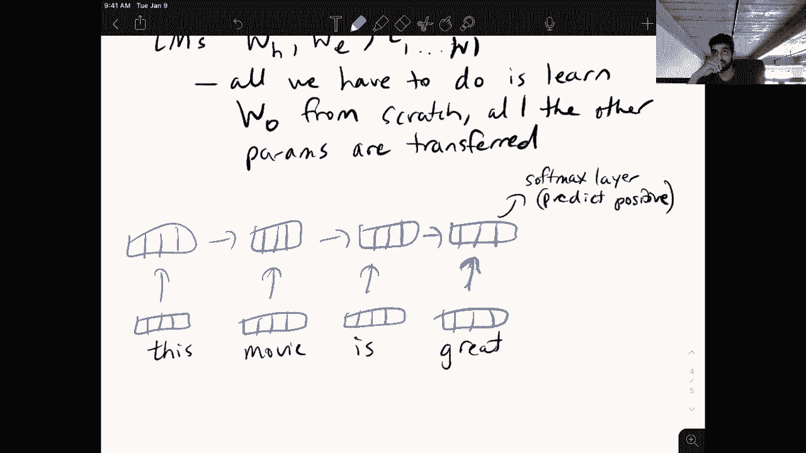

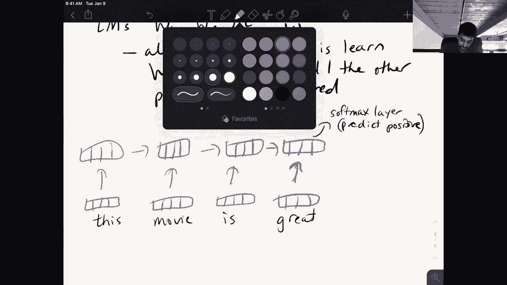

具体到情感分析例子：
1.  使用预训练语言模型的参数（包括词向量和组合网络参数）来**初始化**情感分析RNN模型。
2.  只有最后的softmax分类层权重 `W_o` 需要**从零开始随机初始化**，因为语言模型的输出维度（词汇表大小）与情感分析的标签数（如2个）不同。

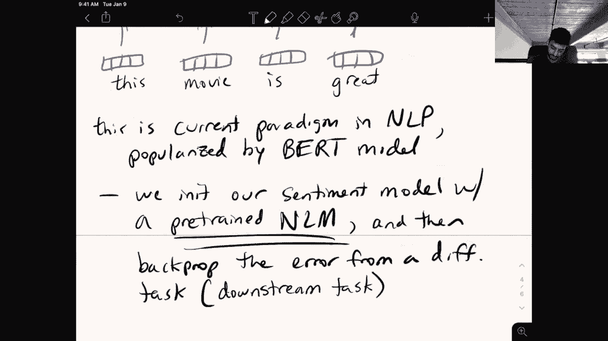

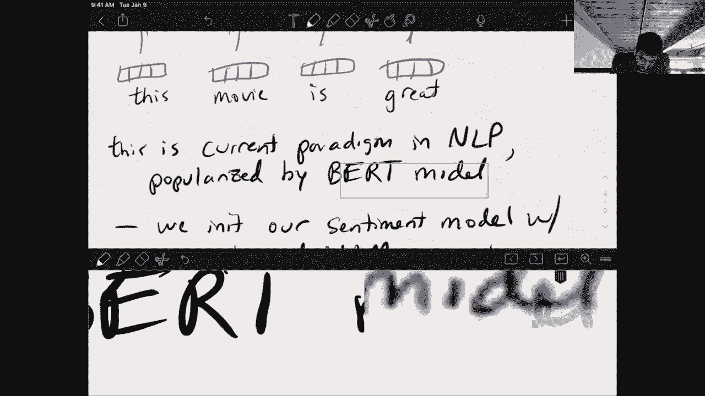

然后，我们使用下游任务的标注数据，通过反向传播来**微调**所有这些参数（包括从语言模型继承来的参数）。这个过程被称为**微调**。

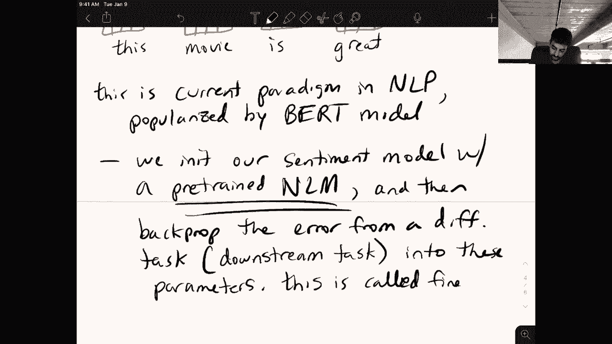

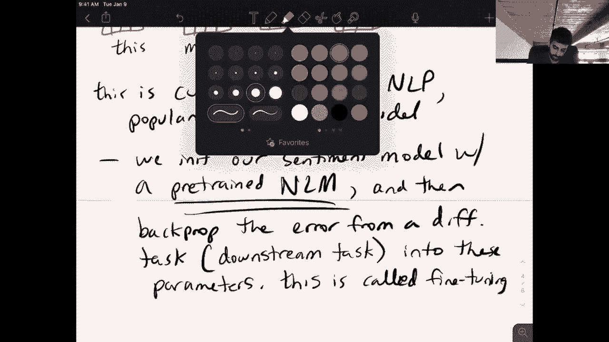

这种共享并微调大部分模型参数的做法，是当前NLP研究的主流范式，由BERT等模型推广开来。

---

## ELMo：深度上下文化词表示

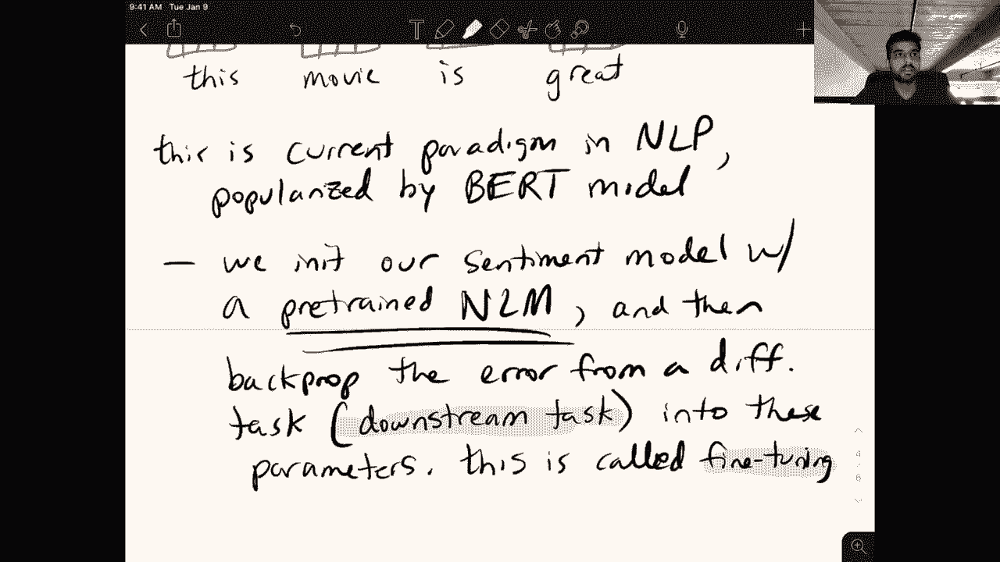

ELMo 是首个成功展示通过使用语言模型能大幅提升多种NLP任务性能的工作之一。其核心创新在于使用了**双向**语言模型来获取上下文信息。

### 双向语言模型

标准的（单向）语言模型只能根据上文预测下一个词，因此每个词的表示只包含其左侧的上下文信息。然而，对于大多数下游任务（如情感分析），我们希望词的表示能包含整个句子的信息。

ELMo 的解决方案是训练两个语言模型：
*   **前向语言模型**：从左到右，根据历史词预测下一个词。
*   **后向语言模型**：从右到左，根据未来词预测前一个词。

然后将两个模型的隐藏状态**拼接**起来。这样，每个词的最终表示就同时包含了其左侧和右侧的上下文信息。

### 模型架构与表示

ELMo 使用了一个深层的双向LSTM语言模型。对于一个句子中的每个词，模型会在每一层LSTM都产生一个隐藏状态。

因此，每个词会得到多个层级的表示（例如，三层LSTM会得到三个向量）。ELMo 并不固定使用某一层的表示，而是学习一个**任务特定的权重**，对所有这些层的表示进行加权求和，从而得到该词最终的上下文化向量表示。

```
ELMo表示 = γ * Σ (s_k * h_{k})
```
其中，`h_{k}` 是第k层的隐藏状态，`s_k` 是可学习的层权重，`γ` 是一个可学习的缩放参数。

### 影响与局限

ELMo 通过简单地用其上下文化词向量替换下游任务模型中的静态词向量，在问答、情感分析、共指消解、命名实体识别、语义角色标注等一系列NLP任务上显著提升了当时的性能。

然而，ELMo 主要将预训练模型作为**固定的特征提取器**，在下游任务训练时通常不更新语言模型本身的参数。这主要是受当时计算资源的限制。

---

## 总结

本节课中我们一起学习了NLP迁移学习的基本概念和发展脉络：

1.  **问题根源**：静态词向量无法区分词语在不同上下文中的含义，且从小规模标注数据中学习复杂的语言组合规律十分困难。
2.  **解决方案演进**：
    *   从**完全随机初始化**训练。
    *   到使用**预训练静态词向量**。
    *   再到使用**上下文化的词向量**（如ELMo），利用双向语言模型的隐藏状态捕获更丰富的语境信息。
    *   最终发展到**参数共享与微调**的范式，即将整个预训练语言模型（包括其组合参数）的参数迁移到下游任务并进行端到端的微调，这也是当前BERT等模型的核心思想。

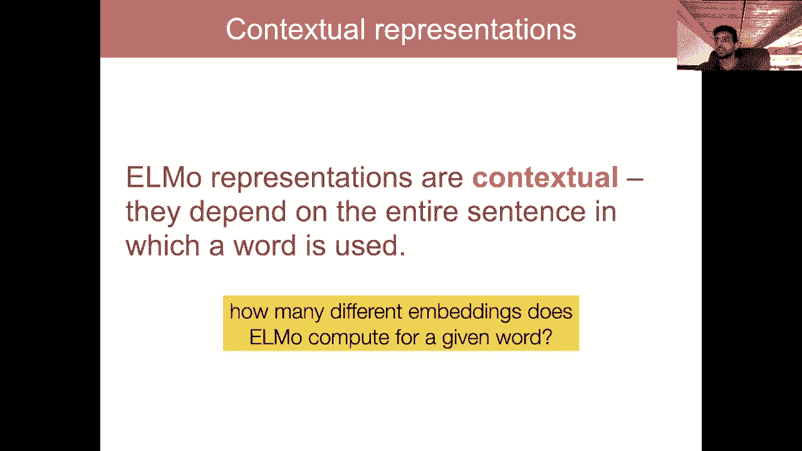

下一节课，我们将深入探讨BERT模型，了解它如何通过改变模型架构（Transformer）和预训练目标（掩码语言模型），进一步推动了迁移学习在NLP中的应用。