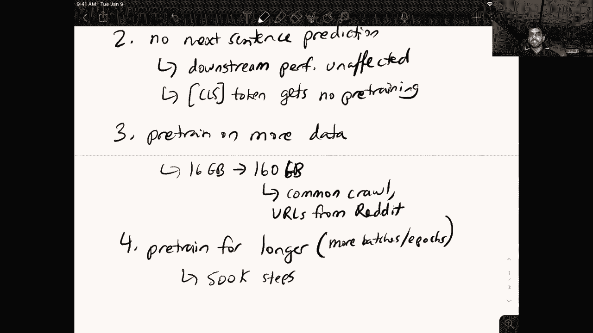
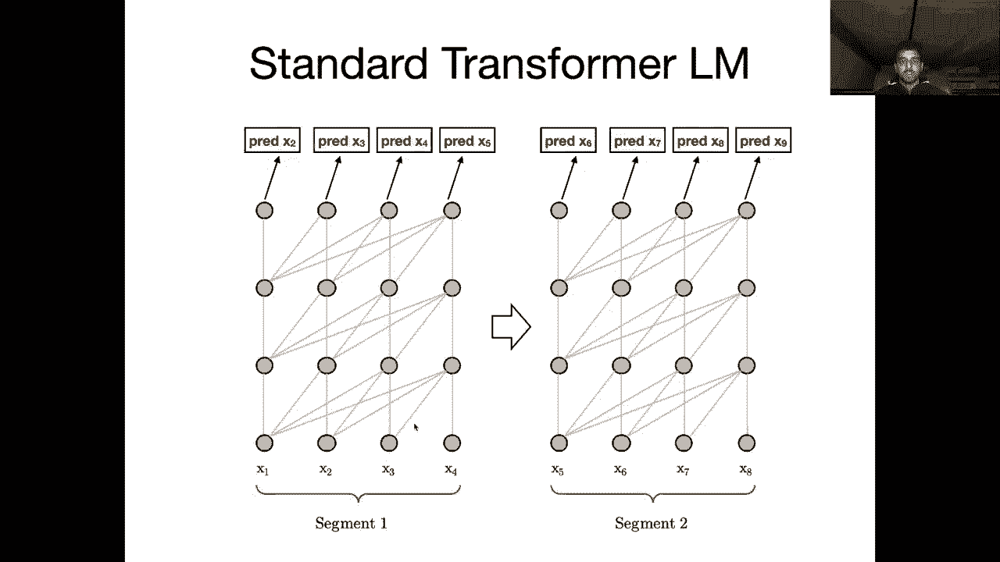
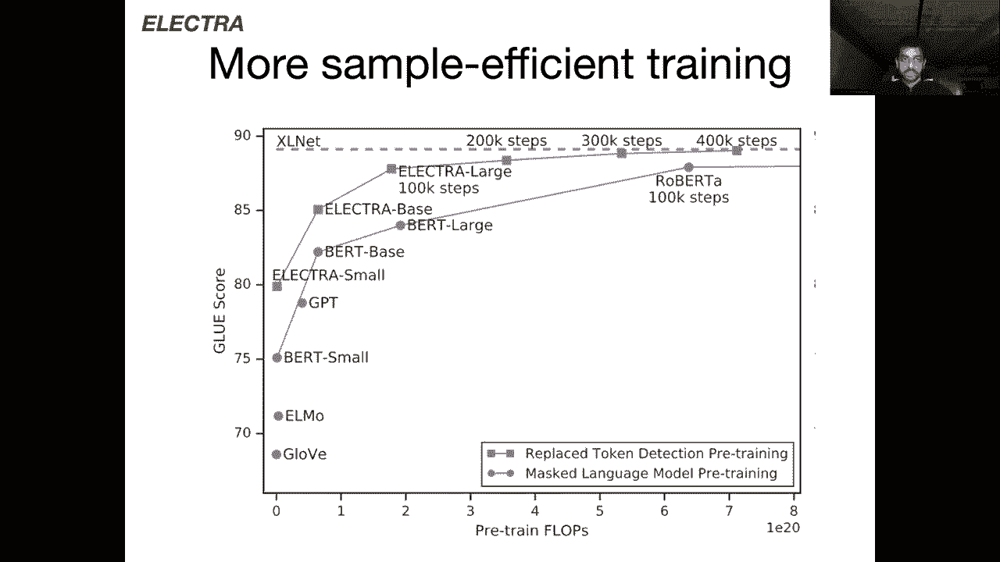
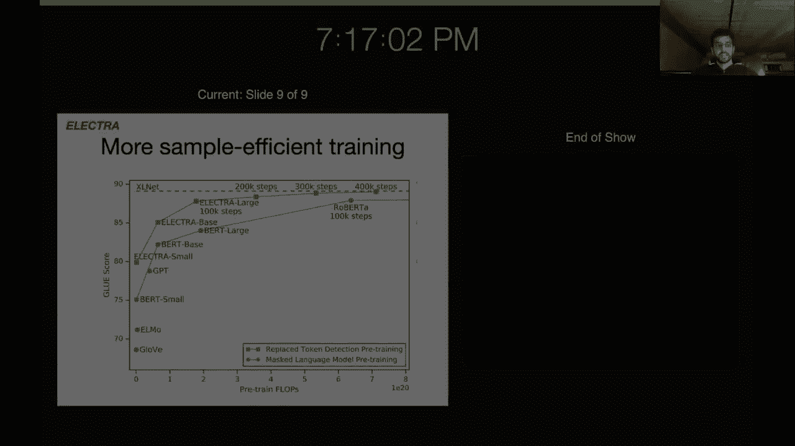
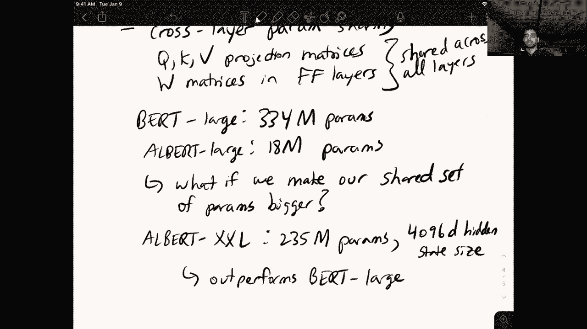

# 13：L10 - BERT变种 🧠

在本节课中，我们将学习四种对原始BERT模型的重要改进。这些改进分别来自RoBERTa、Transformer-XL、ELECTRA和ALBERT论文，它们从训练策略、模型架构和效率等方面提升了BERT的性能。

---

## RoBERTa：更鲁棒的预训练方法 🔧

上一节我们介绍了BERT的基础架构。本节中，我们来看看Facebook AI提出的RoBERTa模型，它通过一系列简单的训练策略改进，显著提升了BERT在下游任务上的表现。

RoBERTa的核心改进并非单一的新架构，而是四个训练策略的集合。

以下是RoBERTa提出的四项主要改进：

1.  **使用更大的批次进行训练**：研究表明，在总计算量（看到的样本数）相同的情况下，使用更大的批次大小（batch size）并减少更新步数，能带来更好的下游任务性能。对于GPU内存有限的场景，可以使用**梯度累积**技术来模拟大批次训练。
    *   **代码示例（梯度累积伪代码）**：
        ```python
        desired_batch_size = 8000
        actual_batch_size = 800
        accumulation_steps = desired_batch_size // actual_batch_size # =10
        optimizer.zero_grad()
        for i in range(accumulation_steps):
            inputs, labels = get_batch(actual_batch_size)
            outputs = model(inputs)
            loss = criterion(outputs, labels)
            loss.backward() # 梯度累积，不立即更新参数
        optimizer.step() # 累积10个批次后，进行一次参数更新
        ```

2.  **移除下一句预测任务**：RoBERTa发现，BERT中的下一句预测任务对于最终性能并非必要。移除该任务后，模型输入变为单个连续的文本段，简化了预训练过程，且性能未受影响甚至略有提升。

3.  **使用更多数据进行预训练**：RoBERTa将预训练数据从BERT的16GB大幅增加至160GB，数据来源包括经过滤的Common Crawl和从Reddit帖子链接中收集的网页文本。

4.  **进行更长时间的预训练**：RoBERTa将预训练步数（steps）大幅增加，让模型有更多机会从海量数据中学习。




这些改进单独看可能增益有限，但组合在一起时，RoBERTa在多项任务上显著超越了原始BERT。

---

## Transformer-XL：建模更长序列 📏

RoBERTa解决了训练策略问题，但BERT及其变种仍受限于512个令牌的固定输入长度。本节我们探讨如何建模更长的序列，重点介绍Transformer-XL模型。




Transformer-XL的核心思想是通过一种**循环机制**来连接相邻的文本段，从而扩展模型的有效上下文窗口。

其关键设计是缓存前一个文本段的隐藏状态，并在计算当前段时允许模型以**注意力机制**访问这些缓存表示。同时，梯度不会回传到已计算的缓存段，这控制了内存和计算量的增长。

*   **公式/概念描述**：设当前段为 \\(\\mathbf{x}_{\\tau} = [x_{\\tau,1}, ..., x_{\\tau,L}]\\)，前一段的缓存隐藏状态为 \\(\\mathbf{h}_{\\tau-1}\\)。在计算当前段第 \\(l\\) 层的表示 \\(\\mathbf{h}_{\\tau}^{l}\\) 时，会同时关注本段上一层的表示 \\(\\mathbf{h}_{\\tau}^{l-1}\\) 和缓存中前一段第 \\(l-1\\) 层的表示 \\(\\mathbf{h}_{\\tau-1}^{l-1}\\)。

这种方法将有效上下文长度从BERT的512个令牌提升到了约900个令牌，是解决长文本建模问题的重要早期尝试。

---

## ELECTRA：更高效的预训练目标 ⚡

Transformer-XL扩展了上下文长度，但预训练目标本身也有优化空间。本节我们介绍ELECTRA模型，它提出了一种比BERT的掩码语言建模更高效的预训练目标。

BERT的掩码语言建模只对输入中15%被掩码的令牌进行预测，样本效率较低。ELECTRA采用了**替换令牌检测**任务。

ELECTRA的运作方式如下：
1.  使用一个较小的生成器网络（如小型BERT）随机替换输入中的部分令牌为其他词汇表中的单词，生成“假”样本。
2.  主模型（判别器）的任务不是预测被掩码的原始词，而是对**输入序列中的每一个令牌**进行二分类，判断它是原始的真实令牌还是被生成器替换的“假”令牌。

*   **公式/概念描述**：对于输入序列 \\(\\mathbf{x} = [x_1, ..., x_n]\\)，生成器 \\(G\\) 会采样生成替换序列 \\(\\mathbf{x}^{corrupt}\\)。判别器 \\(D\\) 对每个位置 \\(t\\) 计算 \\(D(\\mathbf{x}^{corrupt}, t) = P(\\text{real} | x_t^{corrupt})\\)。

这种方法使模型能从每一个输入令牌中学习，大大提高了训练效率。实验表明，ELECTRA能以更少的计算量达到与BERT、RoBERTa相媲美甚至更优的性能。

---

## ALBERT：参数共享的轻量模型 🪶

最后，我们来看ALBERT模型。它的核心思想是：更多的参数并不总是意味着更好的模型，通过**跨层参数共享**可以构建更紧凑的模型。

在BERT中，增加模型规模通常通过堆叠更多层来实现，每一层都有独立的参数。ALBERT则提出，在所有Transformer层之间共享参数（如注意力投影矩阵和前馈网络矩阵）。

以下是ALBERT的关键设计：





*   **跨层参数共享**：所有层使用相同的参数集。一个ALBERT Large模型（与BERT Large层数相同）参数仅为1800万，而BERT Large有3.34亿参数。
*   **扩大隐藏层维度**：在共享参数的基础上，ALBERT通过显著增大隐藏层维度（如增至4096）来增加模型容量。这样得到的ALBERT-xxlarge模型参数为2.35亿，虽仍少于BERT Large，但在多项任务上实现了超越。

这一设计表明，Transformer模型对参数共享具有很好的适应性，为构建高效的大模型提供了新思路。

---

## 总结 📝

本节课我们一起学习了四种重要的BERT变体模型：
1.  **RoBERTa** 通过改进训练策略（更大批次、更多数据、更长时间、移除NSP）获得了更强大的性能。
2.  **Transformer-XL** 通过引入段间循环机制，扩展了模型处理长文本的能力。
3.  **ELECTRA** 设计了更高效的替换令牌检测预训练目标，提升了样本利用率和训练速度。
4.  **ALBERT** 采用跨层参数共享，在减少参数量的同时保持了强大的模型能力。



这些工作展示了在BERT基础之上进行优化的多个方向，也为后续的预训练模型发展奠定了基础。从下节课开始，我们将进入文本生成任务的新篇章。