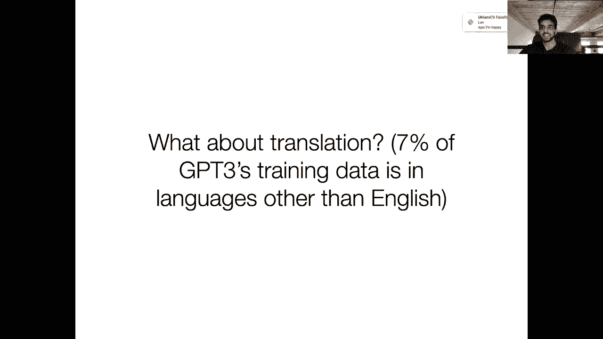
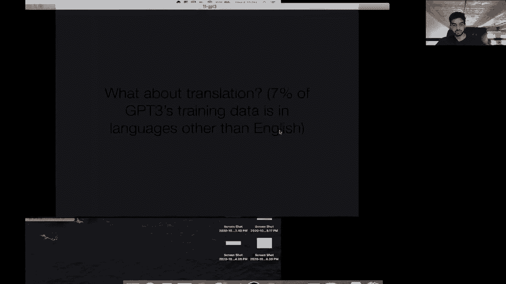
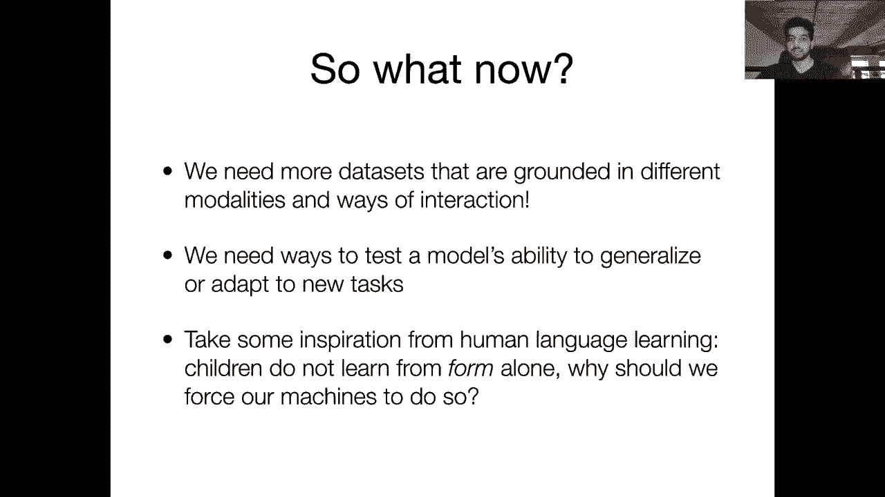
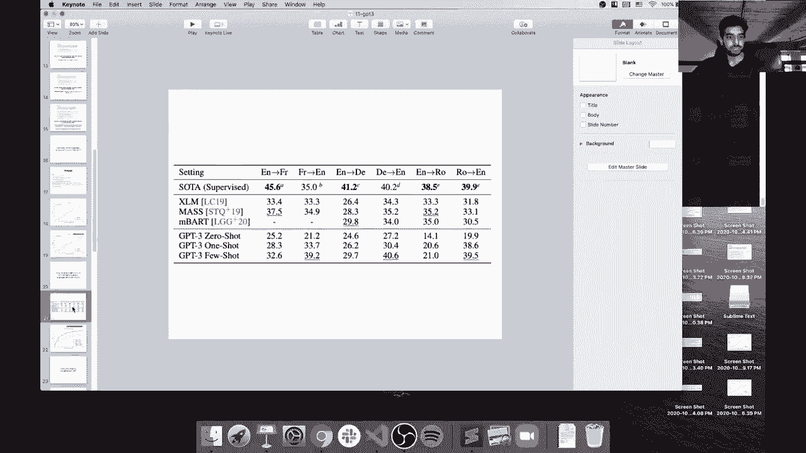

# 14：L11 - 扩展语言模型规模与 GPT-3 🚀

在本节课中，我们将学习 GPT-3，这是由 OpenAI 团队近期发布的最新、最强大的神经语言模型。有趣的是，本次课程不会涉及全新的建模技术，因为 GPT-3 的核心组件——基于 Transformer 的神经语言模型——我们之前已经基本都学习过了。GPT-3 的突破在于将这一架构扩展到了前所未有的巨大规模。

## 模型规模演进 📈

上一节我们回顾了语言模型的基础架构，本节中我们来看看近年来模型规模是如何飞速增长的。首先，我们可以对比一下几个代表性模型的参数数量。

以下是几个关键模型的参数规模对比：

*   **ELMo (2018年)**：约 9300 万参数。它是一个双层双向 LSTM 模型，在当时属于标准规模。
*   **BERT Base**：约 1.1 亿参数（12层 Transformer）。
*   **BERT Large**：约 3.4 亿参数（24层 Transformer）。需要注意的是，这些模型的很大一部分参数集中在词嵌入矩阵中，其大小为 `嵌入维度 D × 词汇表大小 V`。
*   **GPT-3**：最大的版本拥有 **1750 亿** 参数，包含 96 层 Transformer，隐藏层维度超过 12000，每层多头注意力机制有 96 个头。其训练批次大小达到了 320 万。

训练如此规模的模型需要巨大的计算资源和资金投入，成本可能高达数百万美元，这限制了只有少数资金雄厚的机构能够进行此类研究。

## 训练数据规模 📚

模型性能的提升不仅依赖于参数量的增加，也离不开海量的训练数据。我们来比较一下不同模型所使用的训练数据量。

以下是各模型训练数据量的对比：

*   **ELMo**：在 10 亿词（1B tokens）的基准数据集上训练。
*   **BERT**：在 33 亿词（3.3B tokens）上训练，数据来自维基百科和一个未公开的小说数据集。
*   **RoBERTa**：使用了约 300 亿词（30B tokens）的数据。
*   **GPT-3**：在总计约 **3000 亿词（300B tokens）** 上训练，其中主要部分（约 4100 亿词）来自经过过滤和预处理的 Common Crawl 网络爬虫数据。此外，其训练数据中约有 7% 是非英语文本。

如此庞大的数据量，使得模型有可能记忆并理解海量的事实和语言模式。

## 核心范式转变：从微调到上下文学习 🔄

之前我们熟悉的范式是“预训练 + 下游任务微调”。GPT-3 提出了一种替代方案：**完全摒弃微调阶段**，将所有精力集中在预训练上，并期望预训练模型足够强大，能够在没有任何标注数据的情况下解决多种任务。

具体来说，GPT-3 是一个标准的**从左到右的 Transformer 语言模型**，其目标函数就是预测下一个词。它**不使用 BERT 式的掩码语言建模（Masked LM）**。在应用时，我们通过精心设计输入给模型的“提示（Prompt）”来引导它完成任务，这被称为“上下文学习（In-Context Learning）”。

### 任务执行方式

根据提供给模型的示例数量，可以分为三种设置：

1.  **零样本（Zero-Shot）学习**：仅通过文本描述告诉模型任务是什么。
    *   *示例（翻译任务）*: `翻译英文为法文：cheese =>`
2.  **单样本（One-Shot）学习**：在任务描述后，额外提供一个输入-输出示例。
    *   *示例*: `翻译英文为法文：sea otter => loutre de mer。 cheese =>`
3.  **少样本（Few-Shot）学习**：在提示中提供多个（例如 K=64）示例。
    *   *示例*: `翻译英文为法文：sea otter => loutre de mer。 plush giraffe => girafe peluche。 cheese =>`

这种方法的优势在于极其灵活，几乎任何 NLP 任务都可以被构造成“输入文本 -> 输出文本”的格式，且不依赖于大量特定任务的标注数据。提示的具体格式（如使用冒号、箭头）对性能有重要影响，通常通过验证集进行调整。

## 实验结果与性能分析 📊

了解了 GPT-3 的基本原理后，我们来看看它在各种任务上的实际表现。

### 知识问答（Trivia QA）

在 Trivia QA 任务上，GPT-3 展示了令人印象深刻的能力。该任务要求模型回答基于事实的琐碎问题。

*   **实验设置**：GPT-3 在测试时**不提供**支持文档，仅通过问题本身和可能的几个示例来回答。
*   **结果**：在少样本（K=64）设置下，拥有 1750 亿参数的 GPT-3 模型**性能超过了使用全量数据微调的当前最佳模型**。这表明，通过海量预训练，模型已经将大量事实知识编码到了其参数中，形成了一个巨大的“记忆库”，而提示中的示例则像是对这个记忆库进行查询的线索。

### 机器翻译

GPT-3 在多种语言的翻译任务上也表现出了竞争力。

*   **结果**：即使在零样本设置下，GPT-3 也能产生有意义的翻译结果（例如 BLEU 分数达到 25+）。在少样本设置下，其翻译质量进一步提升，在某些语言对上接近有监督训练的先进水平。考虑到其训练数据中仅有 7% 是非英语文本，且互联网上精确的平行句对并不常见，这一能力尤为惊人。

### 阅读理解与推理

在需要复杂推理的阅读理解任务（如 SQuAD 2.0, DROP）上，GPT-3 的表现则好坏参半。

*   **结果**：在较简单的数据集上，少样本 GPT-3 接近微调模型的性能。但在更复杂的、需要多步推理或处理不可回答问题（SQuAD 2.0）的数据集上，与全量微调的先进模型仍有较大差距。这表明，当前规模的 GPT-3 在复杂推理和泛化方面仍存在局限。

### 算术与使用新词

GPT-3 也被测试了一些需要泛化能力的任务。

*   **算术运算**：对于简单的两位数加法，少样本 GPT-3 能达到接近 100% 的准确率。但随着数字位数增加（如五位数加法），准确率骤降至 10% 左右。这表明模型更多是模式匹配，而非真正掌握了算术规则。
*   **使用新造词**：研究人员定义了一个虚构的单词（如“farduddle”意为“快速上下跳跃”），并给出一个使用示例，然后要求 GPT-3 用该词造句。GPT-3 能够生成语法正确、语义连贯的句子，展示了其一定的组合泛化能力，而不仅仅是记忆。

## 局限性与未来方向：形式与意义 🤔

GPT-3 的成功引发了一个问题：**仅通过扩大模型规模和文本数据，能否最终解决所有 NLP 问题？**

Bender 和 Koller 在论文《Climbing towards NLU: On Meaning, Form, and Understanding in the Age of Data》中对此提出了质疑。她们区分了语言的**形式（Form）**和**意义（Meaning）**。

*   **形式**：指文本中的字符、单词序列。
*   **意义**：指语言形式与外部世界（物理对象、概念、体验）之间的关系，即** grounding（接地）**。

### “章鱼测试”思想实验

论文提出了一个思想实验“章鱼测试”：
1.  两个人（A 和 B）被困在两个孤岛上，通过海底电缆通信。
2.  一只章鱼（O）窃听了他们所有的对话，从而学会了预测 B 会如何回复 A（即学会了语言的形式）。
3.  后来章鱼切断电缆，冒充 B 与 A 对话。
4.  当 A 发出涉及真实世界紧急情况和物理对象的求助（如“Help! I‘m being chased by a bear, all I have is a stick. What do I do?”）时，从未接触过真实世界（无 grounding）的章鱼无法给出真正有意义的建议，可能只会回复“Not sure, sorry”这类通用语句。

这个实验的寓意是：**仅从语言形式中学习，无法获得真正的意义理解**。即使模型看到了万亿级别的文本，它也可能无法泛化到需要基于真实世界经验和物理规律进行推理的新情境中。

### 未来方向

因此，纯粹扩大文本模型规模可能存在上限。未来的方向可能包括：
*   **多模态学习**：将语言与视觉、听觉等其他感官信息结合（如图像描述、视频理解）。
*   **交互与具身学习**：让智能体在模拟或真实环境中通过交互来学习语言的意义（如遵循导航指令、操作物体）。
*   **借鉴人类学习**：人类儿童学习语言所需的数据量远小于 GPT-3，因为他们通过与世界的多感官互动获得了丰富的 grounding。

## 总结 🎯

本节课我们一起学习了 GPT-3 这一划时代的巨型语言模型。我们回顾了其惊人的模型与数据规模，重点理解了它如何通过“上下文学习”的新范式，在零样本、单样本和少样本设置下执行多种任务，并在某些任务上取得了媲美甚至超越传统微调方法的性能。

同时，我们也探讨了当前仅基于文本的大规模预训练可能存在的根本性局限——即缺乏对语言意义的 grounded 理解。这提醒我们，在追求模型规模的同时，探索多模态、交互式等能让模型更好地连接语言与世界的学习范式，将是通往更通用人工智能的关键一步。