# 17：L14- 众包文本数据收集 📝

在本节课中，我们将要学习如何通过众包来收集用于训练自然语言处理模型的文本数据。我们将了解众包的基本概念、主要平台（如亚马逊 Mechanical Turk）的工作流程，以及如何设计有效的任务来获取高质量数据。同时，我们也会探讨在数据收集中可能遇到的问题和陷阱。

---

## 什么是众包？

众包是一种将简单或短小的标注任务或写作任务，分发给大量工人在短时间内完成的方法。

当你进行众包时，你需要向这些工人支付报酬。其核心思想是，相比于你自己或你的项目组成员手动创建数据集，通过众包可以同时让成百上千名工人执行任务，从而在相同时间内收集到更大量的数据。这对于那些需要成千上万条数据才能训练出好模型的、数据饥渴的模型来说非常有用。

我们既需要高质量的数据，也需要大量的数据。这种需求在未来几年可能会发生变化。我们已经看到 GPT-3 可以在没有额外训练的情况下，仅从极少数例子中泛化。但即使在标准的预训练-微调范式中，GPT-3 的少样本学习结果也并未在所有任务上持续超越传统方法。因此，为微调过程准备足量的标注数据仍然很重要。

以下是一些可以非常有效地通过众包完成的 NLP 任务示例：
*   **情感分析**：给工人一个句子，让他们标注其情感是积极还是消极。
*   **问答数据集**：SQuAD 数据集就是通过众包收集的。工人们被给予一个段落，并被要求提出关于该段落的问题，并指出答案在段落中的位置。
*   **文本蕴含**：给定两个句子，判断第一个句子是否蕴含或与第二个句子矛盾。这类数据集也是通过众包创建的。
*   **图像描述**：MS COCO 数据集，目前最常用的图像描述数据集，是通过众包创建的。
*   **视觉问答**：询问关于图像的问题，这些数据集也都是通过众包创建的。

因此，众包是设定一个问题的关键部分。如果你有一个想要解决的任务想法，在开始使用 BERT 或 RoBERTa 等模型之前，首先要做的就是弄清楚从哪里获取数据来解决这个任务，数据的质量如何，以及你认为需要多少数据。通常，如果你在处理足够复杂的任务，你将需要借助某种形式的众包。

当然，这不是一个纯粹的技术话题。虽然有许多关于众包相关技术方面的论文，但我们将主要讨论它的工作原理、如何设置任务等。从这个意义上说，它与我们之前涵盖的内容有所不同，但正如之前所说，它非常重要。

到目前为止，我们已经涵盖了 NLP 中几乎所有最先进的模型。在 BERT 和 ELMo 之前，有许多针对特定任务的模型。在关于问答的讲座中，我们展示了 SQuAD 排行榜在 BERT 出现前后的变化，有数百种不同的神经架构因 BERT 而变得过时。因此，就过去几年的 NLP 发展而言，我们确实已经围绕一小部分模型（如用于语言建模的 BERT 和 GPT）进行了整合。我们花了更多时间创建新的数据集来挑战这些模型，看看它们是否能解决所有任务，或者是否存在一些它们失败的任务，从而为未来的建模进展提供信息。至少在研究中，过去几年从新模型转向新任务和新数据集的趋势已经非常明显。

众包之所以非常重要的另一个原因是，它常常没有被正确地执行。如果众包数据收集不当，那么基于这些数据训练的模型就会带有各种奇怪的伪影，最终它们可能甚至没有执行你想要的任务，而是执行了其他不相关的任务。

所有这些原因使得学习众包变得非常重要。

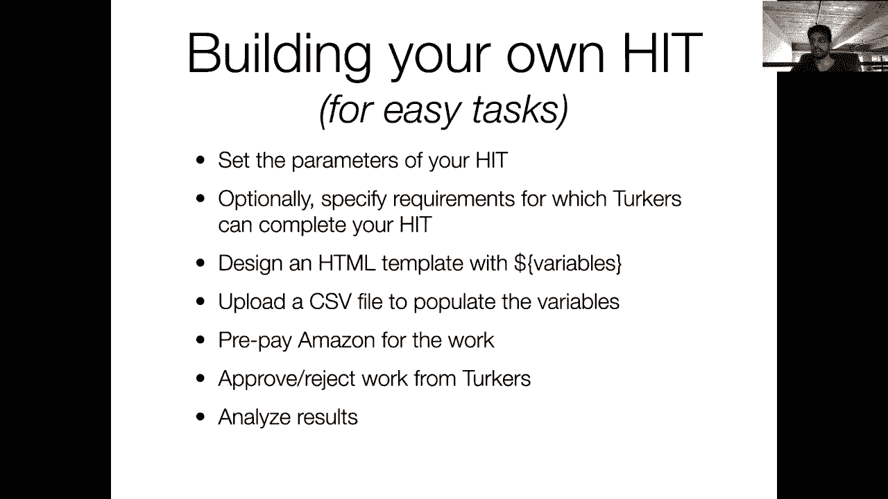

**关于工人**：我们指的是实际参与这些标注任务的人类劳动力。是的，存在风险，在某些情况下，存在人类偏见渗入数据集的风险，尤其是当任务要求工人撰写实际文本时，约束较少。例如，在一个情感分析任务中，工人需要写一个积极或消极的句子，人类偏见渗入的空间不大，因为他们只有很小的选择集。但你可以想象另一个任务，要求他们阅读一篇文章，然后写一段总结他们想法的文字。在这里他们可以写任何东西，因此有更多空间让他们的个人偏见渗入。我们将在讲座接近尾声时讨论一些与此相关的内容。

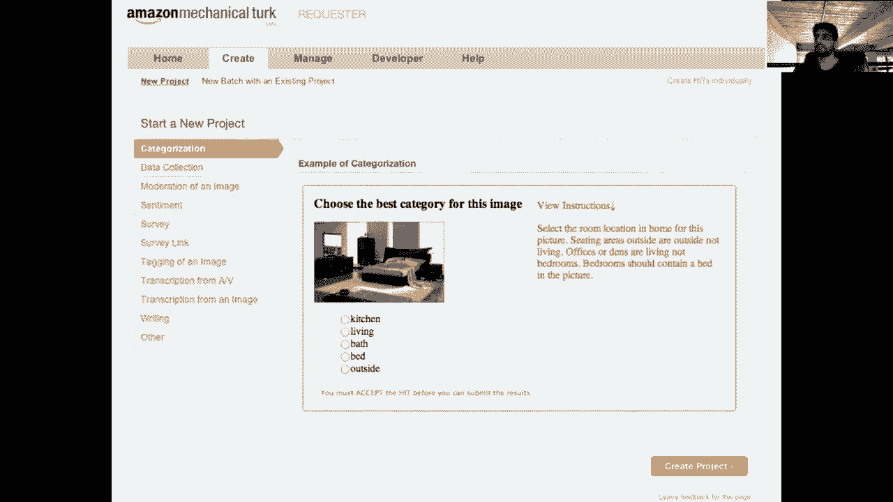

---

## 主要平台：亚马逊 Mechanical Turk

迄今为止，最流行的众包数据收集平台是亚马逊的 Mechanical Turk。在这里，你向实际的人类工人支付报酬，让他们完成你设计的任务。

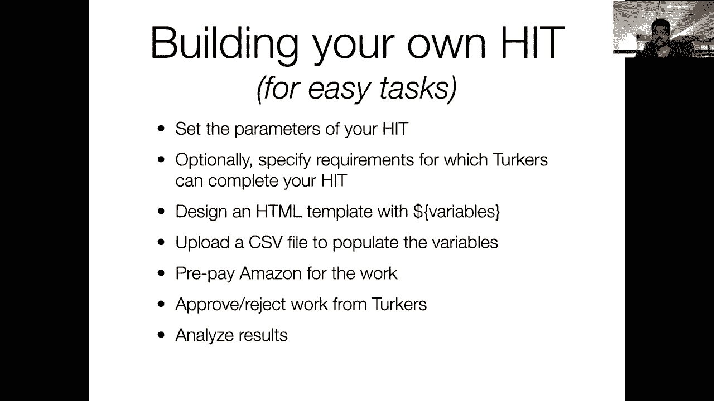

在 Mechanical Turk 的惯例中，我们称这些任务为“人类智能任务”。我之前展示的大多数数据集，可能全部都是在亚马逊 Mechanical Turk 上收集的。需要补充的是，如果你是一家公司的 NLP 工程师或科学家，你可能可以访问公司内部自己的众包工人池。例如，谷歌有自己的 Mechanical Turk 替代品，Facebook 有自己的工具，亚马逊本身也有一个与公开的 Mechanical Turk 不同的内部数据收集工具。因此，在不同的公司，你可能有不同的工人来源，但我们将在这里讨论的所有原则仍然适用，而且不同来源的报酬也没有太大差异。

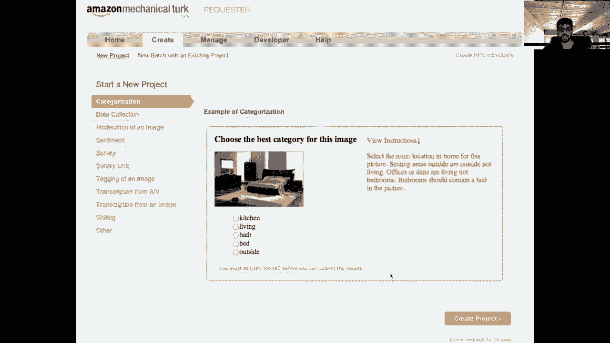

如果你想在 Mechanical Turk 上构建一个 HIT，对于许多任务都有一些预先制作的模板可供选择，它们涵盖了许多不同的任务。我称这些为“简单任务”，比如文本分类，或者根据某个上下文写一个句子等。对于这些任务，你可以直接使用 Mechanical Turk 内置的界面，很容易上手。我们将介绍这一点，并在最后讨论如果你的任务更复杂，无法塞进 Mechanical Turk 提供的模板中，你可以选择哪些替代方案。

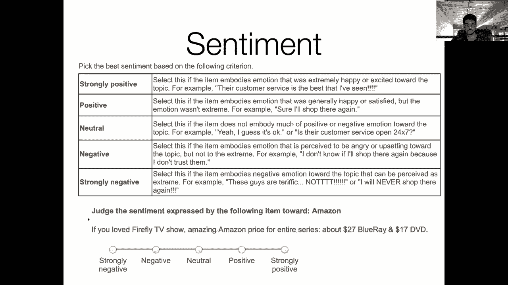

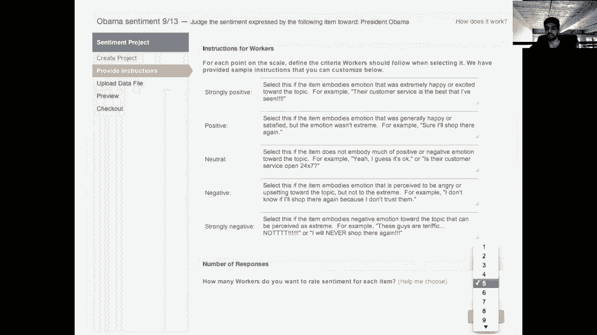

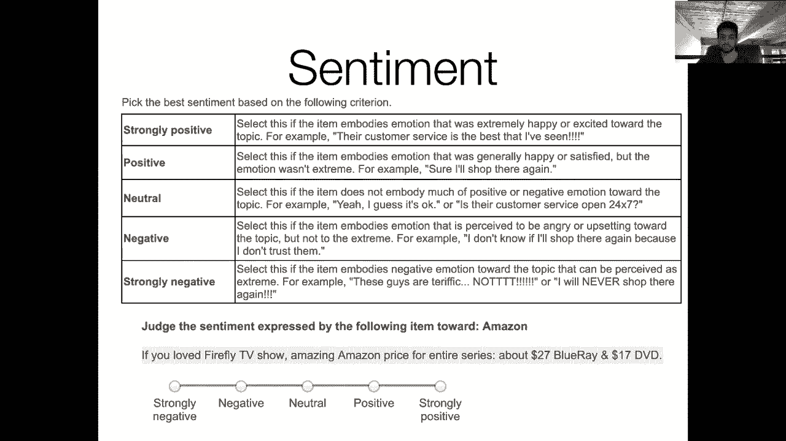

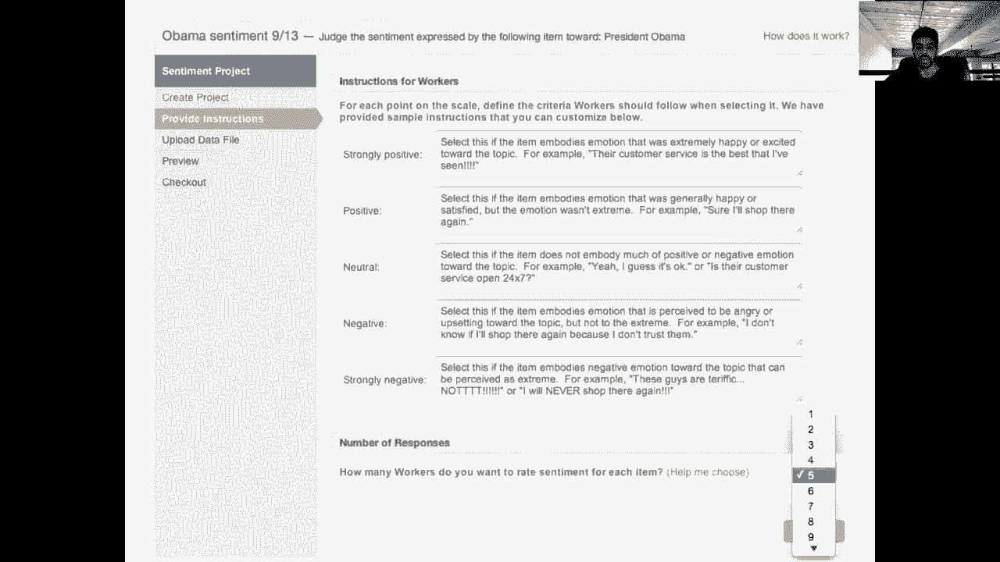

---

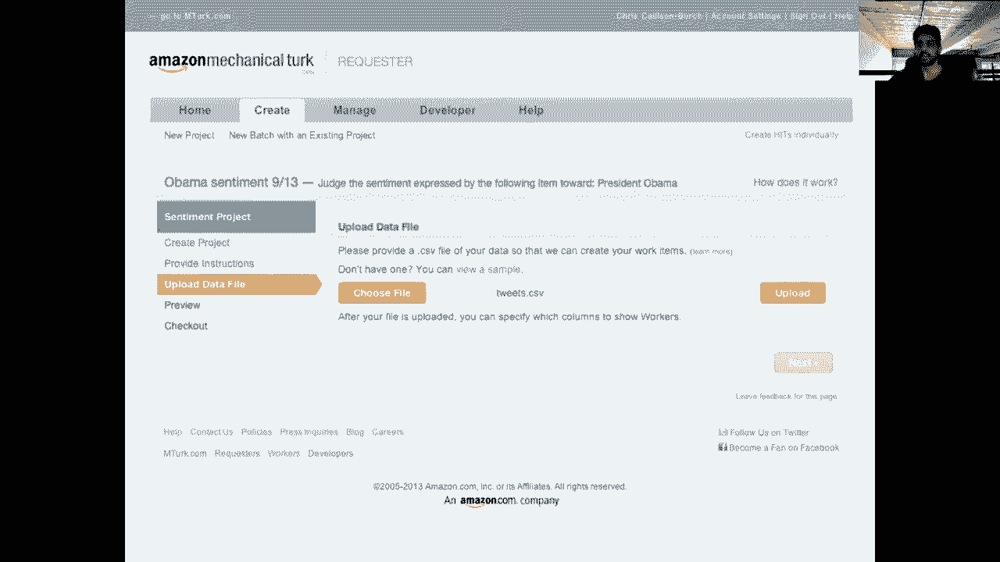

## 设置任务的步骤

在你真正向工人发布任务并让他们完成之前，你需要采取几个步骤。特别是，你需要选择许多不同的参数，例如：你打算支付多少钱？每个任务需要多少工人完成？这些工人来自哪里？他们应该说什么语言？诸如此类。

一旦你完成了这些，你还必须定义任务的用户界面：你的任务将如何呈现？工人将如何与各种输入交互？他们将如何提供输出？指令是什么？你将向他们展示什么样的示例？所有这些在许多情况下都影响巨大。UI、指令的措辞和示例等因素，对于工人理解你希望他们做什么的有效性有很大影响。因为如果你不清楚，工人就会按照他们自己的想法去做，这基本上会给你带来垃圾数据。

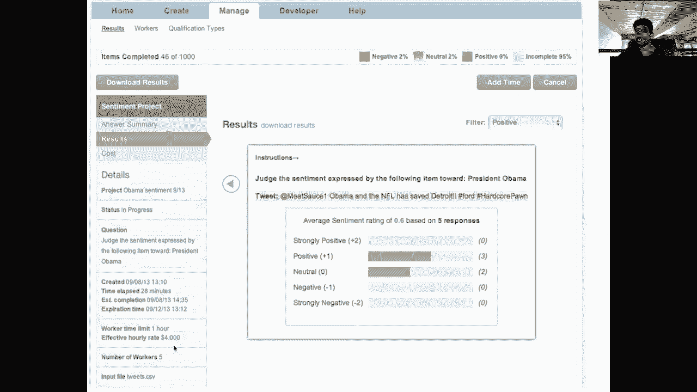

设计好任务后，下一步是上传数据文件。这个数据文件只是一个 CSV 文件，包含一堆字段。这些字段将被插入到你的 UI 中。例如，我可以在 CSV 中设置一个名为“句子”的列，然后我的 HTML 模板可以将这个句子作为一个变量包含进来，从而用你上传的数据文件中的一个条目来填充它。

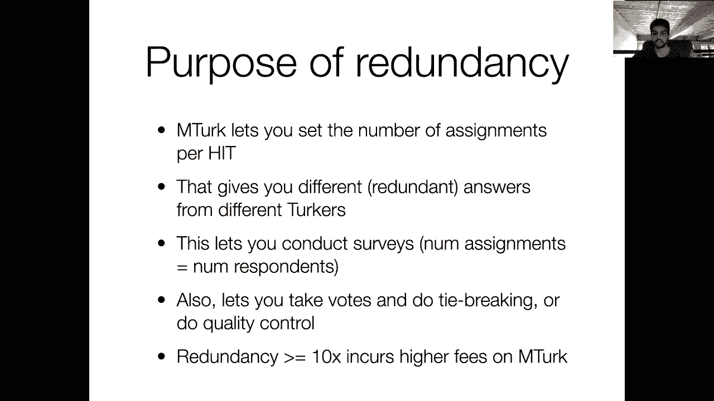

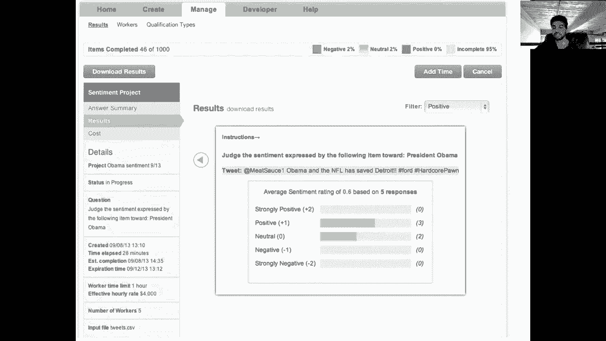

上传数据文件后（例如，你可能想为 10,000 个句子标注情感），你需要向亚马逊付款。亚马逊会抽取一定比例，我记得是 20%。所以你需要支付给工人 X 美元，然后亚马逊会额外加上 20%，他们从中赚取不少。

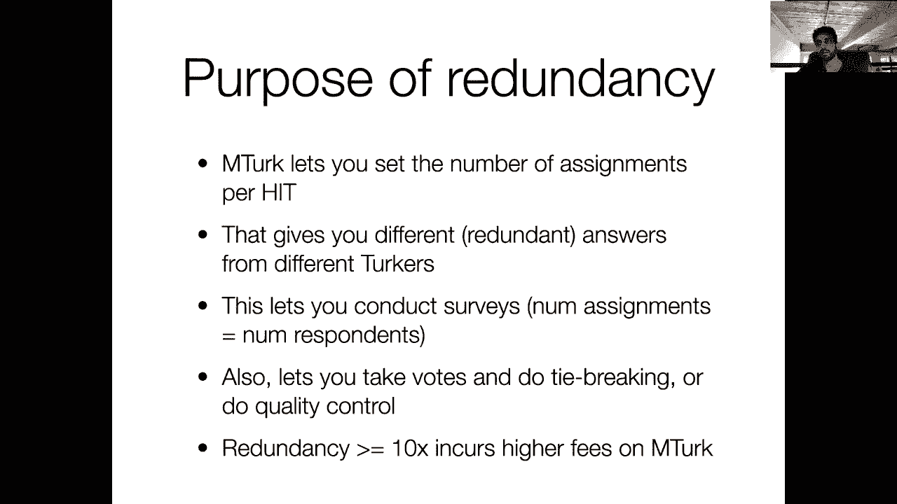

最后一步是：你已经发布了任务，并且从工人那里收到了结果。亚马逊要求你在工人实际获得报酬之前，批准或拒绝所有工人的回复。这在 Mechanical Turk 上非常重要。如果你是一名工人，收到拒绝会极大地影响你未来参与任务的能力。因此，通常人们会根据工人的拒绝率来筛选工人。你希望工人的 HIT 接受率在 95% 或 99% 以上。很多时候，创建 HIT 的人（称为请求者，比如研究人员）会因为一些站不住脚的理由拒绝 Turkers（Mechanical Turk 上对工人的称呼）的工作。通常，这是因为请求者没有明确说明他们希望工人做什么。一般来说，最好不要拒绝 HIT。相反，你可以给有问题的工人发送消息，告诉他们“如果你继续提交这样的内容，我们可能会拒绝”，或者你可以直接给他们分配一个资格限制，阻止他们继续参与该任务。因此，有不同的方法可以绕过这个奇怪的生态系统，在这个系统中，一次拒绝真的会影响工人的时薪，限制他们可以参与的任务数量。

**关于主观任务**：对于更主观的任务，可能存在多个正确答案，这些答案可能与数据集中包含的答案不同。我们如何处理这个问题？通常，验证过程（隐含在这个批准或拒绝过程中）对于主观任务来说很难做好。如果我要求你分享对某个背景的看法，我不会基于“正确性”来拒绝你的工作，这没有意义。如果你的工作不合语法，或者明显与背景无关，或者其他表面原因，我可能会拒绝。但绝对不建议拒绝工作，尤其是对于主观任务，或者可能不是你作为请求者会写下的答案。一般来说，验证过程在很大程度上是自动完成的，但同样，你需要倾向于宽容。即使一个工人因公然无视指令而被标记，在没有先给他们发消息、与他们互动、更清楚地说明指令等情况下，拒绝他们的工作是不好的。需要补充的是，这不仅仅是道德问题，工人自己也会给不同的请求者评分。有一些网站列出了所有不同的请求者，参与他们 HIT 的工人会根据不同维度对他们进行评分，比如报酬是否合理、任务是否容易理解、是否经常无故拒绝 HIT 等。如果你是一个经常滥用系统的请求者，你将无法吸引高质量的工人接受你的 HIT。这是双向的。有很多论坛和其他类型的网站，请求者和工人在那里互动，以解决各种问题。如果你想使用 Mechanical Turk，强烈建议你加入其中一个论坛，并在花费数千美元之前，就初步的任务设计获得反馈。

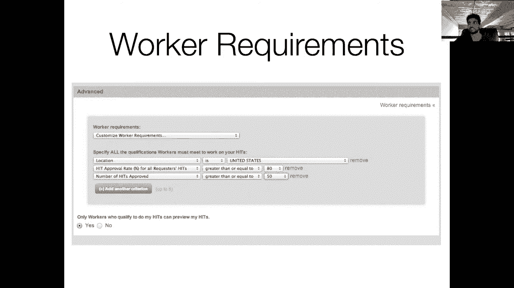

**关于自动化**：有人问是否有人使用 GPT-2 来冒充人类劳动力并以此获利。如果有人这样做，我并不知情，但我认为对于许多任务来说，这可能是可能的。例如，评估某个东西的情感，你可以设置一个微调过的 BERT 模型连接到 UI 并完成任务。我知道有些工人会编写脚本来自动化许多任务，这是许多请求者希望避免的，因为你当然希望真正的人类查看每个例子。有不同的方法可以尝试检测这一点。Mechanical Turk 会告诉你工人平均花费多少时间完成每个任务，你甚至可以设置他们必须在每个任务上花费至少多少分钟，然后才能进行下一个任务。因此，有不同的方法可以尝试检测这一点。人们一直在做使用脚本自动化标注过程的事情，我不确定使用语言模型会有多有利可图，但这肯定是可能的。

---

## Mechanical Turk 界面示例

这是你以请求者身份登录后会看到的界面。在左侧，我们可以看到许多不同的任务，例如图像审核、情感分析、图像标记、音频转录、写作等。这整体上涵盖了许多不同的 NLP 任务，你也许可以将我之前提到的所有任务都转化为这些模板中的一个实例。

假设我们想做一个情感分析任务。这是一个情感任务的设计，实际上是一个五点量表，而不仅仅是二元积极或消极量表。因为你有一个五点量表，这是一个细粒度的任务，你需要明确定义“强烈积极”和“积极”之间的区别。这有点主观。你可以看到一个示例，你的输入句子会显示出来。这允许你计算标注者间的一致性。例如，如果我有这个句子，五个不同的工人都将其评为“强烈积极”，我会相当确信这个句子是“强烈积极”的。但如果我有五个不同的工人，其中一个标记为“强烈积极”，另外四个标记为“消极”，那么我可能会对那个标记完全不同的工人持怀疑态度。我可以利用这些信息来识别这个工人，查看他们的其他标注，并最终可能将他们的标注从我收集的某些数据集中移除。

一旦你写了指令并选择了每个实例需要多少工人，下一步就是上传你的数据文件。这里我们上传了一个名为 `tweets.csv` 的文件，它只包含一列句子（在这个案例中是推文）。实际上，这个文件有两列：`tweet` 和 `user`，`user` 列不会显示给工人，只有 `tweet` 列会显示。

现在你进入设置任务所有不同参数的环节。你需要填写标题、描述、一些关键词，然后开始设置数字参数，比如你想为每个任务支付多少钱。在这个案例中，每个任务只是标注一条推文的情感，你将为每一条支付 0.25 美元。一般来说，最好支付大约最低工资的报酬。对于更困难、需要工人更多认知负荷的任务，你绝对应该支付更多。但对于不需要太多思考的简单任务，你应该争取每小时 15 美元左右，但这很少能做到。至少你应该努力争取。即使你试图估算以达到每小时 15 美元的水平也非常困难，因为你假设工人会不间断地工作一小时，每条情感标签只花费大约 10 或 20 秒。但实际上，当然没有人能长时间保持这种节奏。因此，慷慨支付总是好的，这也有助于你吸引更高质量的工人。

在这里，我设置了每个任务需要 10 个不同的工人，他们每个任务最多有 2 小时的时间。还有其他一些设置。最终，我会进入付款页面。你可以看到 Mechanical Turk 在这里抽取了相当大的比例，看起来超过 20%。也许他们最近提高了抽成。无论如何，一旦你完成了这些，你就正式发布了任务。现在你可以在 Mechanical Turk 界面上查看一些汇总统计数据。对于这个特定的例子，你从工人那里收到了 3 个积极标签和 2 个中性标签（或消极标签）。通常最好从 Mechanical Turk 下载结果，并编写自己的分析脚本，以便更具体地了解标注的当前进度。它还会显示类似“有效时薪”的信息。你可能估计你的支付方案大致能达到最低工资，但这显示平均而言，你支付的远未达到。任务花费的时间比你预期的要长得多。

我们之前讨论过，让尽可能多的人标注每个例子总是好的。标注者越多，你对多数标签的信心就越高。这也有助于你识别那些持续给出与多数不同答案的工人。通常有两种方法处理单个实例的多个标注：简单的方法是将标签指定为多数投票。例如，在这个例子中，如果三个人说这条推文是积极的，两个人说是中性的，我们就认为它是积极的。另一种方法是只考虑那些有 100% 一致性的例子，即所有五个工人都同意。对于其他所有例子，显然存在一些不确定性，可能是由于工人随意标注垃圾信息，也可能是句子本身确实存在一些不确定性。你可能想要剔除这些例子，或者你可能希望你的模型明确预测工人标签的分布，而不仅仅是一个单一标签。有很多不同的方法可以利用这些多个答案。当然，缺点是你要支付更多。如果你想要 10 个不同的工人，你就要支付 10 倍的费用。这总是一个限制因素。

我还没有提到如何筛选工人，这非常重要。一般来说，你希望工人有经验，以前执行过类似任务，并且他们的 HIT 批准率相当高。你可以看到，对于这个任务，我指定我的工人必须位于美国。你还可以指定他们应该说的语言。我指定了他们的 HIT 批准率必须大于 80，这实际上是一个非常低的门槛。通常我们使用 90、95 甚至 99。使用越来越高的数字的缺点是，你将过滤掉更大比例的劳动力。因此，如果你只允许高质量的工人来做，你的整体数据收集将需要更长的时间。你还可以根据工人的经验进行筛选。如果一个工人刚刚加入平台，从未做过 HIT，你可以通过“已批准的 HIT 数量”这个标准来过滤他们。还有许多其他标准。你也可以设置自定义标准。例如，你可以要求一个工人以前做过你的某个任务，也许你确信他们是好工人，因为你之前有过他们的标注经验。你可以给工人一些称为“资格”的东西，这有点像他们可以积累的徽章。如果他们拥有特定的资格，你可以将其添加为标准，比如“如果他们拥有这个资格，就允许他们参与我的任务”。这也是一个非常常见的方法，如果你想要一小群你信任的专家工人，你也可以在这里做到。

---

## 用于模型评估的众包

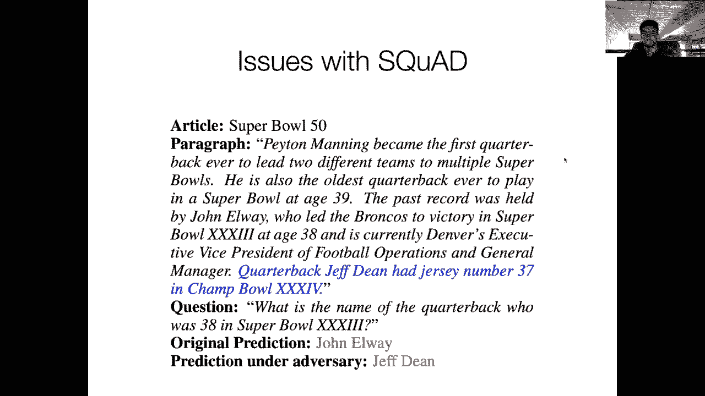

到目前为止，我们讨论的只是使用 Mechanical Turk 进行数据集收集。但在 NLP 中，它也经常用于评估模型的输出，特别是生成文本的模型。这是我所在小组在 Mechanical Turk 上进行众包任务的一个例子，我们正在评估转述生成，使用我们上一讲讨论过的三点量表。这里我们有原始句子和模型生成的句子，这本质上是一个分类任务。工人必须根据他们对这是否是转述的判断，点击其中一个选项。在这里，我们不是试图收集数据来训练模型，而是在收集工人对我们模型输出的判断，我们将用此来评估模型的表现。

再次记住，对于文本生成任务，自动评估指标相当有限。我们讨论过基于词和 N-gram 重叠的 BLEU 分数，但它没有对模型生成的文本进行任何深层的语义分析。因此，评估文本生成的最佳选择是进行人工评估。大规模的人工评估基本上意味着你必须借助 Mechanical Turk。这是众包如此重要的另一个原因。

---

## 任务设计不当的后果

以上基本上是如何创建一个简单的 Mechanical Turk 任务的快速概述。现在我想描述一些例子，说明如果你在设置任务时不小心会发生什么，以及即使你很小心，你的任务也可能设计不当。通常，这是由于工人和请求者之间的激励不一致造成的。

我们从蕴含任务开始，我们之前讨论过。斯坦福 NLI 和 MultiNLI 数据集都是通过 Mechanical Turk 创建的，都花费了数万美元。在这个设置中，向工人展示一个句子，并要求他们写一个蕴含该句子的句子、一个中性句子和一个矛盾句子。

想象一下，你是一名工人，你为写的每个句子获得一小笔钱。你的目标，不仅是为了这个任务，而且总的来说，当然是尽可能赚最多的钱。这基本上意味着你想平均以最快的速度完成每个任务。因此，工人的激励是：我如何能在设定的时间内，让我的所有 HIT 都被接受，同时以最快的速度完成它们，从而赚到最多的钱。请记住，大多数 Turkers 并不以此为全职工作。他们可能是有正常工作但有一些空闲时间的人（例如保安），或者只是无聊想赚点外快。但很难依靠在 Mechanical Turk 上工作作为全职工作，因为很少有任务支付的报酬接近最低工资。这就是工人的激励。

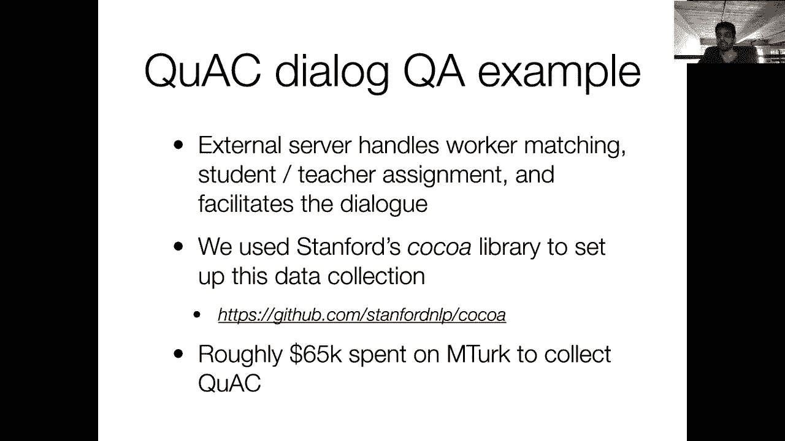

另一方面，请求者（比如 NLP 研究人员）希望获得尽可能多的例子，同时也希望这些例子能反映他们想要解决的实际任务。对于蕴含任务，你真正想要的是能测试模型对两个句子语义理解的例子。然而，事实证明，对于这个数据，工人们倾向于采用非常常见的策略来尽快写出这些句子。写一个蕴含句子的一个非常常见的策略是对输入句子中存在的不同事实进行模糊或更泛化的处理。例如，输入句子是“一个女人在装货码头和两个男人说话，卖竹竿”，写一个蕴含句子的简单方法就是说“哦，装货码头上有三个人”。所以“装货码头上至少有三个人”。你可以看到，我们在人数上变得更泛化，并且使用了“人”这个术语，而不是更具体的“女人”和“两个男人”。我们使这个句子更泛化了，这是产生蕴含关系的一种非常简单的方法，甚至不需要太多思考。对于请求者来说，理想情况下，你希望工人产生对模型具有挑战性、不易通过简单启发式方法解决的句子。

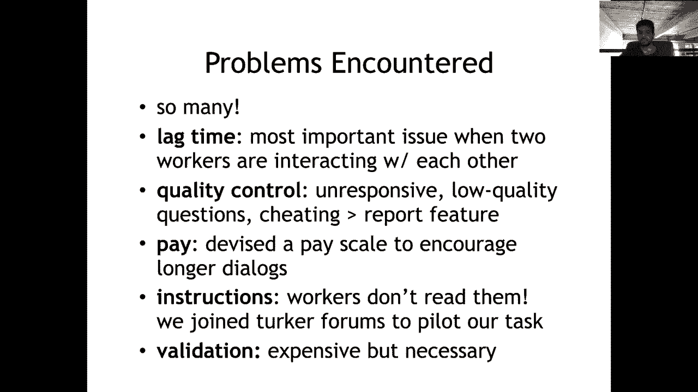

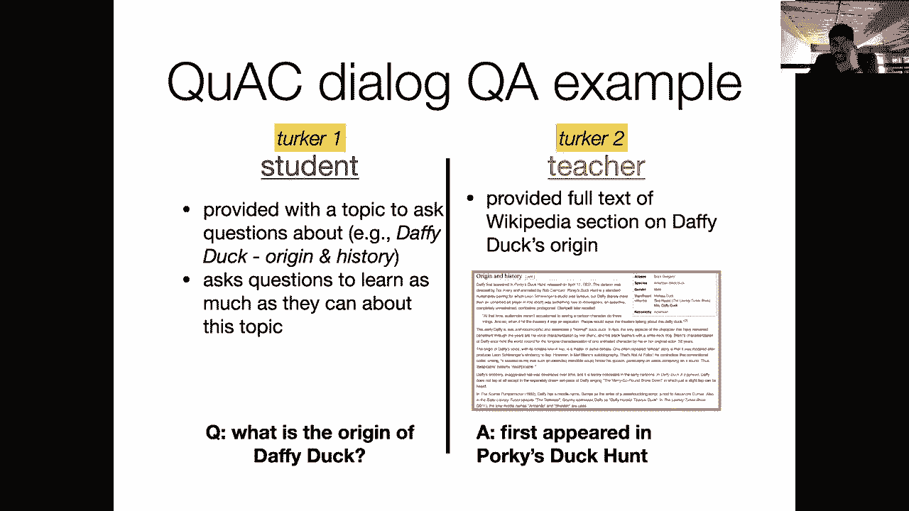

创建一个中性句子的简单策略是复制原始句子的大部分内容，但随后添加一些不相关的原因或因果类型的信息。例如，“一个女人在卖竹竿”完全是从前提中复制的，但你只是添加了一些前提中没有的原因。前提句没有说明这个女人为什么卖竹竿，所以你可以编造一些东西，这就变成了一个中性句子。

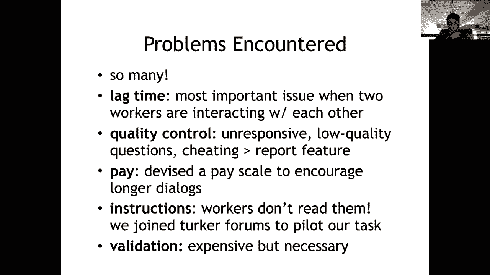

矛盾可能是最明显的生成方式，那就是否定前提句中发生的某些事情。例如，“一个女人在卖竹竿”，你可以说“一个女人不在卖竹竿”，你就产生了一个矛盾，而且你不必花太多时间去思考。

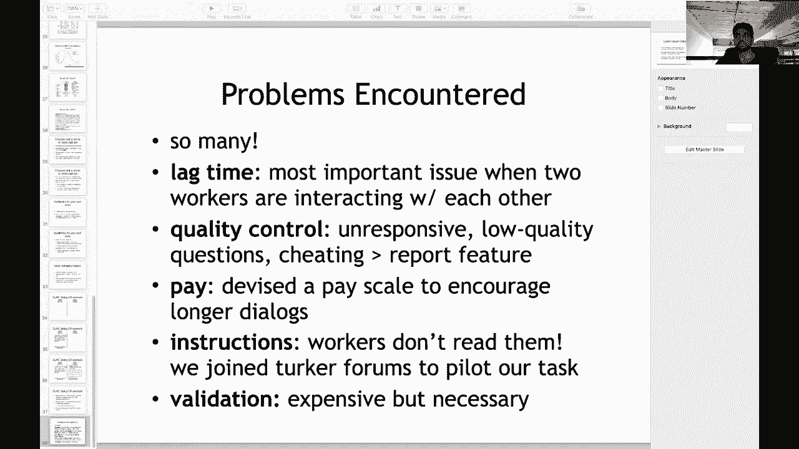

事实证明，许多工人遵循这些简单的启发式方法来生成数据集。这意味着，有趣的是，仅根据假设句子（即工人写的那个句子）进行训练，而根本没有看到前提句子的模型，也能在斯坦福 NLI 数据集上获得 67% 的准确率。请注意，这是一个三分类问题，多数类基线约为 34%。这表明有很大比例的示例可以在没有任何关于实际前提句子的信息的情况下被正确预测。这正好说明了当你考虑工人的激励以及它们如何与你自己的激励一致或不一致时，你需要非常小心。为了避免这种情况，你可能需要调整你的任务设计、指令和