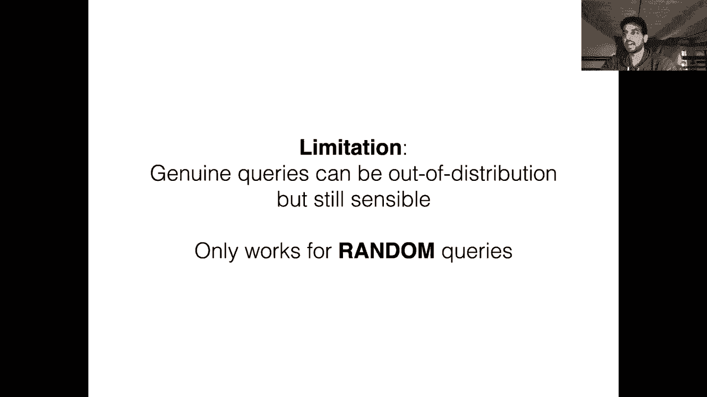

# 18：L15 - 模型蒸馏与抽取 🧠

在本节课中，我们将学习两种重要的模型压缩与复现技术：**知识蒸馏**和**模型抽取**。我们将探讨如何利用大型“教师”模型来训练更小、更高效的“学生”模型，以及如何通过API查询来“窃取”或复现一个黑盒模型的功能。

---

## 📚 概述

随着预训练模型（如BERT、GPT）的规模越来越大，它们在推理时的延迟和计算成本也急剧增加。为了在实际应用中高效部署这些模型，我们需要在不显著损失性能的前提下，将它们压缩得更小、更快。知识蒸馏就是一种实现这一目标的有效方法。此外，我们还将探讨一个相关的安全问题：模型抽取攻击，即攻击者如何仅通过模型的API输出来复现其功能。

---

## 🧪 知识蒸馏

上一节我们介绍了模型压缩的需求，本节中我们来看看**知识蒸馏**的具体原理。知识蒸馏的核心思想是使用一个大型的、性能优异的“教师”模型来指导一个更小的“学生”模型的训练。

### 核心概念

我们假设已经有一个训练好的大型教师模型（例如24层的BERT-large）。我们的目标是训练一个层数更少的学生模型（例如6层的DistilBERT），使其预测分布尽可能接近教师模型。

在标准的预训练中，模型使用**硬目标**进行训练。例如，对于掩码词预测任务，如果真实词是“barbershop”，则目标分布是一个**独热向量**，即“barbershop”的概率为1，其他所有词的概率为0。损失函数是预测分布与该独热向量之间的交叉熵。

**公式：标准交叉熵损失（硬目标）**
`Loss = -log(P_student(barbershop))`

在知识蒸馏中，我们使用教师模型预测的**软目标**来训练学生模型。软目标是教师模型对整个词汇表输出的概率分布。例如，对于同一个掩码位置，教师模型可能给出：`P(barbershop)=0.54, P(barber)=0.20, P(salon)=0.06, ...`。

**公式：蒸馏交叉熵损失（软目标）**
`Loss = - Σ_i [P_teacher(word_i) * log(P_student(word_i))]`

学生模型的目标不是仅仅预测出正确的词，而是模仿教师模型输出的整个概率分布。这种方法通常比直接用硬目标训练小模型效果更好，因为软目标包含了更多信息（例如同义词之间的相对概率关系）。

### 训练流程

以下是知识蒸馏的基本步骤：

1.  **固定教师模型**：使用一个已训练好的大型模型作为教师，其参数在蒸馏过程中保持不变。
2.  **准备训练数据**：使用与教师模型预训练时相同的数据（例如Wikipedia文本）。
3.  **生成软目标**：将训练数据输入教师模型，获取其对每个掩码位置预测的完整概率分布（软目标）。这一步可以预先完成并缓存。
4.  **训练学生模型**：初始化一个更小架构的学生模型。其损失函数是结合了软目标损失和硬目标损失的加权平均。
    *   **软目标损失**：让学生模型的预测分布逼近教师模型的软目标分布。
    *   **硬目标损失**：同时，也使用原始的独热标签（真实词）进行计算。
    *   总损失通常是两者的加权和：`总损失 = α * 软目标损失 + (1-α) * 硬目标损失`。

### 为何有效？

软目标比硬目标更具信息性。它不仅指出了最可能的词，还通过概率值传达了词与词之间的语义相似性和上下文适用性。例如，在“Bob went to the [MASK] to get a buzz cut”中，“church”的概率可能极低，但“and”的概率会更低。这种细微的区别有助于学生模型学习到更丰富的语言知识。

---

## 📊 蒸馏效果与变体

上一节我们介绍了基础的蒸馏流程，本节中我们来看看其实际效果和一些高级变体。

### 性能对比

研究表明，通过蒸馏得到的小模型可以保留教师模型绝大部分的性能。例如，DistilBERT在GLUE基准测试的多个下游任务上，能达到BERT-base 97%的性能，而参数量减少了一半，速度提升约60%。

更有效的方法是**预训练后蒸馏**：
1.  首先，用硬目标在小模型架构上从头预训练（得到一个小型预训练模型）。
2.  然后，用教师模型的软目标对这个小型预训练模型进行蒸馏微调。
这种方法通常比直接从零开始蒸馏效果更好，因为它为学生模型提供了一个更好的参数初始化点。

### 扩展的蒸馏方法

除了在最终输出层进行蒸馏，还可以对模型的中间表示进行约束：

*   **隐藏状态蒸馏**：让学生模型每一层的隐藏状态尽可能接近教师模型对应层的隐藏状态。损失函数可以使用均方误差（MSE）。
    **公式：隐藏状态损失**
    `Loss_hidden = || h_teacher - h_student ||^2`
*   **注意力矩阵蒸馏**：让学生模型的注意力权重矩阵模仿教师模型的注意力模式。

像**TinyBERT**这类模型就综合使用了多种蒸馏损失，从而在极致压缩下仍能保持良好性能。

---

## 🎫 彩票假设：另一种压缩途径

除了蒸馏，**彩票假设**提供了一种截然不同的模型压缩视角。该假设认为，在一个随机初始化的稠密神经网络中，存在一个“中奖彩票”子网络。当这个子网络被单独训练时，它能够达到原网络相当的精度。

### 寻找“中奖彩票”

以下是其基本步骤：

1.  **随机初始化**并训练一个大型网络至收敛，得到参数 `θ`。
2.  **修剪参数**：根据参数的绝对值大小，修剪掉一定比例（例如50%）最小的权重。这产生了一个二进制掩码 `m`。
3.  **重置参数**：将剩余权重（掩码为1的位置）重置回它们最初的**随机初始化值**。
4.  **重新训练**：仅使用这个子网络（应用掩码 `m`），从重置后的初始化状态开始重新训练。

实验发现，这样找到并训练的子网络性能，远好于随机修剪同等数量参数后训练的网络。这表明，初始随机化中蕴含了某些对成功训练至关重要的“幸运”子结构。

---

## 🕵️ 模型抽取攻击

现在，让我们切换视角，探讨一个与蒸馏原理相似但目的不同的技术：**模型抽取攻击**。这指的是攻击者通过查询黑盒模型的API，来窃取或复现一个功能相似的模型。

### 攻击场景

假设一家公司（如Google）通过API提供一项付费的NLP服务（如情感分析或机器翻译）。用户输入文本，API返回预测结果（通常只是最可能的标签，而非完整概率分布）。攻击者的目标是“偷走”这个模型，以便自己免费使用。

### 攻击方法

攻击流程与蒸馏惊人地相似，但条件更加苛刻：

1.  **受害者模型**：即提供服务的黑盒模型（对应“教师”）。
2.  **查询构造**：攻击者生成大量输入文本发送给API。最简单的方法是生成**随机单词序列**（毫无语法和意义）。
3.  **收集数据**：记录每个输入及其对应的API输出标签，形成一个`(输入, 标签)`的数据集。
4.  **训练替代模型**：攻击者选择一个公开的预训练模型（如BERT），用自己的`(输入, 标签)`数据集对其进行**微调**。这里的标签是硬目标（API返回的argmax标签）。

令人惊讶的是，即使使用完全随机的、无意义的查询文本进行微调，得到的“窃取”模型在真实的、有意义的测试数据上也能表现出不错的性能。这意味着，以极低的查询成本（例如，花费几十美元进行数万次API调用），就可能复现一个价值高昂的商业模型。

### 防御措施的局限性

目前，有效的防御措施非常有限：

*   **API水印**：服务商在极少比例的查询中故意返回错误标签，并记录这些“水印”查询。如果将来发现某个公开模型在这些水印查询上系统地输出错误标签，则可能表明它是由自己的API数据训练的。但前提是攻击者必须公开其模型。
*   **成员推断分类器**：训练一个分类器来检测输入是否可能是攻击性的随机查询，并对这类查询返回随机结果。但这可能误伤合法但分布外的用户查询，影响正常服务。

总体而言，模型抽取攻击目前是一种低成本、高威胁的攻击方式，且缺乏完美的防御手段。

---

## 📝 总结

本节课中我们一起学习了：
1.  **知识蒸馏**：一种利用大型教师模型输出的软目标来训练高效学生模型的模型压缩技术。其核心在于软目标比硬目标包含更丰富的监督信息。
2.  **彩票假设**：一种通过修剪和重训练来发现高效子网络的模型压缩新视角。
3.  **模型抽取攻击**：一种通过查询黑盒模型API并收集输入-输出对来窃取模型功能的安全攻击。它揭示了仅凭模型预测结果就可能复现其核心能力的风险。

这些技术突出了在追求模型效率与性能的同时，平衡计算成本、部署可行性和安全性的重要性。