# 25：L20 - 语义解析教程 📚

在本节课中，我们将要学习**语义解析**，这是一个将自然语言句子转换为中间逻辑表示的任务，该表示随后由外部模块执行以产生最终输出。我们将特别关注其在**问答**领域的应用。

---

## 🎯 概述与课程安排

上一节我们介绍了课程的基本信息。本节中，我们来看看本周的具体安排和成绩相关事宜。

本周是课程的最后一周。本课主题是侧重于问答的语义解析。

我们之前在高层次上介绍过阅读理解式问答，但今天我们将讨论一些从机器学习角度看略有不同且更有趣的内容。

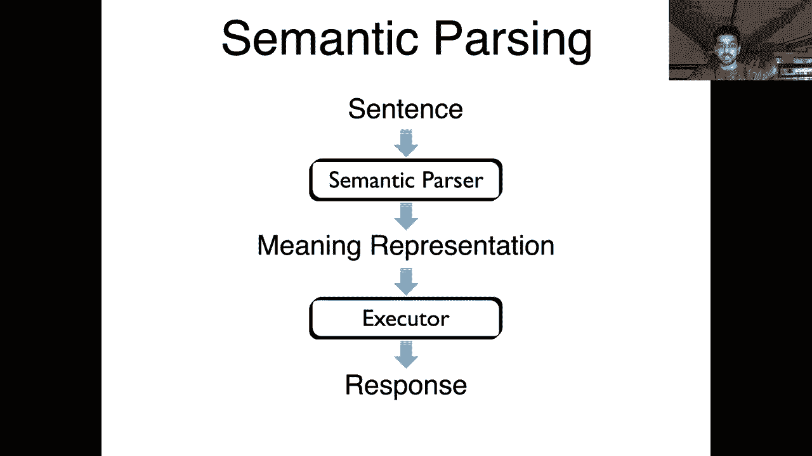

以下是本周的一些课程事务安排：

*   本周五将进行最后一次测验。
*   作业正在批改中，成绩将很快公布。
*   课程项目报告和Pass/Fail选项申请的截止日期均为12月4日。
*   期末考试将在本月月底前完成评分。
*   本学期最后一节课（周三）将由博士生Lorraine带来关于常识推理的客座讲座，可能也会涉及知识图谱相关内容。

关于成绩，上学期的成绩分布显示大多数学生获得了不错的成绩，因此无需过度焦虑。Pass/Fail的阈值将在所有期末成绩确定后划定，但通常C以上即可通过。

---

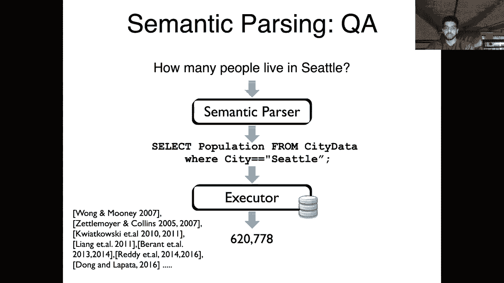

## 🤔 什么是语义解析？

上一节我们了解了课程安排，本节中我们来看看语义解析的核心概念。

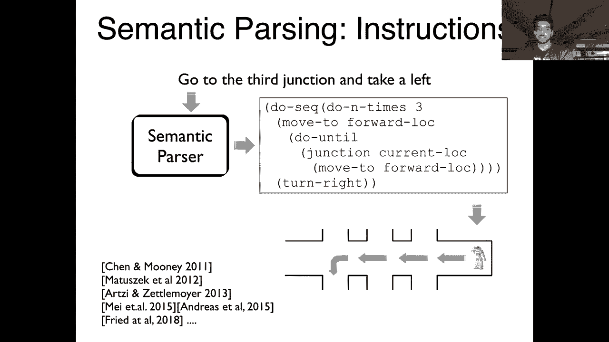

语义解析是一项任务，通过该任务，你可以将一个自然语言句子转换为某种中间逻辑表示，然后由某个外部模块执行该表示以产生最终输出。

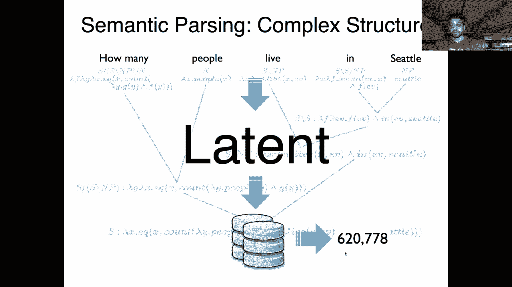

让我们看一个实际例子。假设有一个问题：“西雅图有多少人口？”。

我们可以设计多种模型来回答这个问题。目前最直接的方法可能是将句子输入类似GPT-3的语言模型，看它产生什么数字或回答。或者，你也可以用BERT做类似的事情。

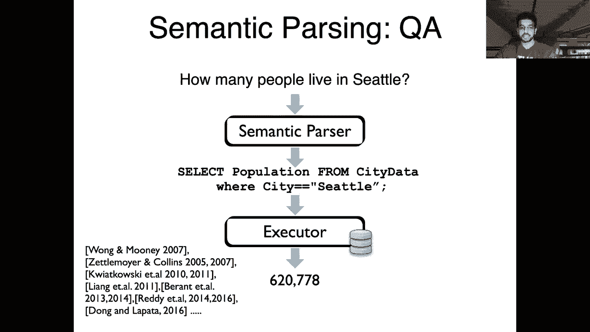

但如果我们假设可以访问包含城市和人口数据的外部数据库或表格呢？那么，我们不是直接生成答案或从维基百科段落中检索，而是能够从这个自然语言问题创建一个可以在外部数据库或知识源上执行的查询。

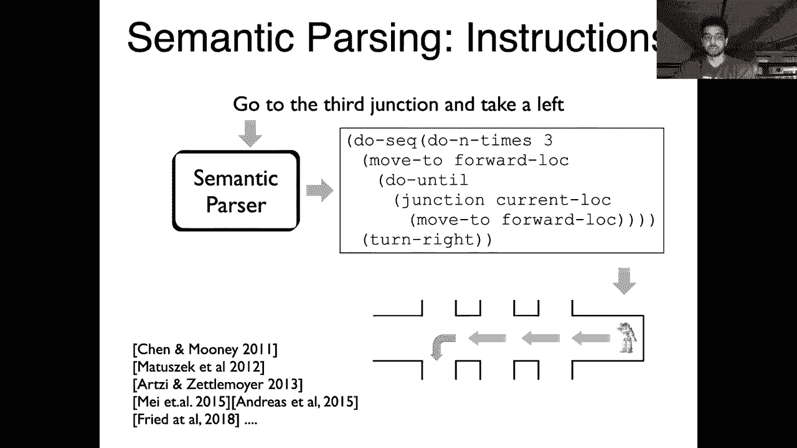

例如，我们可以将这个问题转换成SQL语句：`SELECT population FROM city_data WHERE city = 'Seattle'`。然后，数据库软件将执行此查询并直接从数据库返回答案。

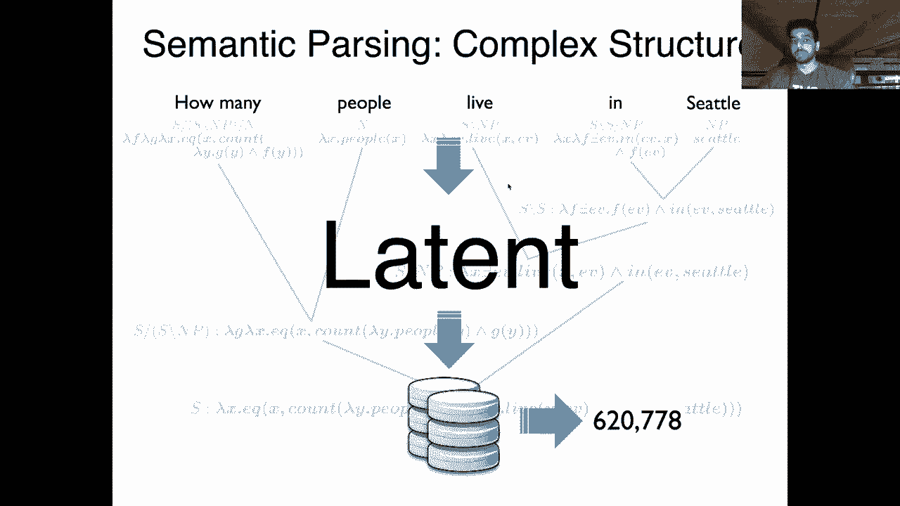

如果我们能找到一种可靠的方法将问题转换为有效且可由执行器模块执行的查询，那么我们就能很好地利用所拥有的外部资源（如数据库）。在许多情况下，这可能是处理此类问答任务的理想方案。

语义解析的概念不仅适用于问答，也适用于涉及机器人和指令跟随等任务。例如，我可能想告诉机器人“到第三个路口左转”。我不只是想给它这个指令的BERT表示，因为它需要从密集的向量表示中提取相关指令。相反，我的机器人很可能使用某种原始语言进行操作，比如“移动到”、“前进”或“右转”等它知道如何用内部软件执行的原始命令。

我可以将这个自然语言指令转换成机器人实际理解的指令序列，这样机器人就很容易执行。例如，“到第三个路口左转”被我用机器人的语言重写。如果解析步骤正确，我的机器人将学会导航到正确的位置。这是语义解析的一个非常实际的应用。

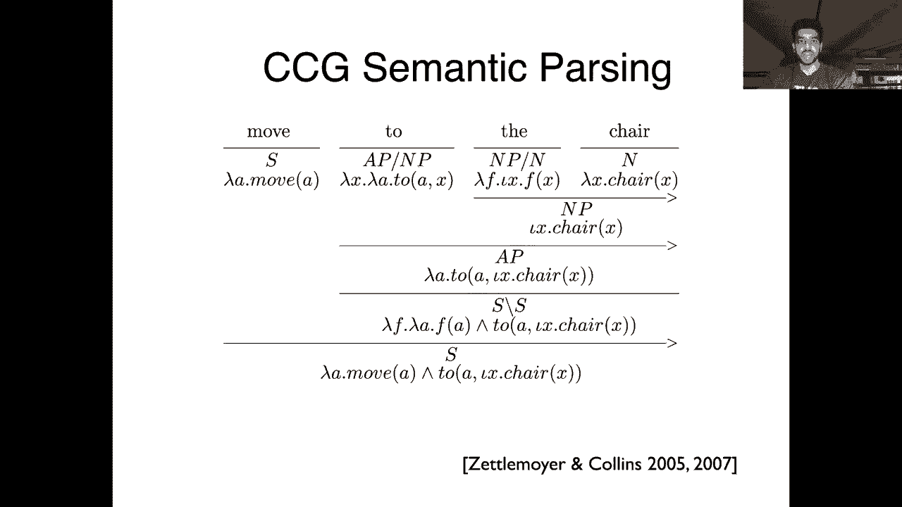

---

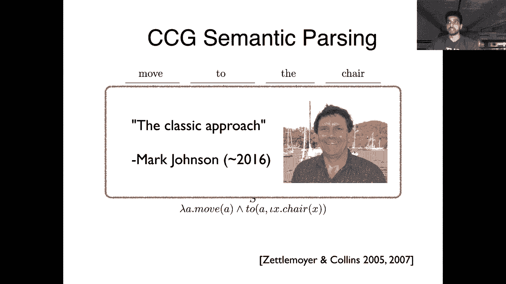

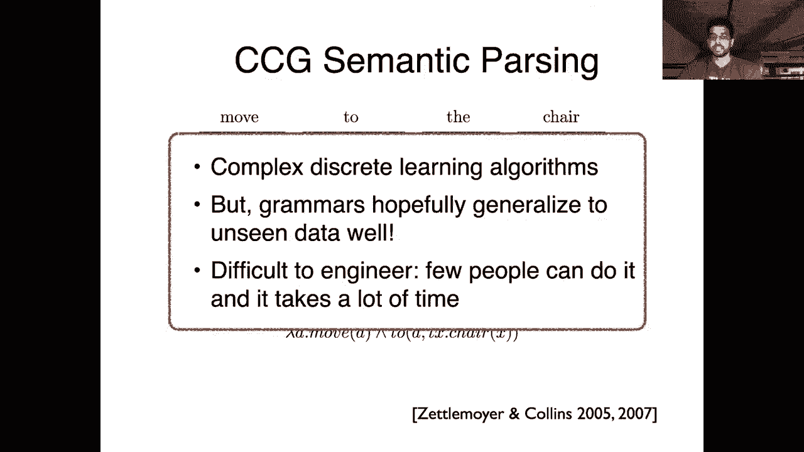

## 🧠 语义解析的挑战与学习

上一节我们介绍了语义解析的应用场景，本节中我们来看看其核心挑战，即训练数据的获取问题。

从机器学习角度看，使语义解析成为一个有趣问题的挑战在于：通常，我们的语义解析数据看起来是输入（自然语言句子/问题）与执行器模块产生的实际输出配对。

我们可能观察到这个问题和它的真实答案，但可能无法获得语义解析器本应产生的真实逻辑形式。

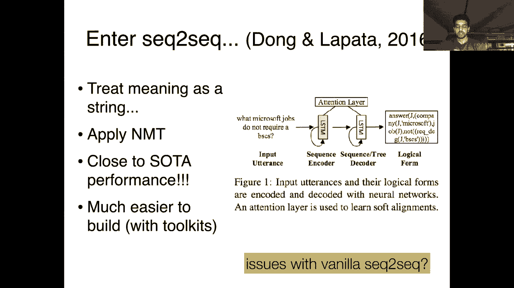

仔细想想，设置一个众包任务让人们为这些问题想出答案很容易。例如，一个众包工作者看到这个问题可能会去谷歌搜索并给出答案。然而，如果要求众包工作者写出能从数据库访问此答案的SQL查询，则需要大量领域专业知识才能可靠地完成，因此对于大多数任务来说，这并不可行或成本效益不高。

即使在指令跟随的情况下，获取这类指令也很困难。想象一下，要求某人编写出能让机器人朝正确方向移动的真实程序。相反，你可能只有指令、起始位置图像和结束位置。这对于进行注释的众包工作者来说，生成起来要快得多。

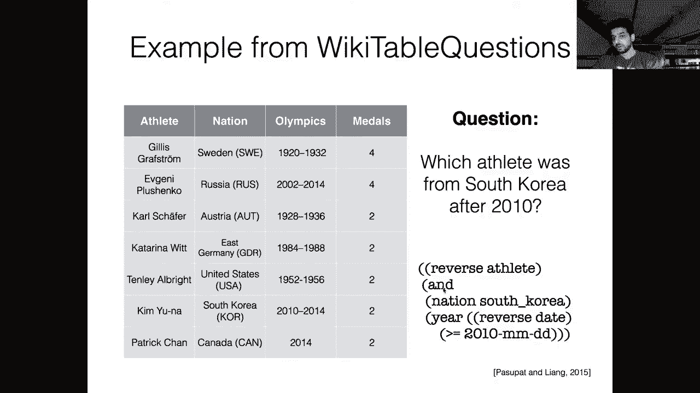

因此，我们通常假设无法获得真实的逻辑形式。这意味着，在我们实际构建模型将自然语言转换为逻辑形式的部分，我们没有监督信号，因此这变成了一个**隐变量问题**。

---

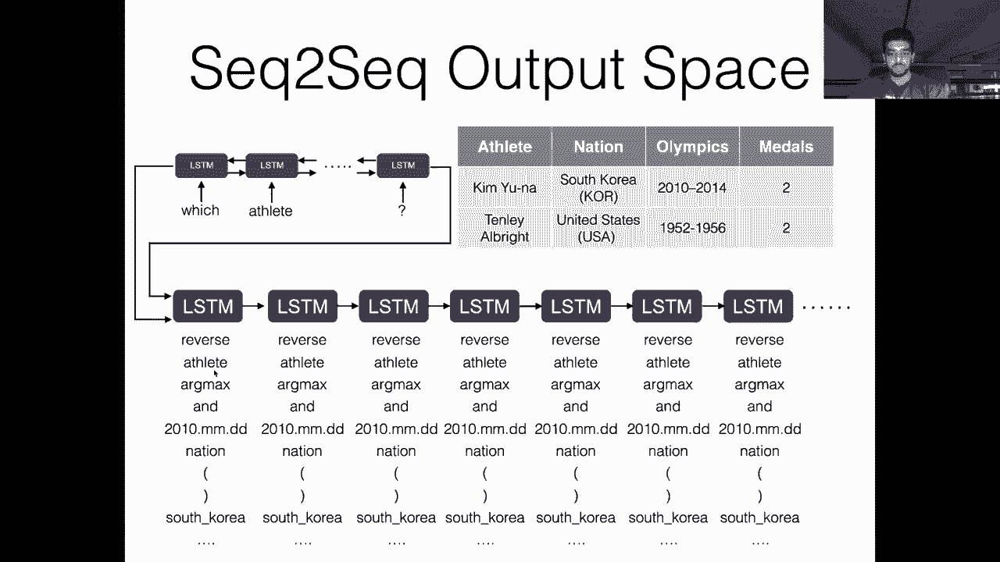

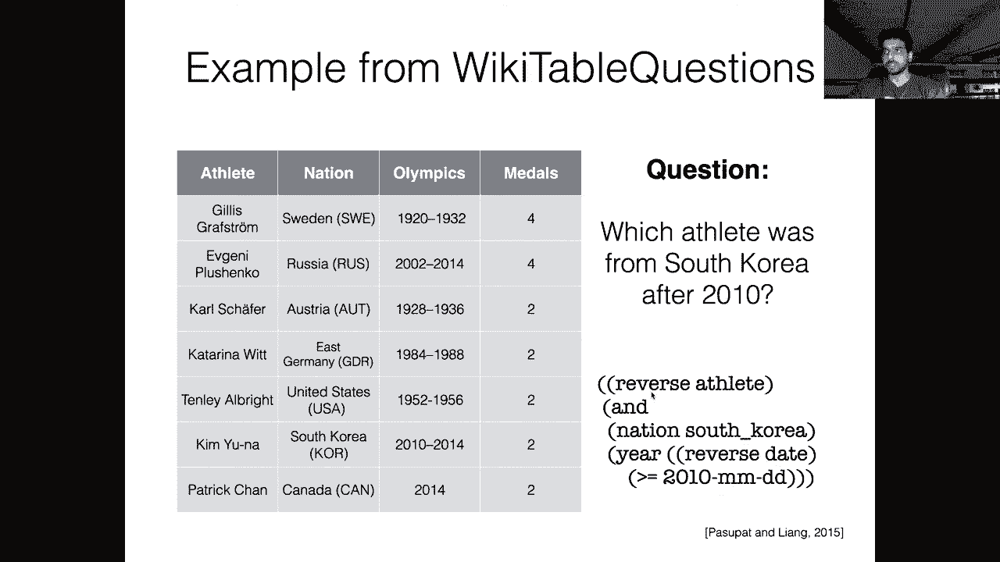

## 📜 语义解析的历史方法

上一节我们讨论了弱监督学习的挑战，本节中我们回顾一下语义解析的历史方法。

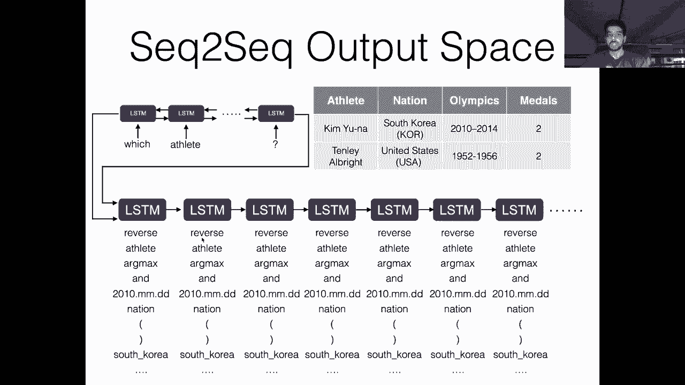

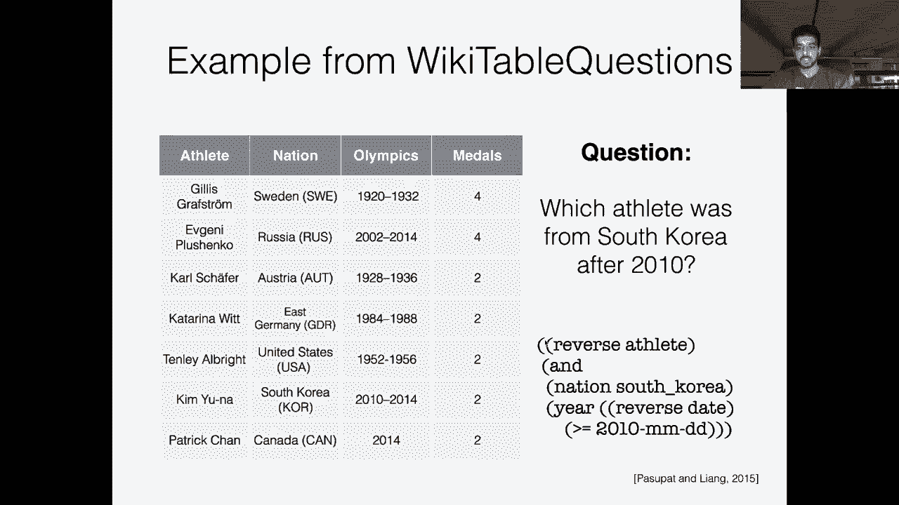

多年来，语义解析一直是**组合范畴语法**解析的领域。这种方法依赖于手工设计语法和词典。

例如，在指令跟随案例中，“移动”是一个重要的动作，我可能希望在词典中有一个具有特定语义的“移动”表示，这些语义定义了“移动”如何与句子中的其他词组合。类似地，我可能有一条规则说“椅子”是名词。如果我看到一个名词旁边有某种限定词，那么我会将它们转换成一个名词短语。最终，动作“移动”将需要一个介词短语来修饰它，告诉它移动实际发生的位置。最终，我可以得到句子的完整解析部分，如果我将这些项目中的每一个都基于某个低级指令，那么我可以将它们组合成更复杂的动作，比如“移动到椅子”。

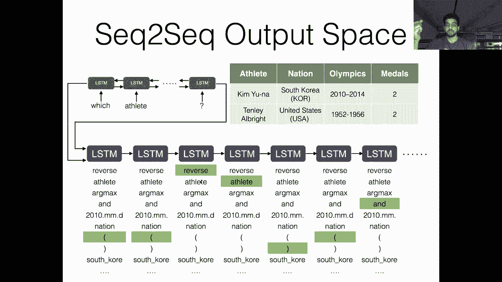

截至2016年，这是经典方法，因为自那以后，它基本上被神经方法所取代，正如NLP中的大多数事情一样。

这种方法的一个主要缺点是，要使这些系统表现良好，需要进行大量的语法工程。

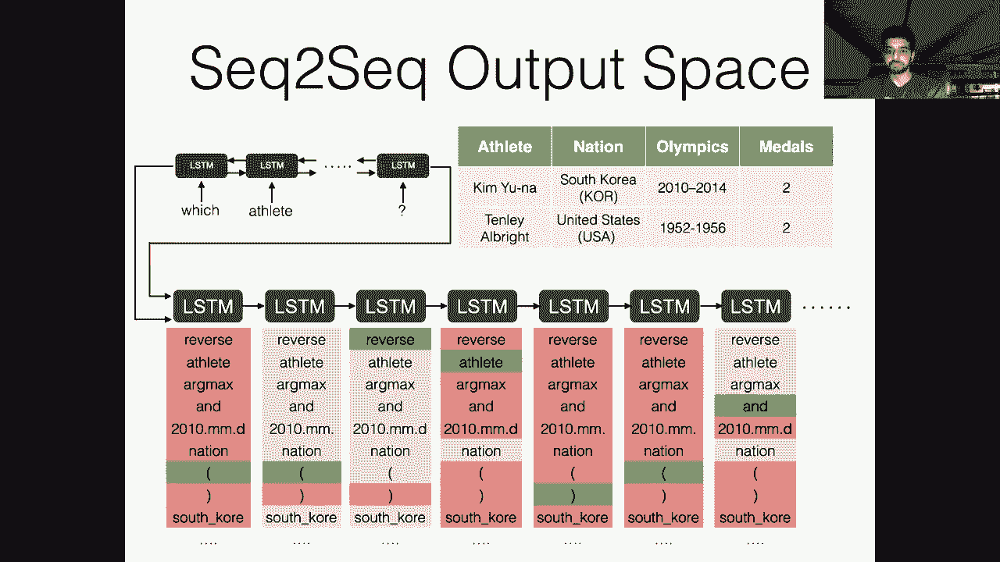

---

## 🧠 神经序列到序列方法

上一节我们介绍了传统的语法工程方法，本节中我们来看看基于神经网络的序列到序列方法。

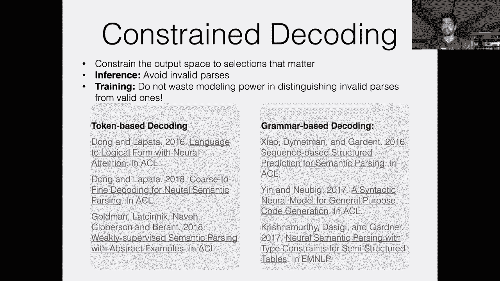

2016年，出现了初步尝试，不将其视为CCG解析问题，而是视为神经序列到序列问题。

这里，输入类似于“哪些微软职位不需要计算机科学学士学位？”，我将其通过编码器-解码器模型，解码器被要求从左到右生成逻辑形式的标记。

这种方法的表现与现有的经典方法相似，并且构建起来非常容易，因为只需应用现成的机器翻译工具包，并将输入和输出从“英语到法语”改为“自然语言到逻辑形式”。你可以添加注意力机制，用Transformer建模编码器和解码器等。

但是，如果只是简单地将此任务移植到序列到序列设置中，会存在一些问题。让我们看看《WikiTableQuestions》论文中介绍的例子。该论文引入了一个问答数据集，其中所有问题都关于维基百科中的单个HTML表格。

例如，我们可能有一个问题：“2010年后来自韩国的运动员是哪位？”。你可以想象将此问题转换为某种逻辑形式，可能是类似SQL的语句。在这篇论文中，他们使用了另一种形式语言，但本质上你是在选择“运动员”列并添加一个过滤器，比如SQL中的WHERE语句，条件是“国家”为韩国且“年份”大于等于2010。这就是你想要生成并在此表上执行的内容。

让我们思考一下，如果我们将此问题建模为序列到序列问题会发生什么。这里我们有一个编码器（例如LSTM），紫色单元格是解码器，我们从左到右一次生成一个标记。在每个时间步，我们都有词汇表中可以选择的完整词汇类型。

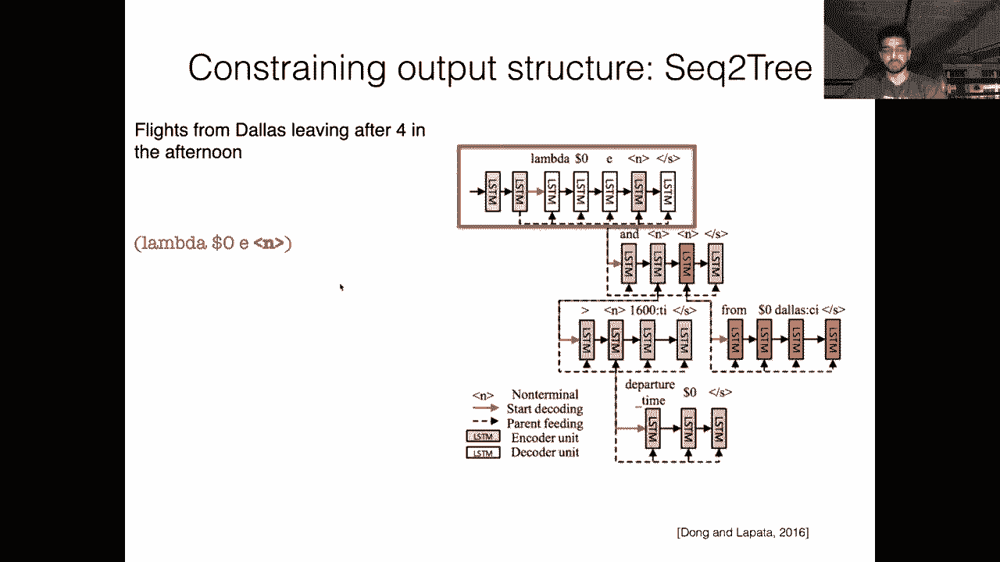

如果我们查看这个逻辑形式并思考这个生成操作，本质上是一个SELECT语句。在许多情况下，使用完整词汇表来解码特定时间步是没有意义的。例如，查看这个逻辑形式，前两个标记是括号。你可以假设所有形式语言的语句都包裹在括号中。因此，你可能有一些先验知识，知道在第一个时间步总是生成一个开括号。

也许你还知道其他规则，例如在开括号之后，我只能生成形式语言中的动作或运算符。我不能直接放入表中的列名或单元格名，因为形式语言不允许这种用法。这些形式语言的语法限制性很强。因此，如果我选择了类似“reverse”（类似于SELECT操作）的内容，那么我知道下一个要解码的内容必须是列标题之一，它告诉我需要选择哪一列。这显然不能是一个单元格，也不能是闭括号。所有这些在形式语言中都不是正确的语法。

因此，使用普通序列到序列解码的一个问题是，在每个时间步，只有一小部分词汇可能在那个特定时间步在语法上是有效的输出。

下图更清楚地显示了这一点：在第一个时间步，你基本上只能输出开括号，这里红色的所有其他内容都不应该被你的模型考虑。你可以看到，在某些时间步，红色单元格的数量远远超过了你实际可以选择的合法单元格数量。因此，你可能希望进行某种**约束解码**，以考虑形式语言的语法。

---

## 🔧 约束解码策略

上一节我们指出了序列到序列解码在语义解析中的问题，本节中我们来看看解决方案：约束解码。

约束解码在这些解码器语言模型中实现起来非常简单。你需要做的就是定义一些规则，根据观察到的先前标记（也可能根据你所在的确切时间步）来约束你的词汇表。

例如，你可以写一条规则：如果时间步等于0，那么我只能生成一个开括号。这样我就不会浪费时间查看词汇表中的其他项目，因为它们根本无法生成。

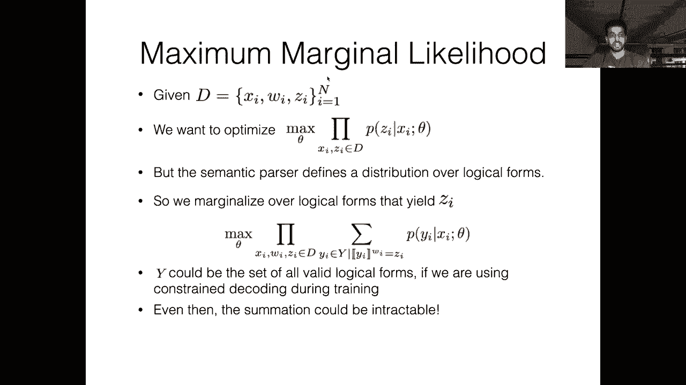

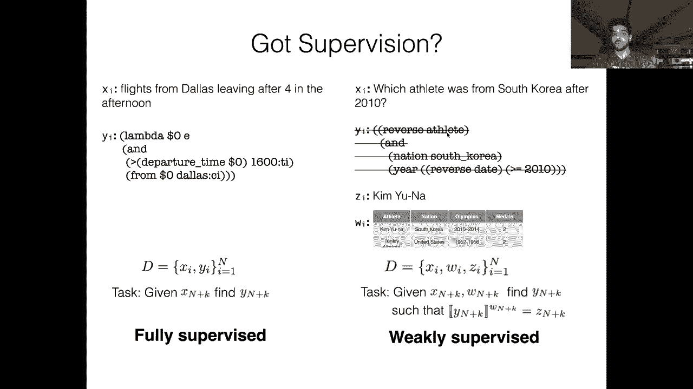

有两种方法可以进行这种基于约束的解码：

1.  **基于标记的解码**：在每个时间步，将词汇空间限制为在形式语言语法中有效的标记。
2.  **基于语法的解码**：不直接生成实际标记，而是生成语法规则，即你可以有非终结符，这些非终结符可以扩展为终结符或进一步的非终结符。但你的解码器将生成这些规则，而不是直接生成逻辑形式的单个标记。

这两种类型都有相关研究工作。应该说，基于标记的解码方法肯定更简单直接。

---

## 🌳 序列到树结构

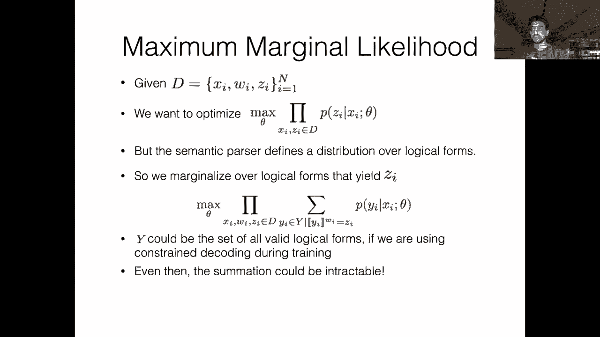

上一节我们介绍了约束解码，本节中我们来看一个结合了层次结构的基于标记解码的例子：2016年的序列到树设置。

这里有一个旅行预订任务，这也是语义解析非常有用的一个案例。用户可能会问自动旅行代理：“显示所有下午四点后从达拉斯起飞的航班”。由于没有真人在线，这个自动代理需要将用户说的话（例如通过电话）解析成某种SQL语句，以便在其航班数据库上执行。

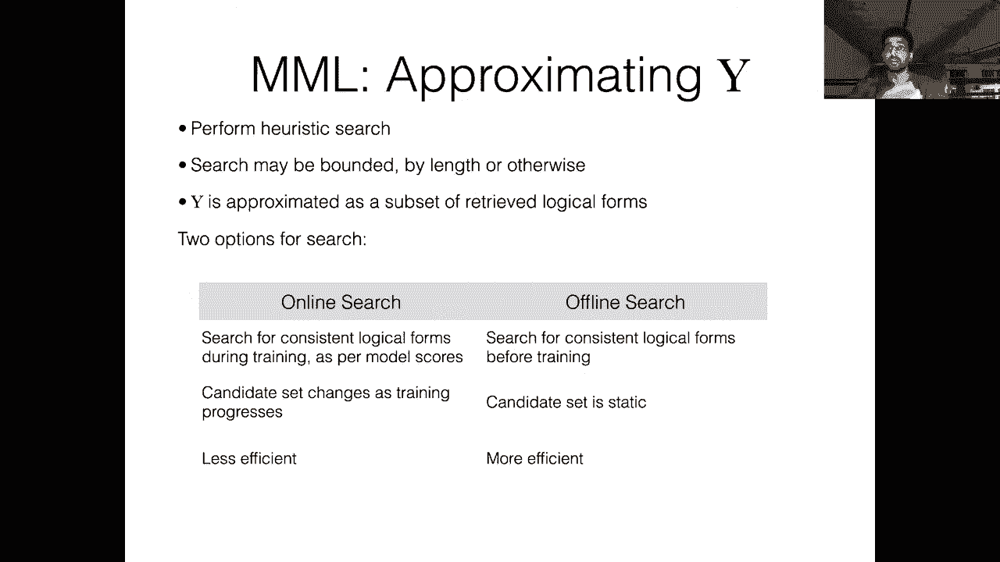

在这种情况下，模型再次生成逻辑形式的所有标记，但以一种有趣的树状方式进行。它首先生成逻辑形式的高级模板。然后，我们有一个类似“`[and]`”的填充标记，这表明在这个特定时间步，我想将其扩展为更进一步的标记，或者也可能是更多稍后可以自行扩展的填充标记。

在这里，我们看到这个标记被扩展为“`and`”，然后是一堆空白标记，这些将是逻辑形式中这两个子句的扩展。最后，在树的最低层，最嵌套的“出发时间”被解码出来。所有这些都是通过一个解码器实现的，在该解码器中，我们进行某种特殊建模，将层次结构较高层的隐藏状态连接到扩展为逻辑形式的较低层部分。

这是一种相当直接的方法，既能获得查询结构的全局知识，又能一直解码到这些低级语句。

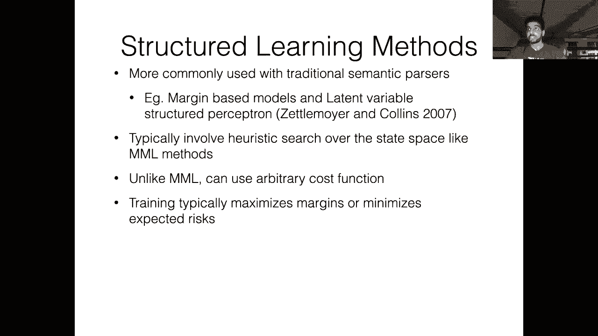

---

## 🏋️ 如何训练语义解析器？

上一节我们讨论了模型结构，本节中我们转向一个有趣的问题：如何训练语义解析器？

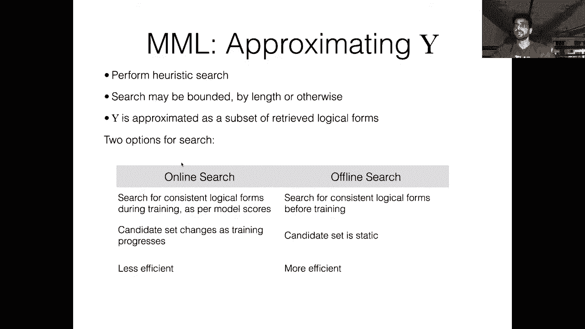

当然，如果你有逻辑形式的监督信号（但之前提到过，我们通常没有这种真实的逻辑形式），那么训练就很容易。我可以像训练机器翻译系统一样，使用真实逻辑形式作为解码器的参考来训练它。但这并不有趣，也不实用，因为很难获得这些逻辑形式来训练。

更可能的情况是**弱监督**情况。例如，我可能有问题“2010年后来自韩国的运动员是哪位？”，并且有该问题的实际答案（即表中回答此问题的单元格）。这是众包工作者可以轻松完成的事情（只需点击表中回答此问题的单元格）。但他们无法产生在表上执行时能导向此单元格的实际逻辑形式。

因此，如果我拥有问题和真实答案，但没有逻辑形式，这就是一个弱监督问题，因为我正在训练的语义解析器的目标是产生逻辑形式的标记。

---

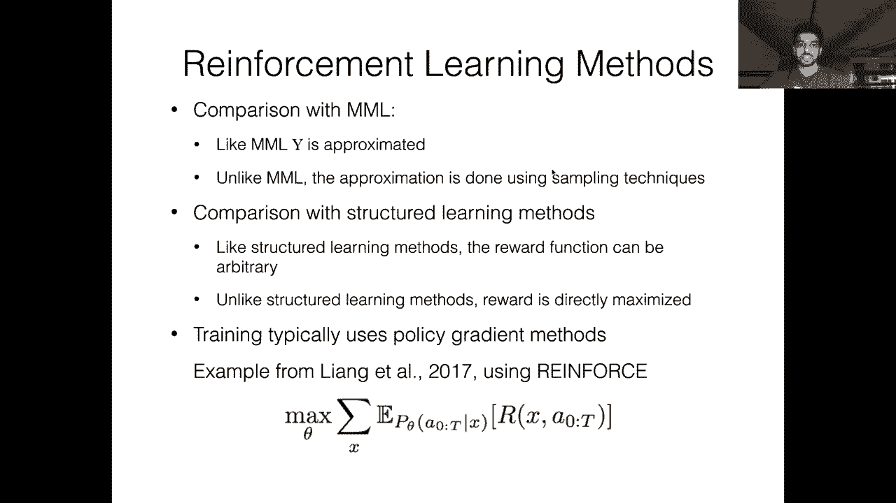

## 📊 弱监督训练方法

上一节我们明确了弱监督问题，本节中我们来看看解决这个问题的三种主要训练方法。

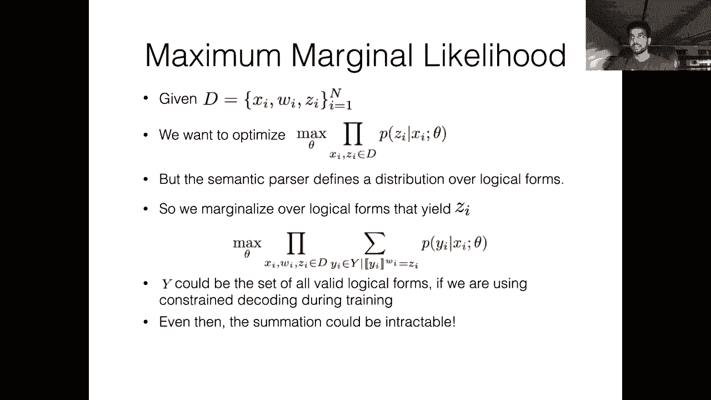

因为我们在本课程中没有详细涵盖任何强化学习甚至结构化学习的内容，所以这里只是让你了解在这些场景中有用的不同类型方法的大致思路。我们目前看到的大多数算法都可以通过反向传播和梯度下降轻松解决，解码时可能使用波束搜索。训练算法本身并不那么有趣。我们重点关注的是如何设计模型、不同类型的架构以及用于计算梯度（如反向传播）的不同目标函数。

对于这种弱监督语义解析问题，事情并不那么简单，这是因为我们没有逻辑形式的真实监督信号。

以下是三种训练方法：

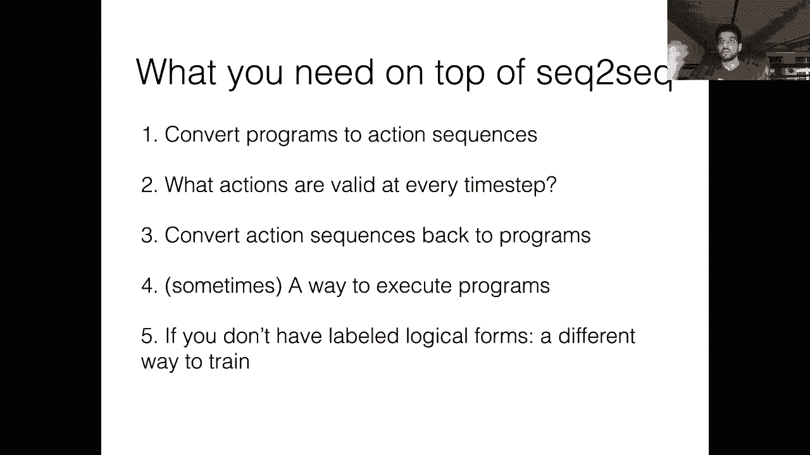

### 1. 最大边际似然训练

这里，我们给定自然语言句子或问题 `x`，该问题的真实答案 `z`（例如表中的单元格），以及逻辑形式 `y`。在我们的设定中，我们不知道 `y`，而 `y` 正是我们实际想要的东西。我们想要一个模型，给定输入问题 `x`，能给出正确答案 `z`。但我们不是直接计算某个以 `x` 为输入、以 `z` 为输出的函数。相反，我们有一个函数以 `x` 为输入，产生逻辑形式 `y`，然后将其交给某个执行器模型以获得 `z`。重要的是，第二步（将 `y` 转换为 `z`）通常无法通过反向传播训练，因为我们不知道SQL具体是什么，它只是执行一些代码在数据库上运行命令。这不是我们流程中可训练的部分。因此，我们唯一能训练的是给定自然语言问题 `x` 产生逻辑形式 `y` 的部分。

那么，我们最终要优化的就是这个方程：我们将对所有可能生成的、在我们的形式语言中有效的逻辑形式进行边际化。我们将查看所有那些在执行器模型执行后能产生正确 `z` 的逻辑形式，并以此方式优化我们的模型。这里，`Y` 是所有可能逻辑形式的空间，`y_i` 是这些逻辑形式的子集，当被执行器执行时，会得到答案 `z_i`（在我们的例子中是“金妍儿”）。

这种公式化的问题在于，找出所有执行后能导向此答案的可能逻辑形式通常是难以处理的。而且，除了非常合成和小型的设置外，在大多数设置中枚举所有可能的逻辑形式根本不可行。因此，这种方法通常不直接使用，但会使用这种公式的某种近似。例如，我们不会使用所有执行后得到答案的逻辑形式，而是进行搜索，可能找到一些执行后得到答案或得到与答案相似结果的逻辑形式，即使它们没有直接执行出答案。我们可以用这些来指导训练。因此，在这个近似搜索过程中，我们的训练信号可能有点嘈杂，但我们希望它们能提供足够的信号来训练我们的语义解析器。

### 2. 基于搜索的方法

这类方法涉及对所有可能逻辑形式的状态空间进行某种启发式搜索。我们可能会获取找到的逻辑形式的某个子集，并使用基于间隔的损失函数来训练我们的语义解析器。

当我们近似这个逻辑形式集合 `Y` 时，我们当然希望找到那些直接执行出答案或与答案密切相关的逻辑形式。例如，你可能有一个逻辑形式，其问题是“哪些运动员在2010年后参加了奥运会？”。那么这个问题不仅会返回金妍儿，还会返回表中2010年后参加的其他运动员。在这种情况下，如果我找到一个执行出一批其他运动员（包括金妍儿）的逻辑形式，它可能没有回答这个确切的问题，但它仍然给了我们一些有用的信号。它部分返回了我们想要的结果，也许我们只需要一些进一步的过滤就能得到正确答案，但这在训练语义解析器时仍然有用。

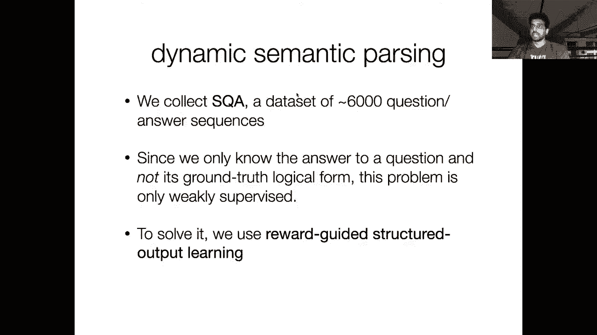

我们可以使用不同的方法来剪枝搜索空间，例如查看当前逻辑形式与真实答案之间的重叠度并以此设定阈值，或者使用实际搜索。另一个选择是使用执行这些逻辑形式后检索到的答案与问题之间的重叠度。我们可以用许多方法来缩小搜索空间。

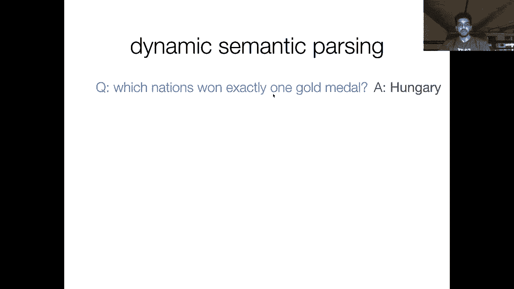

通常有两种进行此搜索的方式：
*   **在线搜索**：每次在训练中看到一个问题时，你都会为该问题进行一次搜索，以获得一组逻辑形式，然后用它们来更新模型。这通常很好，因为随着训练的进行，你的候选逻辑形式可以越来越接近正确的逻辑形式。但效率也不高，因为你实际上必须为每个问题都进行搜索。
*   **离线搜索**：这意味着你只在离线时进行搜索，因此在训练期间你有一个静态的候选逻辑形式集合。显然这更高效，因为你在训练期间不搜索。但除非你有一个非常好的方法在没有训练模型的情况下进行搜索，否则效果可能较差。

一般来说，很难找到这些逻辑形式。如果你能使用某种启发式方法找到它们，并且得到一组逻辑形式，其中部分或全部通常能执行出正确答案，那么你的问题可能没有你想象的那么复杂。因此，对于更具挑战性的问题类型，方法通常使用在线搜索。

### 3. 强化学习方法

第三种策略是强化学习。从概念上讲，这只是另一种近似逻辑形式搜索空间的方法，但这里我们不是通过搜索来找到相关或能精确评估出答案的逻辑形式，而是使用**采样**。我们将使用某种函数为不同类型的运算符或参数分配概率，并在此函数的引导下采样逻辑形式。然后，我们将使用一个奖励信号来训练这个函数，该信号指示这个逻辑形式是否执行出了正确答案。

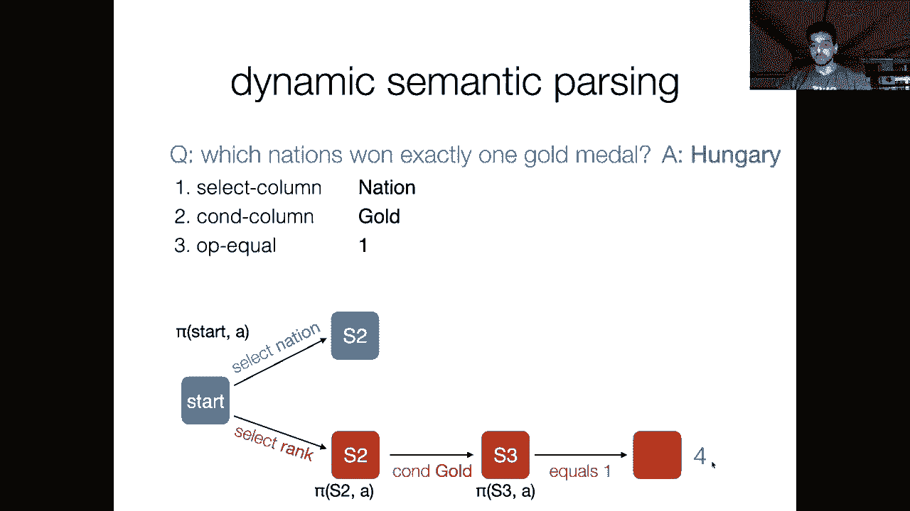

在实践中，强化学习很难让这类问题很好地工作，因为你需要做出许多增量决策。生成这样一个逻辑形式的过程实际上被分解为一系列标记级别的预测。因此，如果我在解码器的每个阶段进行采样，我会做出许多不同的决策，这可能导致**信用分配**问题：我可能不知道我做出的哪个决策（采样的哪个特定标记）导致我获得零奖励。

另一件事是，在许多这些问题中，即使你在逻辑形式中犯了一个小错误，你也可能得到零奖励，因为你的答案可能不完全匹配该问题的正确 `z_i`。在这种情况下，你根本得不到奖励。你可以设计奖励函数，使其给予部分奖励，但这确实依赖于具体任务。当然，也有一些方法混合了我们这里讨论的不同策略，比如搜索和强化学习。我们稍后会看一个例子。这些问题的机器学习非常有趣，这也与NLP中一些尝试使用类似BLEU分数奖励（而不是针对参考句的最大似然）来训练机器翻译模型有关。

---

## 🔄 方法回顾与总结

上一节我们详细探讨了弱监督训练方法，本节中我们退一步，总结一下语义解析的关键要点。

我们研究了这些用于语义解析的序列到序列方法，即试图将问题或程序等转换为逻辑形式语言中的动作序列。

如果你要用序列到序列建模来实现这一点，你应该知道在每个时间步哪些类型的动作是有效的，以及你的词汇表中哪些子集在特定时间步永远不应该被输出。

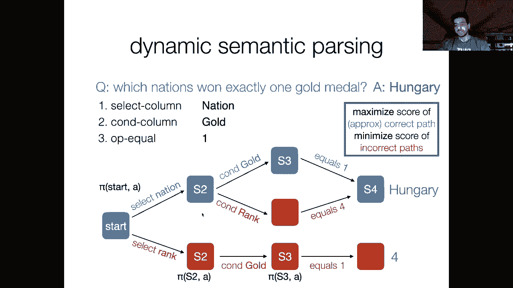

通常，你需要一种方法来执行这些程序，你需要一个执行器模型来告诉你一个特定的逻辑形式是否给出与你的参考相同的答案。

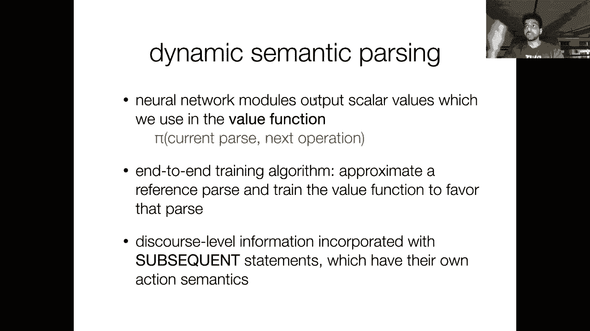

最后，在最实际的、没有参考逻辑形式的情况下，你将不得不使用我们刚刚描述的这些策略之一（强化学习或搜索）来实际可行地训练你的模型。

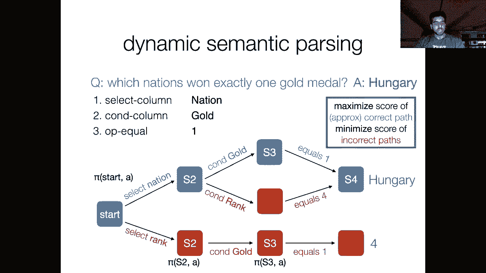

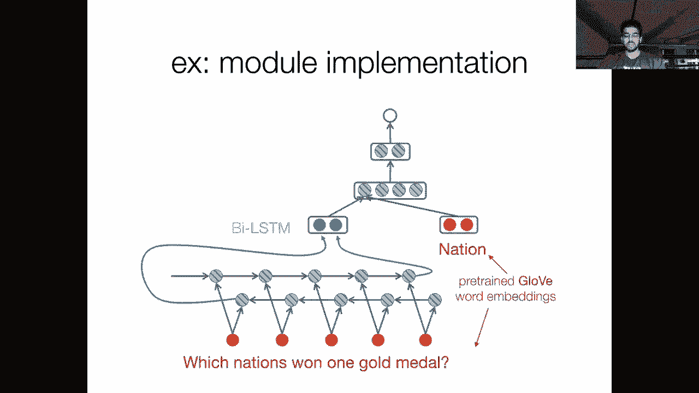

---

## 💡 案例研究：对话式语义解析

上一节我们总结了语义解析的核心方法，本节中我们来看一个结合了多种方法的研究案例。

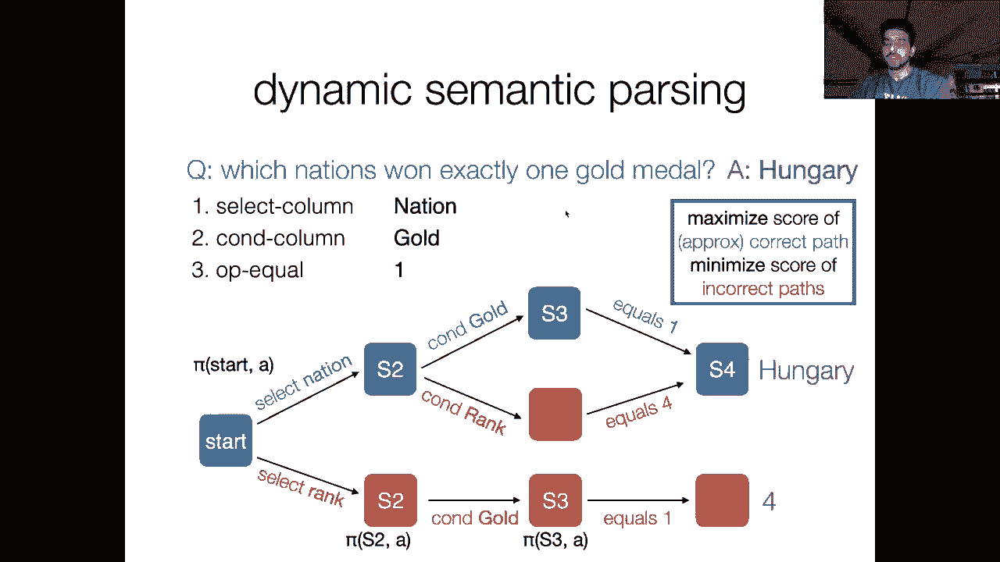

最后要讨论的是我在研究生阶段参与的一个与语义解析和问答相关的项目，它结合了许多这些方法。由于我们没有适当的背景知识来深入细节，我们将在相当高的层次上进行讲解。

这里的任务是**对话式语义解析问答**。你可以想象问你的Alexa“一个鸡蛋含有多少蛋白质？”，她很可能正确回答。但你可能想继续这一系列提问，问一个后续问题“一个鸡蛋含有多少碳水化合物？”。为了让对话代理正确回答这个问题，它需要能够知道后续问题中隐含地提到了鸡蛋。鸡蛋实际上没有在这个后续问题中提到，但它是隐含的。

我们在维基百科的这些表格中研究这个对话式QA问题，这与我们简要看过的WikiTableQuestions数据集非常相似。

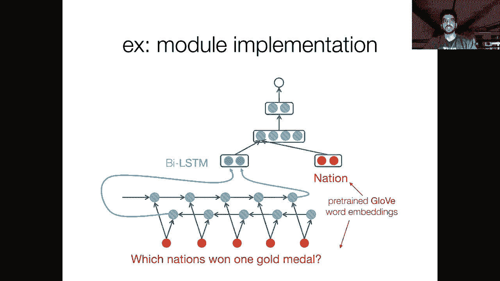

例如，我可能有一个像“女子水球世界杯”这样的表格，以及一个问题