# 26：L21 - [客座讲座] 常识推理 🧠

在本节课中，我们将学习什么是常识推理，探索如何为常识知识学习合适的表示方法，并了解如何评估模型是否具备常识知识。

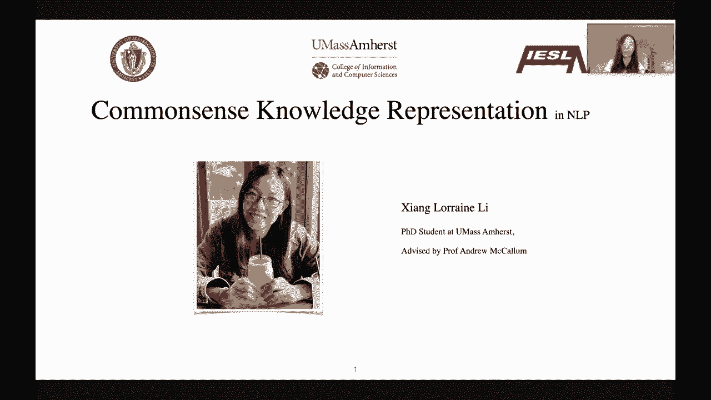

---

## 什么是常识知识？

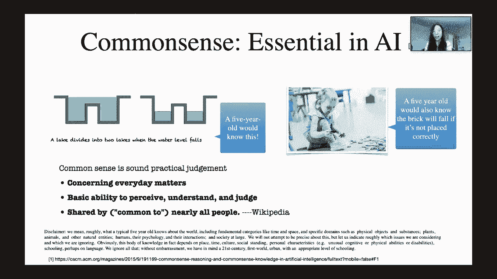

常识知识是一种关于日常事务的、实用的判断能力。它涉及人们感知、理解或判断某些情境的基本能力，并且被几乎所有人所共享。

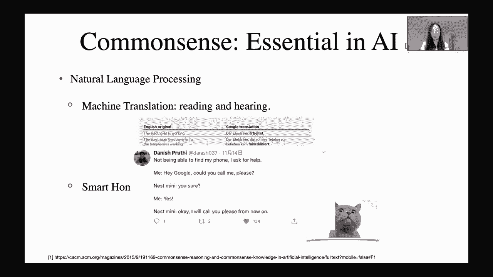

例如，一个五岁的孩子会知道，当水位很高时，湖泊可能会被分成两个湖。他们也会知道，如果积木玩具没有正确放置，积木就会掉下来。

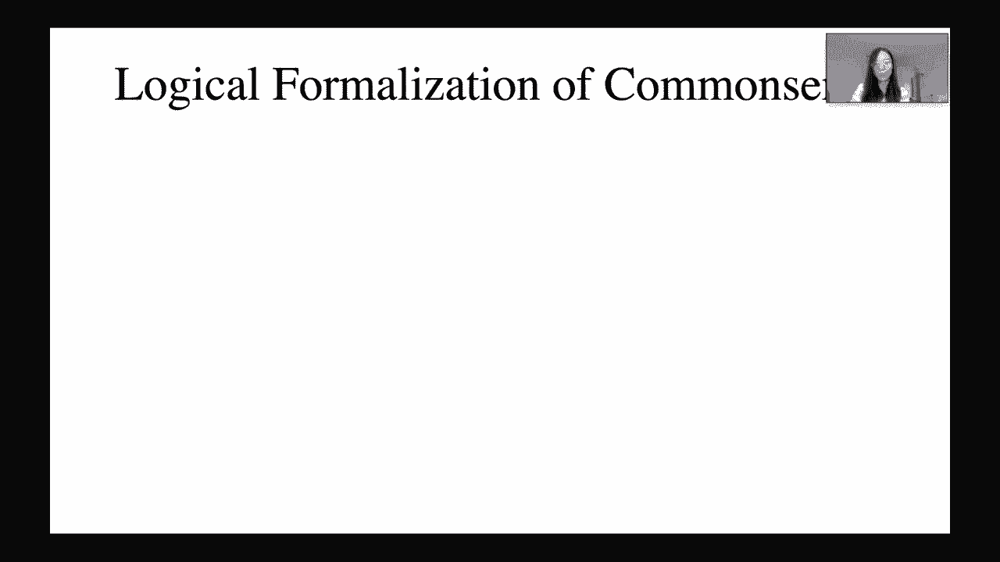

在自然语言处理中，常识知识无处不在。例如，在机器翻译中，软件需要理解“working”一词的确切含义，才能正确翻译成德语。在智能家居助手中，机器需要理解“你能给我打个电话吗？”这样的请求，而不是字面意思。

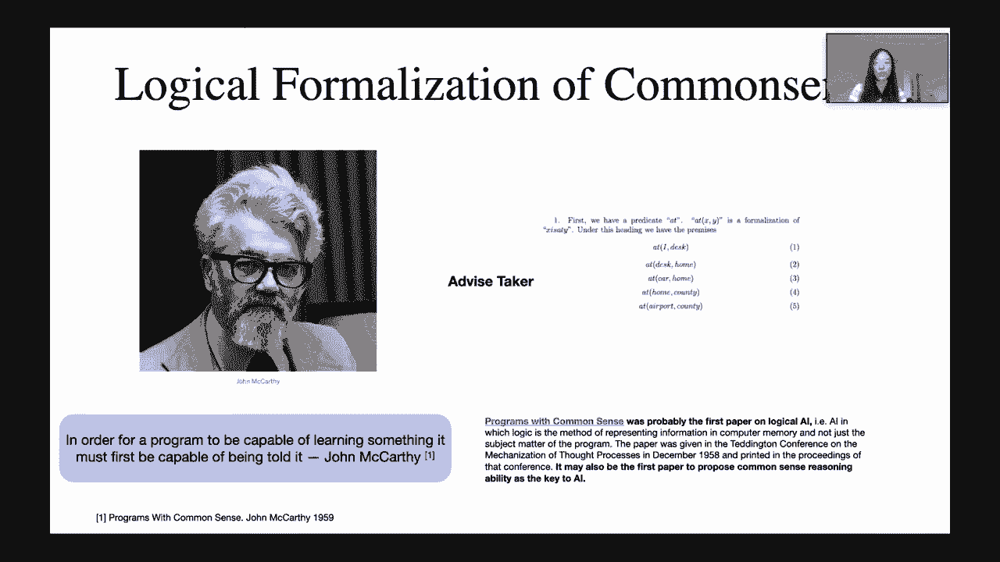

---

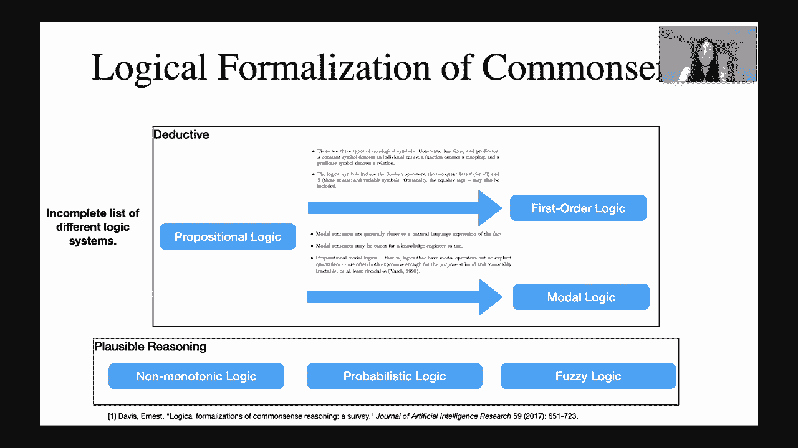

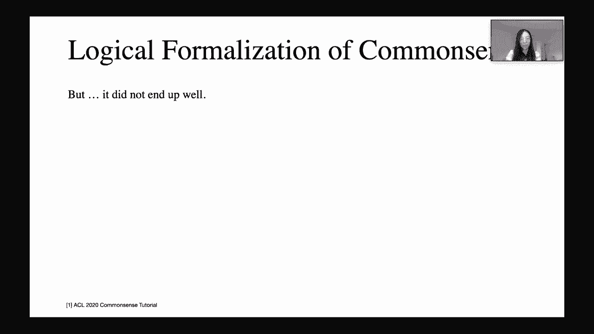

## 常识推理的历史尝试与挑战

既然常识如此重要，之前必然有过解决的尝试。在20世纪70年代和80年代，研究人员投入了大量精力，尝试使用逻辑公式来表示常识知识。

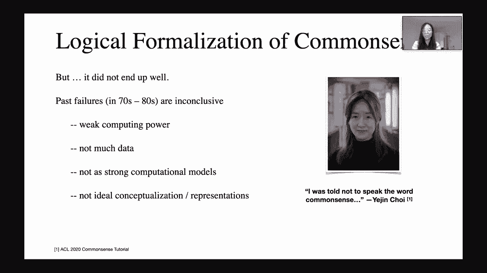

图灵奖得主约翰·麦卡锡是使用逻辑系统形式化常识问题的先驱之一。他在1959年发表的论文《Program with Common Sense》中指出，常识推理是人工智能系统必须具备的关键能力。他提出了“建议接受者”系统，用类似三元组（如“我在桌子旁”、“桌子在家里”）的方式来表示知识。

此后，许多逻辑系统被应用于常识领域，包括命题逻辑、一阶逻辑、模态逻辑等演绎推理逻辑，以及非单调逻辑、概率逻辑、模糊逻辑等似然推理逻辑。

尽管提出了许多不同的逻辑系统，但在那个时代对常识知识的建模取得了一些进展，但总体而言并不成功。

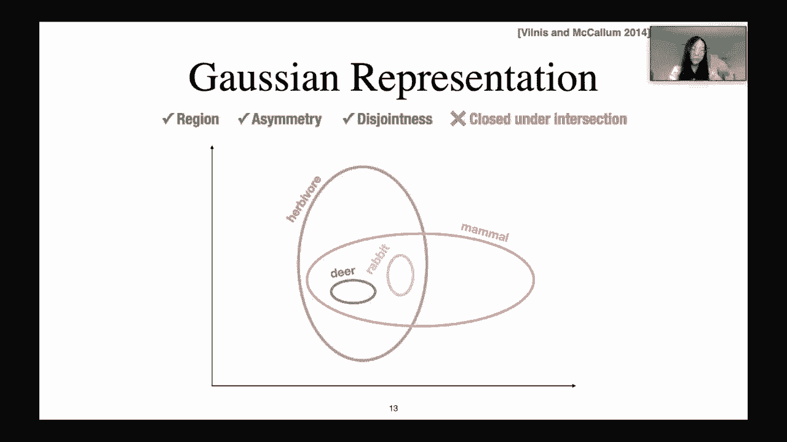

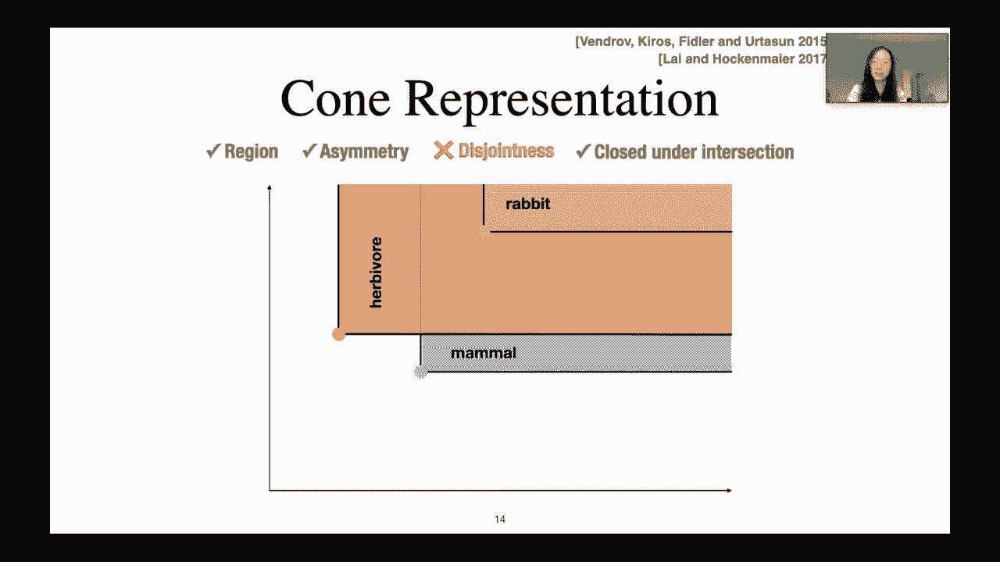

正如华盛顿大学教授叶锦初所说，在21世纪初，人们甚至避免谈论“常识”这个词。过去常识推理失败的原因是多方面的，包括计算能力不足、缺乏数据、没有像亚马逊土耳其机器人这样的工具来收集标注信息，以及缺乏像神经网络这样强大的计算模型。此外，也没有理想的概念转换或表示方法来表征这类知识。

---

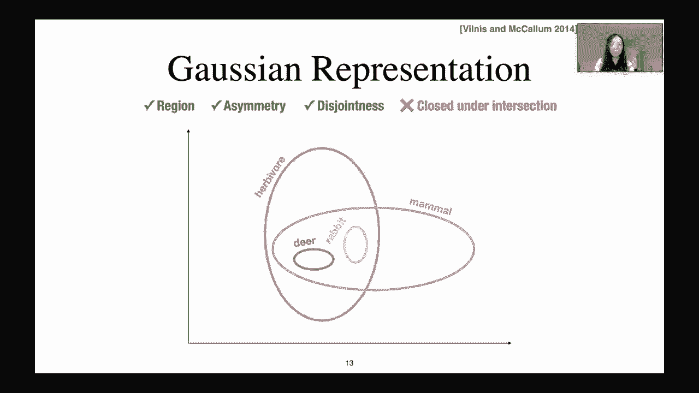

## 如何学习正确的表示方法？

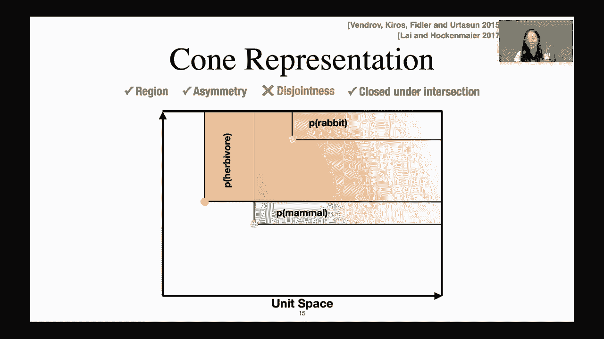

在自然语言处理中，我们通常学习单词的向量表示，如Word2Vec或BERT表示。这些学习到的向量通过词之间的距离来展示词义相似性，相似的词会聚集在一起。

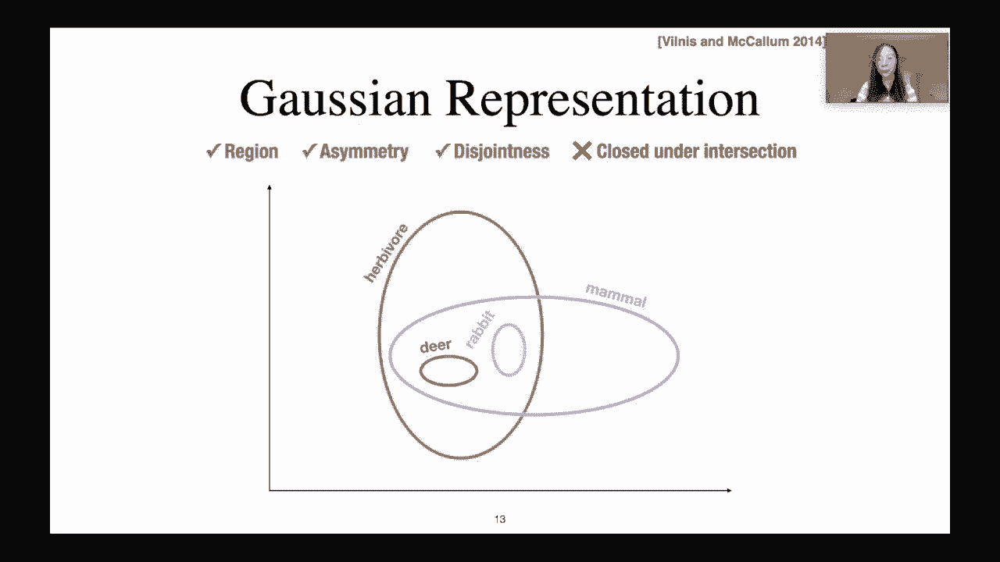

然而，如果我们仔细观察“兔子”和“哺乳动物”，“哺乳动物”是一个更广泛的概念，包含许多像“兔子”这样的小概念。但点表示法无法捕捉到单词所指区域的大小，而这个大小代表了用这个词可以表达的概念数量。此外，“兔子是哺乳动物”，但“哺乳动物不是兔子”。像点积或余弦相似度这样的简单评分函数无法捕捉这种非对称关系。

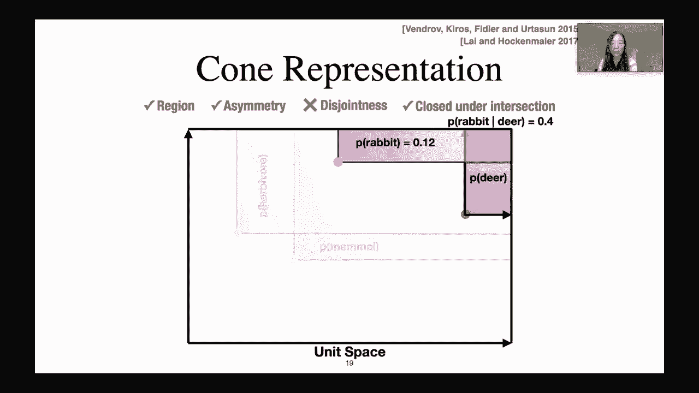

因此，我们的实验室在2014年提出将这种点表示扩展为高斯分布，使表示变为基于区域的。这种表示也是非对称的，因为“兔子”的高斯分布会包含在“哺乳动物”的高斯分布之内，以表示“兔子是哺乳动物”，反之则不成立。此外，它还可以表达概念之间的联合性。

但这种表示法的一个缺点是它们在交集下不封闭。两个高斯分布的交集不一定仍然是高斯分布，这使得模型训练和计算变得非常困难。

2015年，出现了另一种表示方法：锥体表示。它通过使用一个锥体来表示每个概念，解决了交集不封闭的问题，因为两个锥体的交集仍然是一个锥体。

2017年，另一篇论文通过将空间约束在单位空间内，并将密度分配给延伸到无穷远的锥体，将这种表示扩展为概率模型。

然而，一个直接的问题是，我们无法再使“兔子”和“鹿”等概念互斥。更糟糕的是，以一个或多个变量为条件总是会增加概率。例如，“兔子”在给定“鹿”的条件下的概率应该为零，但在这个模型中，条件概率可能变得更高，这不符合常识。

因此，在2018年，我们尝试通过为锥体嵌入设定上限来自然解决这个问题，用轴对齐的超矩形（即“盒子”）来表示每个概念。这是一个二维示意图。在这种表示中，它是基于区域的，可以表示非对称关系，因为一个盒子可以包含在另一个盒子内部。它们也可以是互斥的，并且在交集下是封闭的，因为两个盒子的交集仍然是一个盒子。更重要的是，像“兔子”和“鹿”这样的概念现在可以被表示为互斥的。

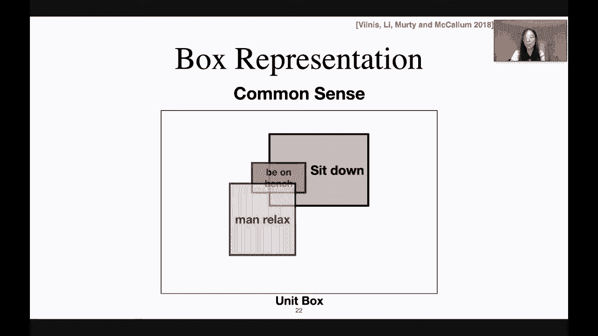

我们尝试使用这个盒子模型来建模常识。作为第一步，我们训练LSTM将任意短短语作为输入，然后输出一个盒子。

这是一个在蕴含任务上训练的盒子示例。如图所示，如果“在长凳上”，那么很可能“坐着”。但如果你“坐着”，你在“长凳上”坐着的概率就低得多，因为你可以坐在很多其他东西上。此外，如果我们加上第三个盒子“男人放松”，它会与“在长凳上”和“坐着”相交一小部分，但它会是一个大盒子，因为一个人有很多其他不同的放松方式。

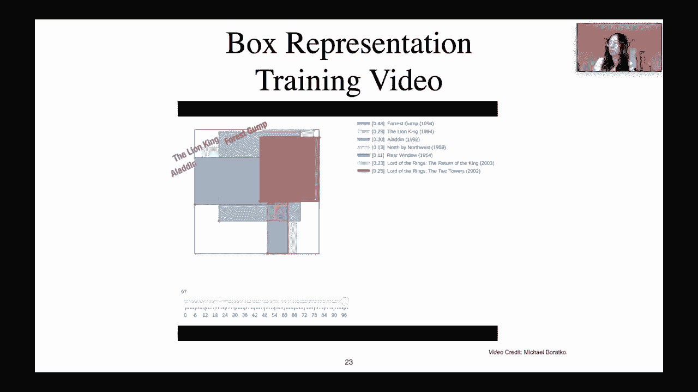

为了更直观地了解这个模型是如何训练的，我想展示这个在七部电影上训练二维盒子的视频。即使电影不是常识知识，但盒子作为一种表示法，比仅仅表示常识知识更通用，它可以被视为一个能够捕捉任何二元随机变量联合分布的概率模型。

这里的目的是，相似的电影最终应该具有相似的盒子表示，盒子的大小代表有多少人给这部电影打了相对较高的分数。如你所见，所有盒子都是随机初始化的。经过一段时间的训练，我们可以看到相似的电影聚集在一起，并且彼此重叠很多。《阿甘正传》是一个相当大的盒子，因为可能有很多人喜欢这部电影并给了高分。此外，《后窗》和《西北偏北》都是希区柯克导演的电影，它们可能拥有相同的观众群体，还有《指环王》系列。

但是，这个模型存在训练困难。在当前模型中，如果一个盒子在另一个盒子内部，而训练目标是使它们互斥，我们无法处理这种情况。因为无论你如何移动这个紫色盒子，蓝色盒子内部的梯度交集大小不会改变，因此损失不会改变，你会得到零梯度。训练结果可能就是这样。这只是其中一种情况，另一种情况是，如果两个盒子是互斥的，而目标是让它们相交，我们也会遇到类似的情况。无论你如何移动这两个盒子，交集不会改变，所以训练结果可能仍然是这样。在这个训练目标中存在很多局部最小值。

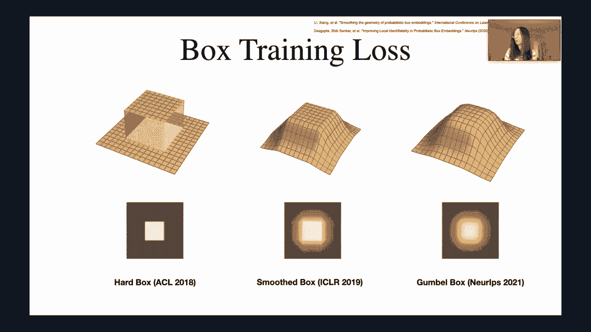

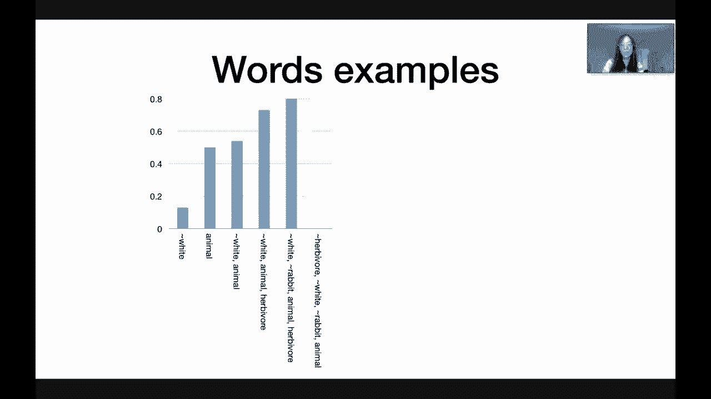

因此，作为后续工作，我们提出了解决方案。原始盒子论文的损失函数存在一个大的下降，但在外部，如果盒子在外部，情况都一样；如果在内部，情况也都一样。在2019年的ICLR论文中，我们尝试解决外部的问题。然后在今年的NeurIPS论文中，我们使用冈贝尔分布来表示盒子，现在我们有了一个处处平滑的损失函数。这些只是非常高层次的概述。如果你感兴趣，可以随时联系我了解更多关于冈贝尔盒子和平滑盒子的细节。

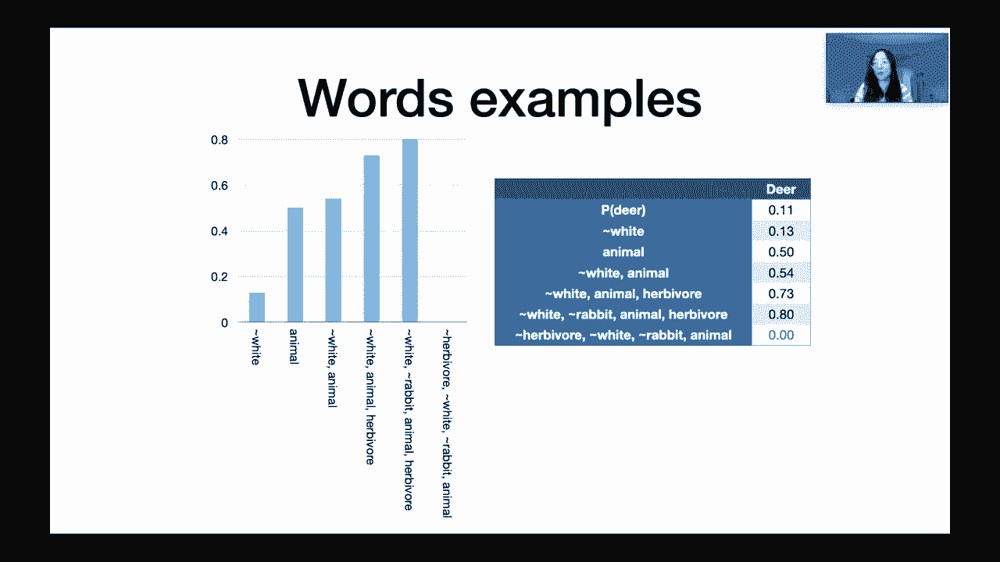

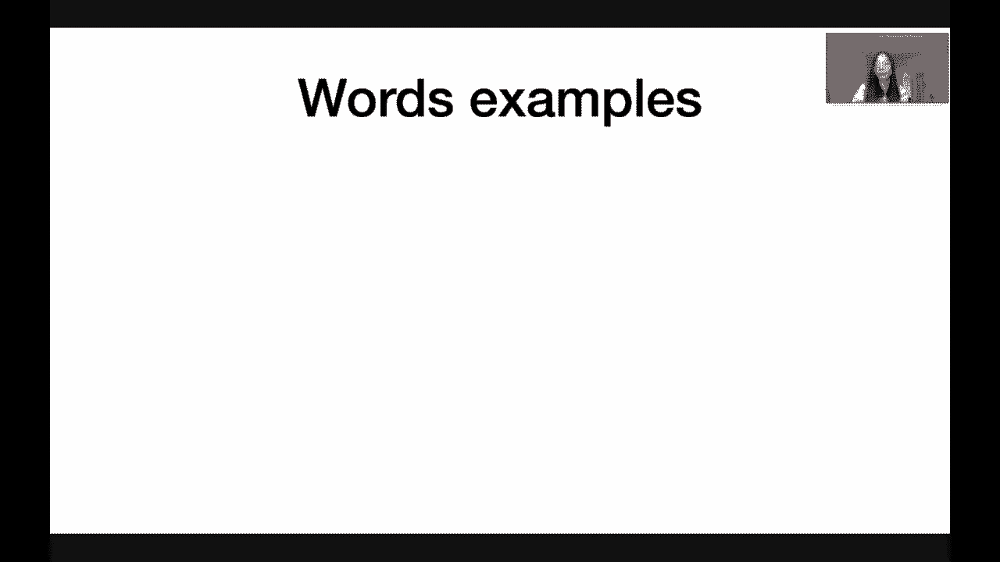

但总的来说，我们想传达的是，这是一种很好的表示方法，现在它不再有这种训练困难了。

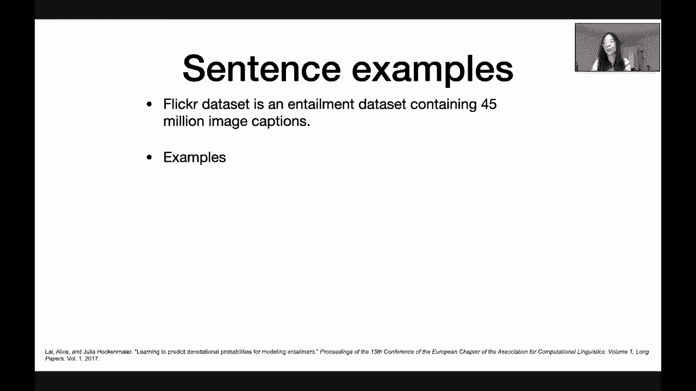

---

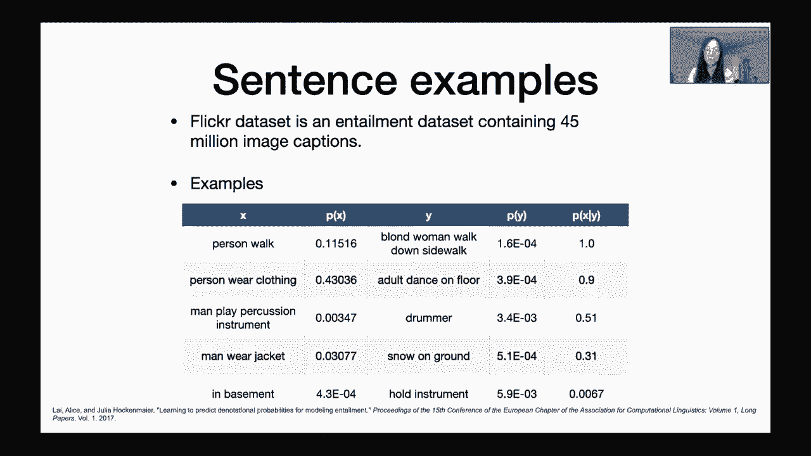

## 预训练语言模型中的常识知识

在我们提出了表示常识知识的不同方法之后，让我们来看一个恰当的训练示例。这个例子是关于“是鹿”的概率。如果你以不同的事物为条件，你会得到不同的概率。例如，如果不是白色，概率会高一点；如果是动物，概率会高得多；如果你以“有蹄类动物”为条件，并且不是白色，不是兔子，是动物，是“有蹄类动物”，那么这个东西是鹿的概率会相当高。但一旦你将“有蹄类动物”改为“不是有蹄类动物”，概率就变为零。

这种能够回答带有否定变量的查询的能力，对于几何表示来说是独特的，因为对于向量表示来说，除非你遍历所有可能性，否则无法做到这一点，而这非常昂贵。

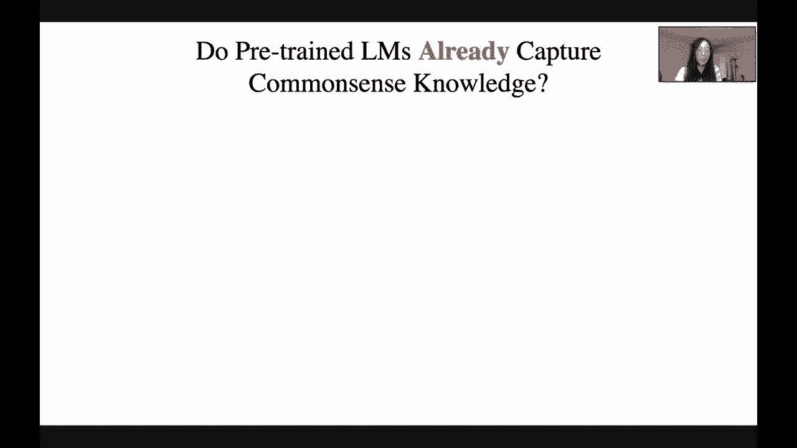

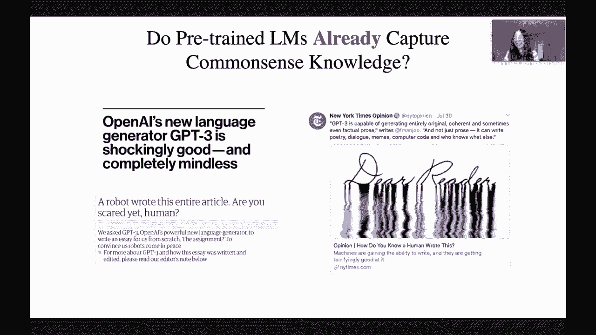

这是一个单词的例子。这是一个句子的例子。我们之前尝试过在句子上使用盒子，通过使用LSTM输出盒子表示。这是我们尝试过的数据集，它是一个Flickr数据集，一个包含4500万图像标题的蕴含数据集。训练后，你可以看到以一个事物为条件的概率从0.0到1.0不等。

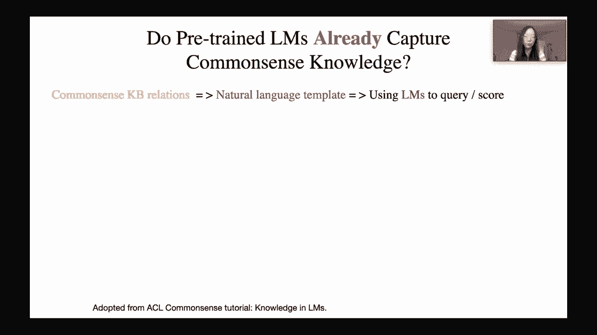

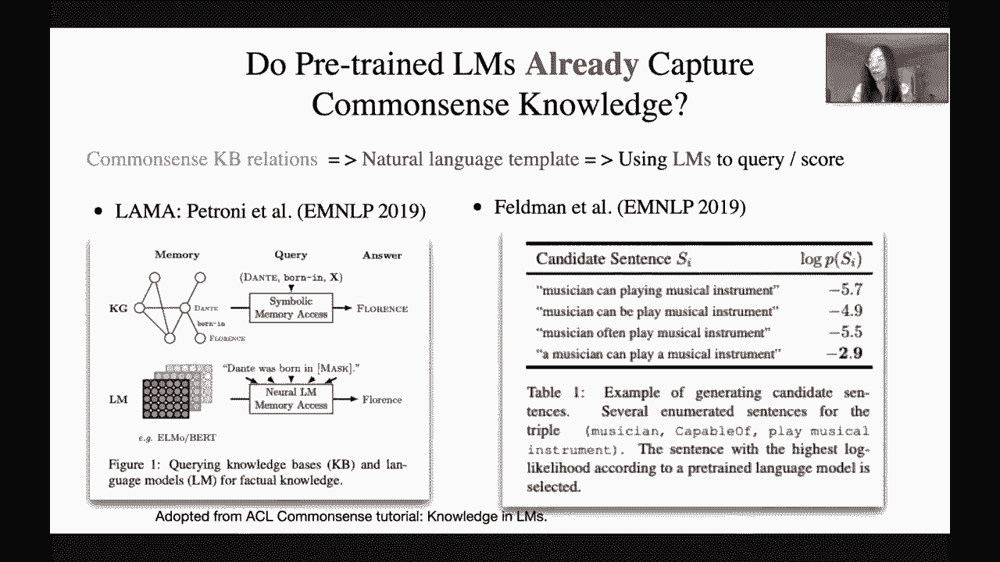

例如，以“一个金发女人在人行道上行走”为条件，“人行走”的概率是1。另一方面，如果你以“整个乐器”为条件，你在“地下室”的概率非常低。虽然仍然有可能，但概率很低。

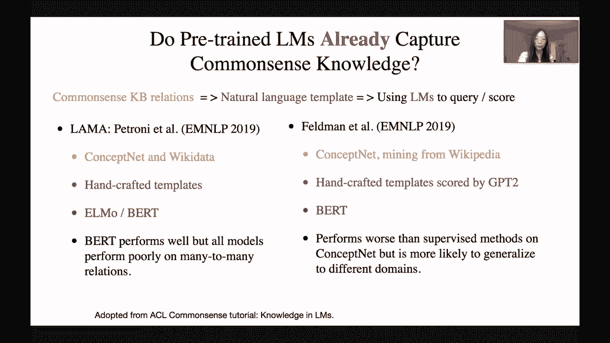

---

## 预训练语言模型是否具备常识知识？

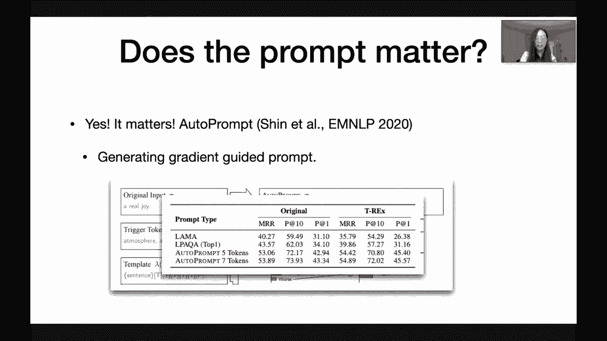

我们经常看到很多新闻标题，比如“机器人写了整篇文章，人类你害怕了吗？”，这可能意味着语言模型表现得非常好。这些误导性的新闻概念几乎让我心脏病发作。幸运的是，研究人员也有和我一样的疑问，所以最近有一些工作试图回答这个问题。

预训练语言模型是否已经捕捉到了常识知识？一种常见的方法是，人们使用现有的常识知识库来探测语言模型。具体做法是，获取现有的常识知识库，将其转换为自然语言模板，并将此模板传递给语言模型，使用语言模型对转换后的自然语言进行查询或评分。

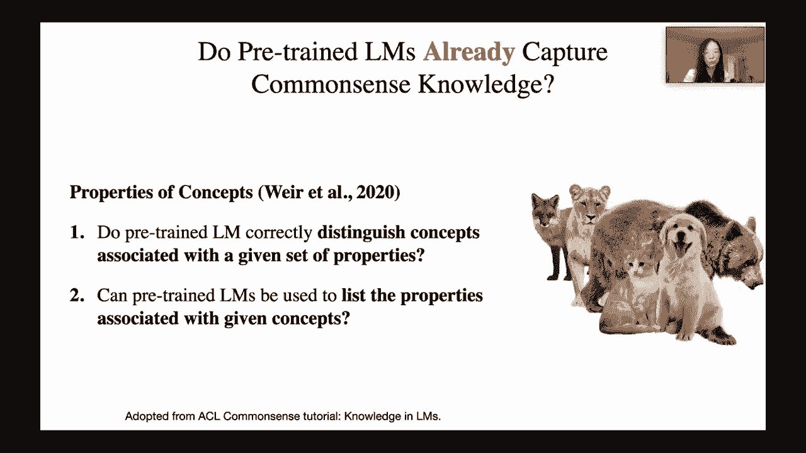

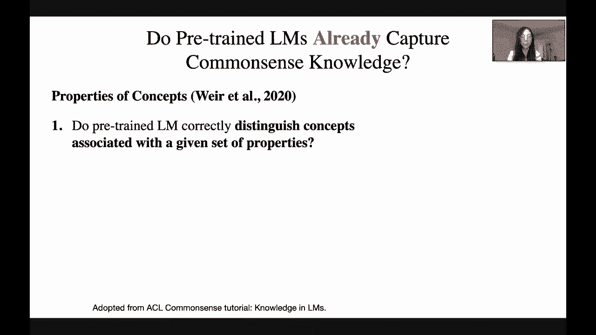

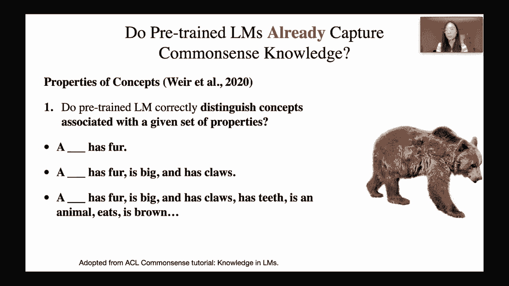

去年EMNLP上有两篇几乎同时发表的论文，它们采用了类似的方法，都使用知识库和语言模型来完成这项任务。大多数论文使用一个名为ConceptNet的知识库，这可能是目前最用户友好的常识知识库数据集。他们还使用维基数据或从维基百科中挖掘信息。他们使用手工规则将三元组表示转换为自然语言。他们评估了不同的模型，如ELMo或BERT。结论是，BERT表现良好，但几乎所有模型在许多关系上都表现得很差。另一篇论文说，如果你试图在ConceptNet上进行分类任务，这种问题比监督方法表现差得多，但它更有可能泛化到不同的领域。

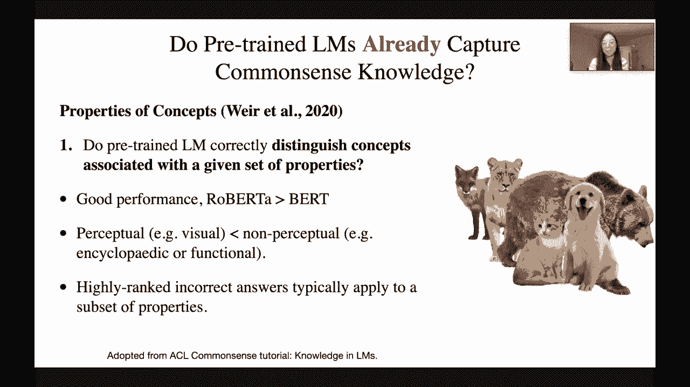

正如我们所说，这两篇论文都使用手工制作的模板将关系三元组转换为自然语言。那么，你给语言模型的提示句子重要吗？答案是肯定的，它很重要。在今年的EMNLP上，有一篇名为AutoPrompt的论文，提出了一种使用自动方法生成提示的方法。直觉是生成提示标记，使得这些标记在预测标签时能产生最大的效果。效果是通过梯度来衡量的。这也被称为梯度引导的提示生成。需要注意的是，这种自动生成提示的方式，生成的句子不一定保证语法正确，但它可以对模型预测产生最大的影响。结果显示，对于之前做的相同的LAMA探测，LAMA论文只得到了40的MRR分数，但AutoPrompt得到了高达53的MRR分数。这说明你传递给模型的句子类型绝对重要。所以，当你尝试探测语言模型时，请记住这一点。

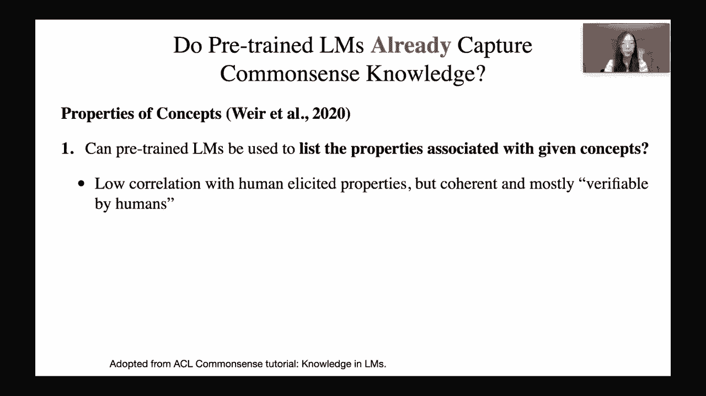

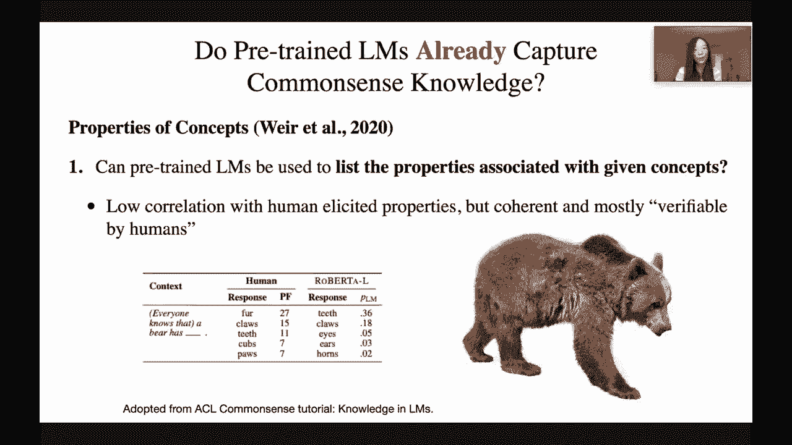

另一条研究路线是人们用来探测语言模型常识知识的方法是检查概念的属性。他们试图回答两个问题：预训练语言模型是否能正确区分与给定属性集相关的概念？以及，预训练语言模型能否用于列出与给定概念相关的属性？

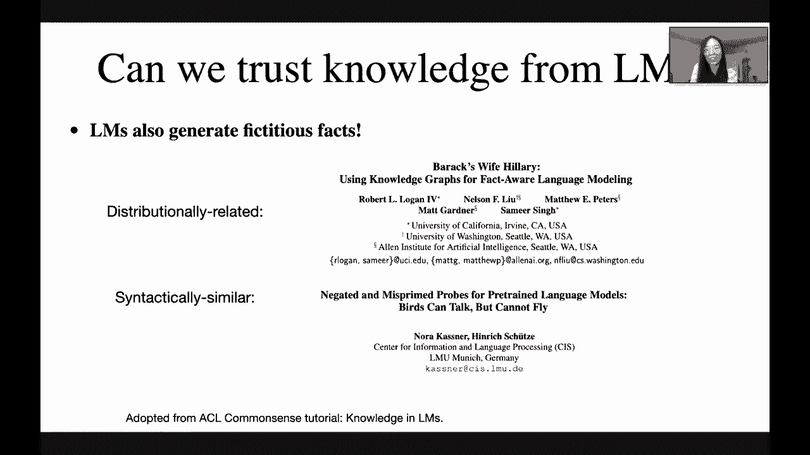

第一个问题，语言模型能否区分与给定属性相关的概念？他们通过给模型一组属性，然后让模型预测哪个概念具有这些属性来设计这个任务。例如，“一个空白有毛皮。”你会有很多不同的选项：狮子、熊、猫、狗。它们都有毛皮。当你逐渐向提示中添加属性时，比如“有毛皮，体型大，有云朵”，现在你应该排除一些概念。随着属性增多，列表变大：“是动物，是棕色的”，那么你可能只剩下“熊”这一个概念了。

对于这个问题的答案，在那篇论文中，他们说模型通常表现良好，RoBERTa比BERT表现更好。但有些属性比其他属性更容易区分，比如需要视觉推理的感知属性。感知属性比所有感知属性表现更差。此外，模型生成的高度排名不正确的答案通常适用于属性的一个子集，这意味着模型并非完全错误，而是部分正确。

现在，这里是第二个问题。如果它能区分属性，那么它能列出与这个给定概念相关的属性吗？例如，我们有“熊”，如果你把这个给人类，每个人都知道熊有毛皮、爪子、牙齿、皮毛这些东西。然后RoBERTa说它有牙齿、爪子、眼睛。总的来说，它与人类列举的属性相关性较低，但它们是连贯的，并且大部分可以被人类验证。

所以，我希望现在基于我们之前看到的探测论文或纯粹的探测实验，假设可能是语言模型中存在一些知识，但肯定不是全部。那么，如果存在一些知识，我们能信任来自语言模型的知识吗？普遍的答案是：不，你应该小心。因为有两篇论文从不同角度说明了语言模型可能生成什么样错误的事实。例如，“奥巴马（B. Obama）的妻子是希拉里”，这是不正确的。还有，“BERT会说话，但不会飞”。这两篇论文的标题清楚地说明了模型可能生成什么样的错误知识。它们要么是分布相关但不正确，要么是句法相似但也不正确。

---

## 如何构建评估常识知识的基准数据集？

除了这种探测任务之外，应该总是有一个用于评估的基准数据集来告诉我们，是否有标准的基准数据来评估包含常识知识的模型？一种标准的方法是使用问答数据集。除此之外，你也可以进行自然语言推理，例如我们之前的例子：“一个女人正在人行道上行走”可以推断出“一个人正在行走”。或者指代消解，比如“约翰问亚历克斯，图书馆在哪里。他说，我不知道。”那么，“他”在这个例子中指代谁？还有许多其他设计基准数据集的方法，但这些是一些例子。

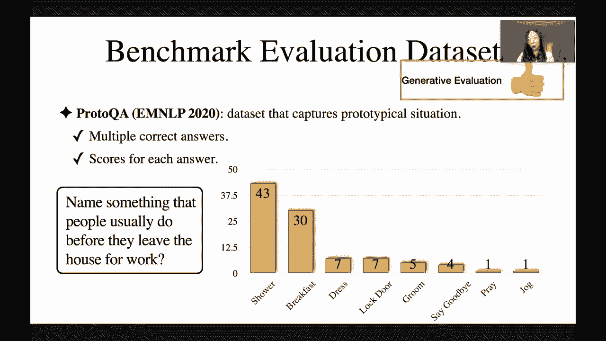

这里我试图列出我们社区中不同类型的常识数据集，这可能不是一个完整的列表，但只是让你了解一下人们是如何尝试创建这样的基准数据的。第一个是HellaSwag。它是一个多项选择问答问题，针对基础常识。例如，“一个女人在外面，拿着一个桶和一只狗。狗跑来跑去想避开一辆公交车。她……”你应该从这四个选项中选择正确答案。目前最佳模型性能与人类性能的差异不到2%。这是基础常识。

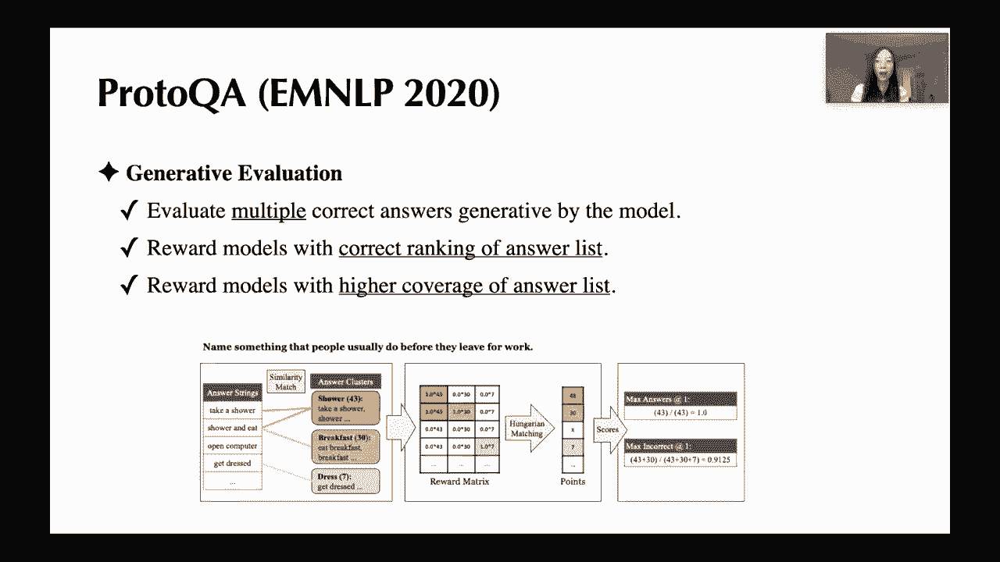

还有这个Abductive NLI，它采用自然语言推理的形式，但仍然是一个多项选择问题，针对溯因推理，差异是3个百分点。Cosmos QA针对具有常识知识的阅读理解，差异约为2%。Physical IQA，正如我提到的，这是一个常识数据集，明确针对朴素物理推理。最佳模型与人类之间的性能差异甚至不到5%。Social IQa，关于社交常识，同样有5%的差异。Winogrande，这是一个指代消解问题，正如我们之前讨论的。即使对于这个看似非常困难的任务，人类与最佳性能模型之间也只有3个百分点的差异。最后，最近有努力尝试将视觉和语言结合起来，即VCR视觉常识推理。即使对于这个，也只有2%的差异。

所以，你可能已经注意到的一件事是模型和人类性能之间的差距都非常小。但这难道不意味着我们已经解决了这个问题吗？我强烈反对这个论点，因为如果你看这类任务，它们都是多项选择。你只需要从两到四个候选选项中选择一个正确答案。但这并不是我们真正进行常识推理的方式。如果你问一个人“熊的属性是什么”，你不应该在“它是棕色的”和“它是红色的”之间选择，你不是在做那个，相反，你是想出“棕色”或“它很大”这些词，你是从你所有的词汇表中做出选择，而不仅仅是在两个选项之间选择。这意味着一个更自然的评估方式可能是通过生成答案。

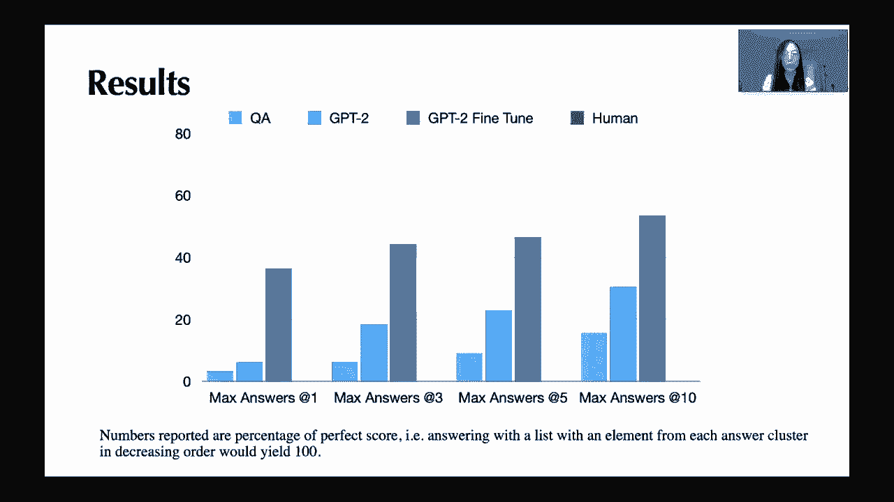

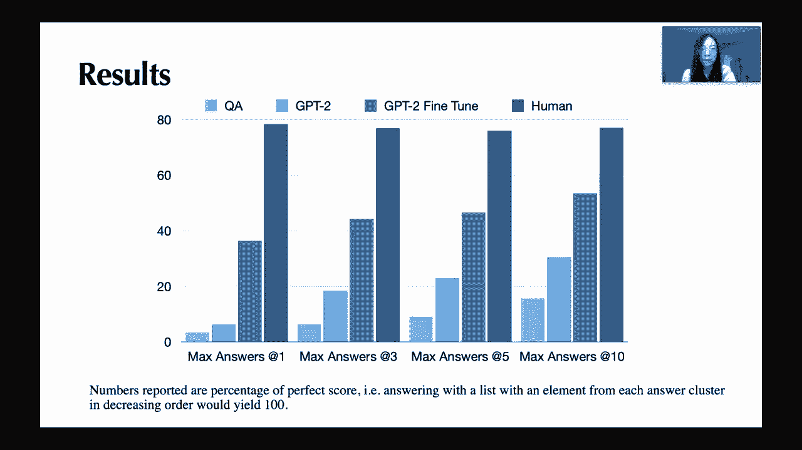

为什么人们还没有这样做呢？因为这是一种困难的方式，存在多个正确答案，当你尝试这样做时，你的答案和真实答案之间的字符串匹配可能不够通用，无法捕捉所有答案。此外，有些答案可能比其他答案更常见。我们如何捕捉这一点？

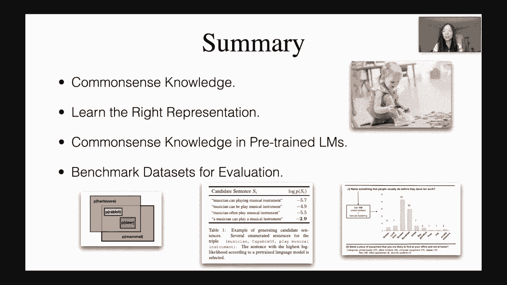

作为对此的首次尝试，我们在EMNLP上提出了这个名为ProtoQA的数据集，用于捕捉具有生成性评估的典型情境。例如，“说出人们上班前通常会做的一件事。”有很多不同的选项你可以回答，比如我们问了100个人，43个人说“洗澡”，30个人说“吃早餐”，还有人说“说再见”、“祈祷”、“穿衣服”、“锁门”。这些都是可能的答案，在这个数据中，我们试图捕捉所有这些。

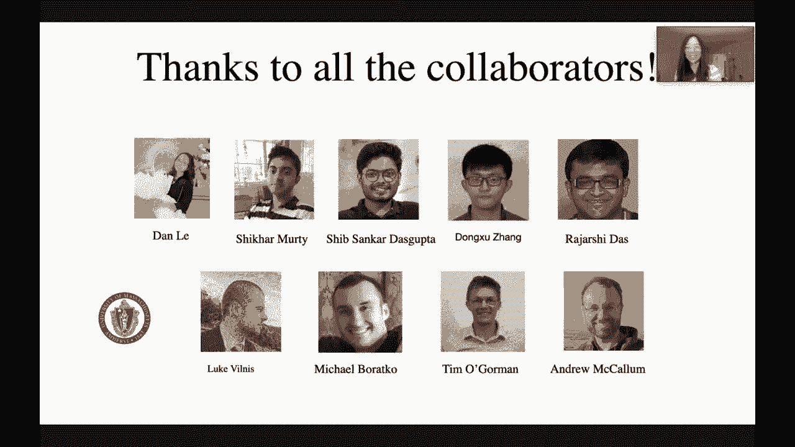

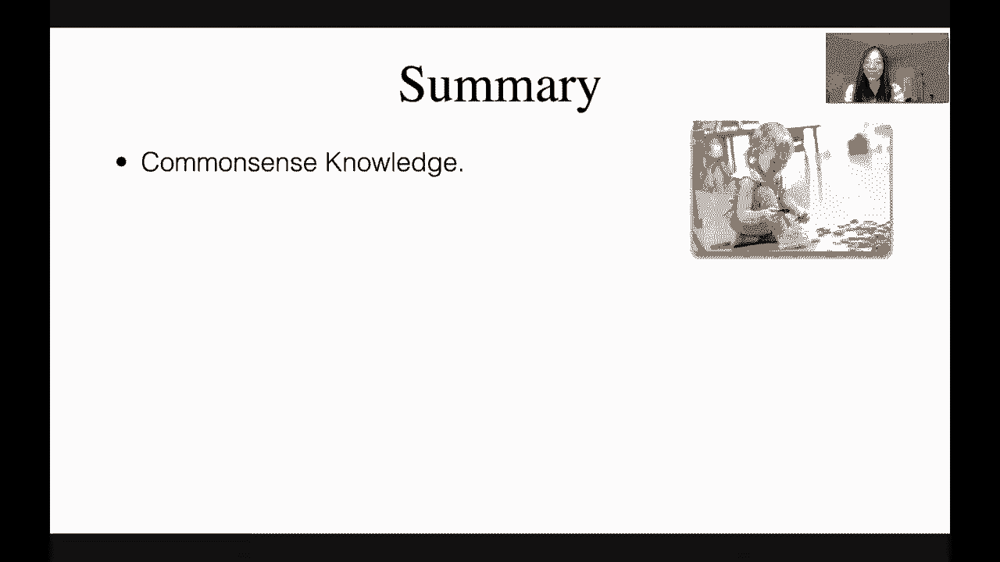

因此，我们的数据集每个问题有多个正确答案，并且对于每个答案，我们都有一个分数。此外，我们提出了这种生成性评估，可以评估模型生成的多个正确答案。正如我们所说，字符串匹配可能不够好，所以在论文中我们还提出了WordNet匹配或使用向量之间的距离来匹配两个单词之间的相似性。对于这种生成性评估，我们还尝试奖励模型具有正确的答案列表排序。你不想让模型在输出“洗澡祈祷”或“祈祷洗澡”时得到相同的分数，因为显然前者更受青睐。我们还奖励模型具有更高的答案覆盖率。

那么，语言模型在这方面表现如何呢？首先，我们在问答模型上测试了问答数据。它表现不佳，主要是因为这是一个真正的开放域问答，我们没有真实的支持文章。我们使用了远程监督的支持文章，这可能非常嘈杂，所以这可能导致了为什么这个QA模型表现不佳。GPT-2肯定比BERT做得更好。为了让GPT-2公平地完成这项工作，我们将提示改为“你会做的一件事是……”。是的，GPT-2在微调了我们的训练数据后表现得更好得多，但我想强调的一点是，GPT-2在阅读了我们的训练数据后并没有泛化。我认为这意味着GPT-2更像是习惯了任务格式，答案可能已经存在了，只是没有微调，GPT-2很难理解你在这里寻找什么。

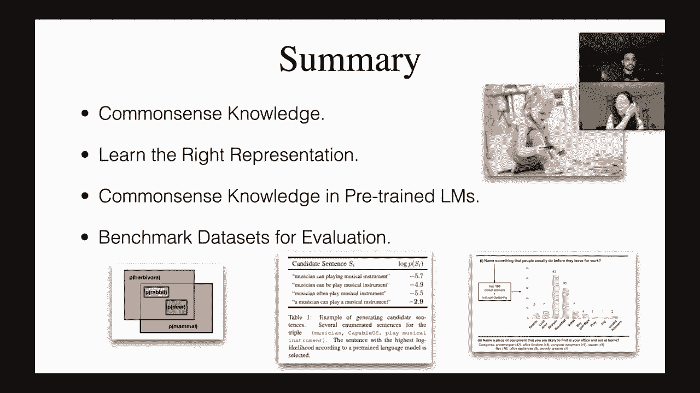

尽管如此，所有模型与人类性能之间仍然存在巨大差距，表明这是一个困难的任务。

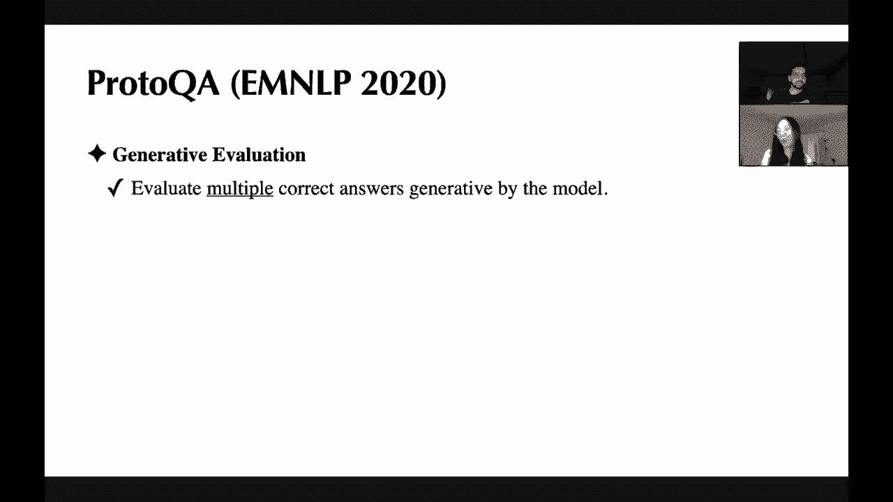

---

## 总结

在今天的讲座中，我首先介绍了常识知识及其过去使用逻辑公式进行建模的失败尝试。接着，探讨了我们可以学习什么样的表示方法，特别是盒子表示，以捕捉特定类型的常识知识。然后，讨论了预训练语言模型中是否存在常识知识，以及可以进行哪些探测工作。最后，讲解了如何生成用于评估此类常识知识的基准数据集。

---

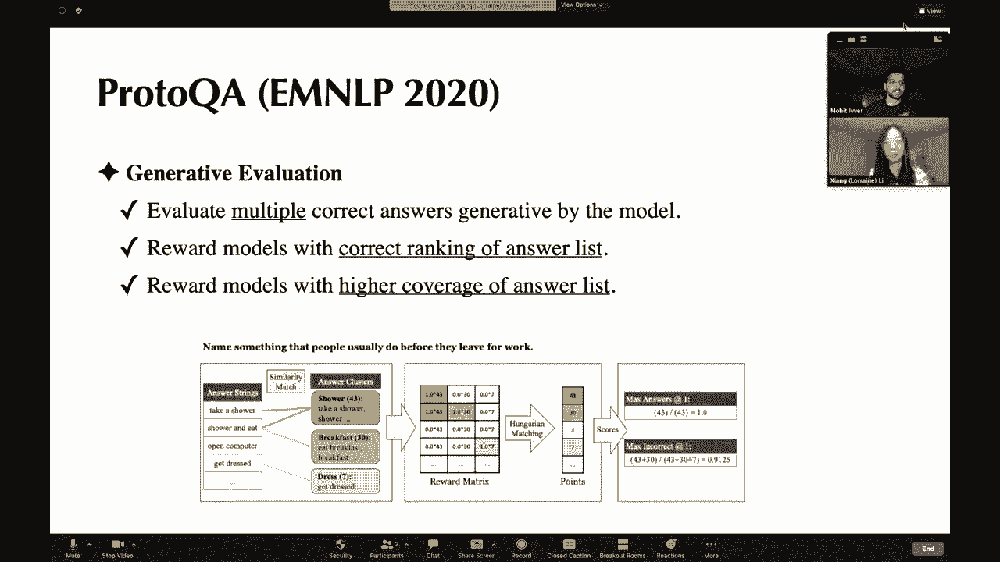

本节课中，我们一起学习了常识推理的基本概念、表示方法的历史演变、当前预训练语言模型在常识知识方面的表现，以及如何构建和评估常识推理的基准数据集。希望这些内容能帮助你更好地理解这个充满挑战又至关重要的研究领域。