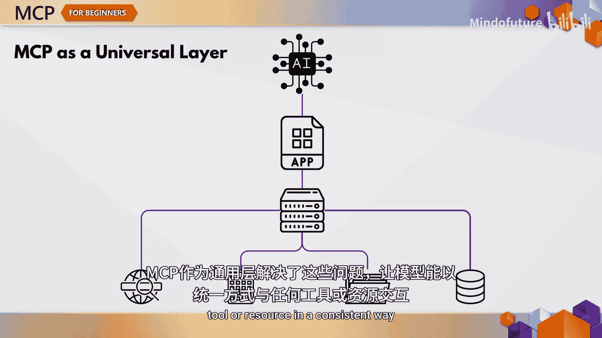
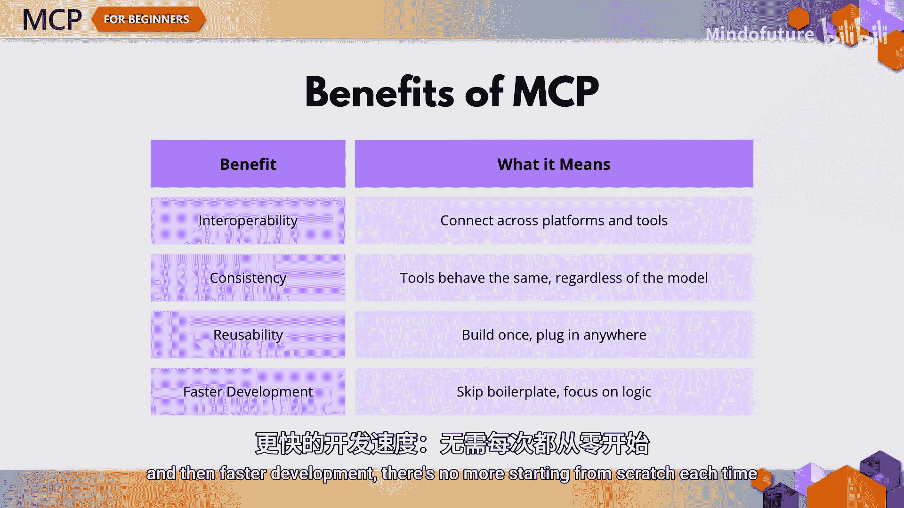
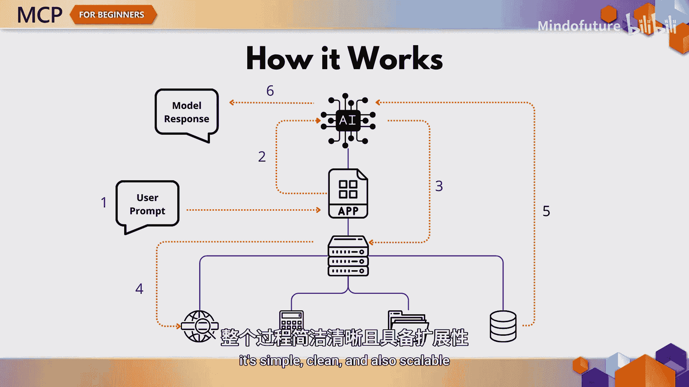
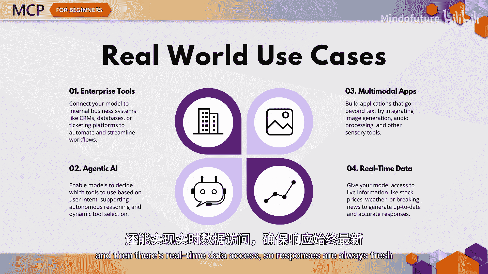
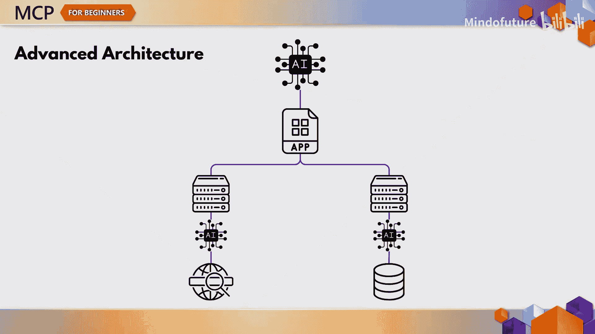
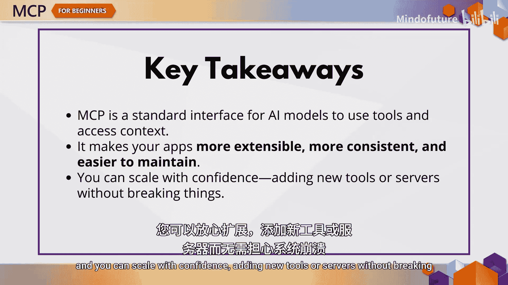

# 【Microsoft】Mcp协议入门 ｜ Model Context Protocol (Mcp) p01 P01_模型上下文协议(MCP)简介 -BV15aptzyE66_p1-

Hey everyone welcome In this video we're kicking off your journey into model Contact protocol or MCP for short if you've ever tried building a generative AI app that does more than just chat。

 you've probably run into some challenges。How do you connect it to realtime data。

 How do you call tools like a calculator or search engines。

 and how do you keep it all scalable and maintainable。 That's exactly where MCP comes in。

 The model context protocol is an open standardized interface that helps AI models like large language models communicate with the outside world。

 Think Apis， tools， data sources all working together through a consistent architecture。

 MCP allows your model to not only respond intelligently， but also take action。

 as AI applications grow in complexity，  custom integration to just don't scale。

 you end up with one- off solutions。 brittle pipelines and code that breaks whenever something changes。

 MCP fixes that back and as a universal layer， so your model can interact with any tool or resource in a consistent way。

 And what's really cool is that this standardization opens a door to building smarter。

 more agentic systems， you can plug in tools once and then reuse them across multiple models。😊。

projects plus it makes it way easier to extend functionality further down the line。

Here are some of the key benefits。Interoptability， you can work across different vendors and platforms。

Consistency， models behave the same way with any tool。Reusability you build a tool once。

 and then you can use them everywhere。And then faster development。

 there's no more starting from scratch each time at a high level， MCP follows a client server model。

 You have an MCP host which runs the AI model， an MCP client author your app。

 which sends requests and an MCP server， which provides tools。

 resources and contacts your model might need。

MCP servers manage things like tool registries， authentication。

 and formatting responses so the model can understand them。When the model needs help。

 maybe it wants to search the web or run some calculations。

 it talks to a server which handles the rest， and here's how it works。

The client sends a user prompt to the model， the model realizes it needs external help。

It sends a request via MCP to the server。The server executes the tool， returns a result。

 and the model completes its response。It's simple， clean and also scalable And if you're ready to give this to try yourself in good news。

 there are MCP servers in Java， Javascript， Python and C sharpharp so you can start building your own MCP servers and a programming language are already familiar with and here's where things get exciting MCP is being used in enterprise data integration to connect models with internal tools and CRMs agentic AI systems where models autonomously decide which tools you use Multimodal apps combining text。

 images and audio tools and then there's realtime data access so responses are always fresh。😊。

Think of MCP as a USBC of AI， a universal connector， just like USBC helped unify device charging。

 MCP unifies how models access tools and data Once something speaks MCP。

 your agent can use it without needing custom instructions。

This also means you can scale one model many servers， each with different capabilities。

 can add a new server and the agent automatically knows what tools are available。

 there's no extra wiring needed。And for more advanced setups。

 both the client and server can have their own LLms。

 This enables smarter feature negotiation and richer interactions。

 Think the way Viual Studio code negotiates capabilities with extensions。

 That's the level of flexibility we're talking about here。 MP isn't just about building better apps。

 It's about building future proof ones。 with it。 you can reduce hallucinations by grounding your model and real data。

 You keep sensitive info secure and you give your model capabilities that it was never trained for。😊。

To recap， MCP is a standard interface for AI models to use tools and access context。

It makes your apps more extensible， more consistent and easier to maintain。

And you can scale with confidence， adding new tools or servers without breaking things。

Think about an AI app you want to build， what tools or data would help enhance it。

 and how can MCP help you plug into those more reliably？That's it for this chapter。

 In the next video， we'll start exploring the core concepts of MCP。

 breaking down what makes it tick and how it all fits together。

 Don't forget to check out the SKs over on Github and start imagining what you could build with MCP。

 I'll see you in the next video。😊。

