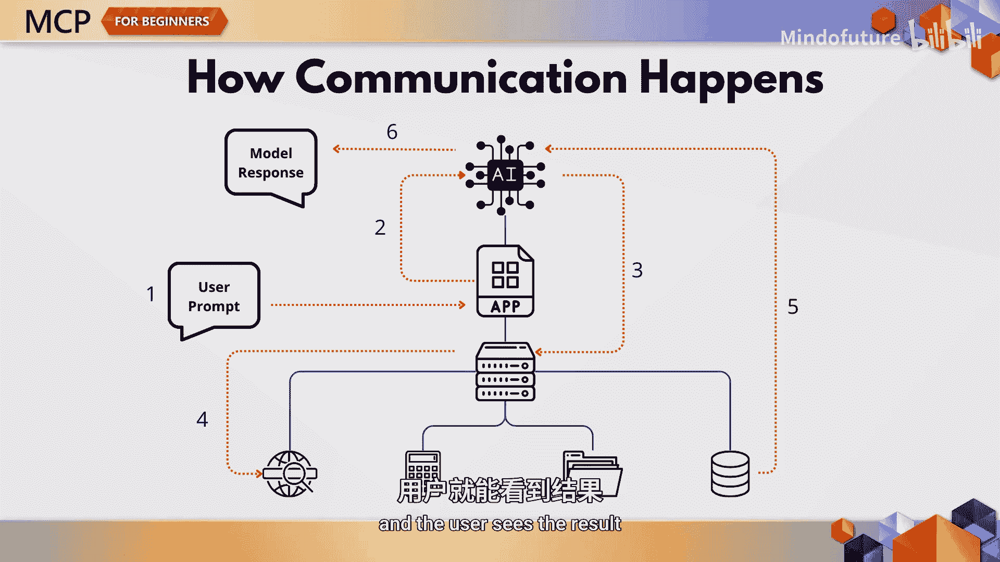
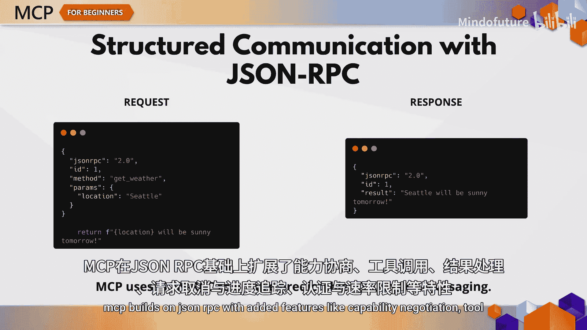
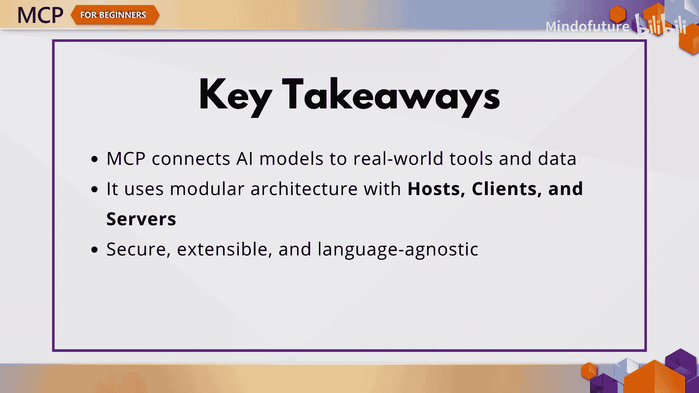
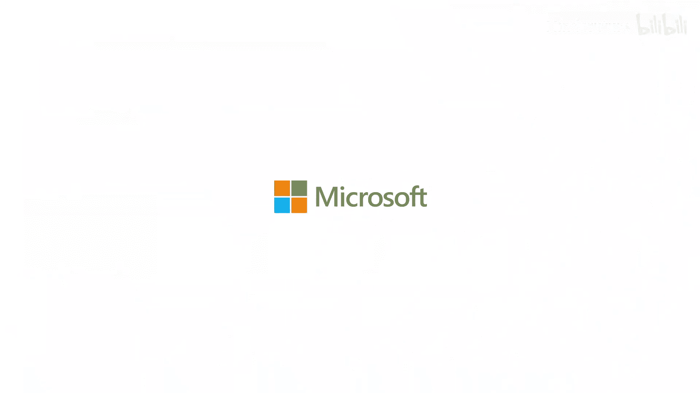

# 【Microsoft】Mcp协议入门 ｜ Model Context Protocol (Mcp) p02 P02_MCP_核心概念 -BV15aptzyE66_p2-

Hey there， in this chapter we're diving into the core of model context protocol if you've ever wondered how AI tools talk to external APIs or databases。

 then you're in the right place， MCP is what makes that possible and powerful。

MCP stands for model context Procol its a standardized way for language models to interact with tools。

 data sources and external applications， Think of it like a translator between your AI model and the rest of your digital ecosystem What makes MCP so special is its architecture its modular flexible and designed to work with any programming language be it Python。

 Java JavaScriptscript。net， you name it。Here's how it works。

 MCPs is a client server architecture with three main roles。

 The host like V code or cloud desktoptop is where the user interacts。

 The client lives inside the host and talks to the server， and then the server provides tools。

 data or prompts that the model can use。If you've ever used an AI agent that could look up a document。

 call the weather API or generate code templates， it probably use something like MCP under the hood。

 So let's break it down。 Hots are where user prompts originate。

 They manage the UI permissions and connect to servers。 Cls handle the back and forth。

 They send prompts to servers and return model responses and then servers expose resources。

 tools and prompts through the workhors doing the actual lifting。

Servere can provide three kinds of features first there's resources like local files。

 database entries， or external APIs。There's also prompts， which are templates that guide AI behavior。

And then there's tools which are executable functions that models can call like Git products or Fe weather。

 This is where MCP really shines。 Tos are like plugs for your AI。 you can define them。

 control their access and use them to make your agent both smarter and more helpful。

 So here's a simple Python example。 We define a tool called Gitwe that takes a location and returns a mock forecast in the real world this might call a weather API and return structure Json back to the model。

 Now， let's talk about how all these parts communicate。 When a user makes a request。

 the host initiates the connection。 The client and server negotiate capabilities。

 What tools or data are available。😊，The model might request a tool or a resource。

 the server executes it and sends back the result。And finally。

 the client integrates everything into the model's response and the user sees the result。

All of this happens using the structured message format called JSON RRPC It ensures clear predictable communication between components。

 whether you're using web sockets， standard input output or service and events。

 MCP builds on JSON RRPC with added features like capability negotiation tool invocation and result handling Request cancellation and progress tracking。

 authentication and rate limiting and most importantly。

 user consent and control Security is baked in， every tool call every data access has to be approved。

 that means user stay in control of what's shared， what's executed and what is exposed to the model Want to build your own MCP server。

 our curriculum provides examples innet， Java， Python and JavaScriptscript no matter your stack。

 you can define tools， serve contacts and participate in the MCP ecosystem。😊。

So to recap， MCP is your bridge between AI and the rest of your digital world， its modular。

 secure and built for real world integration， whether you're debugging in VS code or building custom agents。

 MCP helps your models act on the world， not just talk about it。

Here's a challenge， design a tool you'd want to build with MCP， what would it be called。

 what inputs would it need， what output would it return， and how would a model use it？

That's it for this chapter and the next one we'll discuss security， well cover permissions。

 tool safety， and how to keep your data protected， see you in the next one。

