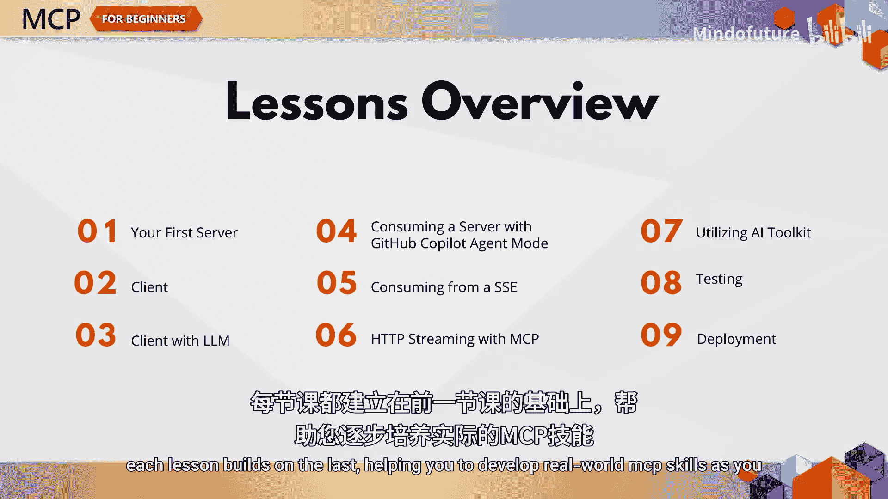
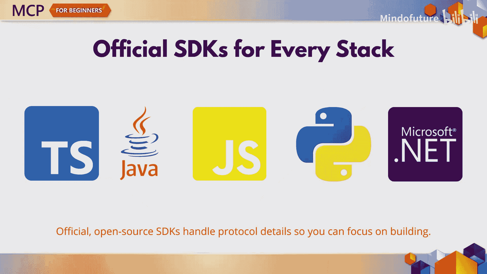
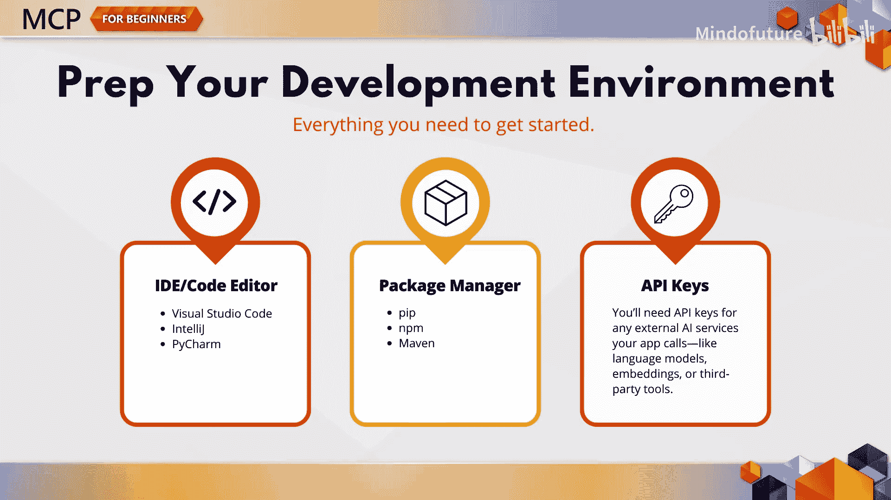
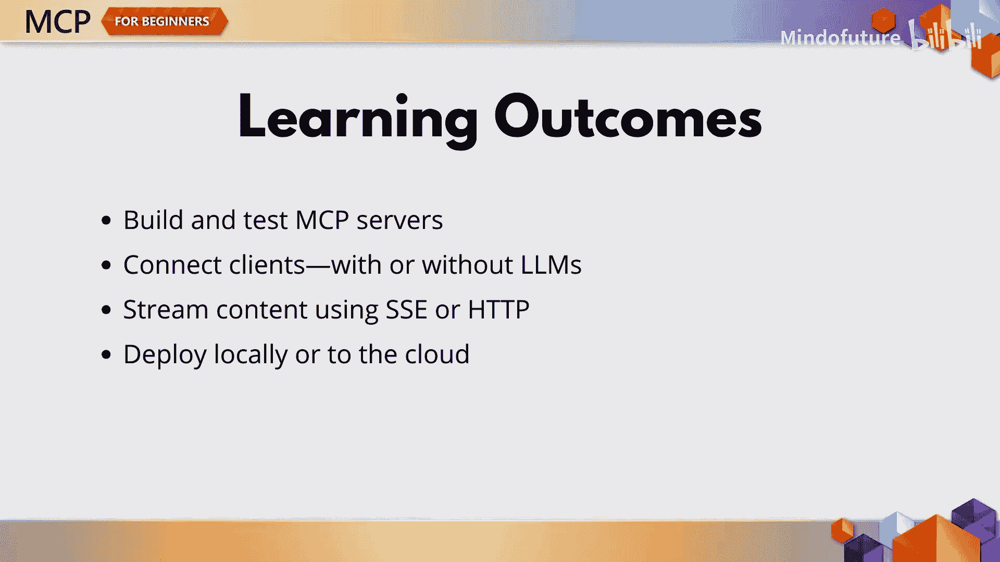
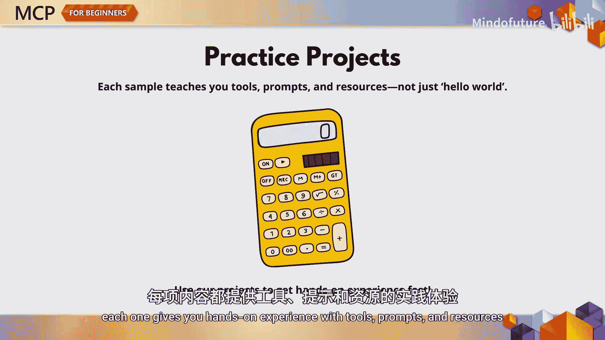
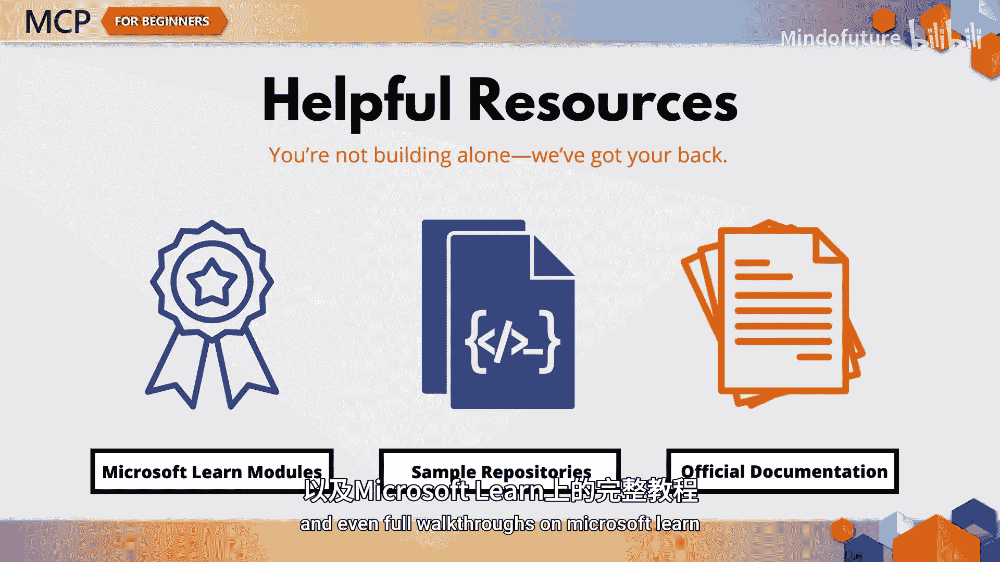

# 【Microsoft】Mcp协议入门 ｜ Model Context Protocol (Mcp) p04 P04_构建你的第一个MCP服务器 -BV15aptzyE66_p4-

Hey there ready to build your first MCP project in this chapter we're setting the stage for everything that follows whether you're brand new to MCP or looking to sharpping your skills this is where your journey begins in this chapter we're going to start with setting up your development environment followed by creating an agent connecting a client and streaming responses and real time Also we're pretty language flexible here you'll find examples in C sharpp Java。

 JavaScript Typescript and Python。Here's a quick preview of what's ahead。First。

 you'll create your very first MCP server and inspect it using the builtilt in Inspector tool。

Then you'll write a client to connect to that server。

You'll then make your client smarter by adding an LLM so it can negotiate with the server instead of just sending commands。

You'll learn how to run everything inside Viual Studio code。

 including using GitHub Copilot's agent mode。Then we'll introduce streaming with the server sent events。

Followed by HTTP streaming， which is perfect for scalable real time apps。

 you'll also explore the AI toolkit for visual Studio code to test it and iterate quickly。

And of course， we'll show you how to test everything thoroughly。Finally。

 you'll deploy your MTP solution， either locally or in the cloud。

Each lesson bills on the la help you to develop real world MCP skills as you go you'll be working with official MCP SDKs for each supported language These SDKs handle a lot of the heavy lifting so you can focus on building your service functionality not worrying about protocol details and yes。

 they're all open source before you dive in make sure your development environment is ready you'll need an IDE or code editor like VS code。

 InligJ or piechar。

The right package manager for your language and any API keys for the AI services your app will connect to。

 we provide links and guidance throughout to help you get everything set up smoothly。

So what can you expect to walk away with by the end of this chapter。

 you'll be able to build and test your own MCP servers， connect clients with or without LLMs。

 stream content from server to client， and deploy your project to the cloud It's a lot。

 but it's the foundation for everything that comes next。

Each language also comes with a simple calculator agent to help you practice these aren't just hello world examples。

 each one gives you hands on experience with tools， prompts and resources。

And if you ever get stuck， we've got plenty of resources， sample apps。

 official documentation and even full walkthroughs on Microsoft learn so that's your starting point By now you should have a clear picture of what MCP is how it's structured and how to set up yourself for a success in the next chapter we're going to shift from setup to real world usage looking at how MCP is applied to practical scenarios and what it takes to build something useful with it I'll see you there。

😊。

