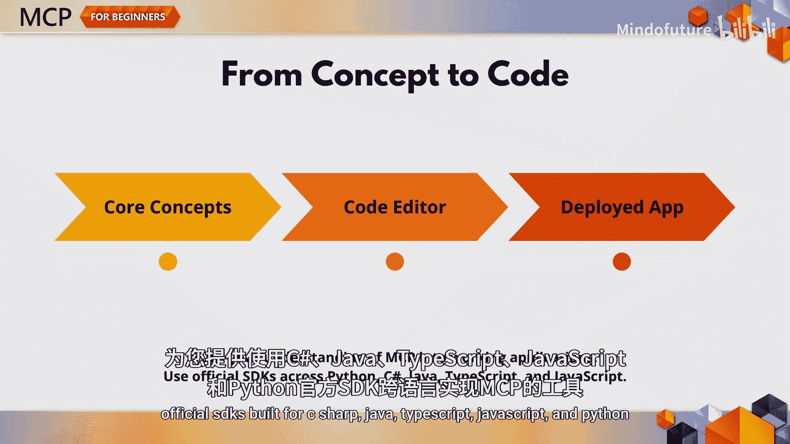
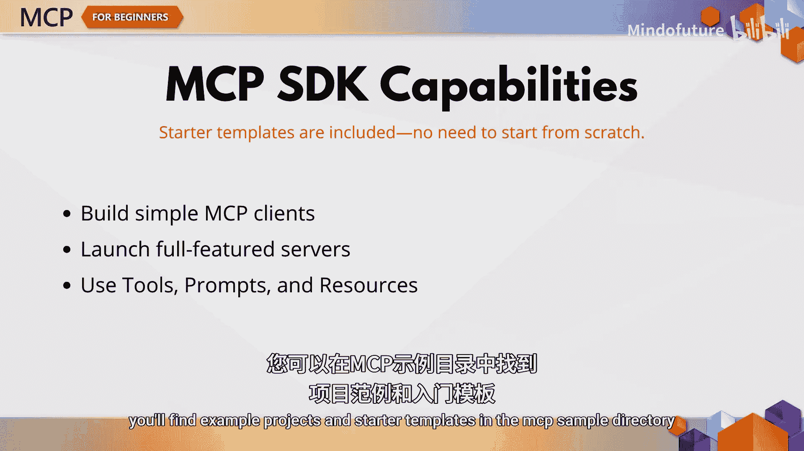
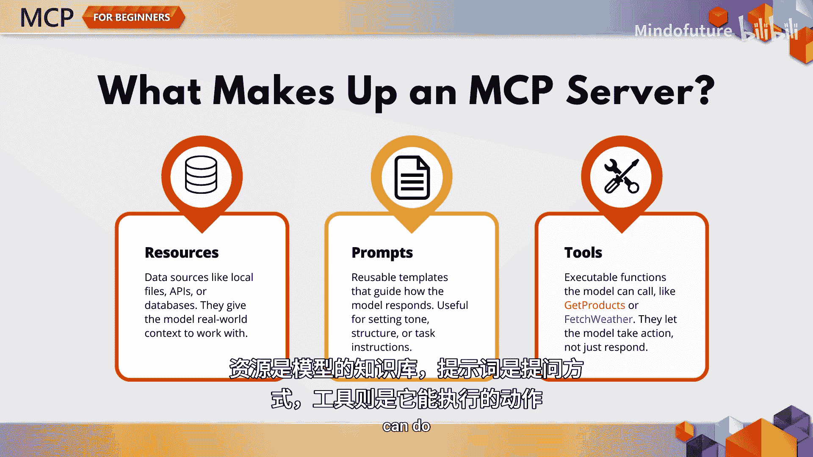
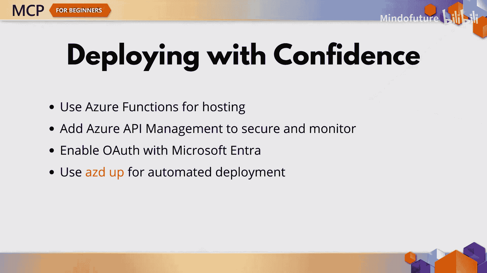
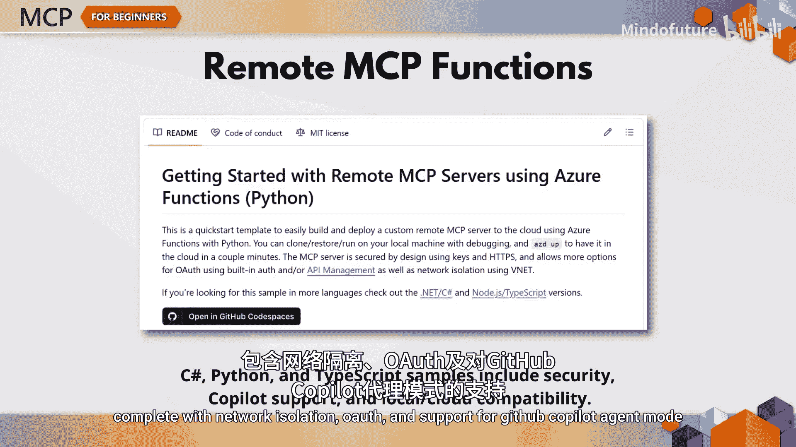
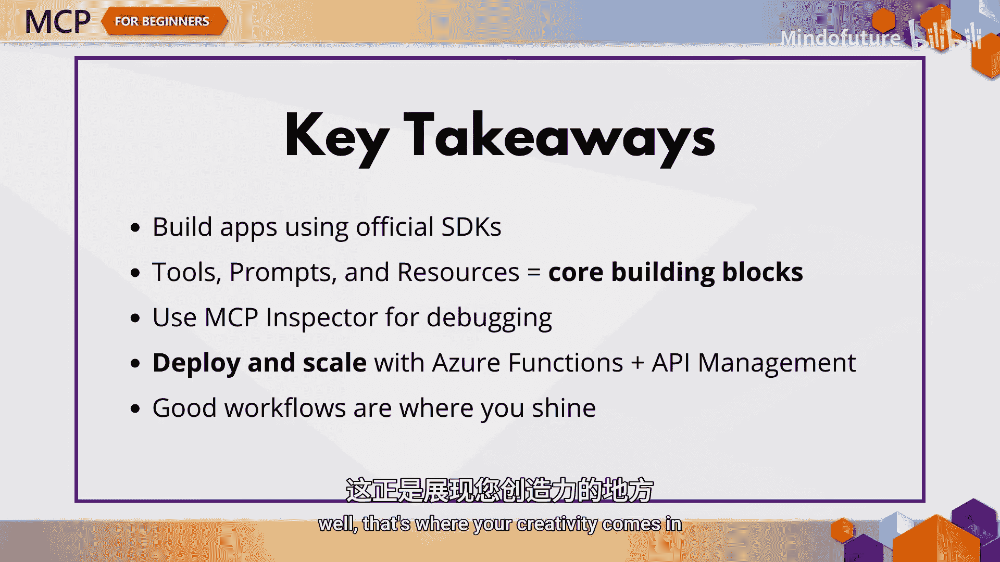

# 【Microsoft】Mcp协议入门 ｜ Model Context Protocol (Mcp) p05 P05_如何使用真实工具和工作流构建、测试、部署MCP应用程序 -BV15aptzyE66_p5-

Welcome back now that you understand the core concepts of model context protocol it's time to bring them to life in this chapter we're exploring practical implementation of model context protocol what it takes to build tests and deployed MTP applications across real world scenarios。

 so whether you're an enterprise developer integrating AI into workflows or a solo builder prototyping your own intelligent assistant this is where things get even more hands on。

The real power of MCP isn't just in understanding how it works。 It's in applying it。

 This chapter bridges a gap between theory and practice。

 giving you the tools to implement MCP across multiple programming languages。

 using official SDKs built for C sharpp， Java， Typescript， Javascript and Python。

 Each S K provides the building blocks you need。 There is simple MCP clients， full featured servers。

 and support for key MCP features like tools， prompts and resources。😊。

You'll find example projects and start a templates in the MCP sample directory so you don't have to start from scratch。

 so let's talk about what you're actually building at the heart of every MCP implementation is the server and the survey is equipped with three core features。

 resources， prompts and tools， resources provide context like documents structured data or files。

Prots shape the interaction， guiding the model through templates or workflows。

And tools let the model take action， calling functions， hitting APIs or performing calculations。

 Think of it like this。 Resources are what the model knows， prompts are how it's aed。

 and tools are what it can do。

The MCP SK repositories come with sample implementations in your favorite language in C sharpp。

 you'll see basic and advanced server setups， including asP。net integrations and tool patterns。

In Java， you get spring ready builds with reactive programming and typeSafe error handling。

The JavaScript SDK supports both node and the browser with web sockets streaming built in。

As for Python， it's asnc native with fastS API or Flask support and integrates naturally with ML tools。

So once you got your server running， what's next？Testing and debugging。

MCP Inspector is your GoTo tool for inspecting live server behavior。After deploying your server。

 just connect via your API endpoint， list the available tools and run them in real time。

 It's like a live console for your agent。 Read to go live。

 MCP servers can be deployed to azure using Azure functions even better。

 you can add Azure API management in front of your MCP server to handle rate limits in token offuth monitoror performance。

 balance load and secure your endpoints with Oof via Microsoft Intra。😊。

With just a few commands using AZDU， you can deploy everything， function apps， API management。

 and all dependencies automatically。

And if you're wondering， can I test this locally before I ship it， absolutelyly。

 these examples are designed to work both locally and in the cloud so you can iterate fast and scale later。

The remote MCP function samples show how to implement secure production ready servers in CSp， Python。

 or TypeScr， complete with network isolation， OOF， and support for GitHub Copit agent mode。

Before we wrap up， here are a few key takeaways。Official SDKs make it easy to build MCP apps in your language of choice。

Tools， prompts， and resources are the building blocks of any MCP server。

MCP Inspector and Azure API management help you test and secure your deployments。

Azure functions let you scale your solution with just a few CLI commands。

And designing good workflows， well， that's where your creativity comes in。

Now is your turn for the exercise in this chapter， you'll sketch out your own workflow。

 choose the tools that you'll need and implement one using the SDK of your choice in the next chapter we're going to explore more advanced topics in model context protocol implementation I'll see you there。

