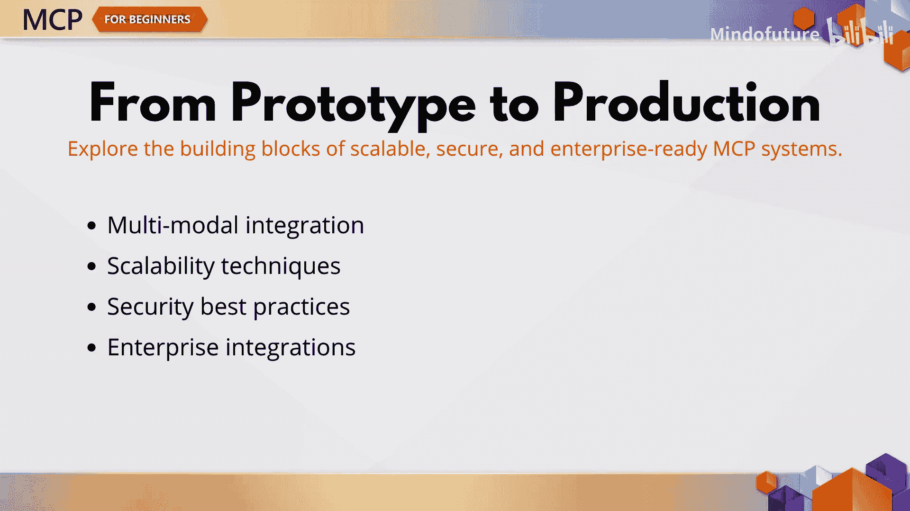
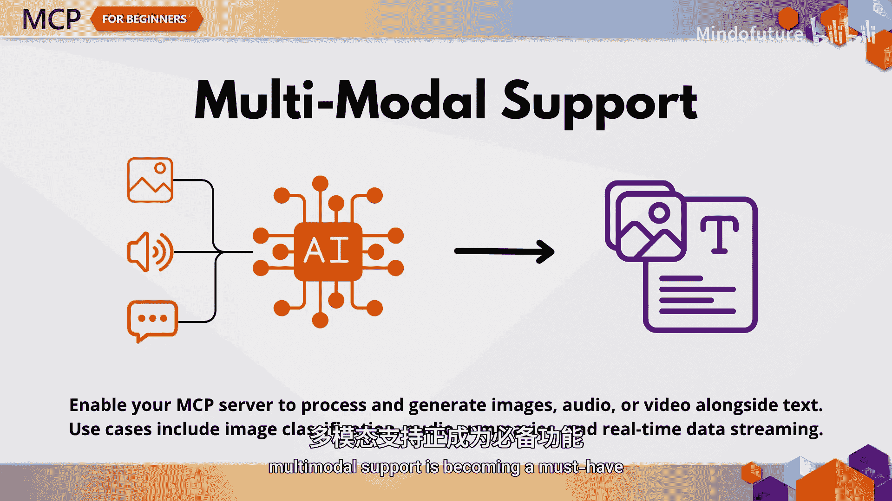
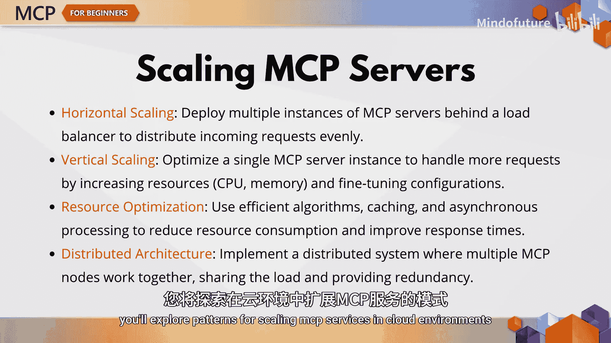
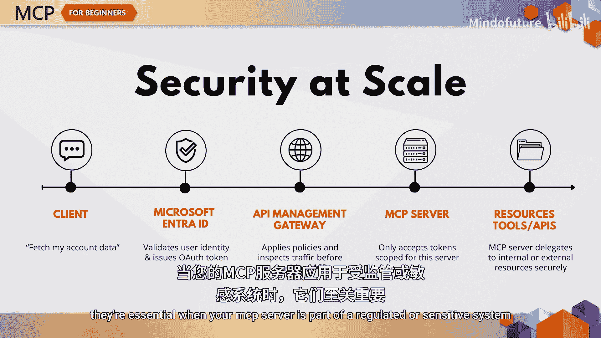
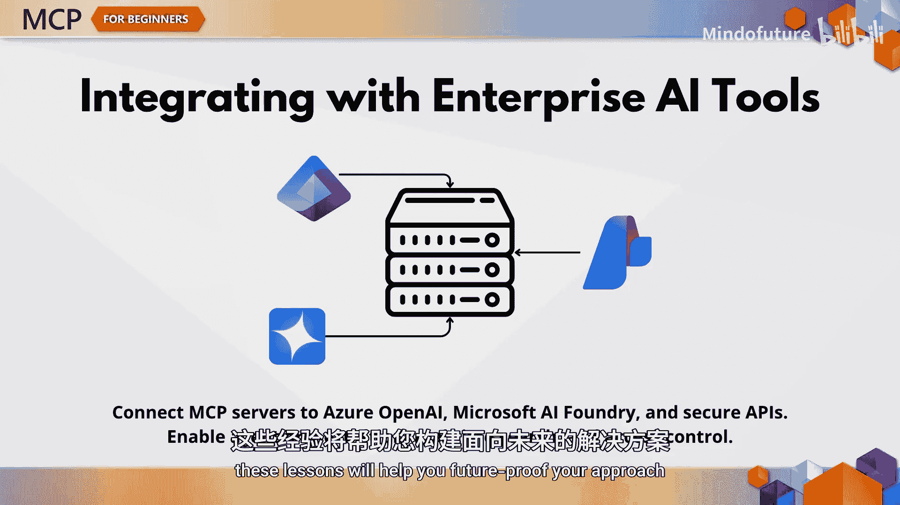
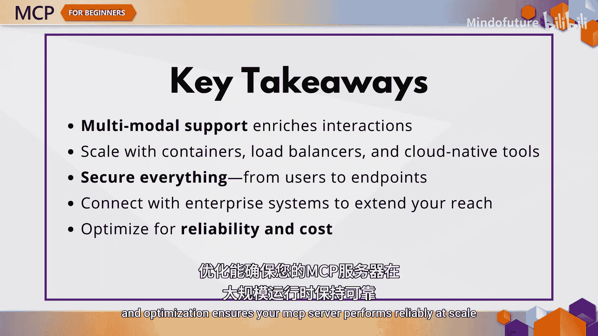

# 【Microsoft】Mcp协议入门 ｜ Model Context Protocol (Mcp) p06 P06_高级MCP-安全、可扩展和多模态AI代理 -BV15aptzyE66_p6-

Hey there and welcome back if you've made it this far congrats。

 you've built a solid foundation in the model context protocol。

 but we're going to kick things up a notch because in this chapter we're exploring advanced topics in MCP implementation。

So if you're looking to build scalable， robust enterprise ready MCP applications。

This is where it gets real。 This chapter is all about making your MCP projects production grade。

 We'll explore multimodal integration， scalability techniques。

 security best practices and how to integrate with enterprise systems like Azure and Microsoft AI Foundry。

😊，Each of these areas helps MTP move from simple prototypes to serious infrastructure。

 especially important for modern AI applications that operate at scale。

Let's start with multimodal capabilities。Think beyond text。

 what happens when you want your MCP server to understand images， process audio。

 or generate video summaries？In this lesson you'll see how to incorporate multimodal response handling into your MCP architecture。

 enabling richer interactions and broader application scenarios。

 whether you're integrating with tools like SerERP API or enabling real time streaming responses。

 multimodal support is becoming a must have。

Next up， scalability。MCP servers aren't just for local testing。

 They're meant to be deployed in high demand environments。

 That means your architecture to support horizontal scaling。

 container orchestration and load balancing strategies。

 You'll explore patterns for scaling MCP services in cloud environments and how to optimize for both performance and cost。

 Of course， with scale comes responsibility， especially when it comes to securing your MCP server。

 Security is built into the MCP protocol， but real world deployments require more。

 This chapter covers O off two flows for both resource and authorization servers。

 Proect endpoints and issuing secure tokens。 Authentating users with Microsoft Inter Id。😊。

And integrating with API management layers， these aren't just best practices3 central when your MCP server is part of a regulated or sensitive system。

 Enterprise integration is another major theme。 You'll learn how to connect your MCP server with enterpriseterse tools like Azure Open AI and Microsoft AI Foundry。

😊。

These integrations unlock log features like tool orchestration， Realtime web search。

 external API connections and robust identity and access management。

 If you're building agents that operate in enterprise ecosystems。

 these lessons will help you future proof your approach。

 This chapter includes a ton of hands on samples。 from routing and sampling strategies to real time streaming and even integrating with Azure container apps。

 And if you're up for the challenge， there's an exercise that walks you through designing an enterprise grade MP implementation for specific use case。

 It's a great way to apply everything you've been learning。 let's wrap with a few key takeaways。😊。

Multtimodal MCP systems allow for richer user interactions。

Scalability requires thoughtful architecture and resource management。

Security is not ne glligible in enterprise environment。

Enterprise integration brings MTP into alignment with real world AI workflows。

And optimization ensures your MCP server performs reliably at scale。

So whether you're working on your first enterprise project or just curious about what's possible with MCP。

 these advanced topics will give you the tools to build with confidence in the next chapter。

 we're going to explore how to engage with the MCP community and how to contribute to the MCP ecosystem。

