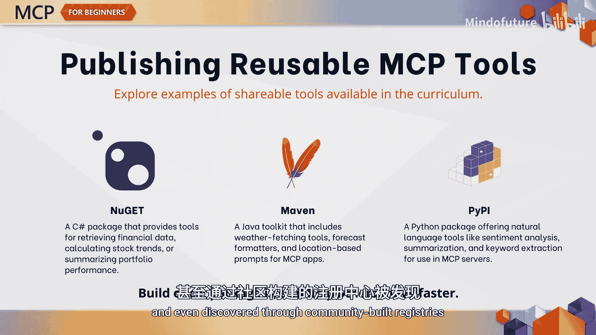
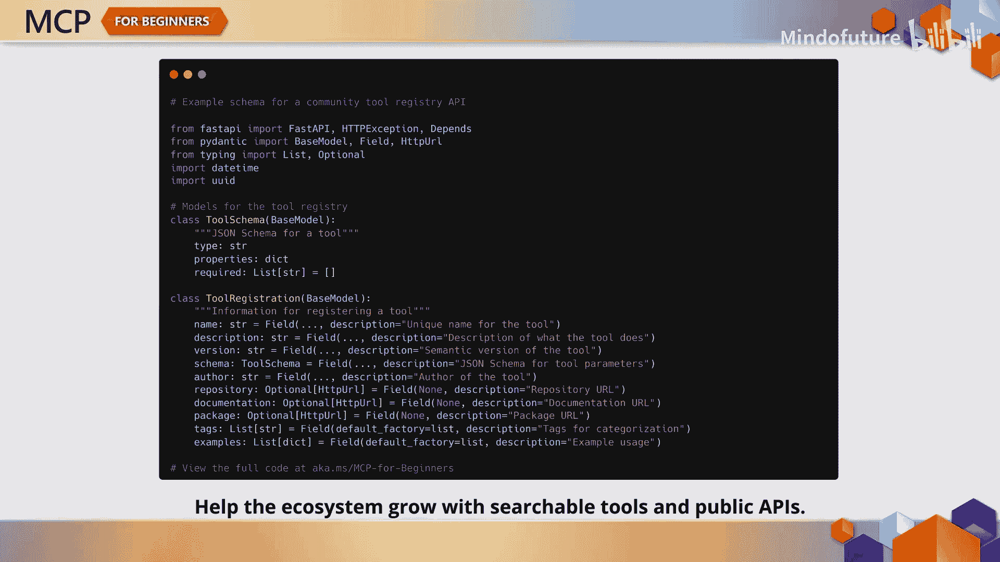
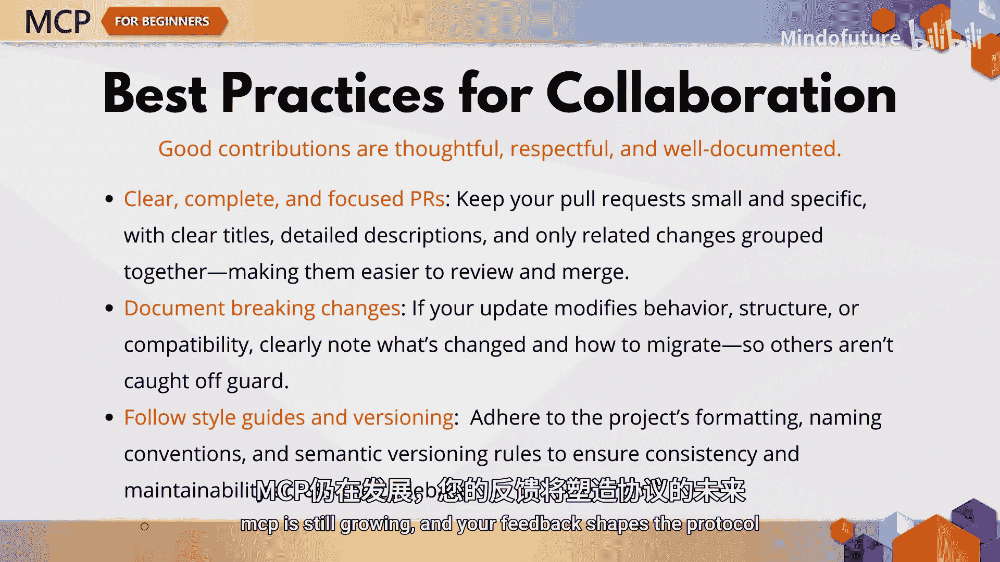

# 【Microsoft】Mcp协议入门 ｜ Model Context Protocol (Mcp) p07 P07_如何为MCP-工具、文档、代码等做出贡献 -BV15aptzyE66_p7-

Hey there and welcome In this chapter， we're going to explore one of the most rewarding aspects of working with the model context protocol Community and Con。

 whether you're looking to foul your first issue， share your own tools， or become a core contributor。

 this chapter will help you understand how to get involved with the MCP ecosystem and why your voice matters。

The MCP community is more than just maintainers and documentation。

 it's a growing network of developers， organizations， tool builders。

 and users who are all working together to shape how intelligent applications interact with models at the core。

 you'll find core protocol maintainers like Microsoft and other orgs that evolve the spec。

Tool developers who create reusable packages and utilities。Integration providers。

 companies using MTP to enhance their own platforms。In users。

 the developers is building apps powered by MCP。And of course， contributors。

 community members like you， helping improve the ecosystem。

The official community lives in a few key places。First， there's the MCP GitthHub organization。

And then there's also disspecification site。And then finally， there are also in GitHub discussions。

 issues and pull requests， but there are also community driven channels like tutorials， blog posts。

 language specific SDKs and open forums if you've ever wanted to share your insights or find collaborators。

 those are great starting points。So how exactly do you contribute to MCP you don't need to write a brand new protocol extension for your first try。

 contributions comes in many forms， whether it as contributing documentation。

 answering community questions， or resolving bugs， so let's walk through a few common paths。

You could contribute code to the core MTP protocol。

 like adding support for binary data streams and C Shaharp。This might mean defining new interfaces。

 handling stream metadata， and returning results in a consistent testable way。

If you're more into back in reliability， you might squash a bug in the Java a validator or improve how nested schemas are handled。

 and if you love building tools， Python is a great place to start like the CSV Pro tool that filters。

 transforms and summarizes data based on a model's request。Not a software engineer， no problem。

 some of the most valuable contributions are documentation， tutorials， translations， and testing。

Creating sample apps or improving error messages helps the entire community grow。

Let's say you've got a great idea for a tool， whether it fetches thought quotes， translates text。

 or gets to weather forecast， you can create a reusable MCP tool。😊。

Package it for others and then publish it to a package registry just as you would with any other open source library。

 so let's look at a few ways that might work。In donet。

 that might be a nuet package like MCP financein tools and Java。

 a maven artifact like MCP Weath tools。In Python， a PiP package like MTP NLP tools。

Each tool defines its name， parameters， schema， and behavior， and can be registered， reused。

 and even discovered through community built registries。

Speaking of registries， imagine contributing a whole service to helps a community find tools。

 this fastS API based MCP tool registry is one example of how developers are building infrastructure around the protocol。

 not just within it。

So what makes a good contribution Well， it starts with starting small， fix a typo， write a test。

 answer a Gitthub discussion question from there， follow the project style guide。

 document your changes and submit focused pull requests and remember。

 collaboration isn't just about the code。It's about communication。

 whether you're opening a PR or reviewing someone else's， prioritize clarity。

 correctness and completeness。Be thoughtful about Vi compatibility and always。

 always document breaking changes。 MCP is still growing， and your feedback shapes the protocol。

The truth is anyone can contribute to MCP and everyone benefits when you do。

If you're ready to make your mark， head over to the GitHub repository。

 explore open issues and find a way to get involved that suits both your skills and your interests In the next chapter。

 we're going to be exploring how early adopters have leveraged model context protocol to resolve real world challenges and drive innovation across industries I'll see you there。

