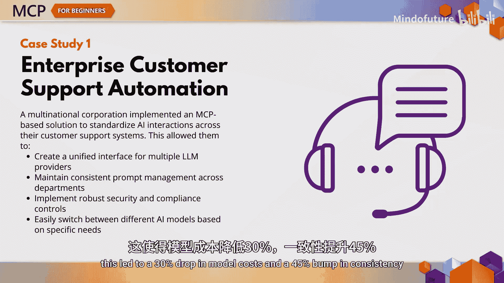
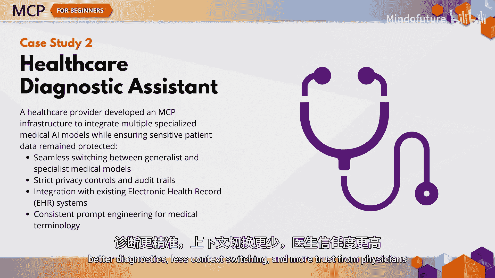
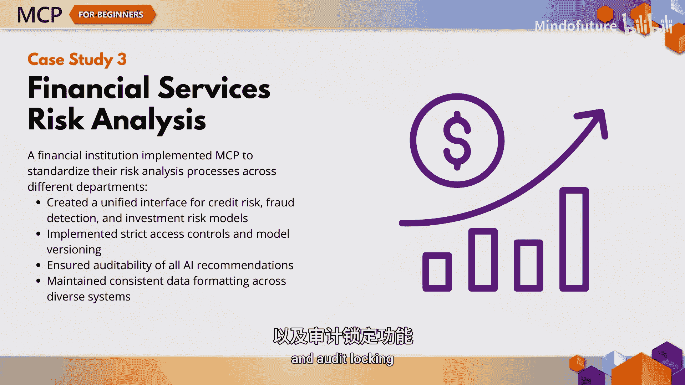
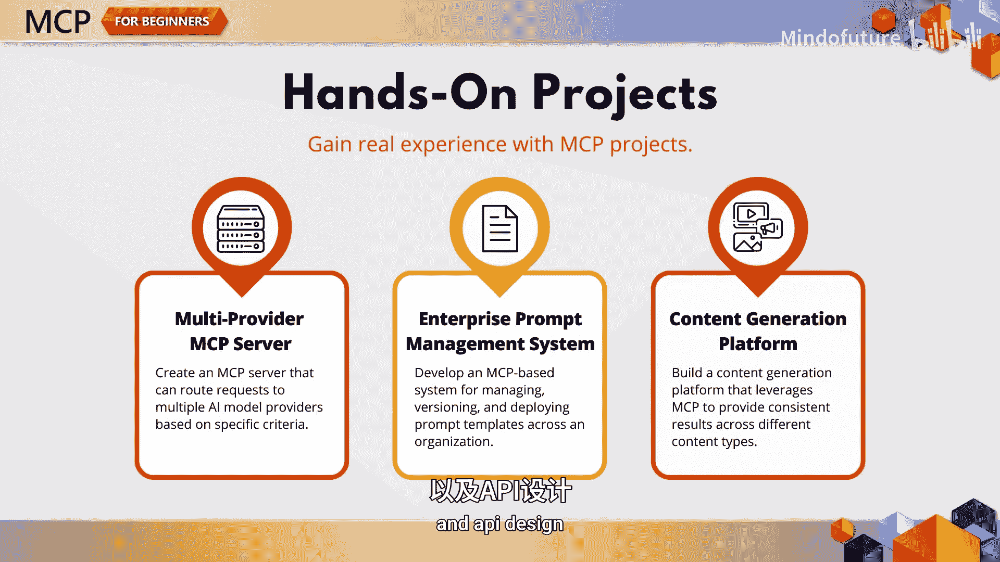
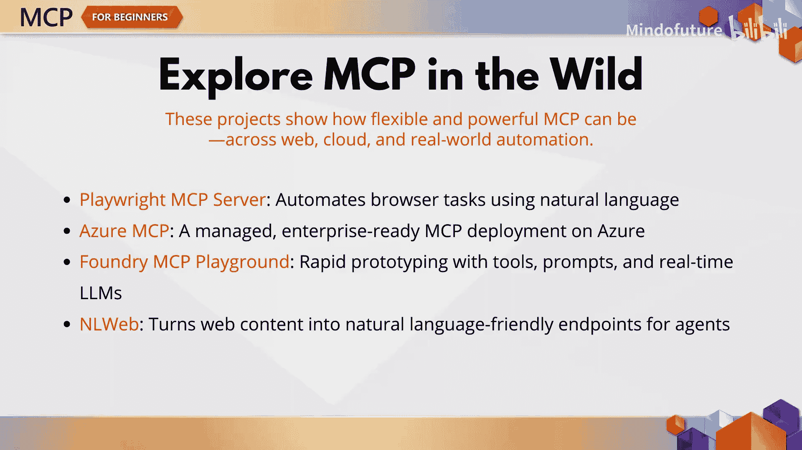

# 【Microsoft】Mcp协议入门 ｜ Model Context Protocol (Mcp) p08 P08_MCP早期采用者的经验教训 -BV15aptzyE66_p8-

Hey there in this chapter we're exploring how early adopters are using the model context protocol in the real world this isn't just theory anymore MCP is helping solve real problems and finance。

 healthcare， enterprise automation and even browser automation。

 so let's walk through what we can learn from the folks who are putting MCP into production。

From customer support bots to diagnostic assistance。

 companies are using MCP to standardize how AI models。

 tools and data all work together MCP creates a unified interface that could connect multiple language models and for security policies and maintain consistent behavior across complex systems let's take a look at a few case studies a global enterprise used MCP to unify their customer support experience The result a single interface from multiple LLMs centralized prompt templates and robust security controls they even built an MCP server and Python to handle support inquiries complete with resource registration。

 prompt management and ticketing tools this led to a 30% drop in model costs and a 45% bump in consistency in healthcare MCP helped one provider integrate general and specialist models while maintaining full HIPAA compliance。

Using a C sharpp MTTP client， they implemented strict encryption， auditing。

 and seamless EHR integration， the result， better diagnostics， less contact switching。

 and more trust from physicians。

A financial institution used MCP to standardize risk models across departments。

 their Java based server featured SOC Compliant access controls。Version control。

PI I redaction and audit logging。 They saw a 40% improvement in model deployment cycles。 Now。

 if you're thinking， cool， but how do I build one of those， Don't worry。

 We have a selection of hands on projects that you can try right now。

 Here are three ways to get your hands dirty with MCP。😊。

First， we have a multi provider MTP server， this route requests to different model providers based on metadata。

 Think open AI， Anthropic and local models all under one roof。For the next project。

 we have enterpriseterprise Pro management。Design a system to version。

 approve and deploy prompt templates organizationwide As for Project 3。

 there's a content generation platform。You can use MTP to generate consistent blogs。

 social posts and marketing content with tracking and review workflows Each of these teaches you critical MCP skills from routing logic and caching to prompt versioning and API design MCP is evolving fast and here's where it's headed。

Multimodal support for images， audio and video。Federated infrastructure for sharing models securely。

Edge computing support and even marketplaces for templates and tools。

These trends are shaping how MCP will power everything from tiny IOT devices to enterprise AI marketplaces。

There's a growing list of open source projects you can explore， for example。

 there's Playwright MCP Ser， which lets AI agents control browsers。There's also Azure MTP。

 a fully managed enterprise Read MTP server。There's also the Foundry MCP Playground。

 which is great for prototyping and experimenting。And then there's tools like NLweb。

 which turns websites into natural language endpoints for AI assistance。

 each one shows a different angle on what MTP can do and how it's being used to drive innovation。

Early adopters are proving that MCP isn't just a protocol。 It's a foundation for building scalable。

 secure and consistent AI systems。 If you're building with large language models。

 you don't have to reinvent the will。 MCP gives you the structure to do it right。

 And now you've seen how others are doing just that。 In the next chapter。

 we're going to explore advanced best practices for developing testing and deploying MCP servers and features within production environments。

 I'll see there。😊。