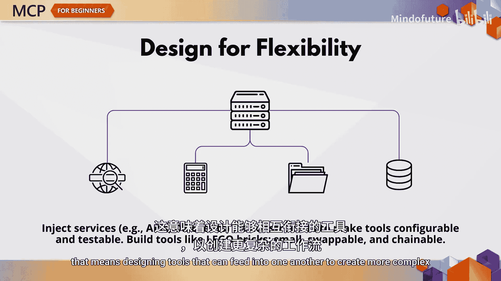
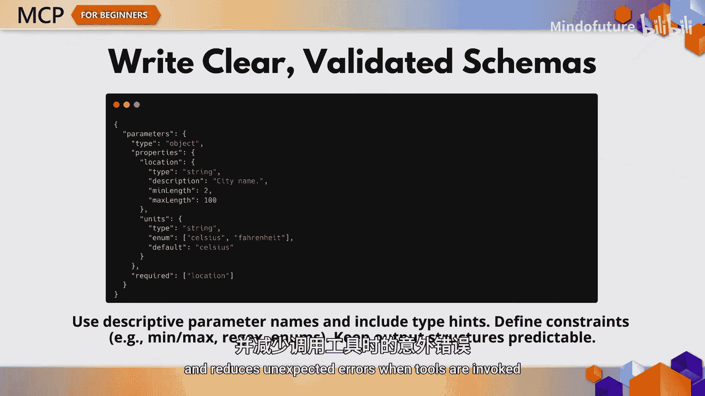
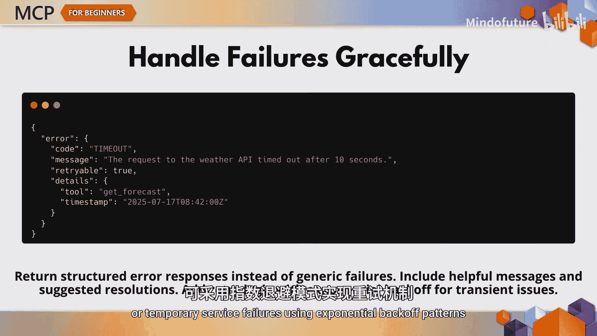
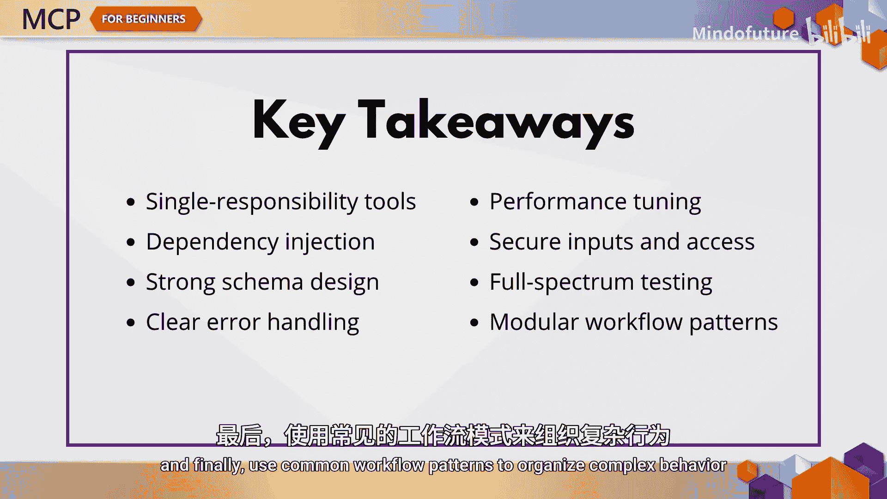

# 【Microsoft】Mcp协议入门 ｜ Model Context Protocol (Mcp) p09 P09_MCP开发最佳实践 -BV15aptzyE66_p9-

Hey there and welcome In this chapter we're exploring best practices in building robust。

 scalable and maintainable MTP servers， so whether you're creating a tool or deploying to production。

 these practices can help ensure that your implementation is reliable。

 secure and easy to work with over time， so let's break things down step by step。

Let's start with architecture One of the most important principles to follow is single responsibility。

 Each tool should do one thing and do it well。 This keeps your code cleaner。

 your API is more predictable and your tools easier to test and maintain。😊。

Instead of creating one mega tool that tries to handle forecasts， alerts， history and more。

 you should break it out into small focused components This makes your tools more modular and reusable across workflows。

Next， prioritize dependency injection。Tools should receive services like database clients。

 APIs or cash through their constructors， This makes them easier to test and more configurable for different environments。

You'll also want your tools to be composable that means designing tools that can feed into one another to create more complex workflows think of them like Lego bricks for your server。

😊。

A well designed schema is a gift to both your model and your users。

 always provide clear descriptions for your parameters。

 define constraints like Min Maxax values or allowed formats。

 and keep your return structures consistent。This helps the model understand how to use the tool properly and reduces unexpected errors when tools are invoked。

Airra handling should be thoughtful and layered。 Cat exceptions at the right level and provide structured responses with meaningful error messages。

 avoid crashing on the first problem。 Make it clear what went wrong and ideally how to fix it。

You can also implement retry logic for transient issues like timeouts or temporary service failures using exponential backoff patterns。

 performance matters， especially in production， Use caching to avoid repeated expensive operations。

 adopt a synchronous patterns for input output bound task and throttle tool user to prevent overloading your system。

 This is especially critical for tools that call external APIs or process large data sets。

 a little optimization goes a long way。

Security is non negotiable。 validateidate all inputs。

 Check for empty strings and force length limits and guard against injection attacks。

 Make sure users are authorized before accessing protected resources。

 and if a tool might expose sensitive data， redacted by default unless explicitly requested and only if the user is authorized。

 Now， let's talk about testing。 Every MCP server should include unit tests for each tool and resource handler schemeche of validation tests。

Integration tests for the full Re response lifecycle end to end tests that assimilate real model to tool workflows。

And performance tests to evaluate how your server behaves underload。Don't just test a happy paths。

 test edge cases， error scenarios， rate limits， and more。When designing tools。

 lean on established patterns。Charain of tools， one tool feeds into the next。Dispatcher。

Routs request to specialize tools。Paraallllel processing run multiple tools at once for speed。

Air recoveryy try fallback To that the primary fills。

Composition combines smaller workflows into larger ones。

These patterns increase flexibility and help you build workflows that scale and recover gracefully。

Let's recap the essentials。Design each tool with a single focused responsibility。

Use dependency injection to improve testability。Write clear schemas with strong validation。

Handle errors gracefully and log them meaningfully。Optimize performance with caching， async patterns。

 and throtling。Protect your tools with strict validation and authorization。Test at all levels。

 unit integration， In to in and underload。And finally。

 use common workflow patterns to organize complex behavior。

嗯。As you've seen， following MCP best practices means thinking holistically about architecture。

 security， performance， testing and user experience In the next chapter we're going to explore real world case studies that demonstrate practical application of MCP in various enterprise scenarios I'll see you there。

