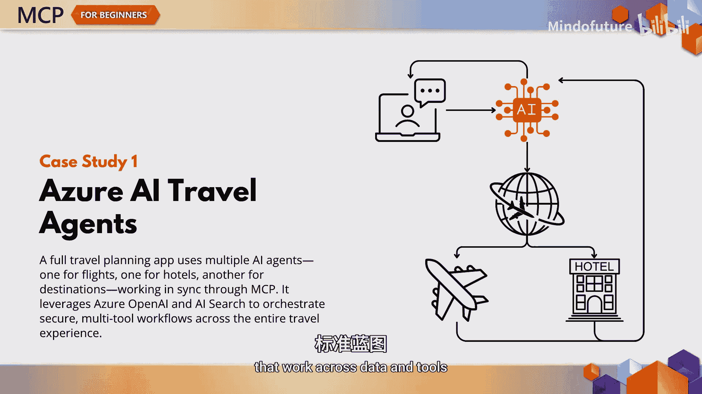
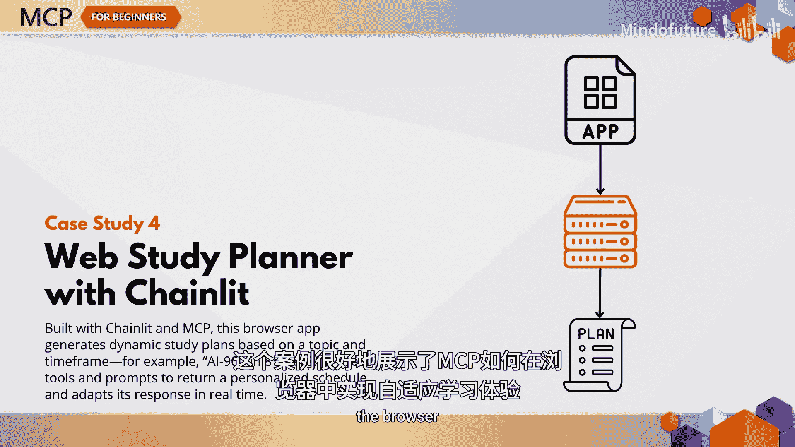
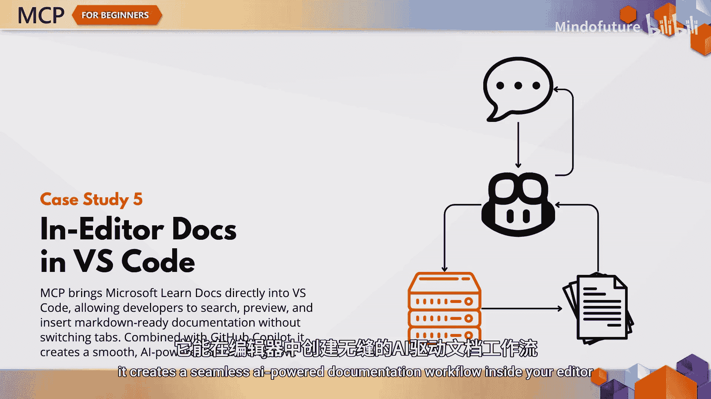
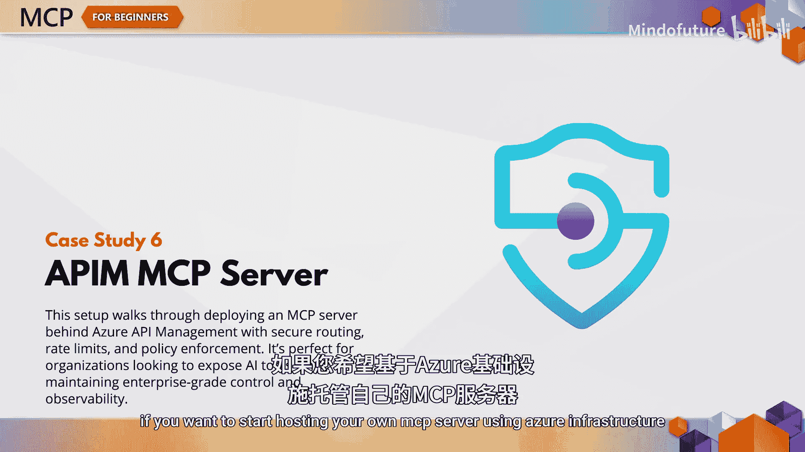
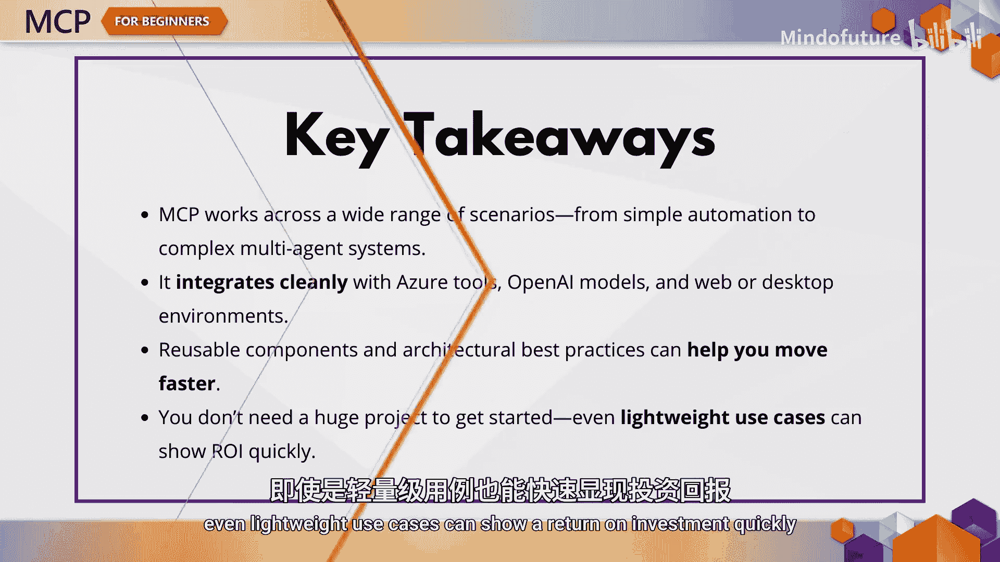

# 【Microsoft】Mcp协议入门 ｜ Model Context Protocol (Mcp) p10 P10_MCP_实际应用-真实世界案例研究 -BV15aptzyE66_p10-

Hey everyone， in this chapter we're diving into something a little different。

 rather than introduce a new concept or diagram， we're going to be exploring just what happens when MCP is actually put to work。

This chapter is packed for the real world case studies that demonstrates just how versatile and powerful the model context protocol can be in enterprise settings。

 So why case studies because theory only gets you so far。

 once you understand the fundamentals of MCP is incredibly helpful to see how other teens are applying those principles。

 how they're solving actual business problems， streamlining workflows and connecting AI to the real world。

😊，Let's kick things off with the Azure AI travel agent's reference implementation。

This one is all about multi agentent orchestration。

 a full travel planning app where each AI agent plays a specific role， searching destinations。

 comparing flights and recommending hotels。 It combines Azure open AI。

 Azure AI search and MCP to create a secure， extensible and enterprise grade experience。

 Think of this as your blueprint for building coordinated AI systems that work across data and tools。

😊。

Next up， a workflow automation scenario， updating Azure DevOs items based on data from YouTube。

 It sounds simple， but it's powerful using MCP， this setup extracts metadata from videos and automatically updates work items in Azure DevOs。

 the takeaway even lightweight MTP implementations can eliminate repetitive tasks and ensure data stays consistent across platforms。

How about accessing live documentation through the terminal。

 The real time documentation retrieval example shows how a Python client connects to an MCP server to stream relevant Microsoft docs in real time right in the console It's great for developers who prefer the command line and want f contextual answers without leaving their dev environment。

Now for something interactive， a web based study planner powered by a chainlet and MCP。

Users input put a topic in timeframe， for example。AI 900 certification in eight weeks and the app builds a personalized weekly study plan in real time with conversational responses。

This one's a great example of how MCP can enable adaptive learning experiences in the browser。

If you're a VS code user， you'll love this one， the In Editor Docs case study shows how MCP brings Microsoft Learn Docs right into your code editor。

Search， reference， and insert Docs into markdown without ever switching tabs。

 and when paired with GitHub Copilot， it creates a seamless AI powered documentation workflow inside your editor。

Finally， there's the APIIM MCP server walkthrough。This case study shows how to build and configure an MCP server using Azure API management。

You'll see how to expose APIs as MCP tools， set rate limits， apply policies。

 and even test your setup directly from VS code。It's a great entry point if you want to start hosting your own MCP server using Azure infrastructurefra。

So what do all these examples have in common They' proof that MCP isn't just a framework。

 but a toolkit for building real scalable AI for solutions。

 so whether you're creating a multi agent travel assistant or streaming documentation to your terminal。

😊，MCP is a connected tissue that links your models， data and tools。

These case studies are meant to inspire you and help you recognize patterns that you can apply to your own projects Here are the key takeaways。

MCP works across a wide range of scenarios， from simple automation to complex multi agent systems。

It integrates cleanly with Azure tools， open AI models， and web or desk environments。

Reusable components and architectural best practices can help you move faster。And finally。

 you don't need a huge project to get started， even lightweight use cases can show a return on investment quickly。

All right， none that youve seen MCP in the wild， it's time to get hands on again the next chapter introduces you to a fourpart lab which will provide handson exercises for connecting an agent to either an existing or a custom MCP server with the AI toolkit I'll see there。

