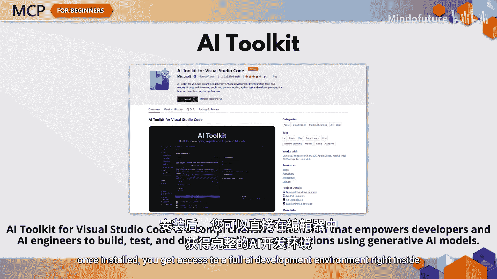
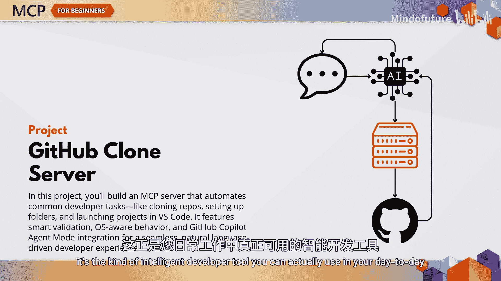

# 【Microsoft】Mcp协议入门 ｜ Model Context Protocol (Mcp) p11 P11_在VS_Code中构建AI代理-4个结合MCP+AI工具包的实践实验 -BV15aptzyE66_p11-

Hey there and welcome In this chapter， you're going to be introduced to the AI toolkit for Viual Studio code extension。

 Your skills will progressively build in learning how to use the AI toolkit in the context of creating an agent that's connected to tools from either an existing or a custom MCP server。

 Let's start with module 1。 Moule 1 is all about getting familiar with the AI toolkit extension and VS code Once installed。

 you get access to a full AI development environment right inside your editor You'll start with the model catalog where you can explore over 100 models from open AI to Github hosted models。

 whether you're doing creative writing cogeneration or analysis。

 There's something for every use case。 Then there's the playground。

 This is where you test your prompts in tweak parameters like temperature Max tokens and top P。

 helping you understand how different models behave。😊。

And finally， you'll build your very own custom agent using agent  builder。 you define its role。

 personality， parameters， and even tools it can use Once you've mastered the basics。

 Model 2 introduces model context protocol。 Think of it as the USBC of AI MCP lets you connect your agents to external tools and services in a standardized way。

😊，You'll get hands on with Microsoft's own MCP server ecosystem。

 which includes integrations for Azure， Dataverse， playwright and more The highlight。

 you'll build a browser automation agent powered by the Playwright MCP server this agent can open web pages。

 click buttons， extract content， take screenshots， and even run full test flows just by describing what you want it to do。

And you'll configure all of this directly from the agent  builder。

 selecting playwright from the MTP catalog， assigning tool capabilities。

 and designing intelligent prompts that drive web automation task Now that your agent can use external tools。

 it's time to level up。Module 3 gets into the nitty gritty of custom MCP server development in module 3。

 you'll build your own MCP server from scratch using the AI toolkits Python templates， your project。

 a weather MCP server that responds to natural language questions like what's the weather in Seattle。

You'll use the latest MCP SDK， configure Adv thebugging with MCP Inspector。

 and run your server live alongside your agent inside VS code。

You'll also learn how to structure an MCP server project。Upgrade dependencies。

 set up launch configurations and background tasks。

 and test your server using both agent  builder and the inspector。

It's a professional grade dev workflow that prepares you to create and debug any kind of custom tool your agent might need。

 and finally in module4， we put it all together with the real world use case you'll build a GitHub clone MCP server that automates the steps developers often do manually Clning a repo。

 creating directories and opening the project in VS code。

This project includes Smart validation and error handling。

OSware logic to launch VS code or VS code Insiders。

Integration with GitHub Coalate and agent mode and a clean user experience driven entirely through natural language prompts Its the kind of intelligent developer tool you can actually use in your day to day work In just four modules you'll go from installing the AI toolkit to building production ready NP servers that makes your agents truly powerful。

 We can't wait to see what you create。😊。

