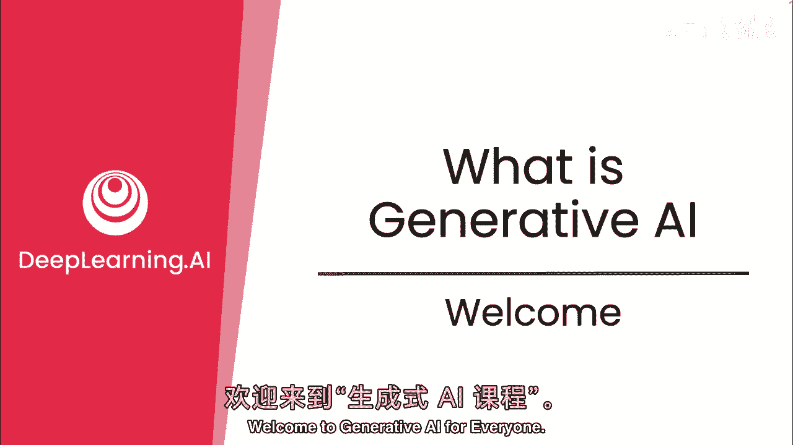
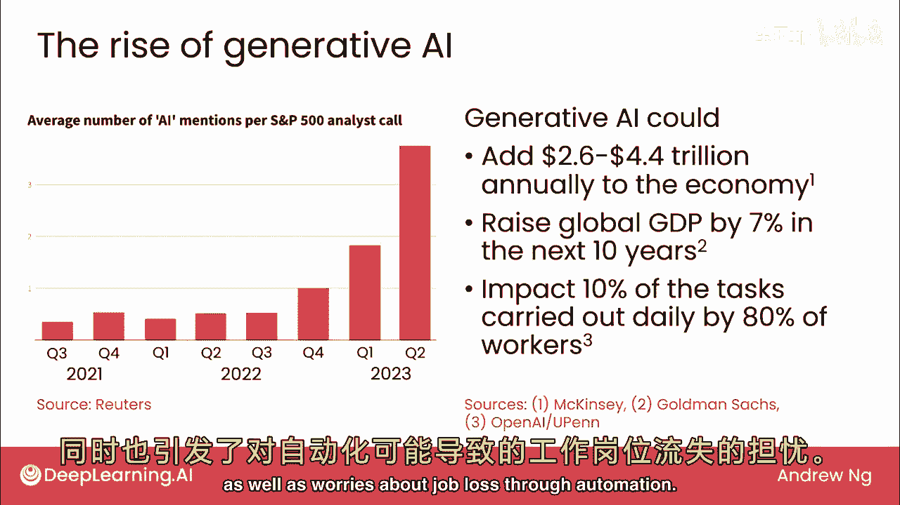
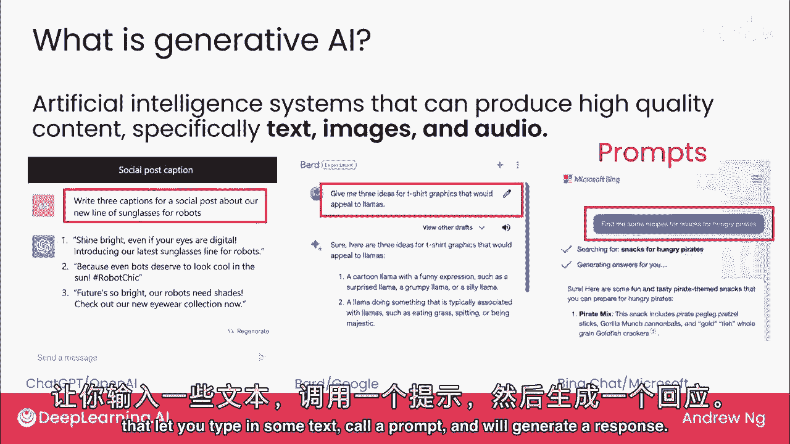
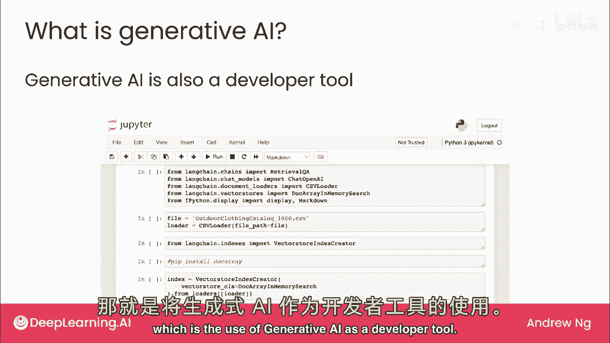
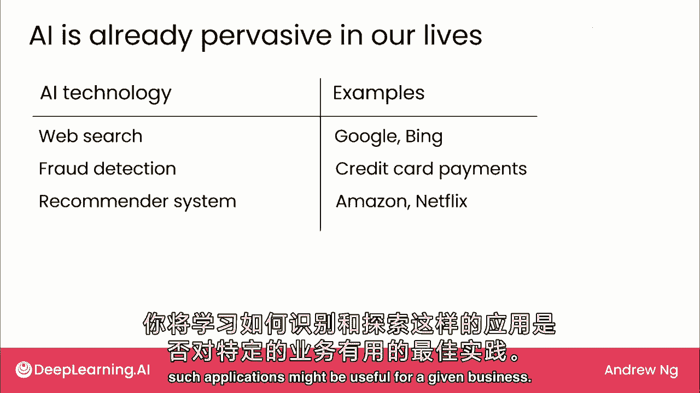
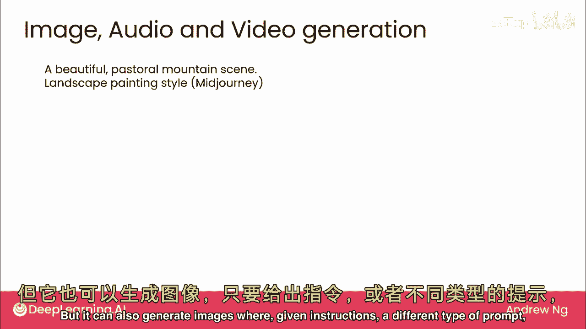
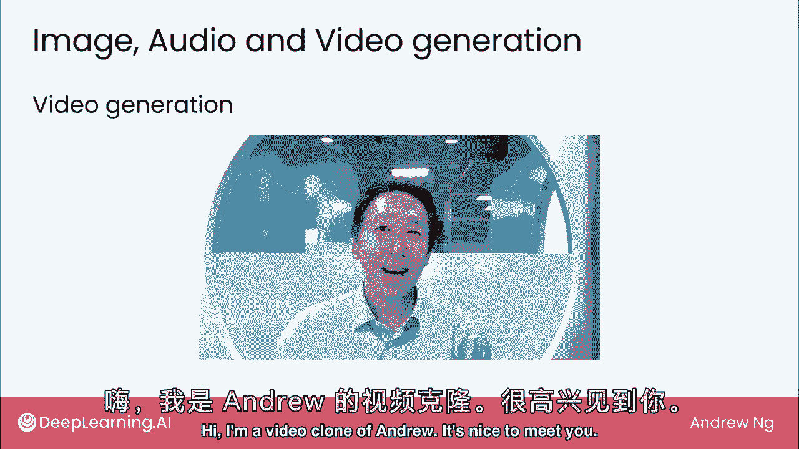
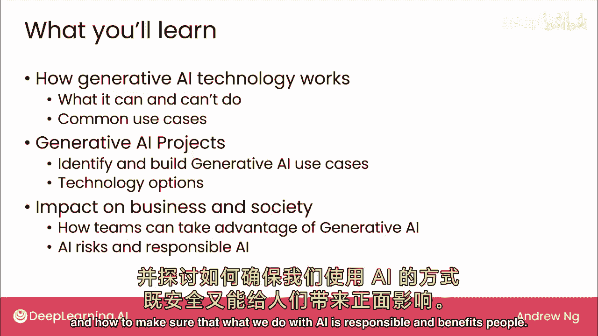

# 课程一：生成式AI入门教程 🚀

在本节课中，我们将要学习生成式人工智能（Generative AI）的基本概念。我们将了解它的定义、核心能力、主要应用领域以及它对社会和经济的潜在影响。无论你是否有技术背景，本教程都将帮助你建立对这项颠覆性技术的准确理解。

---

自ChatGPT发布以来，生成式AI吸引了大量个人、公司和政府的关注。这是一种极具颠覆性的技术，已经在改变人们学习和工作的方式。

许多开发者认为，生成式AI将使许多人受益，提高生产力，并对全球经济增长做出重大贡献。但它也可能带来负面影响，例如改变就业结构。在本课程中，你将了解生成式AI是什么、它能做什么和不能做什么，以及如何在你自己的工作或业务中应用它。

由于这项技术较新，仍存在许多错误信息。因此，本课程旨在提供一个准确、非技术性的理解，并与你一同思考如何最好地利用这项技术。本课程不预设任何技术或AI背景，旨在对商业、科学、工程、人文、艺术等任何领域的从业者都有用。

那么，让我们开始深入探讨生成式AI。

## 什么是生成式AI？🤖

生成式AI指的是能够生成高质量内容的人工智能系统，特别是文本、图像和音频。

最知名的生成式AI系统是OpenAI的ChatGPT。它可以遵循指令执行任务，例如“为我们的机器人太阳镜设计写3个社交媒体标题”，并生成各种创意输出。许多用户熟悉这类能直接生成文本的网站或应用程序。

以下是其他一些知名的生成式AI应用示例：
*   谷歌的Bard
*   微软的Bing Chat

这些应用通常提供一个用户界面，让你输入一些文本（这被称为**提示**），然后AI会生成响应。

## 生成式AI的深远应用：开发工具 🔧

除了上述面向消费者的应用，生成式AI还有另一个我认为可能产生更长期、更深远影响的应用领域：作为开发工具使用。

AI已经融入我们的生活。我们每天可能使用它数十次而不自知。例如：
*   每次使用谷歌或必应进行网络搜索，背后是AI。
*   每次使用信用卡时进行的欺诈检测，背后是AI。
*   每次访问亚马逊或Netflix时收到的个性化推荐，背后也是AI。

然而，过去的许多AI系统构建复杂且成本高昂。生成式AI使得构建许多AI应用变得更加容易。这意味着AI产品的数量和种类正在激增，因为与之前相比，构建某些AI应用的成本正在降低。

因此，本课程将反复探讨的一个主题是：**生成式AI如何能让你的业务以更低的成本，构建出极具价值的AI应用**，并帮助你学会识别和探索这些可能性。

## 生成式AI的能力展示 🎨

如前所述，我将生成式AI描述为能够生成文本、图像和音频。在这三种内容类型中，迄今为止影响最大的是文本生成。

但它也能根据指令生成图像。例如，对于不同的提示，它可以生成风格各异的图像。

它可以生成精美的艺术图像，甚至逼真的照片。

生成式AI同样可以生成音频。例如，以下是我声音的克隆（注：此处为文字描述，原视频包含音频）：“嗨，我是一个AI生成的吴恩达声音克隆。吴恩达从未说过这些话。”不是吗？

你还可以将音频生成与图像甚至视频生成结合起来，创建一个视频克隆。

## 课程路线图与总结 🗺️

生成式AI领域正在快速发展，这是一项令人兴奋且具有颠覆性的技术，我相信你会在工作中发现它的用处。

在本课程的后续安排中：
*   **第一周**，我们将深入了解生成式AI技术的工作原理，特别是它能做什么和不能做什么。你还将看到各种常见的用例，希望能激发你关于如何用它为自己生活或工作创造价值的灵感。
*   **第二周**，我们将讨论生成式AI项目，特别是如何识别有价值的生成式AI应用、构建它们的最佳实践，并深入探讨可用的技术选项，以构建多种有价值的项目。
*   **最后一周**，我们将超越单个项目，审视生成式AI如何影响企业乃至整个社会。我们将探讨团队或公司利用这项技术的最佳实践。

---

**本节课中，我们一起学习了**：生成式AI的基本定义，它是一种能生成文本、图像和音频内容的人工智能。我们了解了它既可以通过聊天机器人等应用直接面向消费者，也能作为强大的开发工具降低AI应用构建门槛。最后，我们预览了生成式AI的多种能力以及本课程的完整学习路线。