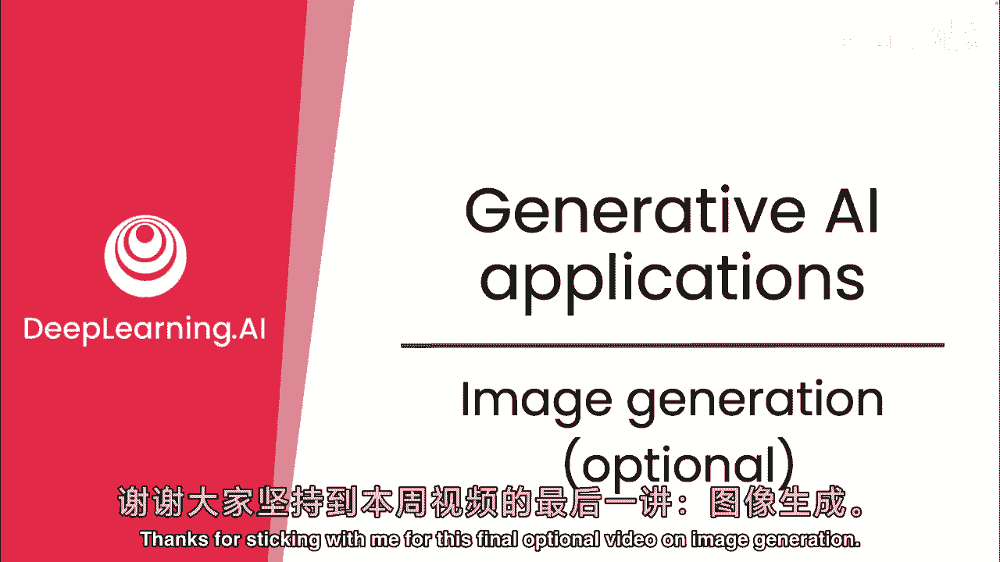
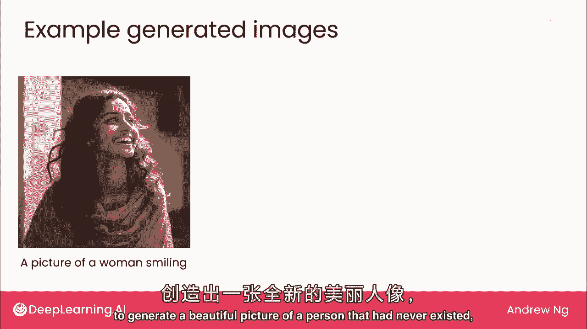
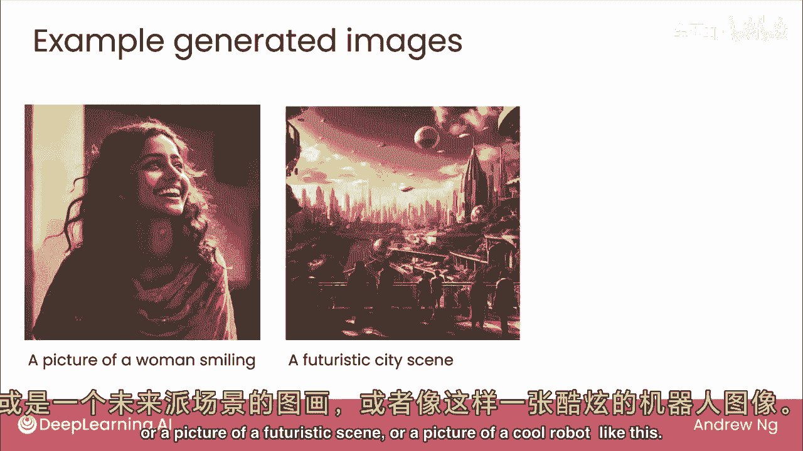
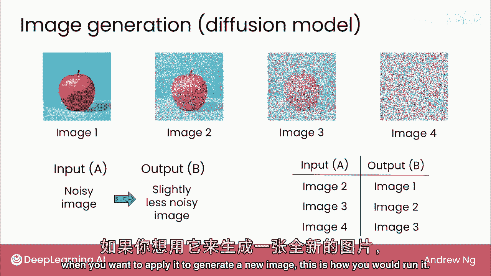
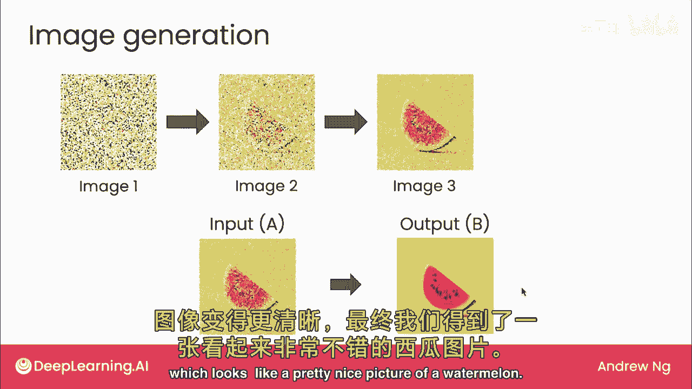
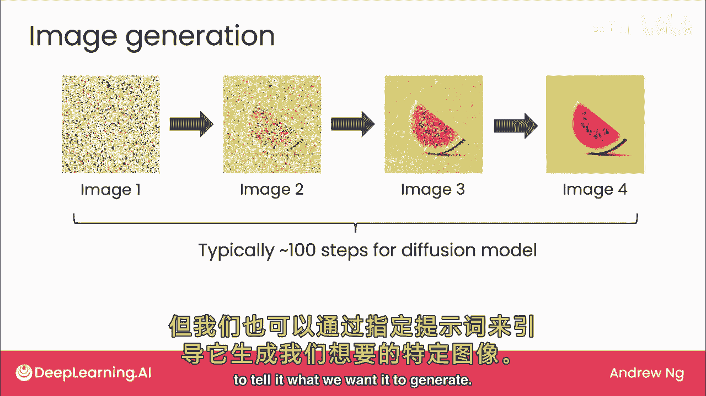
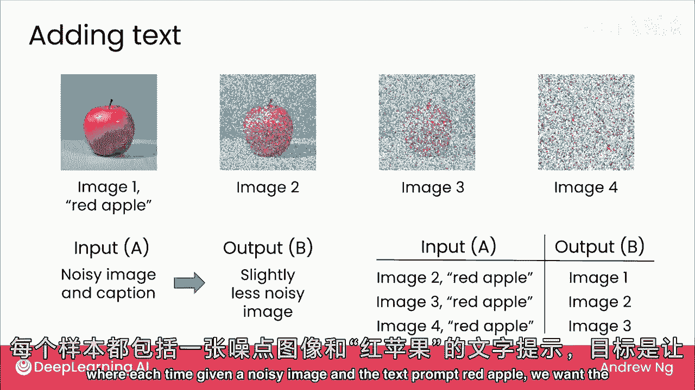
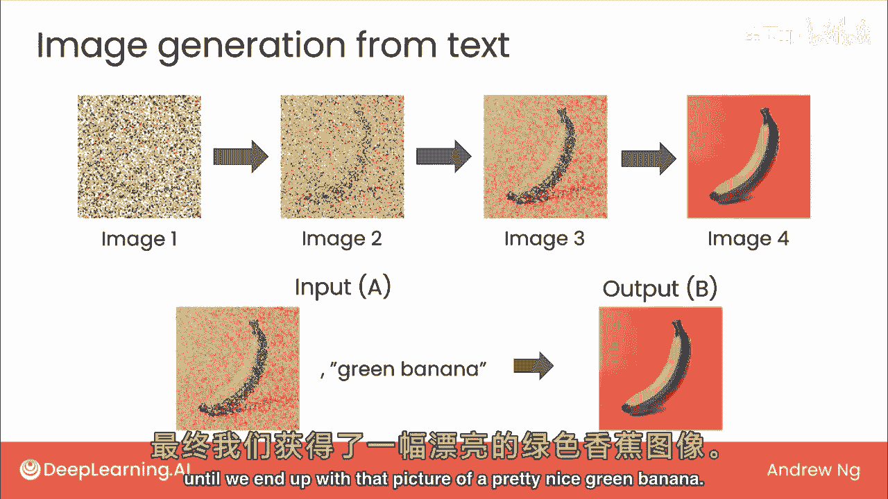

# 课程10：生成式AI应用 - 图像生成 🖼️

在本节课中，我们将要学习生成式AI在图像生成领域的应用。我们将了解当前主流的图像生成技术——扩散模型——是如何工作的，并理解它如何根据文本提示创造出全新的图像。

---

## 概述

上一节我们介绍了文本生成，它是生成式AI中影响最广的应用之一。然而，图像生成同样是这项技术令人兴奋的领域。一些模型甚至能够同时处理文本和图像，这类模型被称为多模态模型。本节中，我们来看看图像生成技术背后的核心原理。

## 图像生成的应用

以下是图像生成技术的一些典型应用场景：

*   **生成不存在的人物肖像**：AI可以创造出从未存在过的人的美图。
*   **描绘未来场景**：AI能够生成想象中的未来世界图景。
*   **设计酷炫概念图**：例如，生成具有未来感的机器人图像。

## 核心技术：扩散模型

当前，图像生成主要通过**扩散模型**实现。这类模型的核心是**监督学习**。它的工作原理可以概括为两个相反的过程：**加噪**与**去噪**。

### 1. 训练阶段：学习去噪

首先，模型需要从大量图像数据中学习。我们以一张苹果图片为例来说明训练过程。

**加噪过程**：从一张清晰的苹果图片开始，逐步向其添加随机噪声。经过多步后，图片会变成一张完全由随机像素组成的纯噪声图，完全看不出原图内容。

**构建训练数据**：扩散模型利用这个过程构建数据集。其核心思想是：**给定一张有噪声的图片，让模型学习预测并输出一张噪声更少的图片**。

具体来说，监督学习算法的训练数据对 `(输入, 期望输出)` 是这样构建的：
*   **输入**：一张带有噪声的苹果图片。
*   **期望输出**：一张噪声更少、更清晰的苹果图片。

这个过程会使用不同噪声程度的图片创建数百万个这样的数据点。最终，模型学会了如何从任何程度的噪声图中，“逆向”恢复出清晰的图像。

### 2. 生成阶段：从噪声中创造

当模型训练完成后，生成一张新图片的过程如下：

1.  **从纯噪声开始**：首先创建一张每个像素都是随机值的图片。
2.  **逐步去噪**：将这张纯噪声图片输入训练好的模型。模型会预测并输出一张噪声稍少的图片。
3.  **迭代优化**：将上一步的输出作为新的输入，再次送入模型去噪。重复这个过程多次（实践中通常是几十到上百步）。
4.  **得到清晰图像**：经过多次迭代去噪后，最终会得到一张清晰、有意义的图像。

这个过程就像一个逆向的“病毒扩散”，将无序的噪声逐步转化为有序的图像。

## 引入文本提示的控制

上述方法可以随机生成图像，但我们通常希望控制生成的内容。这时就需要引入**文本提示**。

训练过程需要进行调整。现在，我们不仅给模型看噪声图片，还会同时提供描述原图的文本提示（例如：“一个红苹果”）。

此时，监督学习算法的训练目标变为：
*   **输入**：一张噪声图片 **+** 文本提示（如“红苹果”）。
*   **期望输出**：一张与文本描述对应的、更清晰的图片（如一个清晰的红苹果）。

通过在海量“图像-文本”对上训练，模型学会了将文本语义与视觉特征关联起来。

在生成阶段，如果你想生成“一个绿色的香蕉”，你需要：
1.  从一张纯噪声图开始。
2.  将这张噪声图 **和** 文本提示“绿色的香蕉”一起输入模型。
3.  模型根据提示，开始将噪声朝“绿色香蕉”的方向去噪。
4.  经过多次迭代，最终生成一张符合描述的绿色香蕉图片。

**核心公式/代码描述**：
虽然实际模型非常复杂，但其去噪步骤的核心可以简化为：
`输出图像 = 模型(输入噪声图像, 文本提示)`
这个过程在一个循环中重复执行，直到噪声被充分去除。

## 总结

本节课中，我们一起学习了生成式AI在图像生成方面的应用。我们了解到：

1.  **扩散模型**是当前图像生成的主流技术。
2.  其核心是**监督学习**，通过“加噪-去噪”的过程让模型学会从噪声中重建图像。
3.  通过引入**文本提示**，我们可以精确控制生成图像的内容，实现“文生图”的功能。
4.  图像生成是一个逐步迭代的过程，从纯噪声开始，经过模型多次去噪，最终得到清晰的图像。

这项技术结合了强大的学习能力和人类的创造性指令，正在不断拓展艺术、设计和内容创作的边界。