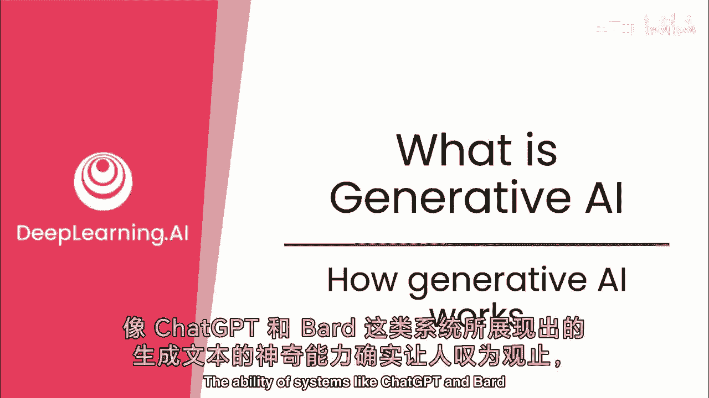
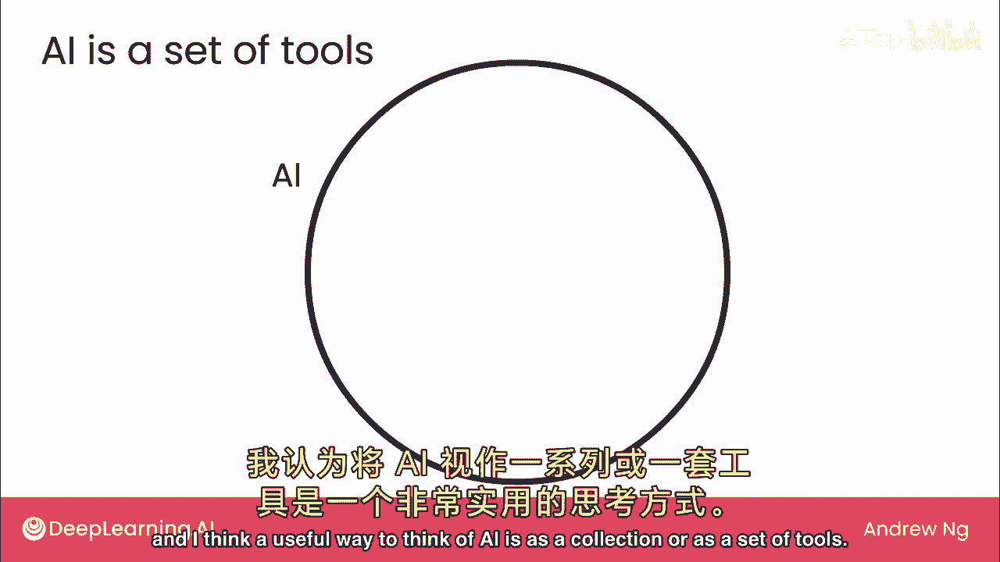
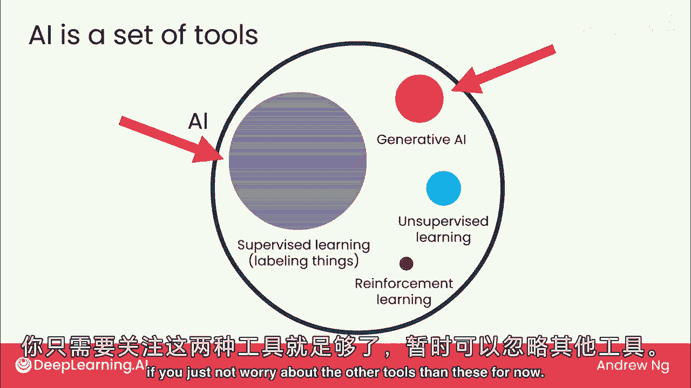
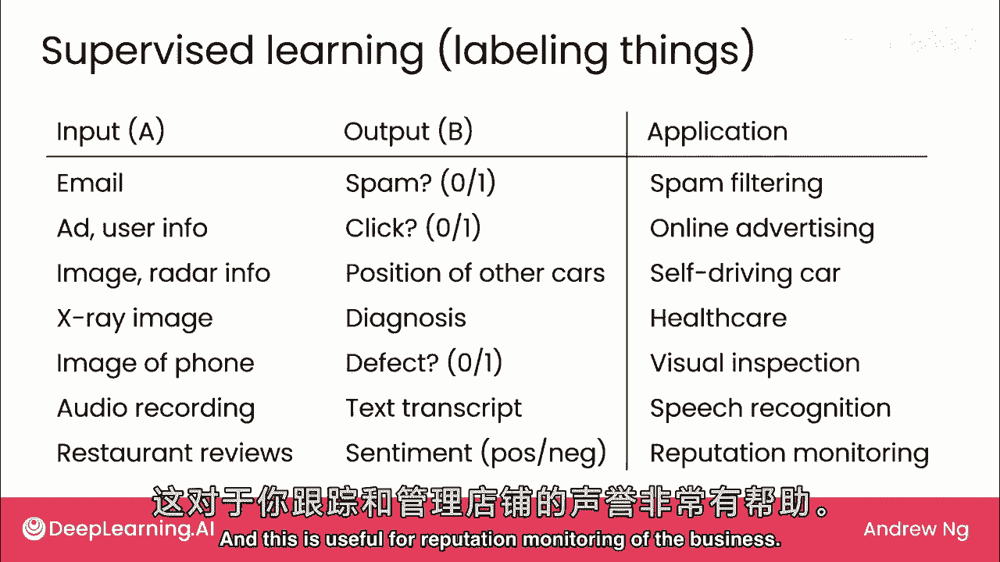
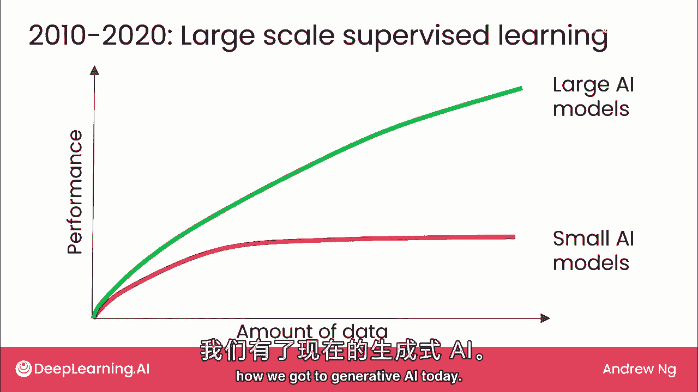
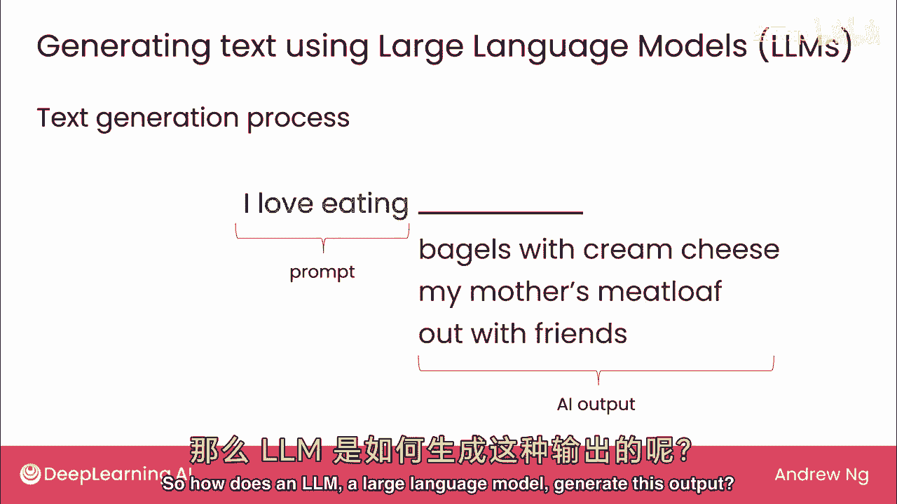
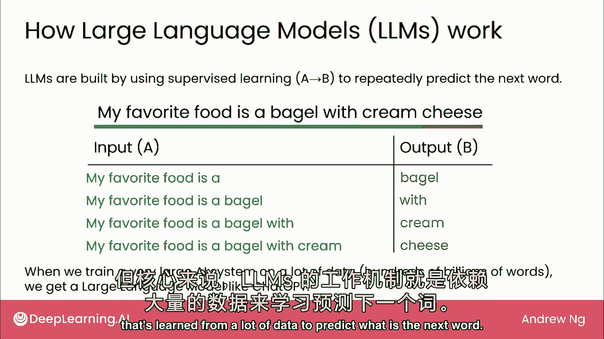

# 课程 P2-2：什么是生成式 AI？原理与指南 🧠

在本节课中，我们将要学习生成式人工智能（AI）的基本原理。我们将探讨它如何工作，以及它与另一种重要的AI工具——监督学习之间的关系。通过理解这些基础，你将能更好地理解生成式AI的能力与局限。

---

## 生成式AI在AI领域的定位 🗺️

上一节我们介绍了课程的整体框架，本节中我们来看看生成式AI在广阔的AI领域中处于什么位置。

AI领域存在很多炒作和兴奋。我认为将AI视为一系列有用的工具会更有帮助。

以下是AI领域中最重要的两种工具：
*   **监督学习**：它非常擅长为事物打标签。
*   **生成式AI**：这是最近才开始真正发挥巨大作用的工具。

如果你研究AI，可能会注意到还有其他工具，如无监督学习和强化学习。但就本课程而言，我们将简要介绍监督学习，然后花大部分时间讨论生成式AI。对于大多数商业应用，掌握这两种最重要的工具就足够了。

---

## 监督学习：生成式AI的基石 🧱

在描述生成式AI如何工作之前，我们需要先简述一下监督学习，因为生成式AI正是建立在它的基础之上。

监督学习使计算机能够根据输入 `a`，生成相应的输出 `b`。

让我们看几个监督学习的应用示例：
*   **垃圾邮件过滤**：输入 `a` 是一封邮件，输出 `b` 是0或1（0表示非垃圾邮件，1表示垃圾邮件）。
*   **在线广告**：给定一个广告和用户信息（输入 `a`），AI系统预测用户点击该广告的可能性（输出 `b`）。
*   **自动驾驶**：输入 `a` 是汽车前方的图片和雷达信息，输出 `b` 是其他车辆的位置标记。
*   **医疗影像诊断**：输入 `a` 是X光片，输出 `b` 是尝试标记的诊断结果。
*   **语音识别**：输入 `a` 是一段音频，输出 `b` 是相应的文字稿。
*   **情感分析**：输入 `a` 是一段商业评论，输出 `b` 是标记的正面或负面情绪。

---

## 大规模监督学习的兴起 📈

接下来，我们看看监督学习的一个重要发展，这为现代生成式AI奠定了基础。

大约从2010年开始，研究者们发现，对于许多应用，即使给小型AI模型提供海量数据，其性能提升也非常有限。例如，一个语音识别系统在听了数万小时数据后，准确率可能并不比只听少量数据的系统高多少。

然而，越来越多的研究者意识到，如果训练**大型AI模型**（即使用高速、强大、内存充足的计算机），那么模型的性能会随着输入数据量的增加而持续提升。几年前，我领导谷歌大脑团队时，早期的主要任务就是构建超大型AI模型并喂给它们大量数据。这个方法最终奏效了，并推动了AI的进展。

**大规模监督学习**至今仍然非常重要，正是这些用于打标签的超大模型，使我们今天拥有了生成式AI。

---

## 生成式AI与大型语言模型（LLM） 🗣️

现在，让我们进入核心部分，看看生成式AI如何利用大型语言模型来生成文本。

大型语言模型（简称LLM）能够根据给定的输入（称为**提示**）生成文本。例如，给定提示“我爱吃”，LLM可能会生成“贝果配奶油芝士”来补全这句话。如果你再次运行，它可能会生成“妈妈做的肉饼”。那么，LLM是如何生成这些输出的呢？

---

## LLM的工作原理：预测下一个词 🔮

事实证明，LLM是通过监督学习技术构建的。它的核心是反复**预测下一个单词是什么**。

例如，如果一个AI系统在互联网上读到一句话：“我最喜欢的食物是贝果配奶油芝士”。那么这句话会被转换成多个供它学习的数据点，以学习预测下一个单词。

具体来说，基于这句话，我们可以创建以下数据点：
*   输入 `a`：`我最喜欢的食物是`
    *   输出 `b`：`贝果` （正确答案）
*   输入 `a`：`我最喜欢的食物是贝果`
    *   输出 `b`：`配`
*   输入 `a`：`我最喜欢的食物是贝果配`
    *   输出 `b`：`奶油芝士`

所以，整句话被转换成多个输入 `a` 和输出 `b` 供模型学习。LLM正是从海量文本数据中学习“给定一些单词，预测下一个最可能出现的单词”。

当你用一个非常庞大的数据集（对LLM来说，这意味着数百亿甚至上万亿个单词）来训练一个大型AI系统时，你就会得到一个大型语言模型。像ChatGPT这样的模型，在给定一个提示后，就非常擅长生成后续的单词作为回应。

> 目前，我省略了一些技术细节。特别是，我们将在后续课程中讨论一个使LLM不仅能预测下一个单词，还能学会遵循指令并确保输出安全的过程。但大型语言模型的核心，正是这种从海量数据中学习预测下一个单词的技术。

---

## 总结 📝

本节课中我们一起学习了生成式AI的基础原理。我们了解到：
1.  生成式AI是AI工具集中最重要的一员，与监督学习并列。
2.  生成式AI建立在监督学习的基础之上。
3.  大规模监督学习的成功（用海量数据训练超大模型）为生成式AI的出现铺平了道路。
4.  大型语言模型（LLM）是生成文本的核心，其工作原理是通过监督学习，在海量文本数据上反复训练以**预测序列中的下一个单词**。

理解这些基本原理，将帮助你更有效地使用生成式AI工具，并对其能力形成合理的预期。