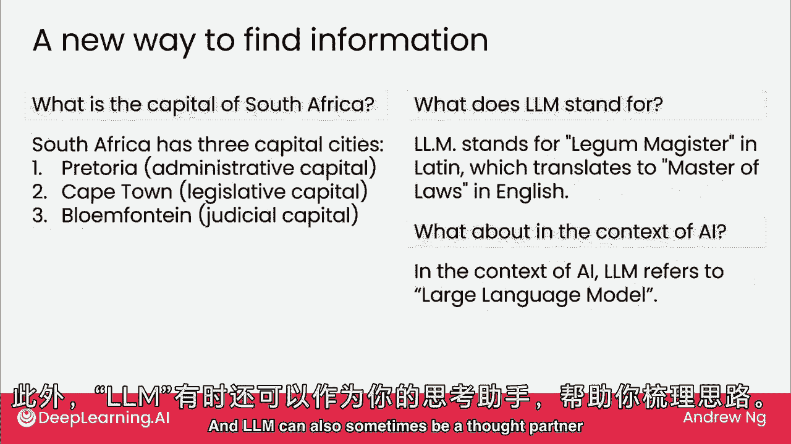
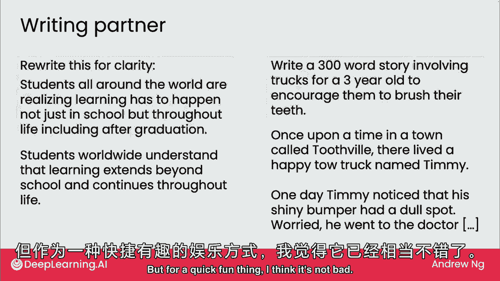
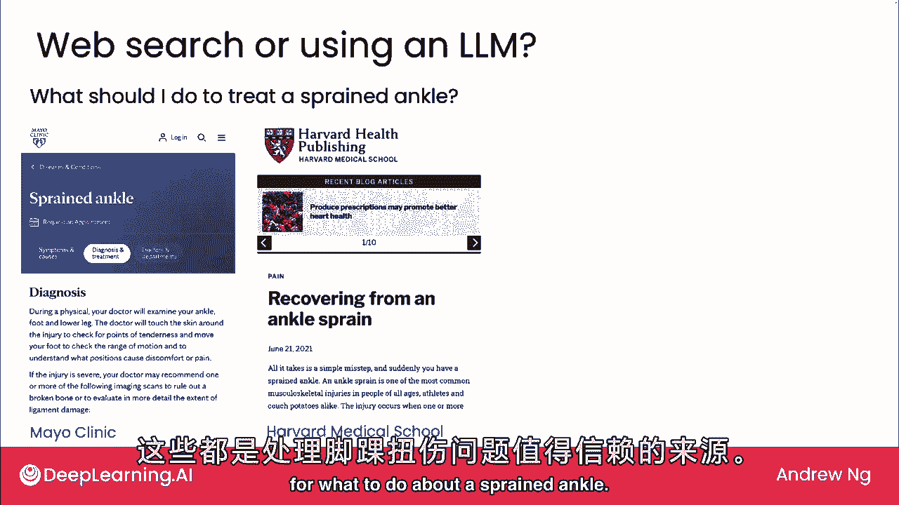
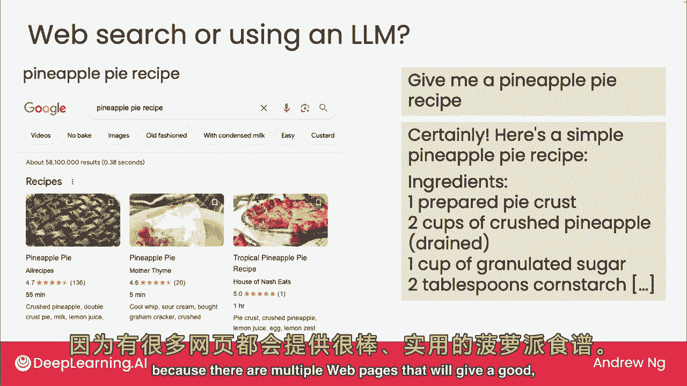
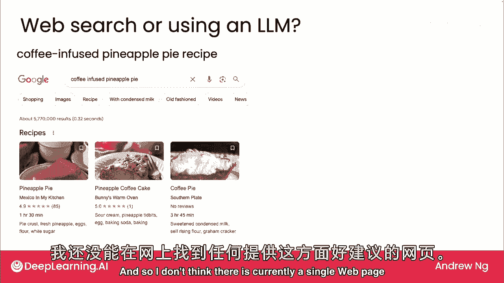

# 课程 P3-3：什么是生成式 AI？大语言模型作为思考助手 🤖💭


在本节课中，我们将学习大语言模型（LLM）如何作为思考助手，探索其应用场景、优势与局限性，并了解如何有效地利用它来辅助我们的工作和学习。

---

## 概述

生成式人工智能，特别是大语言模型，正通过多种网页界面（如 ChatGPT、谷歌 Bard、微软必应等）变得触手可及。无论你是否经常使用它们，了解其工作原理和应用方式都能为你带来新的启发。本节将介绍人们如何使用这些模型，并帮助你思考它们可能对你有用的方式。

---

## 大语言模型：一种新的信息查找方式 🔍

上一节我们介绍了生成式 AI 的基本概念，本节中我们来看看大语言模型如何作为一种新型的信息检索工具。

大语言模型提供了一种新的信息查找方式。例如，如果你问它“南非的首都是什么？”，它可能会给出正确的答案。

> **代码示例：**
> ```
> 用户输入：南非的首都是什么？
> 模型输出：南非有三个首都：行政首都为比勒陀利亚，立法首都为开普敦，司法首都为布隆方丹。
> ```




然而，正如我们稍后将看到的，大语言模型有时会编造事实，这种现象被称为 **幻觉**。因此，如果你依赖它来获取关键问题的正确答案，最好在采纳前与权威来源进行核对。

---

## 通过对话提供上下文 💬

有时，与大语言模型进行多轮对话有助于获得更准确的信息。这可以帮助你为模型提供正确的上下文，从而获取你真正寻找的信息。



例如，如果你问“在我的答案中，LM代表什么？”，模型可能会根据通用语境回答“泻湖大师”（一个法律术语）。但如果你随后补充说“在AI的背景下”，模型就会修正其回答。

> **对话流程：**
> 1.  用户：在我的答案中，LM代表什么？
> 2.  模型：LM 代表“泻湖大师”，这是法律中使用的术语。
> 3.  用户：在AI的背景下。
> 4.  模型：在人工智能的背景下，LM 指的是“大型语言模型”。


这种交互表明，清晰的上下文引导对于从大语言模型获得精准答案至关重要。

---



## 作为思考与创作伙伴 ✍️

除了查找信息，大语言模型还可以作为思考伙伴，帮助你完善想法和进行创作。

以下是它的一些应用方式：

*   **文本润色**：你可以要求模型重写一段文字以提高其清晰度。例如，输入“重写以提高清晰度：世界各地的学生意识到学习已经发生……”，模型能够生成更流畅、更专业的版本。
*   **内容创作**：你可以要求模型根据特定主题进行创作。例如，输入“写一个关于卡车、长度为300字的故事，目的是鼓励孩子刷牙”，模型就能生成一个有趣且贴合主题的小故事。


虽然这些创作可能无法与专业作家的作品媲美，但对于快速生成灵感或初稿而言，它是一个非常有用的工具。

---



## 大语言模型 vs. 传统网络搜索 ⚖️

在寻找信息时，你可能会犹豫应该使用传统网络搜索还是大语言模型。理解它们各自的优势有助于做出选择。

以下是两种方法的对比：



*   **寻求可靠事实或专业建议时，优先使用网络搜索**：例如，如果你运动时扭伤了脚踝，想知道如何处理。网络搜索可以引导你找到梅奥诊所或哈佛大学等权威医疗机构发布的、可信的医疗建议网页。直接询问大语言模型同样会生成答案，但由于其存在“幻觉”的风险，对于医疗、法律等专业领域，在遵循其建议前务必进行二次核实。
*   **寻找创意、综合或小众信息时，可尝试使用大语言模型**：例如，如果你想烘焙一个标准的菠萝派，网络上有大量由可信网站或厨师提供的成熟食谱，这是更安全的选择。但如果你朋友挑战你制作一个“咖啡风味的菠萝派”，网络上可能没有现成的完美方案。这时，大语言模型就可以作为一个“思考伙伴”，帮助你构思和生成一个融合了这两种风味的创新食谱思路。


---

## 总结

本节课中，我们一起探索了大语言模型作为思考助手的多种用途。我们了解到它可用于信息查询、通过多轮对话澄清问题、辅助文本润色与创意写作。同时，我们也认识到它的局限性，特别是在可能产生“幻觉”方面。因此，在需要高度准确性的场景下，应将其与权威信息来源结合使用。关键是要根据任务的性质——是寻求已知事实还是需要创意发散——来灵活选择使用传统网络搜索或大语言模型。

在下一个视频中，我们将系统地讨论生成式 AI，并开始梳理它们能胜任的各类任务，包括写作、阅读和对话等。