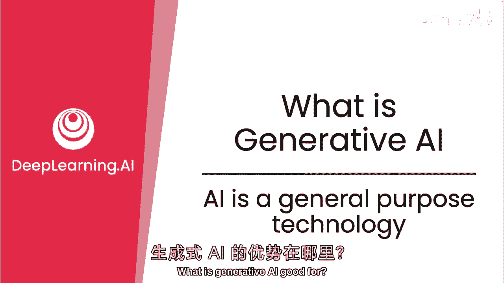
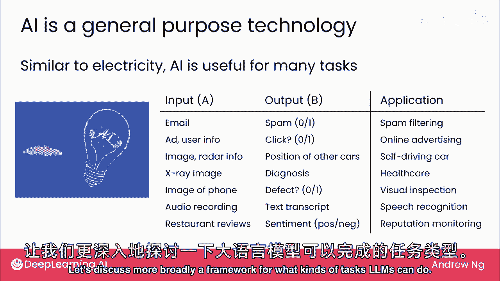
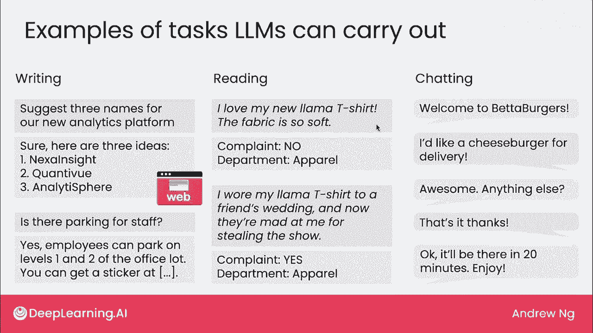
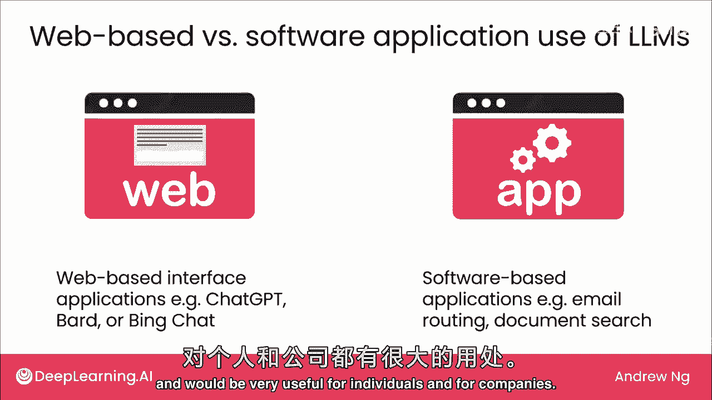

# 课程 P4-4：什么是生成式 AI - AI 是一种通用技术 🧠

在本节课中，我们将要学习生成式人工智能（AI）的广泛应用。我们将探讨为什么AI被称为“通用技术”，并介绍一个实用的框架来理解大语言模型（LM）能完成的主要任务类型。

## 概述：AI 作为通用技术

生成式AI有何用途？这个问题难以回答的原因之一是，AI是一种通用技术。它不像汽车（主要用于交通）或微波炉（主要用于加热食物）那样，仅用于单一目的。AI可用于许多不同的事情，这使得讨论其用途更具挑战性。让我们来看看“通用技术”的真正含义。

AI类似于电或互联网。若问电或互联网有何用途，答案会非常广泛，因为它们已渗透到我们生活的方方面面。同样，你之前见过的监督学习技术，已被用于垃圾邮件过滤、广告投放、语音识别等众多任务。生成式AI也是如此。

在上一节视频中，我们看到了大语言模型能执行的一些任务，例如回答特定问题和辅助写作。接下来，让我们更系统地讨论大语言模型能执行任务的框架。

## 大语言模型的任务框架

我发现将大语言模型的能力分为三大类非常实用：**写作**、**阅读**和**聊天**。以下是这三类任务的详细介绍。

### 写作任务 ✍️

生成式AI能够生成文本，因此非常适合用于写作辅助。我经常使用生成式AI工具作为头脑风暴伙伴。例如，若要为新产品命名，你可以要求它生成一些创意建议。

大语言模型也能很好地回答问题。如果为它们提供关于你公司的特定信息，它们可以帮助团队成员快速找到所需信息，例如查询办公室的停车政策。

### 阅读任务 📖

除了写作，生成式AI还擅长“阅读摘要”。你将给模型一段较长的文本，让它生成一个简短的输出。例如，如果你经营一家电子商务公司并收到大量客户邮件，生成式AI可以快速阅读邮件内容，帮助你判断这封邮件是否是投诉。

*   **投诉示例**：“我穿着羊驼T恤参加朋友婚礼，他们生我气抢了风头。” —— 这可能是一封投诉。
*   **非投诉示例**：“我喜欢我的新羊驼T恤，面料很柔软。” —— 这不是投诉。

虽然监督学习也可以用于此类分类任务，但生成式AI使得构建这类“阅读”任务变得更加快速和经济。我们将在本周晚些时候看到更多例子。

### 聊天任务 💬

最后，生成式AI也广泛用于构建各种聊天机器人。除了像ChatGPT这样的通用聊天机器人，大语言模型技术也使得构建专业用途的聊天机器人成为可能。

例如，一个用于在线订餐的聊天机器人。用户可以说“芝士汉堡送货”，聊天机器人便能确认并为客户下单。

## 两种应用模式

在讨论这些任务时，我发现区分两种不同类型的AI应用很有用。

### 1. 基于网页界面的应用 🌐

这种应用模式是指你直接在ChatGPT、Bard或互联网上其他大语言模型的网页界面中输入提示（Prompt），并直接获取结果。例如，为新产品命名而进行的头脑风暴，就很适合这种方式。我将这种应用称为 **Web界面AI应用**。

### 2. 基于软件的AI应用 💻

相比之下，在判断客户邮件是否为投诉的例子中，更合理的做法是将大语言模型集成到公司更大的软件自动化工作流中。没有人会手动将每封邮件复制粘贴到网页界面去获取答案。因此，这是一个**基于大语言模型的软件应用**。

第二个写作示例（回答公司人事问题）也更适合构建成软件应用，因为通用的网络大语言模型可能不了解你公司的内部政策。本课程后续将更详细地讨论如何构建这类应用。大多数专业聊天机器人也将基于软件模式。

在本课程剩余部分，我将用这两个符号（🌐 和 💻）来区分网页应用和软件应用。对许多人来说，从网页应用开始可能更容易上手。我认为这两种应用模式都至关重要，对个人和公司都将非常有用。

## 总结

本节课中，我们一起学习了生成式AI作为通用技术的特性。我们介绍了一个实用的框架，将大语言模型的能力分为**写作**、**阅读**和**聊天**三大类任务。同时，我们区分了**基于网页界面的应用**（🌐）和**基于软件的AI应用**（💻）两种主要使用模式。在接下来的三个视频中，我们将深入探讨每一类任务的具体示例，希望你能发现其中一些对你的工作或学习有所帮助。