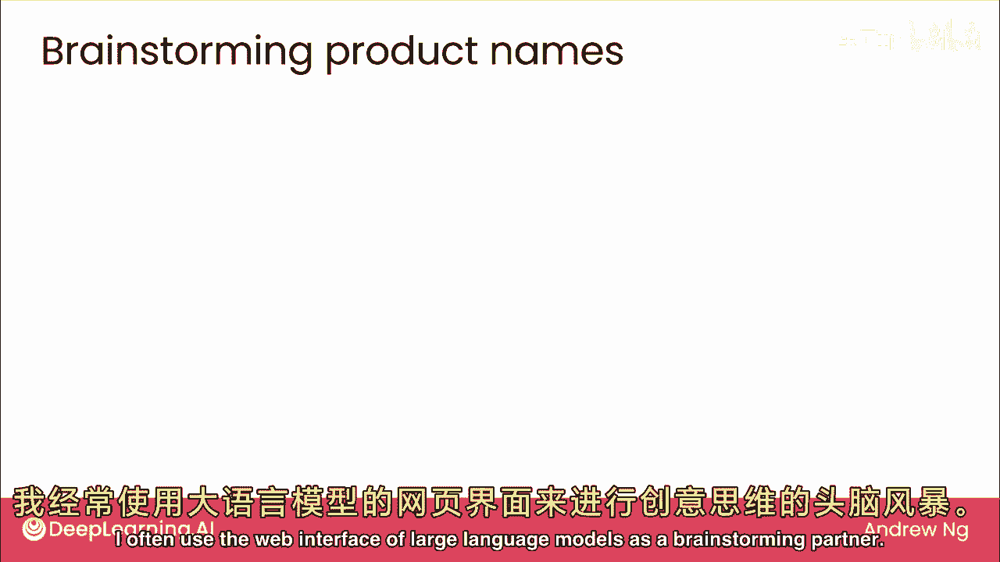
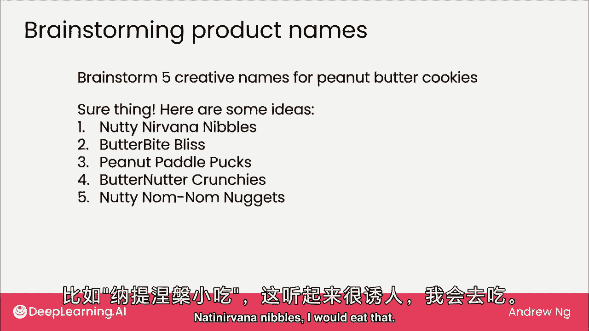
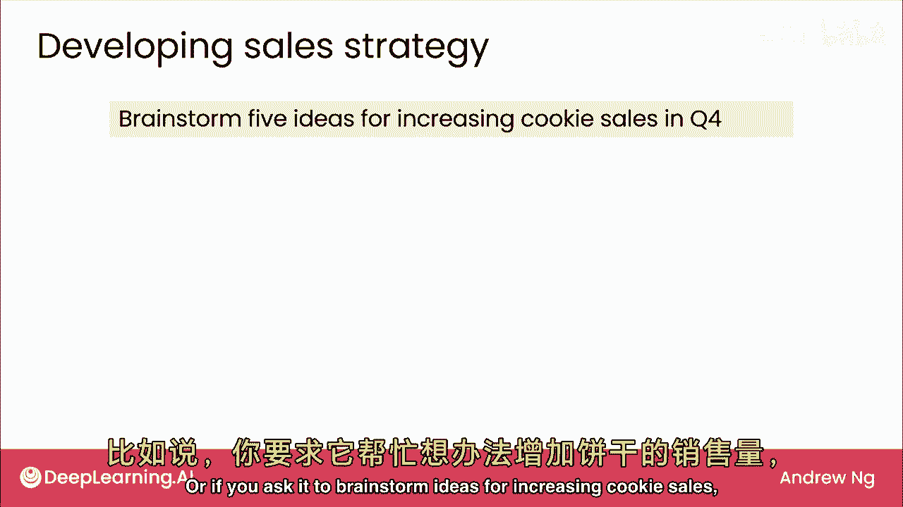
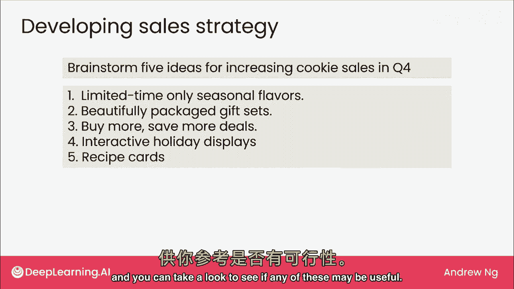
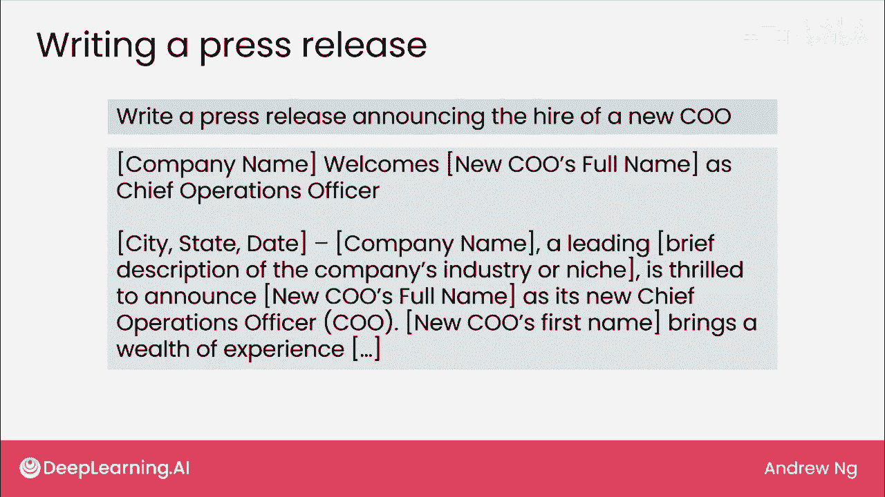
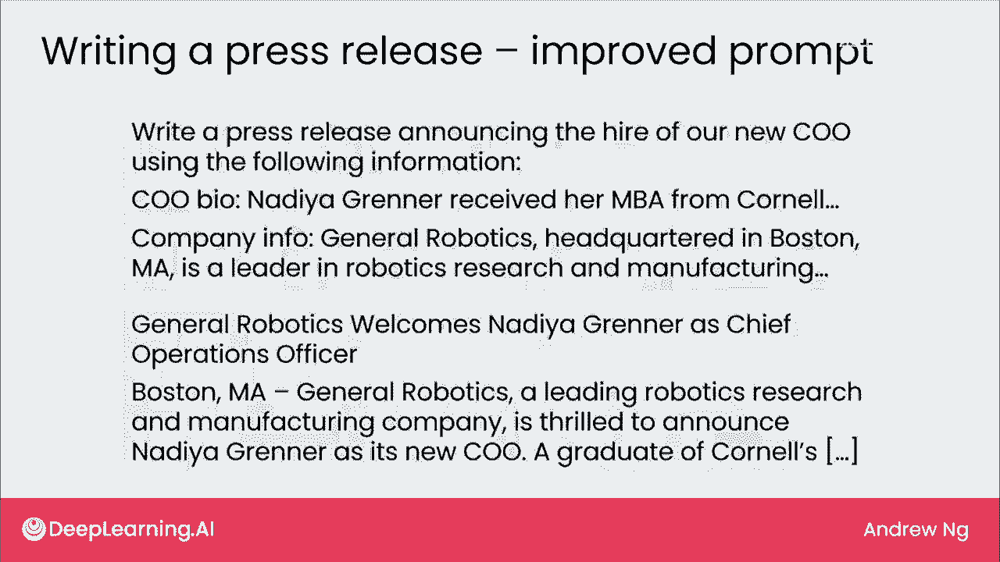
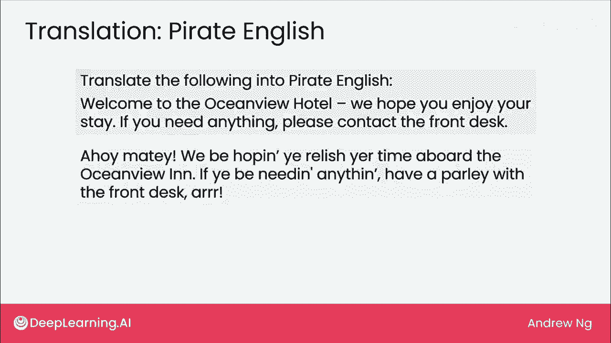

# 课程五：生成式AI应用 - 写作 ✍️

在本节课中，我们将要学习如何利用大型语言模型（LLM）来完成各种写作任务。我们将从简单的头脑风暴开始，逐步深入到撰写新闻稿、翻译文本等更具体的应用，并学习如何通过优化提示词来获得更好的结果。


---

## 概述

大型语言模型的核心训练目标是预测下一个单词，因此它们天生擅长处理文本生成任务。写作是LLM最直接的应用领域之一，许多任务甚至可以通过简单的网页界面完成。本节我们将深入探讨如何有效地利用LLM进行写作。

---



## 头脑风暴与创意生成 💡

上一节我们介绍了LLM在写作上的基础能力，本节中我们来看看如何将其用作创意伙伴。通过简短的提示，LLM可以快速生成大量创意点子。

例如，如果你需要为新产品构思名称或营销点子，可以直接向LLM提问。



以下是请求LLM进行头脑风暴的示例：



**提示示例：**
```
为花生酱曲奇饼头脑风暴五个有创意的名字。
```

**模型可能输出：**
```
1. 尼尼瓦纳纳比尔斯
2. 花生酱爆裂曲奇
3. 奶油坚果天堂
4. 黄金花生酥
5. 经典酱心曲奇
```



同样，你也可以要求它为商业问题提供想法。

**提示示例：**
```
为增加曲奇饼销售量头脑风暴一些营销想法。
```

通过这种方式，LLM可以成为一个高效的创意助手，帮助你打开思路。

---

## 撰写具体文本：以新闻稿为例 📄

仅仅进行头脑风暴可能还不够，有时我们需要生成完整、具体的文本内容。让我们以撰写一份公司新闻稿为例。

如果你只给出一个非常宽泛的指令，LLM会生成一份通用模板。



**初始提示示例：**
```
写一份新闻稿，宣布公司新雇用了一位首席运营官（COO）。
```

由于模型缺乏具体信息（如公司名、COO姓名、公司细节等），它生成的新闻稿会非常笼统。这时，我们就需要为模型提供更多上下文。

优化后的提示应包含具体信息，这样模型才能生成针对性更强、质量更高的文本。


**优化后的提示示例：**
```
使用以下信息撰写一份新闻稿：
- 公司名称：深度创新科技
- 公司简介：一家专注于人工智能解决方案的初创企业。
- 新任COO姓名：张伟
- COO背景：拥有15年科技行业管理经验，曾任某知名公司副总裁。
- 新闻稿基调：专业、积极、面向投资者和客户。
```

通过提供详细背景，LLM能够生成一份信息充实、符合要求的新闻稿。在实践中，**迭代优化提示词**是获得理想结果的关键步骤。如果第一次的输出不令人满意，只需修改提示并重试即可。

---

## 翻译任务 🌐



除了创意和撰写，LLM在翻译任务上也表现出色，有时甚至优于某些专门的机器翻译引擎，尤其是在互联网上语料丰富的语言上。

然而，对于低资源语言（即互联网上文本较少的语言），其表现可能不尽如人意。此外，翻译的正式程度和用词准确性也需要关注。

例如，将酒店欢迎信息翻译成印地语：

**初始提示示例：**
```
将以下英文欢迎信息翻译成印地语：“欢迎来到我们的酒店！前台可以为您办理入住。”
```

初始翻译可能不够准确，例如将“前台”直译为“前面的桌子”。这时，我们可以通过调整提示来指定翻译风格。

**优化后的提示示例：**
```
将以下英文欢迎信息翻译成正式的口语化印地语：“欢迎来到我们的酒店！前台可以为您办理入住。”
```

通过指定“正式的口语化”风格，模型可能会选用更地道的词汇（如“接待处”）来翻译“前台”，从而得到质量更高的译文。

一个有趣的实践是，即使团队中只有一人懂目标语言，也可以通过翻译成一种风格独特的变体（如“海盗英语”）来测试模型的翻译能力和创意。

**测试提示示例：**
```
将以下句子翻译成海盗英语：“祝您在海景房度过愉快时光！”
```

**模型可能输出：**
```
“啊哈！愿你享受海景房的时光，伙计！”
```

这种方法可以帮助不熟悉目标语言的团队成员，直观感受模型输出的风格和流畅度。

---

## 总结

本节课中，我们一起学习了大型语言模型在写作方面的多种应用。



1.  **创意生成**：LLM可以作为高效的头脑风暴伙伴，快速生成名称、点子等创意内容。
2.  **文本撰写**：通过提供具体的上下文信息，并迭代优化提示词，我们可以引导LLM生成高质量的定制化文本，如新闻稿。
3.  **语言翻译**：LLM是强大的翻译工具，尤其对于高资源语言。通过调整提示词指定风格和语境，可以进一步提升翻译的准确性和地道性。

核心在于理解：**LLM的输出质量高度依赖于输入提示的质量**。通过提供清晰、具体、富含上下文的指令，并勇于进行多次尝试和调整，你就能充分利用LLM的强大写作能力。