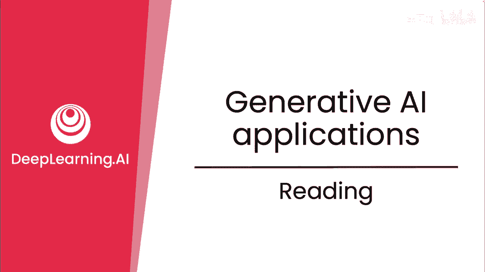
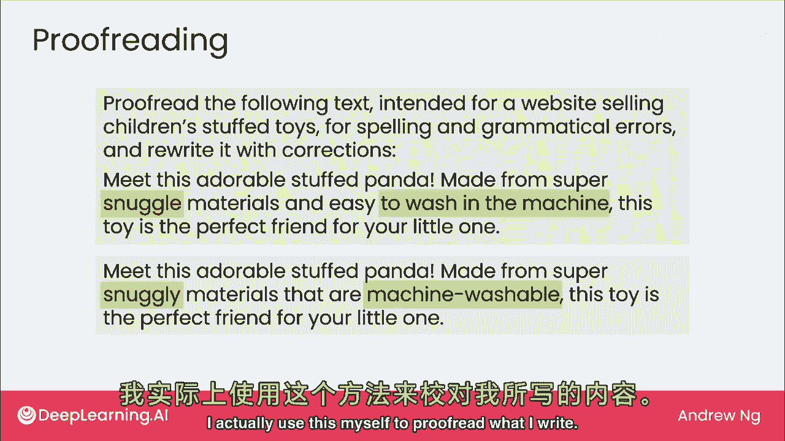
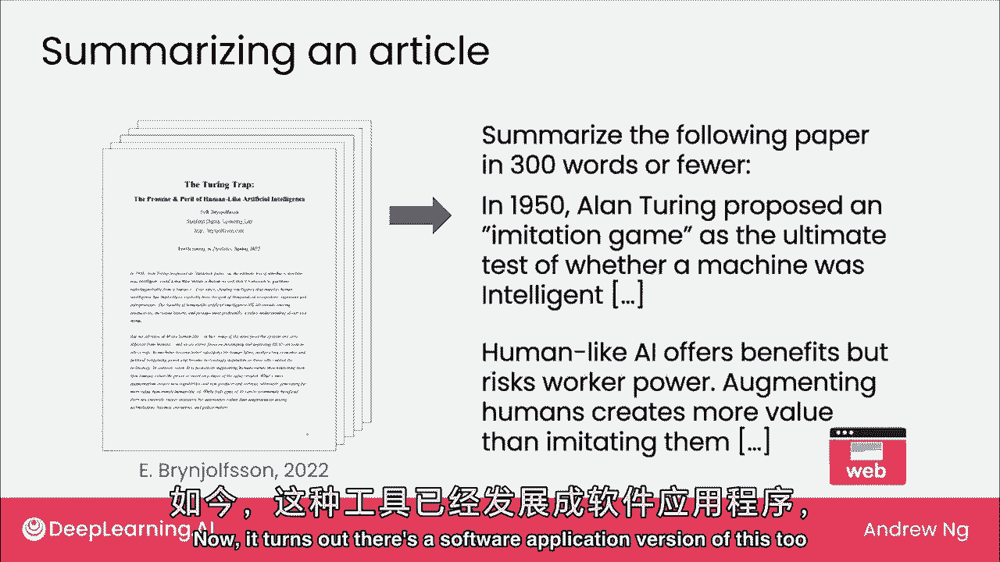
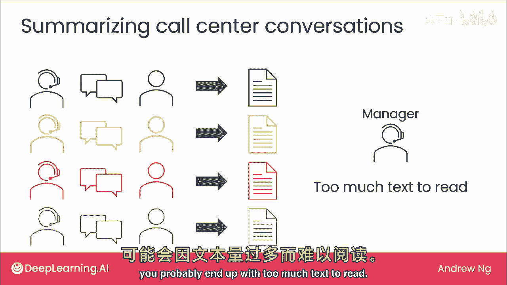
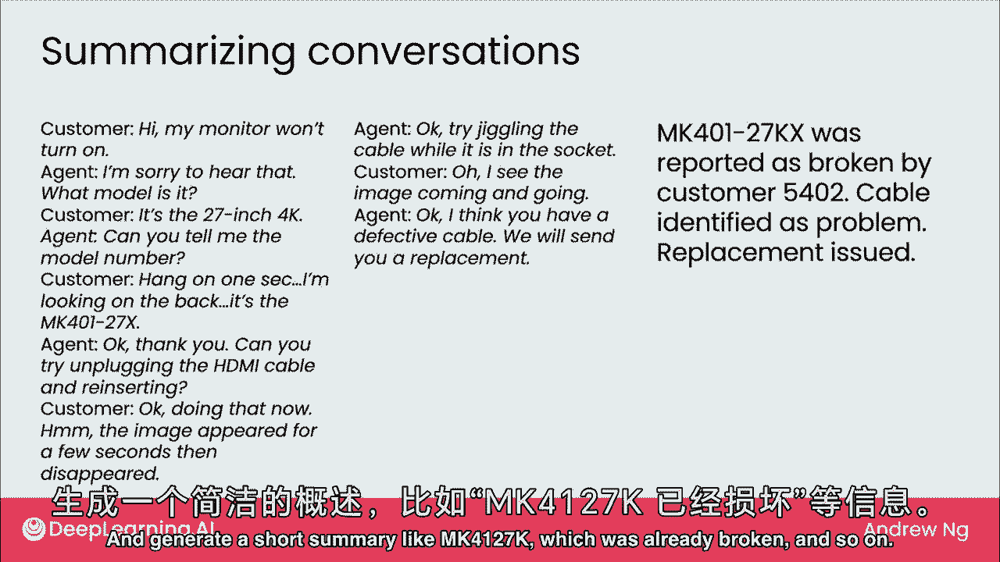
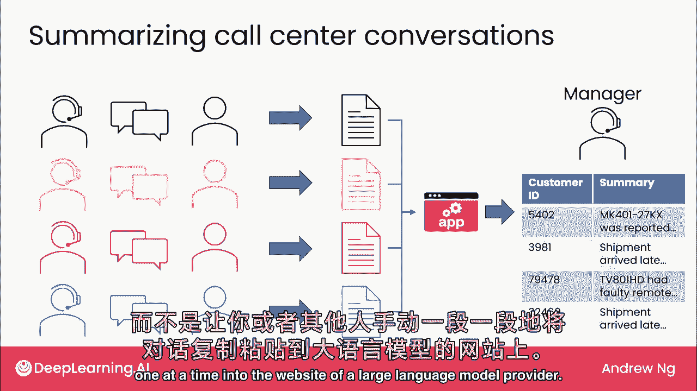
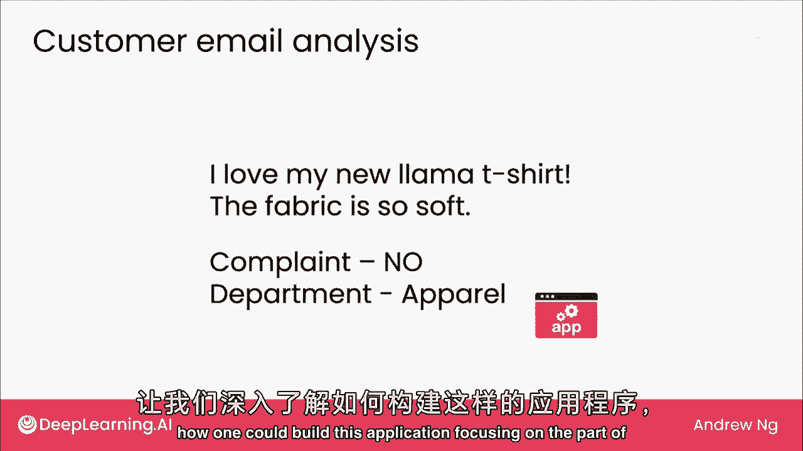
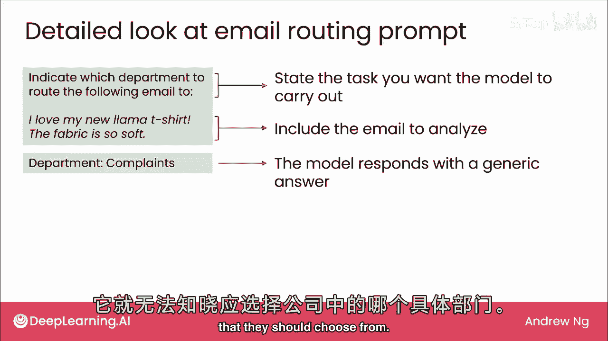
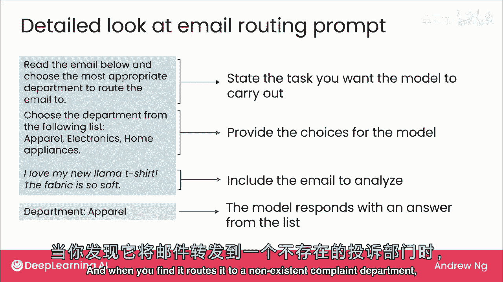
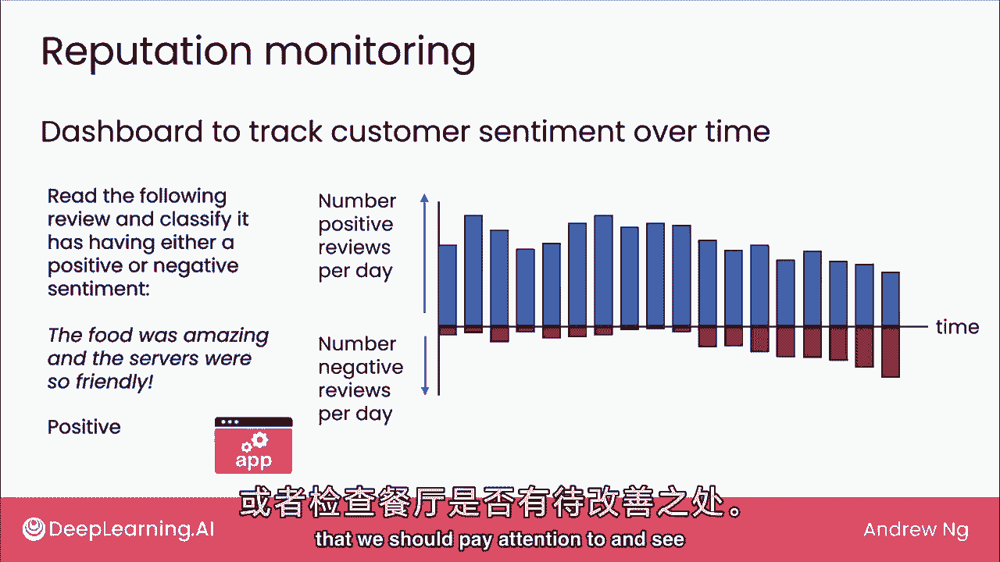

# 课程 P6：生成式 AI 应用 - 阅读 📖



在本节课中，我们将学习大型语言模型在**阅读任务**中的应用。阅读任务指的是你向模型输入一段文本（提示），模型通过“阅读”并理解后，生成一个通常较短或长度相当的输出。我们将探讨几个具体的应用场景，包括文本校对、内容摘要、邮件路由和情感分析。

上一节我们介绍了生成式AI在写作任务中的应用。本节中，我们来看看它在处理已有文本信息方面的能力，即阅读任务。

## 应用一：文本校对与润色 ✍️

大型语言模型可以作为一个高效的校对工具。即使你反复检查自己的文本，模型仍可能发现你遗漏的错误。



以下是一个可以尝试的校对提示示例：

```markdown
请检查以下文本的拼写、语法错误以及不流畅的句子，并改正重写。
文本用途：为儿童毛绒玩具网站准备的文案。
文本内容：[这里粘贴你的文本]
```

通过这种方式，你可以快速获得一份无拼写和语法错误、语句通顺的文本，提升写作质量。

## 应用二：总结长文章 📄

当面对一篇长文章而没有时间通读时，可以利用大型语言模型进行快速总结。

以下是总结长文章的步骤：
1.  将整篇文章复制粘贴到大型语言模型的交互界面。
2.  使用一个简单的提示，例如：“请总结以下文章的核心要点。”
3.  模型会生成一个简短的摘要，帮助你快速把握文章主旨。



例如，对于一篇关于“图灵陷阱”的长文，模型可以总结出其核心观点是：**应致力于让AI增强人类工作，而非自动化取代人类工作**。这能让你在回复邮件或讨论前快速了解内容。

## 应用三：客服对话摘要与邮件路由 📞



在企业环境中，大型语言模型能处理大量文本数据，提升管理效率。



### 客服对话摘要
假设你是客服中心经理，拥有大量客服与客户的通话文本记录。手动阅读所有记录是不现实的。

解决方案是构建一个软件应用，其工作流程如下：
1.  系统自动识别通话录音并转为文本。
2.  将每段对话文本输入大型语言模型。
3.  模型生成类似“客户咨询产品保修期，客服已提供解决方案”的简短摘要。
4.  经理通过浏览所有摘要，即可快速发现普遍问题或需要关注的趋势。



### 客户邮件路由
对于收到的客户邮件，可以使用模型自动判断应将其路由至哪个部门处理。

**初始提示可能存在的问题：**
如果只提示“阅读邮件并决定将其路由到哪个部门”，模型可能根据常识选择“投诉部门”，但这在你的公司组织中可能并不存在。



**改进后的提示：**
通过限制模型的选择范围，可以确保输出符合实际业务设置。

```
请阅读以下客户邮件，并从以下部门列表中选择最合适的一个进行路由：
- 服装部
- 电子产品部
- 账单与支付部
- 一般咨询部

邮件内容：[粘贴邮件内容]
```



在构建应用时，第一次编写的提示不完美是正常现象。通过观察输出结果（如路由到不存在的部门），然后迭代更新提示（如增加部门列表），即可解决问题。

## 应用四：声誉监控与情感分析 📊



你可以利用大型语言模型构建仪表板，自动追踪客户对你业务或产品的情感倾向（正面/负面）。

**应用场景：**
如果你经营一家餐厅，顾客会在网上发布评论。

**实现方法：**
1.  收集所有在线评论。
2.  对每一条评论使用如下提示进行分析：
    ```
    阅读以下餐厅评论，判断其情感是正面的还是负面的。
    评论：[粘贴单条评论内容]
    ```
3.  模型会将每条评论分类为“正面”或“负面”。
4.  软件自动统计每天正面和负面评论的数量。
5.  通过仪表板可视化情感趋势随时间的变化。

如果仪表板显示客户情绪从积极转为消极趋势，就能及时提醒你关注并解决餐厅可能存在的问题。



## 总结 🎯

本节课中我们一起学习了大型语言模型在多种阅读任务中的应用：
-   **校对润色**：检查并修正文本的拼写、语法和流畅度。
-   **内容摘要**：快速提炼长文章的核心要点。
-   **信息处理**：自动生成客服对话摘要，并将客户邮件路由到正确部门。
-   **情感分析**：自动分析文本情感，用于声誉监控。

核心在于，**任何需要“阅读”一段文本并给出简短结论或指示的任务**，都是大型语言模型可以发挥作用的阅读任务。在下一个视频中，我们将继续探讨生成式AI的另一个强大功能：聊天。