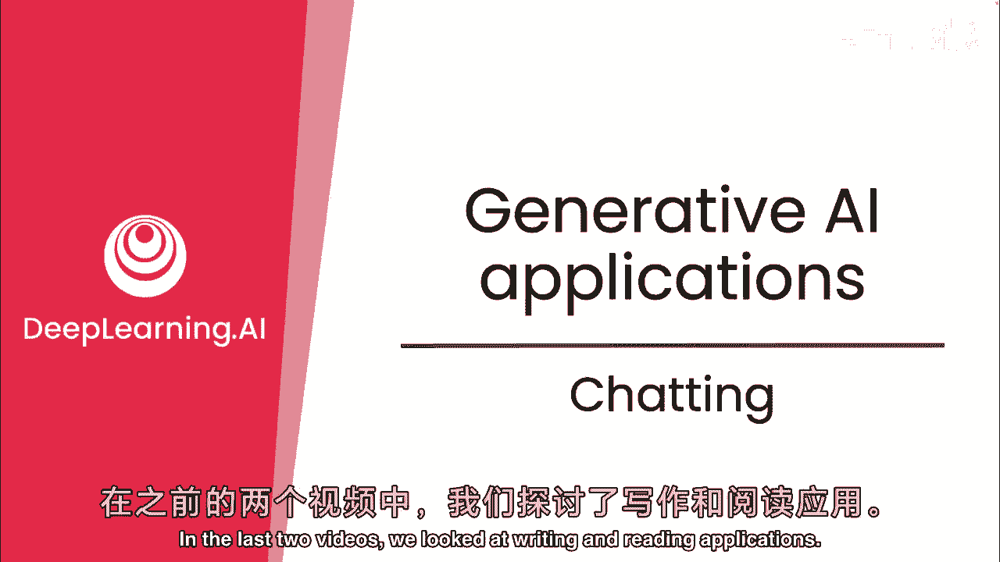
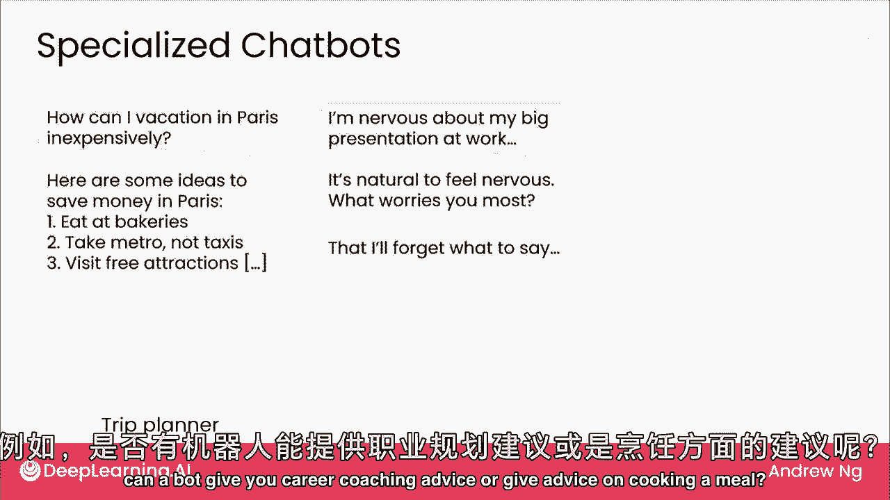
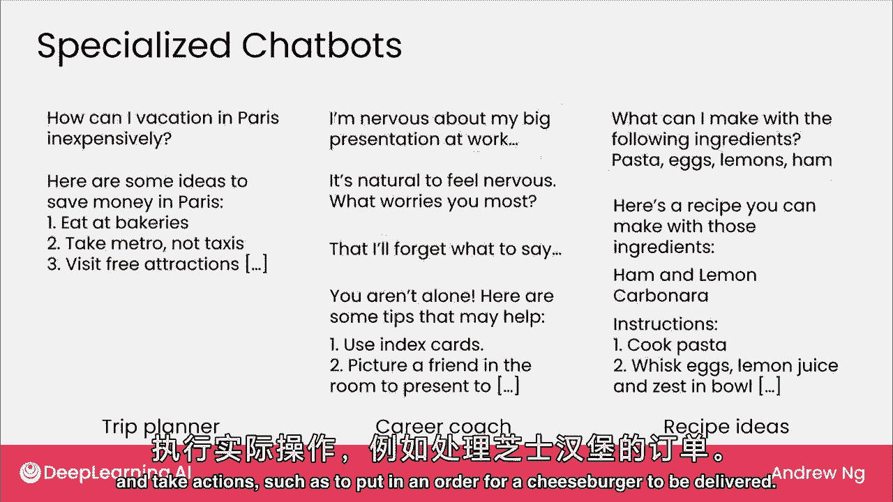
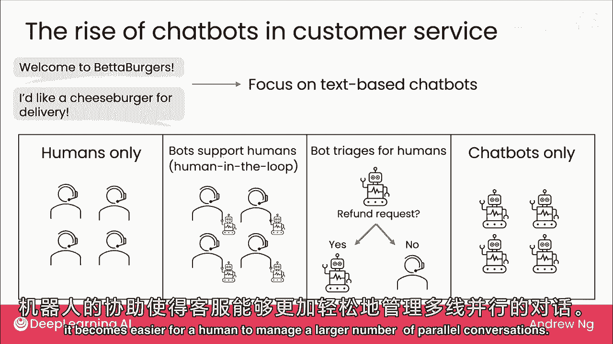
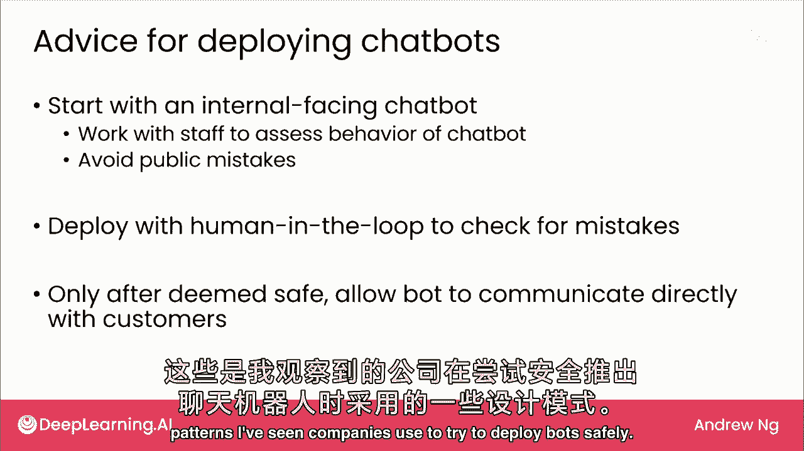

# 课程 P7：生成式 AI 应用 - 聊天 🤖

在本节课中，我们将学习生成式 AI 在聊天应用中的具体实现。我们将探讨从通用聊天机器人到专业聊天机器人的演变，并了解如何安全地设计和部署它们。

---

前两个视频介绍了读写应用，本节中我们来看看聊天应用。除了通用聊天机器人，许多公司正在考虑构建专业聊天应用。如果公司有大量员工需要与客户互动，或者存在大量同类对话，可以考虑使用专业聊天机器人来辅助这类对话。我们先回顾一下之前看过的客服聊天机器人例子。

一个专业聊天机器人的例子是专注于帮助你规划旅行的，例如“如何在巴黎度假更便宜”。这类机器人可以被构建为具备旅行领域的专业知识。目前，许多公司正在探索广泛的建议类机器人。

以下是建议类机器人的一些例子：
*   机器人能为你提供职业指导建议。
*   机器人能为你提供烹饪餐点的建议。

因此，许多擅长处理特定事务的专业机器人正在由不同的公司开发。目前，一些机器人已经能够进行对话并提供建议。这些机器人可以与公司的其他软件系统交互并采取实际行动。

以下是机器人采取行动的例子：
*   例如订购芝士汉堡并安排送餐。
*   另一个例子是客户服务聊天机器人。许多 IT 部门会收到大量密码重置请求。如果机器人能处理这类请求，将减轻 IT 部门的工作量。这类机器人需要能够发送短信验证用户身份，并实际执行密码重置操作。

这是一个需要被赋予实际行动能力的机器人，例如发送短信给用户。接下来，我们将讨论如何构建这类不仅能生成文本，还能实际采取行动的聊天机器人。

由于许多客户服务组织正在探索使用聊天机器人，我想与您分享不同企业在设计时常见的考量范围。本部分将专注于基于文本的聊天，而非语音或电话。

在自动化程度的一端，是完全由人类客服组成的服务中心。人类客服代理会与客户来回发送消息。在另一端，则是完全自动化的聊天机器人，由软件直接回应客户。

在完全人工与完全自动化之间，存在几个常见的设计点。第一种是机器人辅助人类。机器人生成建议消息，人类客服阅读这些消息。如果合适，人类可以批准发送；或者有机会编辑消息后再回复客户。这种设计通常被称为“人在回路”，因为人类是消息发送给客户前流程的一部分。

这是减轻聊天机器人风险的一种方式，因为机器人可能会说错话，而人类可以进行检查。在下一个视频讨论大语言模型的能力与局限时，我们会回顾它可能犯的一些错误，这种设计有助于防止这些错误。

在自动化光谱的更远端，是使用机器人为人类筛选消息。例如，机器人回答简单消息，但将机器人尚未准备好处理的复杂问题转交给人类。我曾领导团队构建自动检测机器，用于识别客户是否在请求退款。这处理了我们总通话量的10%，成功分流了约10%的流量，为人类代理节省了大量时间，让他们能专注于处理更困难的请求。

这种分流类型的设计也常用于节省人类服务代理的时间，使他们只需关注更擅长处理的难题。在许多客服中心，一名代理可能同时与4位或8位客户聊天。在某些情况下，甚至可能同时与16位客户交流。有了机器人的辅助，人类管理更多并行对话会变得更容易。

考虑到机器人有时会说错话，我想分享公司如何安全地构建和部署机器人。公司通常会先开发内部聊天机器人。例如，我常构建只供团队内部使用的聊天机器人，用于回答旅行问题或执行特定任务。假设内部团队对错误更宽容、更同情，这给了我们评估机器人行为的时间，避免了因公开错误而导致的公司尴尬。

在机器人表现足够安全后，下一步通常是进行“人在回路”的部署，让人类检查许多消息后再发送给客户。这样做了一段时间后，如果机器人的消息通常可以安全发送，那么就可以允许机器人直接与客户交流。当然，具体细节因商业需求而异。对于某些应用，由于流量巨大，人类检查每条消息可能不切实际。这取决于机器人说错话的风险以及流量大小。因此，“人在回路”是否可行，是我观察到的公司常用的一种设计模式。

以上是关于尝试安全部署机器人的总结。我们已经看到了大语言模型如何用于写作、阅读和聊天。这三大类并非大语言模型能做的全部，但它们是你可能想要使用它的几个广泛类别。大语言模型能做很多事，但它不能做所有事。在下一个视频中，让我们看看大语言模型能做什么和不能做什么，以便更好地理解其限制。

---

本节课中，我们一起学习了生成式AI在聊天领域的应用。我们了解了从通用到专业聊天机器人的设计思路，探讨了“人在回路”和消息分流等关键部署策略，并强调了通过内部测试和渐进式部署来确保应用安全的重要性。这些知识将帮助你理解如何在实际业务中构建和引入聊天机器人。