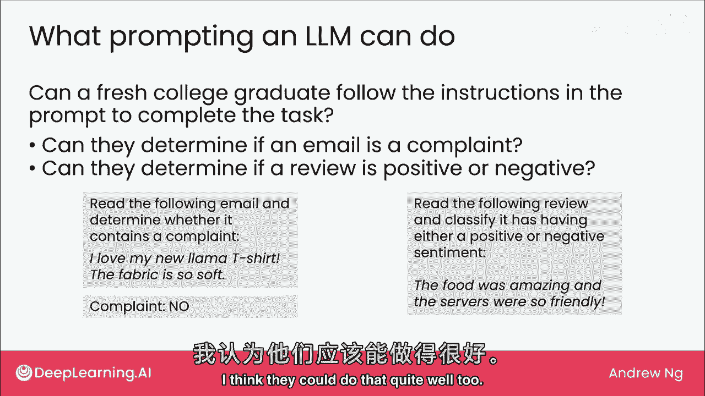
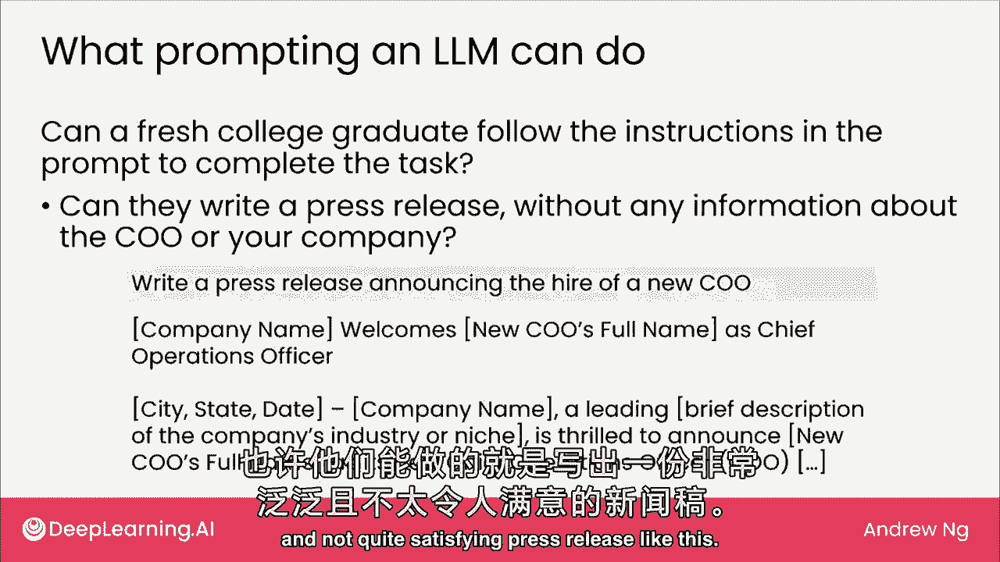
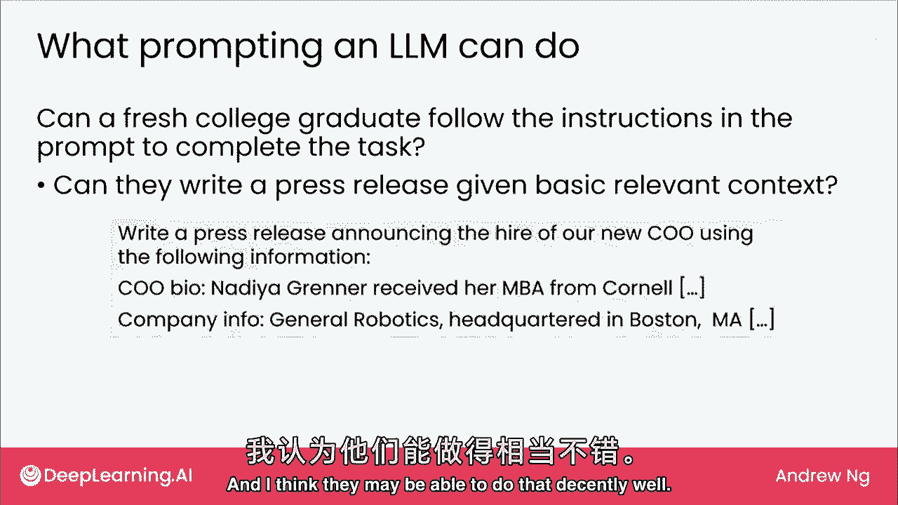
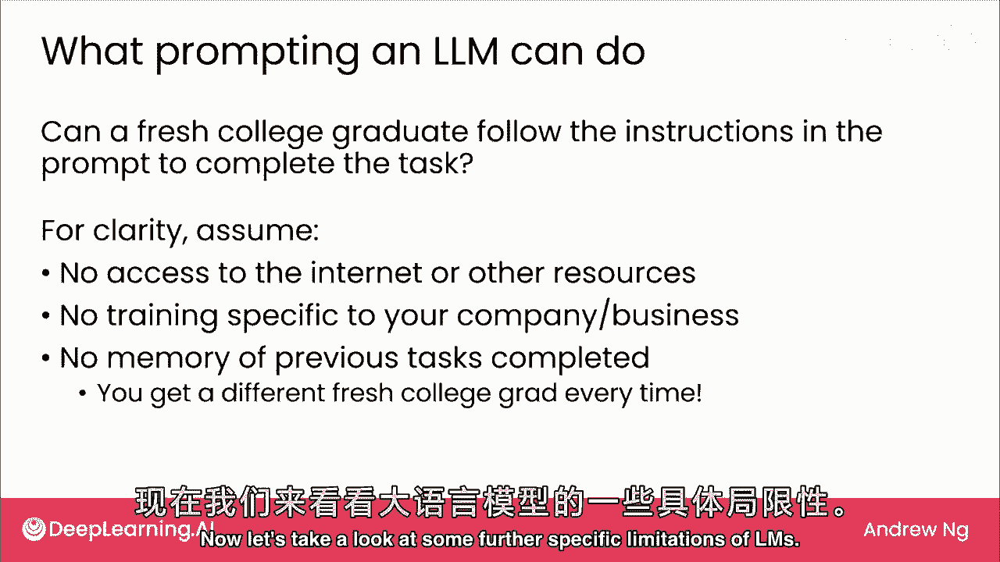
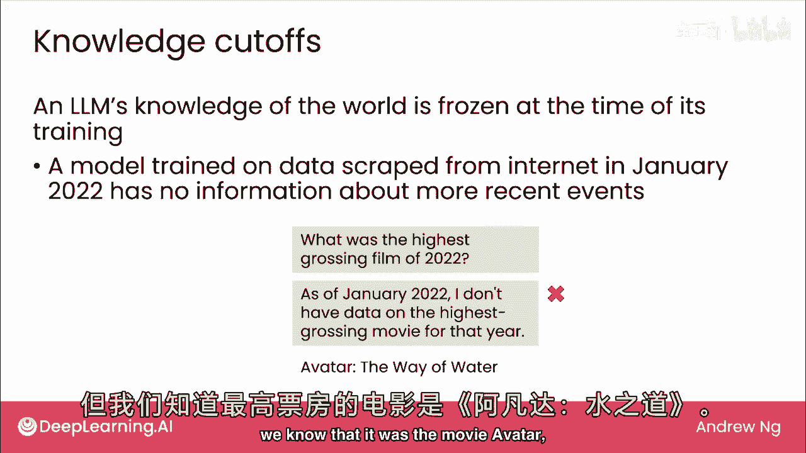
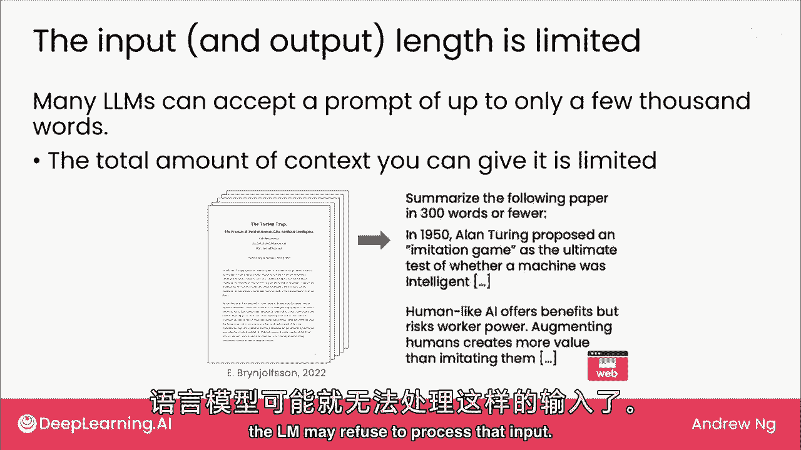
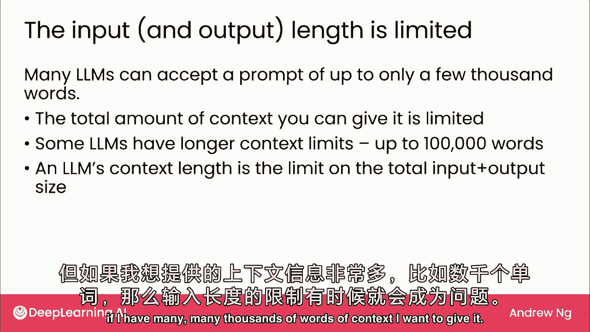
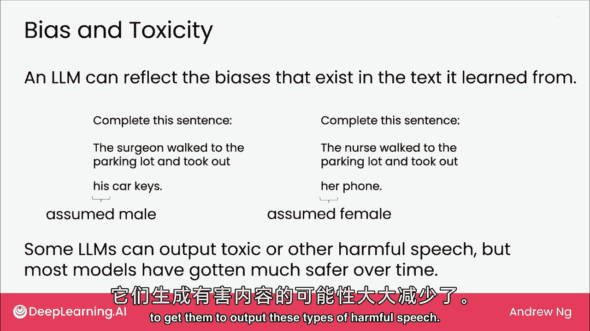

# 课程 P8：大语言模型的能力与局限 🧠

在本节课中，我们将要学习大语言模型（LLM）的核心能力与主要局限。理解这些内容对于有效且安全地使用生成式AI至关重要。

## 概述：一个有用的心理模型

上一节我们介绍了生成式AI的基础概念，本节中我们来看看如何评估大语言模型能做什么。一个有用的思考框架是：**仅遵循指令和提示，一名大学毕业生能否完成你想要的任务？**

例如：
*   一名大学毕业生能否遵循指示阅读电子邮件以确定电子邮件是否是投诉？可以。
*   一名大学毕业生能否阅读餐厅评论以确定其是正面还是负面情绪？可以。

同样，大语言模型提示也能很好地完成这些任务。

这个心理模型将大语言模型想象成一名拥有大量通用知识（来自互联网）的大学毕业生，但他对你或你的业务一无所知，并且每次任务都是“新”的，无法记住之前的对话。这个模型虽然不完美，但它是思考大语言模型能力的一个有用起点。

## 大语言模型的具体限制

理解了其基本能力框架后，现在让我们看看大语言模型的一些具体限制。理解这些限制可以降低你在使用中被绊倒的风险。

### 1. 知识断点 📅

大语言模型的世界知识存在截止日期。它的知识不会在训练时间点之后更新。

例如，一个基于2022年1月之前互联网数据训练的模型，将不知道2022年票房最高的电影是《阿凡达：水之道》，也不会知道2023年关于室温超导体LK-99的新闻。

**核心概念**：模型的知识仅截至其训练数据抓取的最后一个时间点。

### 2. 幻觉问题 🎭

大语言模型有时会编造听起来合理但实际不存在的信息，我们称之为“幻觉”。

以下是幻觉的两个例子：
*   要求模型提供莎士比亚关于碧昂丝的名言，它会自信地编造出如“她歌声，如阳光般闪耀”这样的句子。
*   要求列出加州审理的AI相关法庭案件，它可能会编造一个不存在的案件，例如“Ingersoll诉Chevron案”。

幻觉可能导致严重后果。曾有律师使用ChatGPT生成法律文件并提交给法院，其中包含了大量虚构的案例，导致该律师因提交虚假文件而受到处罚。

### 3. 上下文长度限制 📏

大语言模型对输入（提示）和输出的长度都有限制，这被称为“上下文长度”。

例如，如果你有一篇非常长的论文需要总结，而论文长度超过了模型的输入限制，模型可能无法直接处理。你需要将论文分块输入，或者寻找支持更长上下文的模型。

### 4. 不擅长处理结构化数据 📊

与处理文本、图像等非结构化数据相比，大语言模型目前并不擅长处理表格类的结构化数据。

**核心概念**：
*   **结构化数据**：存储在Excel或数据库表格中的数据，如房屋面积与价格、用户访问记录等。
*   **非结构化数据**：文本、图像、音频、视频。

例如，如果你将一组房屋面积和价格数据输入模型，然后问它“一千平方英尺的房子值多少钱？”，它的表现通常不如传统的监督学习算法（如线性回归）。

### 5. 偏见与有害输出 ⚠️

大语言模型基于互联网文本训练，可能反映并放大社会中存在的偏见，甚至偶尔产生有害言论。

例如，让模型补全句子：
*   “外科医生走向停车场并取出______”，它可能输出“他的车钥匙”。
*   “护士走向停车场并取出______”，它可能输出“她的手机”。

这反映了模型可能隐含地假设外科医生是男性，护士是女性。在构建应用时，需要小心处理，避免助长此类不良偏见。

## 总结

本节课中我们一起学习了大语言模型的能力评估框架及其五大主要局限：**知识断点、幻觉问题、上下文长度限制、不擅长处理结构化数据以及可能产生偏见与有害输出**。

理解这些限制是负责任地使用AI的第一步。在接下来的课程中，我们将探讨一些技术来克服部分限制，从而扩展大语言模型的应用范围与能力。但首先，让我们在下一个视频中学习一些实用的提示技巧。