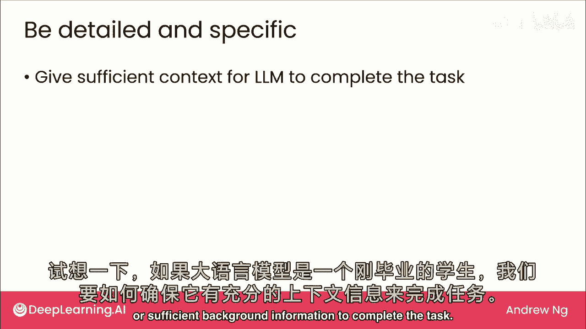
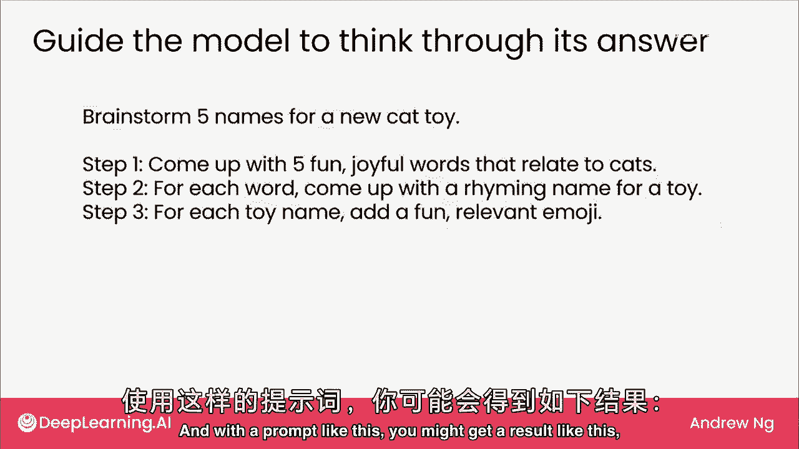
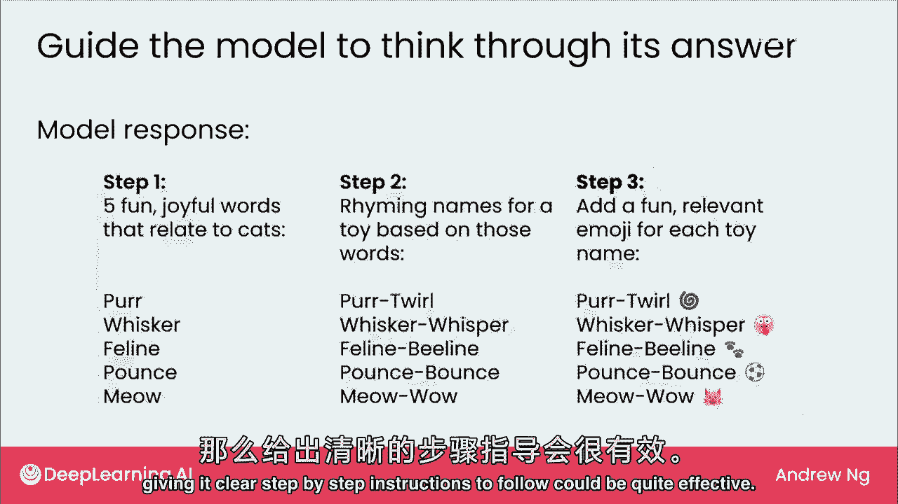
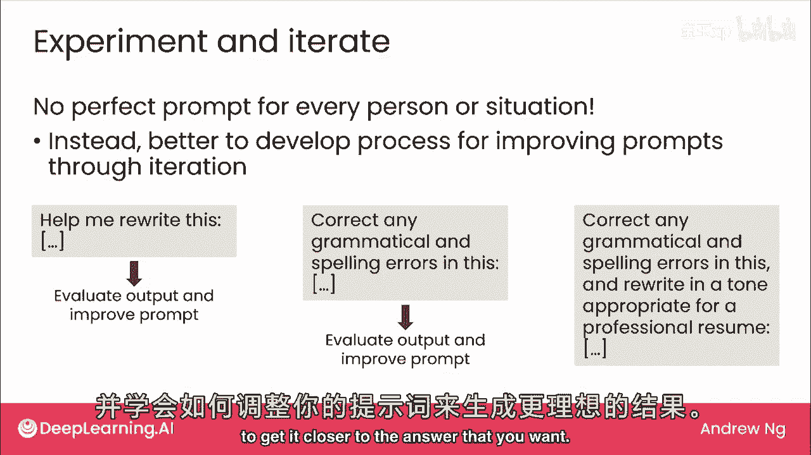
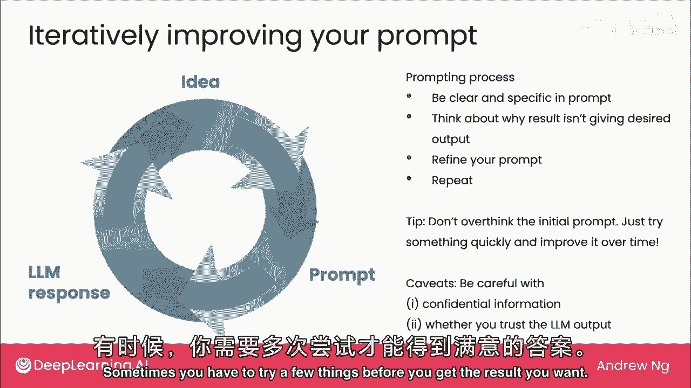

# 课程9：生成式AI应用 - 高效提示词撰写技巧 🚀

在本节课中，我们将学习如何高效地撰写提示词，以更好地引导大型语言模型生成我们期望的输出。我们将重点介绍三个核心技巧：**详细具体**、**引导思考**和**实验迭代**。

---

## 1. 技巧一：详细且具体 📝

上一节我们介绍了课程目标，本节中我们来看看第一个核心技巧：提供详细且具体的上下文。

为了让语言模型充分理解任务并生成高质量结果，你需要提供足够的背景信息。一个模糊的提示往往无法得到理想的回应。

以下是具体操作方法：

*   **提供背景**：在提示中说明你的身份、目标和相关经验。例如，不要只说“写一封邮件”，而是说明“我是一名应届毕业生，正在申请法律文档项目的工作，需要一封邮件来阐述我的算法经验如何能帮助项目提高文本准确性”。
*   **明确任务**：清晰地告诉模型你希望它执行的具体动作。例如，将“帮我写点东西”改为“请撰写一段文字，解释我的背景为何使我成为该项目的强有力候选人”。

通过提供详细上下文和明确指令，你更有可能获得符合预期的输出。

---

## 2. 技巧二：引导模型思考 🤔

上一节我们学习了提供详细上下文的重要性，本节中我们来看看如何通过结构化指令引导模型的思考过程。

直接提问有时能得到好结果，但通过分解任务步骤，你可以更精确地控制输出的格式和内容。

以下是具体操作方法：

*   **分解步骤**：将复杂任务拆解为模型可以逐步执行的指令。例如，想要为猫玩具起名，可以这样提示：
    **步骤一**：想出五个与“快乐”相关的词汇。
    **步骤二**：为每个词汇想出一个押韵的玩具名称。
    **步骤三**：为每个玩具名称配上一个相关的表情符号。
*   **遵循流程**：当你自己有一个清晰的思考过程时，明确地将这个过程作为指令交给模型。模型会遵循你的指示，生成结构化的结果，例如“喵喵乐趣（😺）”或“毛线团乐园（🧶）”。

通过引导模型的思考步骤，你可以获得更具创意且符合特定要求的结果。

---

## 3. 技巧三：实验与迭代 🔄

上一节我们介绍了如何引导模型思考，本节中我们来看看提示词撰写的核心心法：它是一个需要不断实验和迭代的过程。

很少有人能一次性写出完美的提示词。更有效的做法是快速开始，然后根据模型的反馈不断优化。

以下是具体操作方法：

*   **快速启动**：从一个相对简单的提示开始，不必过度思考初始措辞。例如，先输入“帮我重写这段文字”。
*   **评估与优化**：查看模型的输出。如果不满意，就分析原因并修改提示。例如，可以追加指令：“纠正语法和拼写错误”，或“请用更专业的简历语气重写”。
*   **循环改进**：将这个过程视为一个循环：**初始想法 -> 撰写提示 -> 获得输出 -> 分析差距 -> 优化提示**。通常需要几次迭代才能得到理想结果。

一个小贴士是：不要害怕最初的提示不完美。大胆尝试，根据结果反馈来逐步澄清和细化你的要求，这是掌握提示词撰写技能的关键。

---

## 重要注意事项 ⚠️

在开始愉快地尝试之前，有两点必须注意：

*   **保密信息**：在使用大型语言模型的Web界面时，如果你需要处理高度机密的信息，务必先了解服务提供商的数据使用政策，确认其是否会保密你的输入数据。
*   **核实输出**：对于关键任务（如法律文件），不要完全信任模型的输出。在依据其生成的内容采取行动或提交之前，务必进行人工核实和判断。

在注意以上两点的前提下，你就可以放心地开始实践了。

---

## 总结 ✨

本节课中我们一起学习了撰写高效提示词的三个核心技巧：
1.  **详细具体**：为模型提供充分的背景信息和明确的指令。
2.  **引导思考**：通过分解步骤来结构化地引导模型的输出。
3.  **实验迭代**：理解提示词优化是一个循环过程，勇于尝试并根据反馈进行改进。

掌握这些技巧将帮助你更有效地与大型语言模型协作。我们鼓励你立即访问一些语言模型提供商的界面，亲自尝试和应用这些想法。