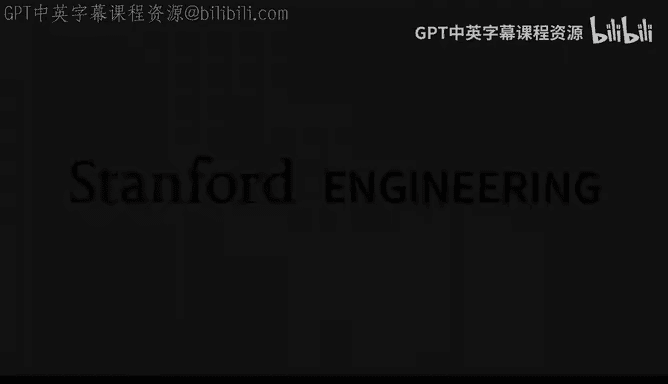
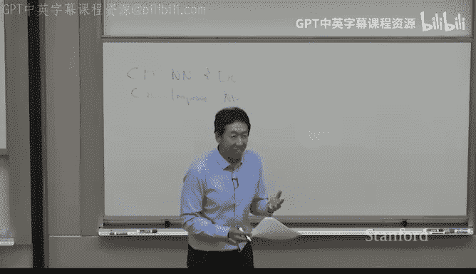
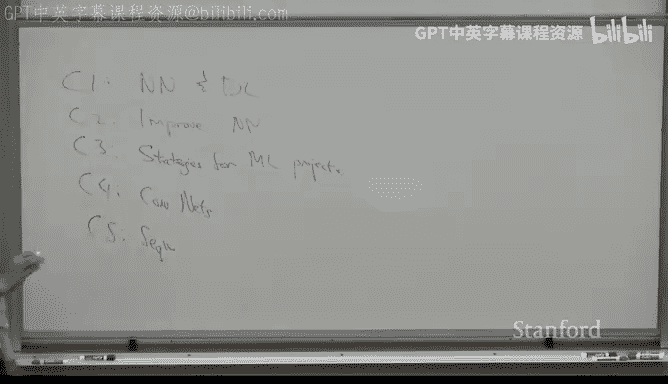
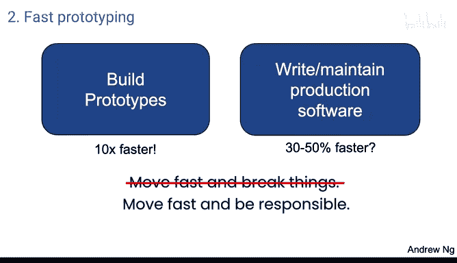
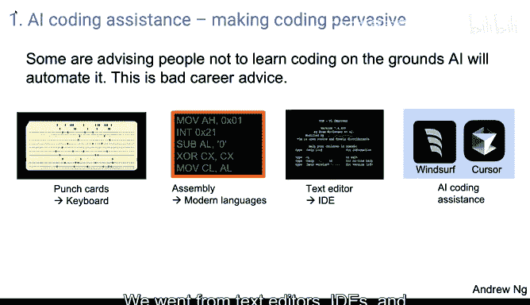

# 课程1：深度学习导论 🚀

在本节课中，我们将要学习深度学习的基本概念、它在人工智能领域中的位置，以及这门课程的整体安排。我们将探讨深度学习为何如此成功，并了解构建实际应用所需的核心技能。

---

## 课程概述与形式

今天，我将概述这门课程。在开始之前，我很好奇，现在是2025年9月，你们中有多少人刚刚来到斯坦福？请举手。很好。请关注那些举手的人，向他们问好，欢迎所有新加入斯坦福任何项目的同学。

CS230是一门采用翻转课堂形式的课程。这意味着，与其在课堂上听我或下周将见到的联合讲师Chiian进行长达80分钟的讲授，我们更希望你们在线观看大量的视频讲座。这样，我们就可以利用宝贵的课堂时间进行更丰富、更深入的讨论。因此，无论是今天还是整个学期，我都热烈欢迎大家随时举手提问。实际上，我发现与其长时间坐着听课，不如进行互动。注册处安排的课程时间较长，但我们通常只使用大约80分钟。目标是，既然很多斯坦福学生已经在网上观看讲座，与其年复一年地重复讲授，我们投入更多精力制作高质量的在线讲座视频，并要求你们在线观看。这样，人们可以高效地离线学习，而课堂时间则用于进行更适合面对面交流的活动。

因为你们还没有观看任何讲座，或者我假设大多数人还没有，所以今天的课程可能会稍短一些，用来讨论课程安排等事宜。

---

## 深度学习的兴起与重要性

正如许多人所知，深度学习是计算机科学和人工智能领域最新、最热门的技术趋势之一。如果我们看看博士招生甚至硕士招生，很大一部分申请斯坦福的学生都希望从事人工智能研究。具体数字不便透露，但比例非常高。

我和我的联合讲师Kan的共同目标是通过这个学期，帮助你们达到接近或处于深度学习的先进水平，并确保你们在课程结束时能够熟练应用深度学习。

事实证明，过去大约十年到十五年里，人工智能的许多进展是通过**规模化**实现的。深度学习之所以如此成功，其中一个原因是它擅长吸收大量数据。

如果我在X轴上绘制问题的数据量，使用更传统的机器学习算法（如逻辑回归、决策树等），随着数据量的增加，这些传统算法的性能会趋于平缓。例如，在语音识别中，即使输入成千上万小时的语音数据，旧算法的准确率也常常会达到瓶颈。就好像旧算法不知道如何处理我们现在拥有的所有数据。

但大约十到十五年前，我们发现，如果训练一个**小型神经网络**（也称为小型深度学习模型），其性能可能会逐渐提升。如果训练一个**中型**网络，性能会更好。如果训练一个**大型**神经网络，性能会持续提升。我认为深度学习在过去十年主导人工智能领域的原因是，我们有一套训练大型神经网络的**方法**，可以将大量数据输入其中，从而获得卓越的性能。

我们开始看到这一点，部分源于大约十五年前斯坦福的一些研究论文，当时我们率先使用CUDA编程和GPU来扩展深度学习。有趣的是，我第一台用于训练神经网络的GPU机器是用CUDA构建的，这在当时是有争议的。它是由一名斯坦福本科生在他的宿舍里建造的，他的名字是Ian Goodfellow。我认为，这台在斯坦福本科生宿舍里建造的计算服务器，让我们得以奠定使用CUDA（当时用于在GPU上训练大型神经网络的现代语言）的早期基础。这显然影响了许多人，并帮助深度学习的规模化得以起飞。我讲这个故事是因为，有时你们在宿舍、学生公寓或实验室里所做的工作，在几年后回顾时，可能会产生巨大的影响。也许在这门课程中，你们中的一些人将来也会做出同样有影响力的工作。

我们发现，随着我们训练越来越大的神经网络，它们能够吸收大量数据并驱动卓越的性能。后来，百度的一篇研究论文表明，随着你扩展神经网络和深度学习算法，性能提升实际上是相当可预测的。你可以预测，如果购买这么多GPU，拥有这么多计算资源和数据，性能会如何。随后，OpenAI通过一篇关于**缩放定律**的有影响力的论文普及了这一观点。深度学习性能提升的这种可预测性，推动了对数据中心和构建大型AI模型的大量投资。

---

## 深度学习在技术栈中的位置

在计算机科学中，我们都建立在彼此的工作之上。计算机科学和人工智能的许多进步都是建立在其他想法之上，而这些想法又建立在更多想法之上。因此，我们想给你们一张小地图，展示深度学习所处的位置。

我认为，**机器学习**建立在**计算机科学基础**之上。学习计算机科学基础非常有帮助。尽管我怀疑绝大多数人使用AI辅助编码工具（如Claude Code、GitHub Copilot、Cursor或Windsurf等），但我发现，真正理解计算机科学、理解计算机工作原理的人，比那些仅凭感觉编码的人，能构建出好得多的系统。

在计算机科学基础之上，是**机器学习技能**。即如何构建能从数据中学习的算法。

然后，**深度学习**是一种特殊类型的机器学习。它是目前最有效的机器学习形式，我们通过训练神经网络（一种特定类型的算法）来从大量数据中学习。

在过去的十分钟里，你们可能听到我使用了“深度学习”和“神经网络”这两个词。我认为今天这两个术语几乎可以互换。有些纯粹主义者会坚持一些技术差异，但在实践中它们意思相同。但实际情况是，“神经网络”这个术语已经存在了几十年，但大约十到十五年前，我们中的一些人意识到，“深度学习”是一个更好的品牌。所以，尽管神经网络已经存在了几十年，但从大约十到十五年前开始，是深度学习真正起飞了，因为谁不想要“深刻”的学习呢？这只是一个好品牌。你们会听到我交替使用这些术语。

深度学习算法（神经网络）为我们提供了一种利用越来越多计算能力的方法。它们可以构建具有大量参数的非常大的AI模型，以吸收大量数据，从而变得越来越智能，或做出越来越好的预测，利用我们可用的大量数据生成更准确的输出。

自从我十几岁起，我妈妈就一直试图说服我不要喃喃自语。但多年后的今天，我仍然在这方面有困难。所以我会尽力，但如果我的声音又开始变小，请向我挥手或示意我。我想我妈妈会很高兴我现在这样练习。

所以，技术栈是：计算机科学基础 -> 机器学习 -> 深度学习 -> 最近的**生成式AI革命**。生成式AI主要是由一种特定类型的神经网络构建的，称为**Transformer神经网络**，你们将在本课程中学到它，实际上在本学期晚些时候你们会学习Transformer架构。生成式AI是建立在深度学习之上的。

我假设你们所有人都经常提示大型语言模型来帮助完成工作。我发现，虽然我经常将LLM用于许多应用程序，但仅仅提示LLM是不够的。有很多事情无法仅通过提示LLM来完成。因此，我经常需要深入到深度学习的抽象层，并调整深度学习算法，以使某些事情正常工作。

事实上，这门课程涵盖的内容是，我们将确保你们在本课程结束时成为深度学习的专家或接近专家。我们也会稍微涉足一些机器学习概念，讨论很多关于**目标函数**以及高效优化参数的技巧。我们还会向上延伸，涵盖一些生成式AI的内容，特别是讨论Transformer网络。在本学期中，我们还将聊一聊与生成式AI和深度学习相关的就业前景，以及深度学习如何赋能某些类型的生成式AI应用。

关于这一点我还有更多要说的，但让我先暂停一下，看看你们是否有任何问题。

---

## 课程先修与定位

**问：机器学习是这门课的先修要求吗？**
答：不完全是。我认为进入AI领域的几个常见入口是CS129、CS229和CS230。如果你没有任何机器学习知识，这门课程在最初两三周可能会感觉有点快，但有些人确实能很快掌握。实际上，有几门课程你可能听说过。CS129是相对容易进入机器学习的起点，它倾向于花更长时间讲解机器学习的核心概念，比如什么是优化目标、梯度下降如何工作、什么是逻辑回归、什么是非常基础的神经网络。CS229则更加数学化和理论化，节奏快、强度大、数学内容多。它比129和230更偏理论，会讲解很多机器学习算法背后的理论和数学推导。例如，如果你想学习如何使用矩阵和向量进行微积分（而不仅仅是实数），CS229会涵盖这些。CS230这门课程相对更偏应用，并且只专注于深度学习。在所有的机器学习算法中（有监督学习、无监督学习等），最有用的、发展最迅猛的一类是深度学习，而本课程只专注于这一部分。其他算法也值得学习。129是最容易的入门课程，但如果你已经学过229或230，我可能会建议跳过129。但如果你是初学者，有多个入门途径。

**问：可以同时上CS229和CS230吗？**
答：可以。我们设计这两门课程的课程内容重叠度相对较低，它们之间只有非常少量的重叠。

**问：课程会涵盖最新的LLM发展吗？**
答：当我们讨论最近的LLM发展时，我们会涉及Transformer神经网络，但不会涵盖最新的LLM变体。我认为，当你去找工作时（假设你去工业界工作），实际训练LLM的人数其实非常少。这些工作可能薪酬很高，你在媒体上会听到高薪，但绝大多数应用程序构建者最终通常在生成式AI层面工作，并不经常从头开始训练Transformer，但经常使用深度学习工具。例如，我的团队做过的一件事是，我们从头开始训练过相对较小的Transformer基础模型（比如在初创公司）。但我们做得更多的是，拿一个预训练好的Transformer网络，然后用自己的数据对其进行**微调**。如果你们现在不完全理解这些术语（预训练、微调），到本学期末你们就会明白。我们日常实际做的这类工作对于解决现实世界中的许多问题非常重要，你们将在本课程中获得进行这类工作所需的基础。我们不会花很多时间讨论如何训练最大、最前沿的Transformer网络。我认为这是一项非常重要的技能，但相对小众，有些人因此获得非常高的报酬，但世界上做这件事的人数实际上很少，而使用你们将学到的技能集构建应用程序的人数则非常多。

**问：课程中编码和数学分析的比例是多少？**
答：这门课程数学内容相对较少，或者说非常实用。我记得很多年前，我和一位数学家聊天，他告诉我他选择成为数学家是因为他觉得自己的使命是追求宇宙中的真理和美。在这门课程中，我不会做任何追求真理和美的事情。真理和美是好的，但你们会发现，我将采取一种非常实用的方法来讨论如何构建应用程序和可工作的软件。

还有其他问题吗？太好了，谢谢所有问题。请在整个学期中随时向我或Karen提问，我很喜欢这样。

---

## 深度学习在实际应用中的角色

为了更详细地阐述这一点，以下是我在构建实际应用的团队中所看到的情况。我说的是应用程序，因为随着机器学习算法、深度学习算法、生成式AI算法的改进，现在可以构建许多几年前不可能或难以构建的应用程序。

我发现，当我提示生成式AI时，它在许多基于文本的应用程序中效果非常好。也有关于多模态LLM的工作，推出多模态模型，在视觉和音频方面取得进展。但生成式算法，特别是训练用于输出文本的Transformer网络（如GPT、Gemini等），对于基于文本的应用程序来说确实非常出色。

我发现自己经常直接使用深度学习算法来处理**音频**、**视频**和**结构化数据**。结构化数据指的是大型数字表格，比如巨大的Excel或Google Sheets电子表格。非结构化数据指的是文本、音频、图像，可能还有视频。因为许多生成式AI大型语言模型（如GPT）本质上是“文本输入-文本输出”的机器，它们在许多文本处理应用中表现出色。但对于其他类型的数据，我最终经常直接使用各种深度学习算法。

事实证明，对于基于文本的数据，如果只进行提示，通常可以走得很远。许多应用程序是通过提示LLM构建的。但我曾在不少团队中，在调整提示一个月后，仅仅通过调整提示无法获得更好的性能。另一个可能遇到的问题（算是好问题）是，当你进行原型设计时，使用生成式AI的成本相对较低（每百万tokens几美元），你可以做很多事情。但有时，如果你有幸参与一个产品市场契合度高、很多用户想使用的产品，我曾多次在团队中遇到，我们基本上不关心大型语言模型的账单，每月20美元或100美元都可以。但当越来越多的用户开始使用时，你的AI账单会开始飙升。然后到了某个时候，你看着为大型语言模型支付的AI账单，为了降低成本曲线，更深入的技术和深度学习就变得非常相关了。我们的一些账单确实令人咋舌，我不想说具体数字，但肯定比我们想付的要多。尽管我们很喜欢提供LLM的公司，但我们付给他们的账单明显高于我们愿意支付的金额。这时，知道如何使用深度学习来微调、使用更小的模型，就成了至关重要的技能集，它真正地压低了成本曲线，使得继续提供服务变得可以承受。

这就是我希望你们从这门课程中获得的技能集。

---

## 课程模块概览

为了快速概述，本课程的在线材料分为五个模块。

第一个模块是关于**神经网络基础**和深度学习。你们将学习如何用Python从头开始构建神经网络或深度学习算法。我发现，有时如果使用像TensorFlow或PyTorch这样的框架，它会隐藏很多细节。所以实际上，我们会学习如何用纯Python构建一个基本的神经网络和深度学习算法，以便你们真正理解它。

第二个模块（第二个迷你课程）将是关于**如何改进和调整神经网络**。我们听说过，在训练神经网络时，有很多参数，或者我们称之为**超参数**。超参数是控制参数的参数。权重是参数，超参数是像学习率或神经网络大小这样的东西。实际上，我们最终需要调整很多超参数，我们将尝试让你们了解哪些是最重要的，以及调整它们的实用技能。事实证明，看看我的博士生们，我认为他们每个人都……嗯，我认为我认识的每一个成为优秀研究者的博士生，都曾在凌晨两点调整过超参数。我仍然清晰地记得在办公室里凌晨两三点调整参数让模型工作的情景。坦率地说，你调整超参数的技能真的会产生影响。有些晚上，我知道我调整超参数的技能，决定了我是凌晨3点回家睡觉还是早上7点回家睡觉。也许不要学我，我不是鼓励这种行为，这只是我的个人经历，但它确实有很大的不同。你如何快速找到训练这些神经网络的配方，这方面的实践技能至关重要。

与此相关的是，我们在这门课程中会大量讨论**构建机器学习项目的策略**。事实证明，如果你构建一个复杂的系统，比如一个识别你面孔的系统（一个识别你和你朋友面孔、用于解锁门禁或安全的摄像头），这样的系统有多个组件：摄像头、图像提取和清理、人脸颜色校正、人脸注册、人脸比对、在解锁门前决定是否再拍一张照片（以防有人试图举着一张打印的照片）等等，有很多决策。

我发现，知道如何良好地推动此类项目并在几天而不是几周、几周而不是几个月内完成的团队，与经验较少的团队之间最大的区别在于，推动**有纪律的开发过程**的能力。经验较少的团队在面对复杂系统时，常常会随机选择工作内容。比如读到一篇研究论文说“AI需要大量数据”，然后就花六个月去收集更多数据。但很多时候，收集更多数据对你的应用程序没有帮助，但有时却有很大帮助。那么，给定你的应用程序，你如何决定是应该花更多时间收集数据，还是应该购买更多GPU？我确实认识一些人，他们在新闻上看到很多GPU有帮助，然后我确实遇到过相当资深的企业领导花了大量资金购买GPU。有些有趣的故事。然后我去和他们交谈，问他们用这些GPU做什么。有时，在一个会议上，一个非常大的家族企业购买了很多GPU，其CTO指着他的侄子（一名在读本科生）说：“哦，我侄子懂AI，我给了他这笔非常大的GPU预算，我想他会为我做AI。”所以我认为，知道如何做出这些决策，而不是仅仅相信你在报纸上读到的炒作，是非常重要的。我希望在这门课程中与你们分享推动有纪律的开发过程是什么样的，因为这确实是能让事情工作速度产生10倍差异的因素之一。我确实见过一些团队花了六个月或十个月追求一种方法，而有经验的工程师会进去说：“你知道吗，我六个月前就可以告诉你，花所有这些时间收集数据不会让你的应用程序达到你想要的效果。”那么，如何检查一个应用程序，找出诊断方法，以确定对你的应用程序来说哪些是富有成效的事情？我们将花很多时间讨论这个。事实上，我很兴奋在本学期晚些时候与你们在课堂上进行一些模拟练习，我会邀请你们在特定场景下思考“你会怎么做”，看看你们是否能以更系统的方式做出决策。

然后，第四个模块，我们将讨论**卷积网络**。卷积网络对于计算机视觉应用非常有用。卷积网络是主要用于视觉应用（处理图像）的专门模型。

最后，我们将讨论**序列模型**。序列可以是时间序列或文本序列（如单词），这也会触及推动生成式AI革命的Transformer网络。

在学习所有这些内容的过程中，我希望你们获得一套强大的工具集，使你们能够应对几乎令人眼花缭乱的各种应用。

我认为作为AI从业者，我最享受的事情之一是，当你从事AI工作时，有那么多其他团队拥有数据并可以利用我们的帮助。所以我觉得，作为一个AI人，我莫名其妙地有权参与构建自动驾驶直升机、帮助公司（也许不是最鼓舞人心的事情，但非常有利可图）、改进网络搜索排名、提高安全性、消除你可能不希望出现的负面有毒搜索结果、改进电子商务零售、改进语音识别、帮助航运更高效（这些都是真实例子）或打击欺诈。打击金融欺诈实际上非常令人兴奋，虽然欺诈显然是坏事，但有时当你打击欺诈时，你早上醒来，你的团队会提醒你有一个新的骗局，然后你必须实时去打击它们并构建算法，你知道每拖延一小时，金融系统就会损失更多钱。所以，金融欺诈虽然很糟糕，但这是我参与过的最令人振奋的事情之一，因为字面上每慢一小时做出响应，每小时就有更多美元流失。总之，当你拥有深度学习这套工具集时，你就有权或能够参与大量需要你帮助的应用领域。我认为在校园里也是如此，校园里许多院系（科学、工程、人文、商业）都有有趣的数据，你的技能集将让你可以选择与他们合作开展有趣的项目。例如，奇怪的是，我的一些博士生正在从事气候科学研究。我对气候科学了解多少？我希望我知道更多。但使用机器学习工具，我们实际上可以从事气候建模和地球工程研究，并参与所有这些重要且有趣的领域。所以我希望你们在本学期结束时也能拥有这套技能集。

**问：如何知道是否有足够的数据来训练神经网络？**
答：事实证明这真的很难知道。如果这是一个别人做过或你以前做过的应用，那么你可能会有感觉。例如，因为我做人脸识别，你大概知道，如果你想从头开始训练一个人脸识别系统，拥有大约5万张图像（5万个独特的人脸）是相当不错的。所以，如果你做过或读过相关研究文献，这会给你一个关于多少数据可能足够让你开始的直觉。但对于全新的、世界上没有人做过的项目，如果你找不到类似或可比较的项目，就很难判断。因此，对于完全全新的项目（我的意思是全新的，比如有人发明了一种新的医疗设备，以前没有人收集过这种类型的血液样本数据），真的很难判断。在这种情况下，最常见的建议是获取一点数据，然后尝试训练一个模型。你的初始模型工作或不工作的程度，将帮助你完善对可能需要多少数据的看法。你可能会感到惊讶，也许100个数据点就足够了。有时我们对此感到惊讶。但有时我们也处理过一些应用，在1000亿个数据点之后，我们仍在努力获取更多数据。我发现这真的很难判断。

---

## 人工智能的当前趋势与影响

这是一个很好的暂停点，让我来回答问题，因为接下来我将转换话题，讨论一些AI领域令人兴奋的趋势，以及我对AI格局的看法。但在那之前，看看大家是否有其他问题。

**问：生成式AI和深度学习有什么区别？**
答：这些术语中的许多都是模糊的，并且有点相互融合。当我提到生成式AI时，它指的是使用深度学习算法以特定方式生成文本（有时