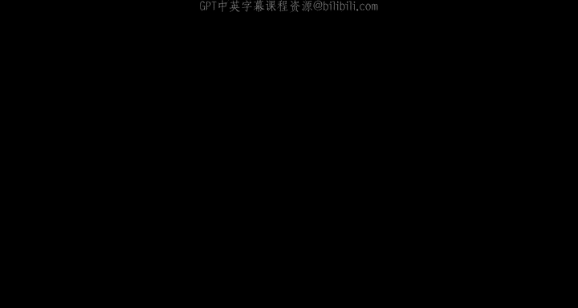
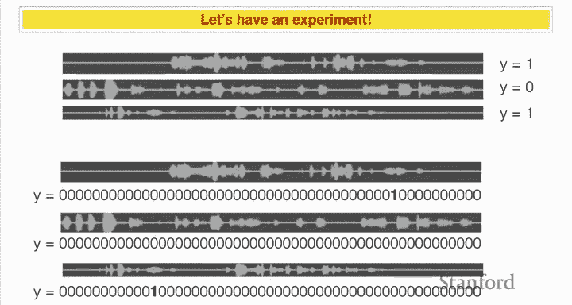
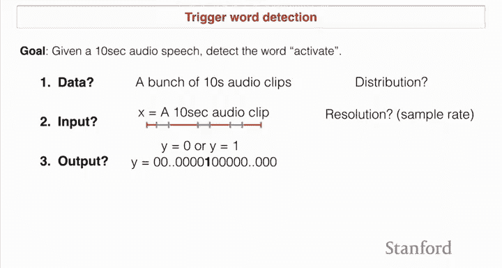

# 课程2：深度学习直觉 🧠

在本节课中，我们将学习如何系统地思考深度学习项目。我们将涵盖从数据收集、标注、架构选择到损失函数设计的全过程。课程将通过几个具体应用案例，帮助你建立对深度学习项目流程的直观理解。

---

## 1. 机器学习与深度学习回顾

上一节我们介绍了课程概述，本节中我们来看看机器学习与深度学习的基本概念。

你可以将机器学习或深度学习视为对一个函数的建模。这个函数接收一个输入（如图像、语音、自然语言或CSV文件），经过一个“黑箱”处理后，产生一个输出（如分类结果）。

一个很好的记忆方式是：**模型 = 架构 + 参数**。
*   **架构** 是你选择的设计，例如逻辑回归、浅层神经网络、深度神经网络、卷积神经网络或循环神经网络。
*   **参数** 是构成这个函数的核心数字，是模型需要学习的数百万个数值。

当你输入一张猫的图片，并通过前向传播得到输出后，你需要将这个输出与真实标签进行比较。用于比较的函数称为**损失函数**。计算损失函数的梯度会告诉你应该如何调整参数，以降低损失值，从而使模型更好地识别猫。这个过程会重复多次，直到找到合适的参数。

深度学习的有趣之处在于，许多部分都可以变化：
*   **输入**：可以是自然语言、语音、结构化数据等。
*   **输出**：可以是二分类、多分类或回归问题（例如预测猫的年龄）。
*   **架构**：如前所述，有多种选择。
*   **损失函数**：针对不同项目需要选择不同的损失函数，这是今天的重点。
*   **优化过程**：可以选择不同的优化器（如SGD、RMSprop、Momentum）和超参数（如学习率、批次大小）。

---

## 2. 从逻辑回归到多分类

上一节我们回顾了基本概念，本节中我们来看看如何扩展基础架构。

我们见过的第一个架构是逻辑回归。一张图像在计算机中可以用一个3D矩阵表示，每个矩阵代表一个颜色通道（RGB）。我们可以将这些数字展平成一个向量，输入到逻辑回归模型中。模型通过参数 `W` 和偏置 `B` 进行计算，再经过Sigmoid函数，输出一个介于0和1之间的值，表示图像中有猫的概率。

现在，如果我们想构建一个能分类多种动物（例如长颈鹿、大象、猫）的分类器，该如何修改这个架构呢？

答案是增加输出单元（神经元），每个神经元负责一种动物。我们称之为**多逻辑回归**。

那么，网络如何知道哪个神经元对应哪种动物呢？这取决于你如何标注数据。以下是几种标注方式：

以下是几种常见的数据标注方式：
*   **独热编码**：一个全零向量，仅在对应类别位置为1。例如，`[1, 0, 0]` 表示猫。**缺点**：无法处理单张图片中出现多个动物的情况。
*   **整数编码**：每个整数对应一种动物。例如，1代表猫，2代表大象。
*   **多热编码**：向量中可以存在多个1。例如，`[1, 1, 0]` 表示图片中同时有猫和大象。这适用于多标签分类。

如果你的任务约束是每张图片只有一个动物，并且使用独热编码，那么最后一层通常不使用Sigmoid激活函数，而会使用 **Softmax** 函数。

这个例子说明了**选择标注方式**是项目开始前的重要决策。

---

## 3. 编码的概念

上一节我们讨论了架构扩展，本节中我们来理解“编码”这一核心概念。

在一个非浅层的网络中，不同层学习到的信息抽象层次不同：
*   **第一层神经元** 看到的是数据的像素级表示。
*   **第二层（隐藏层）神经元** 接收第一层所有神经元的输出，这些信息更高级、更复杂（例如边缘）。
*   **后续层** 会组合更高级的特征（例如眼睛、鼻子、嘴巴）。

这个过程称为**编码**。从某一层提取出的所有数字，构成了输入数据在该抽象层次上的表示。
*   从网络末端提取的编码是数据的高度复杂表示。
*   从第一层末端提取的编码是数据的较低级表示（如边缘）。

我们将在这个讲座中多次使用“编码”这个概念。

---

## 4. 应用一：昼夜图像分类 🌇🌃

现在，让我们通过具体应用来建立直觉。首先从一个简单的热身开始：昼夜图像分类。

**任务**：给定一张图像，构建一个网络来判断它是白天拍摄的（标签0）还是夜晚拍摄的（标签1）。

**1. 数据集**：我们需要收集白天和夜晚的图像。数据量取决于任务复杂度。与猫识别任务相比，这个任务更简单，因此可能需要更少的数据（例如10,000张）。但如果想让模型也能识别室内或黄昏等复杂场景，则需要更多数据。

**2. 数据划分**：将数据集划分为训练集、验证集和测试集。一个常见的比例是80%训练，20%测试。对于非常大的数据集（如100万张），测试集比例可以更小（如2%）。**注意**：需要确保数据集中白天和夜晚类别的平衡。

**3. 输入**：图像的像素值。我们需要决定图像的分辨率。

**4. 分辨率选择**：分辨率越低，计算成本越小。选择依据是：在保证人类能完美完成该任务的前提下，使用最低的分辨率。例如，通过测试发现，64x64x3的分辨率足以让人类判断昼夜。

**5. 输出**：单个标签，y=0（白天）或 y=1（夜晚）。

**6. 最后一层激活函数**：**Sigmoid**，将输出压缩到0到1之间，可解释为概率。

**7. 架构**：由于任务简单，一个浅层的全连接网络或卷积网络可能就足够了。

**8. 损失函数**：**对数损失（Log Loss）**，也称为逻辑损失或二元交叉熵。公式如下：
`L = -[y * log(y_hat) + (1 - y) * log(1 - y_hat)]`
其含义是：当 y=0 时，我们希望预测值 y_hat 接近0；当 y=1 时，希望 y_hat 接近1。

---

## 5. 应用二：人脸验证与识别 👤➡️👤

上一节我们完成了一个简单的分类器，本节中我们来看一个更复杂的任务：人脸验证与识别。

**任务（人脸验证）**：学校希望使用人脸验证来让学生进入健身房。学生刷卡后，摄像头将其现场照片与数据库中的ID照片进行比对，确认是否为同一人。

**1. 数据集**：需要学生ID与其对应照片的映射数据库。为了训练一个能理解人脸通用特征的模型，仅靠学校的数据可能不够，通常需要利用网上包含数百万人脸照片的公开数据集进行预训练。

**2. 输入**：现场拍摄的人脸图像。

**3. 分辨率**：需要比昼夜分类更高的分辨率（例如400x400），因为需要检测更精细的面部特征（如眼距、鼻型）。

**4. 输出**：1（是同一个人）或 0（不是同一个人）。

**5. 架构思路**：不能直接比较两张图像的像素距离（因为光照、妆容、年龄变化等因素会导致失败）。我们需要一个函数将图像转换为更好的表示（编码）。

**方案**：使用一个深度网络，将ID照片和现场照片分别输入，得到两个编码向量。如果这两个向量足够“接近”，则认为是同一个人。

**关键问题**：如何确保网络输出的编码向量是有意义的？这需要通过损失函数的设计来指导训练。

**6. 训练与损失函数**：我们希望实现：
*   同一个人的不同照片，其编码向量应相似。
*   不同人的照片，其编码向量应不同。

为此，我们使用**三元组损失**。每次训练使用三张图片：
*   **锚点**：某个人的一张图片。
*   **正样本**：同一个人的另一张图片。
*   **负样本**：另一个人的一张图片。

损失函数的目标是：最小化锚点与正样本编码的距离，同时最大化锚点与负样本编码的距离。一个基本的损失函数形式是：
`L = ||enc(A) - enc(P)||² - ||enc(A) - enc(N)||²`
但实际中会加入一个边界值 `α`，形成：
`L = max(||enc(A) - enc(P)||² - ||enc(A) - enc(N)||² + α, 0)`
`α` 的作用是防止网络将所有编码都学习为0这种平凡解。

通过优化这个损失函数，网络会学习生成能代表人脸特征的编码。

**任务升级：人脸识别**
与人脸验证不同，人脸识别没有预先提供的ID。摄像头需要直接识别出你是谁。
**解决方案**：可以使用训练好的人脸验证模型。
1.  预先计算数据库中所有学生照片的编码向量。
2.  当新人脸出现时，计算其编码向量。
3.  将该向量与数据库中所有向量进行比较（例如计算L2距离），找出最接近的一个或多个。这本质上是一个 **k-最近邻** 搜索。
4.  如果用于照片整理（如手机相册），可以对所有照片的编码进行**聚类**（如K-Means算法），将同一个人物的照片自动归组。

---

## 6. 应用三：艺术生成 🎨

上一节我们处理了识别任务，本节中我们来看看一个创造性的任务：艺术生成。

**任务**：生成一幅画。我们将其定义为：将一张**内容图片**（如卢浮宫）用一张**风格图片**（如莫奈的画作）的风格重新绘制。

**1. 数据**：需要内容图片和风格图片。

**2. 核心思路**：我们不训练网络的参数，而是**训练生成图片本身的像素值**。我们使用一个预训练好的、能很好理解图像的分类网络（如在ImageNet上训练的模型）。

**3. 方法**：
*   **内容提取**：将内容图片输入预训练网络，从较浅的层（通常捕捉边缘、纹理）提取特征，作为“内容”表示 `C`。
*   **风格提取**：将风格图片输入网络，使用**格拉姆矩阵**等技术从各层提取特征，计算其相关性，得到“风格”表示 `S`。风格是非局部化的信息（如笔触、色彩搭配）。
*   **生成与训练**：
    1.  初始化一张随机噪声图像 `G`。
    2.  将 `G` 输入同一个预训练网络，提取其“内容” `Gc` 和“风格” `Gs`。
    3.  定义损失函数：`L = α * ||Gc - C||² + β * ||Gs - S||²`
        其中，第一项保证生成图的内容与内容图片相似，第二项保证生成图的风格与风格图片相似。
    4.  计算损失相对于生成图像 `G` 的像素的梯度（**不更新预训练网络的参数**）。
    5.  更新图像 `G` 的像素，以降低损失。
    6.  重复步骤2-5，最终 `G` 会逐渐兼具目标内容和风格。

**优点**：灵活，可为任意内容和风格组合生成图像。
**缺点**：每次生成都需要进行迭代优化，速度较慢。

---

## 7. 应用四：触发词检测 🎤

上一节我们生成了艺术图像，本节中我们处理一个时序任务：触发词检测。

**任务**：给定一段10秒的音频，检测其中是否出现了“activate”这个词。

**1. 数据**：需要大量包含“activate”一词的10秒音频片段，涵盖不同的口音、性别、年龄。数据分布至关重要。

**2. 输入**：10秒的音频片段。

**3. 输出与标注策略**：
*   简单的“是/否”标注对于模型学习来说效率不高。
*   更好的策略是进行**时序标注**：在音频时间轴上，在触发词**结束后**的一小段时间内（例如1秒）标记为1，其余部分标记为0。为了避免标签严重不平衡（0太多），可以将1标签持续一小段时间（如20个时间步）。

**4. 架构**：通常使用**循环神经网络**（如LSTM）来处理时序数据。每个时间步输出一个通过Sigmoid函数得到的概率值。

**5. 损失函数**：对每个时间步的预测使用二元交叉熵损失，然后对所有时间步的损失求和。

**项目成功的关键因素**：
*   **战略性的数据获取流程**：与其费力地收集和手动标注大量完整音频，不如分别建立三个小型数据库：
    1.  **正面词库**：包含“activate”的1秒片段。
    2.  **负面词库**：包含其他词的1秒片段。
    3.  **背景噪音库**：各种环境噪音。
    然后，通过编程方式随机将正面词和负面词插入背景噪音中，并自动生成对应的时序标签。这种方法可以高效、廉价地生成海量训练数据。
*   **架构搜索与超参数调优**：不要盲目尝试。咨询该领域的专家（如语音识别专家）可以节省大量时间，他们能指出关键问题，如傅里叶变换的参数设置、使用卷积层减少时间步、加入批归一化层等。

**另一种思路**：也可以使用类似人脸验证的**三元组损失**方法，学习“activate”一词的音频编码，然后通过比较编码距离来判断。

---

## 8. 扩展：目标检测的损失函数 📦

最后，我们快速看一个复杂但优美的损失函数示例，它来自目标检测模型YOLO。

`L = λ_coord * Σ( (x - x_hat)² + (y - y_hat)² + (√w - √w_hat)² + (√h - √h_hat)² ) + Σ( (C - C_hat)² ) + λ_noobj * Σ( (C - C_hat)² ) + Σ( (p(c) - p_hat(c))² )`

这个损失函数包含多个部分：
1.  **边界框坐标**：最小化预测框与真实框中心点 `(x, y)` 以及宽度高度 `(w, h)` 的误差。对 `w` 和 `h` 取平方根是为了对**小边界框的误差给予更大惩罚**，因为对小物体来说，几个像素的偏差影响更大。
2.  **目标置信度**：如果单元格中有物体，则希望目标置信度 `C` 预测值高。
3.  **无目标置信度**：如果单元格中没有物体，则希望目标置信度预测值低。
4.  **类别概率**：预测框中物体的具体类别。

这个函数清晰地展示了如何通过一个综合的损失函数来指导网络同时学习定位（回归）和分类任务。

---

## 总结

本节课中，我们一起学习了如何系统地思考深度学习项目。我们从基本的模型构成（架构+参数）出发，回顾了编码的概念，并通过四个具体应用（昼夜分类、人脸验证、艺术生成、触发词检测）深入探讨了关键决策点：
*   **数据**：需要多少？如何标注？如何高效获取？
*   **输入/输出**：格式、分辨率、表示方法。
*   **架构**：根据任务复杂度选择。
*   **损失函数**：是项目的核心设计之一，它直接定义了模型的学习目标。

我们还看到了一个复杂损失函数（目标检测）的例子。记住，在项目中遇到困难时，进行错误分析并咨询领域专家往往是最高效的路径。希望这节课能为你未来的项目提供一个坚实的思考框架。