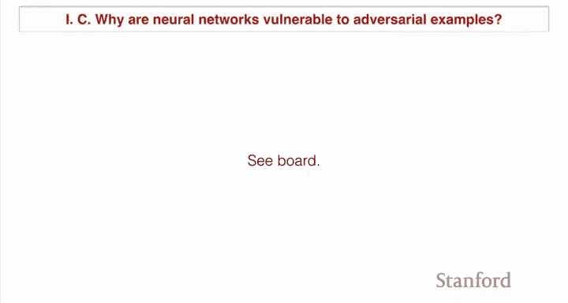
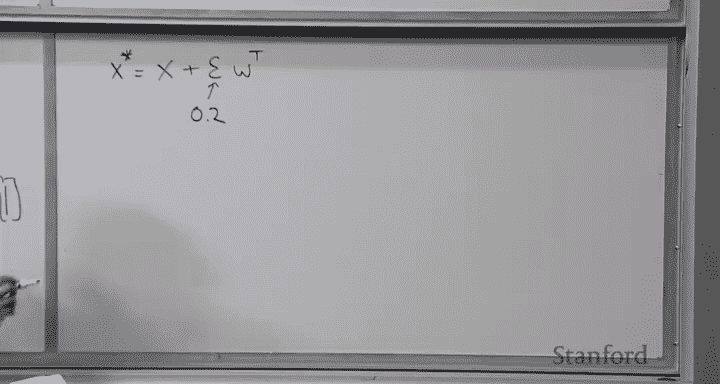
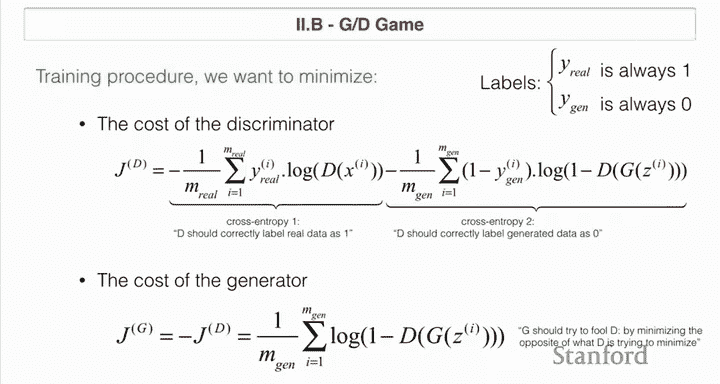
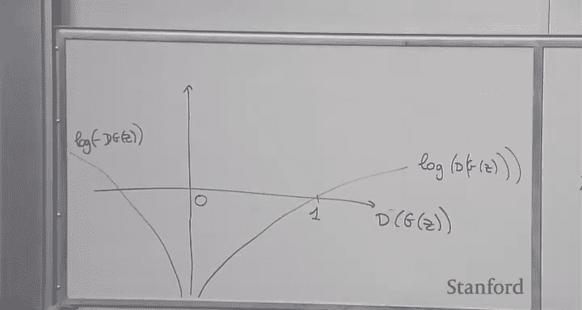

# 课程04：对抗性攻击与生成对抗网络 (GANs) 🛡️🎨

在本节课中，我们将学习两个在Coursera视频（C2M1和C2M2）中未深入讨论的重要主题：对抗性攻击和生成对抗网络。虽然它们都包含“对抗”一词，但这是两个独立的研究领域。我们将首先探讨如何利用对抗样本来攻击神经网络，然后学习如何构建能够生成逼真图像的生成对抗网络。

---

## 第一部分：对抗性攻击 🎯

上一节我们介绍了课程概述，本节中我们来看看对抗性攻击。2013年，Christian Szegedy及其团队发表了一篇题为《神经网络的有趣特性》的论文。他们发现，包括VGG16、Inception和ResNet在内的先进神经网络都存在一个“盲点”，容易受到**对抗样本**的攻击。

我们将分三部分学习：
1.  解释在图像背景下，这些样本如何攻击网络的盲点并导致错误分类。
2.  探讨如何防御此类攻击。
3.  从理论层面分析神经网络为何对此类攻击脆弱。

### 目标设定与攻击原理

我们的目标是：给定一个在ImageNet数据集上预训练好的分类网络，找到一个**看起来不像鬣蜥**，但会被网络**分类为鬣蜥**的输入图像。如果成功找到，我们称之为对抗样本。

假设我们从一个猫的图像开始。网络会正确将其分类为猫。我们希望找到一个图像 **X**，使得网络输出 **ŷ(X) = y_iguana**，其中 **y_iguana** 是一个在鬣蜥类别位置为1的one-hot向量。

这个过程类似于神经风格迁移。我们**固定网络参数**，通过反向传播将损失函数的梯度一直传回输入图像，并迭代更新图像的像素值。

我们定义损失函数为网络输出与目标鬣蜥标签之间的差异，例如使用交叉熵损失：
`L = CrossEntropy(ŷ(X), y_iguana)`

通过最小化这个损失，我们推动图像X被网络识别为鬣蜥。

### 约束攻击与真实威胁

然而，上述方法生成的图像可能看起来像随机噪声，对人类而言明显异常，因此威胁有限。

更危险的攻击是：**图像看起来像猫（人类认为它是猫），但网络将其分类为鬣蜥**。这需要我们在损失函数中添加一项，约束生成的图像必须与原始猫图像相似：
`L = CrossEntropy(ŷ(X), y_iguana) + λ * Distance(X, X_cat)`
其中，距离度量可以是L2范数等。通过优化这个复合损失，我们有望得到一个看起来像猫，但被网络识别为鬣蜥的图像。

以下是恶意应用场景：
*   **人脸识别**：让系统将他人的脸识别为你。
*   **绕过验证码**。
*   **社交媒体**：发布能被算法漏检的违规内容。
*   **自动驾驶**：制作一个人类看来是停车标志，但被自动驾驶系统识别为其他物体的贴纸。

### 攻击类型与防御策略

攻击可分为：
*   **非目标攻击**：仅旨在欺骗模型，使其产生任何错误输出。
*   **目标攻击**：旨在迫使模型输出攻击者指定的特定错误类别。

根据攻击者对模型的了解程度，又可分为：
*   **白盒攻击**：攻击者完全了解模型架构和参数，可以直接计算梯度。
*   **黑盒攻击**：攻击者不了解模型内部细节，只能通过查询输入输出对来估计梯度。

一个有趣的现象是对抗样本的**可迁移性**：针对一个模型生成的对抗样本，有很大概率也能欺骗另一个不同架构的模型。这使得黑盒攻击更为可行。

目前没有完美的防御方法，但有一些研究思路：
1.  **安全网**：在主要网络前放置一个用于检测对抗样本的“防火墙”网络。
2.  **集成模型**：使用多个模型进行预测，对抗样本难以同时欺骗所有模型。
3.  **对抗训练**：在训练过程中，将生成的对抗样本连同其正确标签加入训练集。但这计算成本很高。

### 理论解释：为何存在对抗样本？

一种观点认为，对抗样本的存在并非主要源于神经网络的非线性或过拟合，而是由于其**高维输入空间中的线性行为**。

考虑一个简单的线性模型：`ŷ = wX + b`
其关于输入X的梯度为 `∇X L = w`。如果我们对输入做一个小扰动：`X* = X + ε * sign(w)`
那么输出的变化为：`ŷ* ≈ ŷ + ε * w · sign(w) = ŷ + ε * ||w||_1`
由于L1范数 `||w||_1` 是各维度绝对值之和，**即使ε很小，在高维（如图像的64x64x3=12288维）下，输出的变化也会被显著放大**。神经网络在许多区域表现出近似线性的特性，使得这种基于梯度符号的快速攻击方法（Fast Gradient Sign Method）非常有效。

---

## 第二部分：生成对抗网络 (GANs) 🧠

上一节我们探讨了如何攻击网络，本节中我们来看看如何让网络创造内容。生成对抗网络的目标是让计算机理解数据分布，并生成逼真的新数据（如图像）。

### 基本概念与架构

GAN的核心思想是让两个网络通过竞争共同进步：
*   **生成器 (G)**：接收一个随机噪声向量 **z**，试图生成逼真的假图像 **G(z)**。
*   **判别器 (D)**：接收一张图像，判断它是来自真实数据集还是生成器产生的假图像。

这是一个**极小极大博弈**过程：生成器试图生成以假乱真的图像来欺骗判别器，而判别器则努力提升自己的鉴别能力。

### 训练过程与损失函数

以下是训练步骤：
1.  从真实数据集中采样一批真实图像。
2.  从先验分布（如高斯分布）采样一批随机噪声 **z**，输入生成器得到一批假图像 **G(z)**。
3.  用真实图像和假图像训练判别器，使其能更好地区分它们。
4.  训练生成器，使其生成的图像能更有效地欺骗当前的判别器。

判别器的损失函数是标准的二元交叉熵：
`J_D = -[E_(x~真实数据)[log D(x)] + E_(z~噪声)[log(1 - D(G(z)))]]`
其中，`D(·)` 输出图像为真的概率。

最初，生成器的损失函数被定义为最小化 `E_z[log(1 - D(G(z)))]`。但这在训练早期（`D(G(z))`接近0）会导致梯度消失（饱和问题）。因此，实践中常采用**非饱和损失**，即最大化 `E_z[log(D(G(z)))]`，这等价于最小化 `-E_z[log(D(G(z)))]`。这能提供更有效的早期训练梯度。

### 训练技巧与先进架构

训练GAN是困难的，常被称为“艺术”。一些技巧包括：
*   **多训练判别器**：通常对判别器进行k次更新后，才对生成器更新1次，以保持判别器的领先。
*   **使用虚拟批归一化**等稳定训练的技术。

一些先进的GAN架构能实现更复杂的任务，例如**CycleGAN**用于无配对图像的风格转换（如马变斑马）。其核心是引入**循环一致性损失**，确保将图像A转换到域B后再转换回来，能近似得到原图A：
`L_cycle = ||G_B2A(G_A2B(A)) - A|| + ||G_A2B(G_B2A(B)) - B||`

### 应用与评估

GAN有广泛的应用：
*   **图像生成**：生成逼真的人脸、物体等。
*   **图像到图像翻译**：将语义图转为照片、素描上色、风格迁移等。
*   **超分辨率**：从低分辨率图像生成高分辨率版本。
*   **隐私保护**：生成匿名化的医疗数据用于共享研究。

评估GAN生成图像的质量是一个挑战。常用方法包括：
*   **人工评估**：让人判断图像是否真实。
*   **Inception Score**：使用预训练的Inception网络，同时评估生成图像的**质量**（属于某个明确类别的概率高）和**多样性**（覆盖多个类别）。
*   **Fréchet Inception Distance**：比较生成图像与真实图像在特征空间中的分布距离。

---

## 总结 📚

本节课中我们一起学习了深度学习中的两个重要话题。

在第一部分，我们探讨了**对抗性攻击**。我们了解了如何通过微调输入像素来制造欺骗神经网络的对抗样本，这些样本可能对人类不可见但却能导致模型严重误判。我们还讨论了白盒与黑盒攻击、对抗样本的可迁移性，以及一些尚不完善的防御思路。其理论根源与高维输入空间中的线性行为密切相关。

在第二部分，我们学习了**生成对抗网络**。GAN通过生成器与判别器之间的对抗博弈，使生成器能够学习并模拟复杂的数据分布（如图像），创造出逼真的新数据。我们分析了其训练目标、损失函数（特别是非饱和损失的重要性）以及训练中的挑战。最后，我们看到了GAN在图像生成、风格转换等领域的强大应用，并了解了评估其性能的常用指标。

理解这些概念不仅有助于认识现代深度学习模型的局限性与潜力，也为构建更鲁棒、更智能的系统奠定了基础。