# 课程名称：CS230 深度学习 - 第五讲：AI + 医疗健康 🏥

## 概述

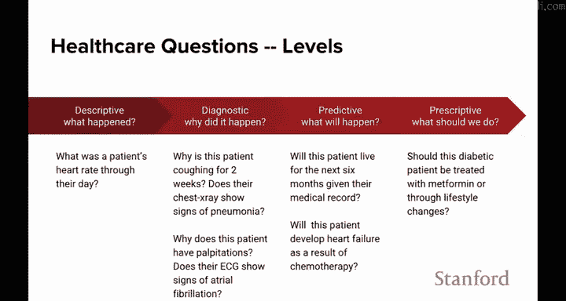

在本节课中，我们将学习人工智能在医疗健康领域的应用。我们将首先了解AI在医疗中可以解决的不同层次的问题，然后通过三个具体的案例研究，深入探讨深度学习如何应用于一维、二维和三维的医疗影像分析。最后，我们将讨论如何参与到这个激动人心的领域中来。

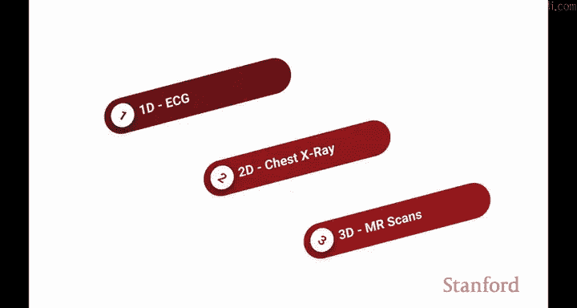

---

## AI在医疗健康中的应用层次

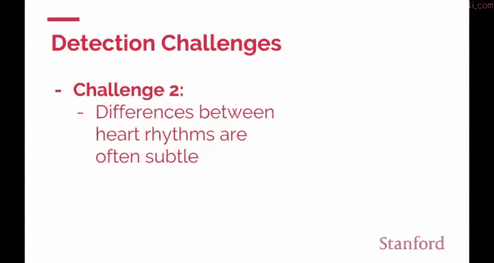

上一节我们介绍了课程的整体安排，本节中我们来看看如何系统地理解AI在医疗健康中的作用。我们可以根据从数据中提出的问题类型，将AI在医疗中的应用分解为几个层次。

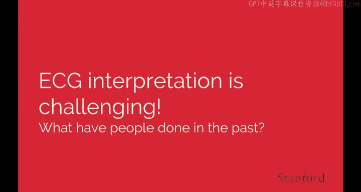

以下是四个主要的问题层次：

1.  **描述性问题**：这里我们试图了解“发生了什么”。例如，汇总患者的生命体征数据。
2.  **诊断性问题**：这里我们询问“为什么会发生”。例如，根据患者的X光片判断其是否患有肺炎。
3.  **预测性问题**：这里我们关心未来“将会发生什么”。例如，预测患者在接下来六个月内的疾病风险。
4.  **处方性问题**：这是最高层次，我们试图回答“我应该做什么”。例如，根据患者的症状和风险轨迹，推荐最佳的治疗方案。

达到处方性问题的层次是最终目标，但这需要大量的数据和多个步骤。

---

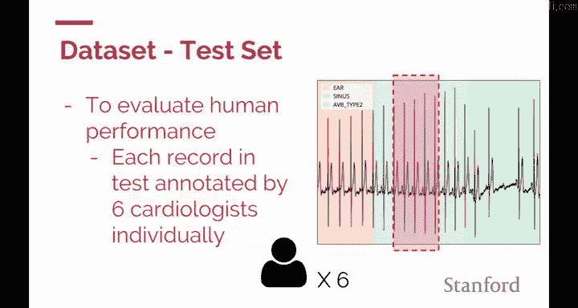

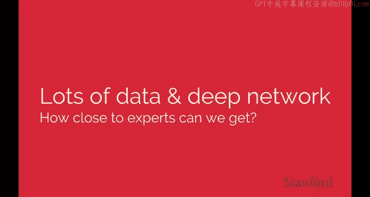

## 案例研究一：一维心电图（ECG）心律失常检测 ❤️

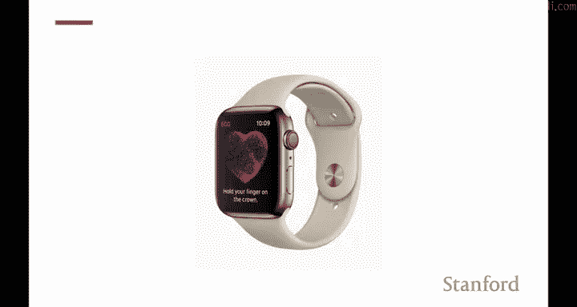

上一节我们了解了AI在医疗中的宏观框架，本节中我们将深入第一个具体案例：使用一维心电图信号检测心律失常。

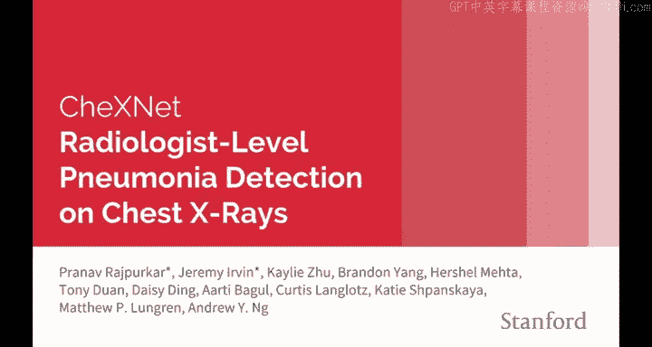

### 问题背景与挑战

心律失常影响着数百万人。传统上，患者在医院进行几分钟的心电图检查可能无法捕捉到异常心律，因此需要佩戴24至48小时的动态心电图监测仪。新型设备（如Zio patch）甚至可以进行长达两周的监测，但这会产生海量数据（例如两周产生160万次心跳），人工分析极其耗时。

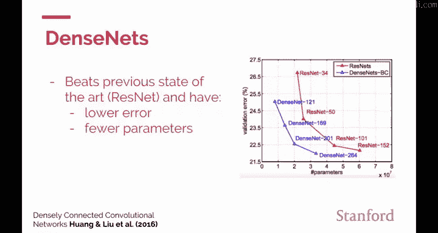

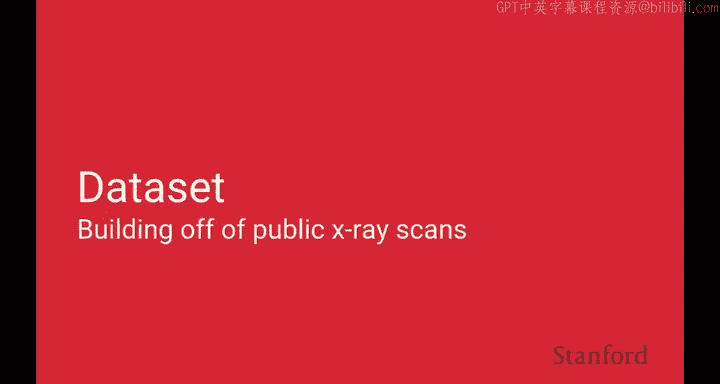

自动化检测面临两大挑战：
1.  新型便携设备通常只有单导联，而医院设备有多导联，这减少了对心脏三维电活动的观测视角。
2.  不同心律之间的差异非常细微。

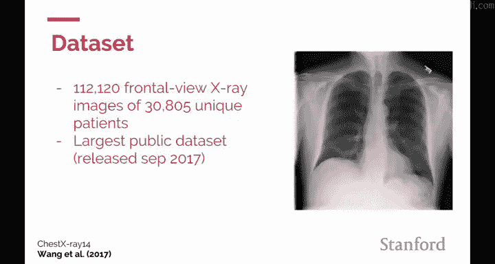

### 深度学习方法

我们摒弃了传统基于小波变换和特征工程的方法，采用端到端的深度学习。我们将心电图信号分割成等长的片段，每个片段对应一个心律标签（如A、B、C类心律）。

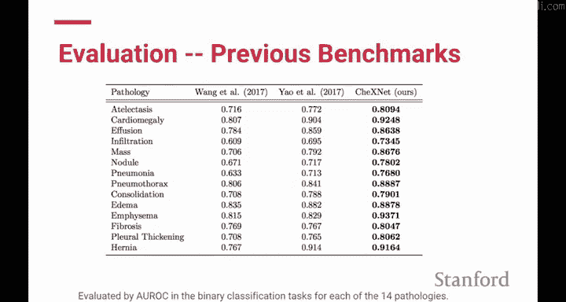

我们构建了一个34层深的**一维卷积神经网络（1D CNN）**来处理时间序列信号。网络架构基于**残差网络（ResNet）** 的思想。

**ResNet核心公式**：
`H(x) = F(x) + x`
其中，`x`是输入，`F(x)`是残差映射，`H(x)`是期望的底层映射。通过引入“快捷连接”（`+ x`），使得网络可以更容易地学习恒等映射，缓解了深度网络中的梯度消失问题，允许训练更深的网络。

### 数据与结果

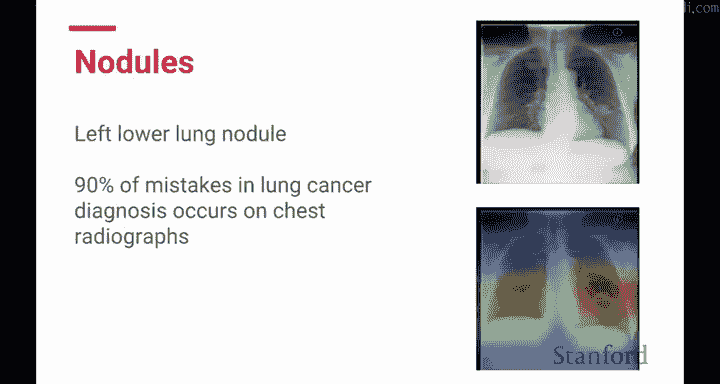

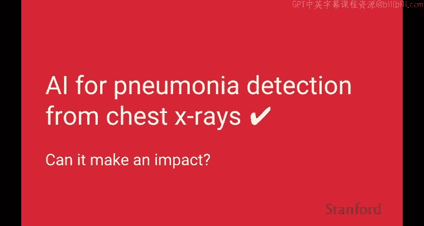

我们与一家硬件初创公司合作，获得了约30,000名患者佩戴设备长达两周的数据，这比之前最大的公开数据集大了600倍。每条心电图都由临床心电图专家标注。

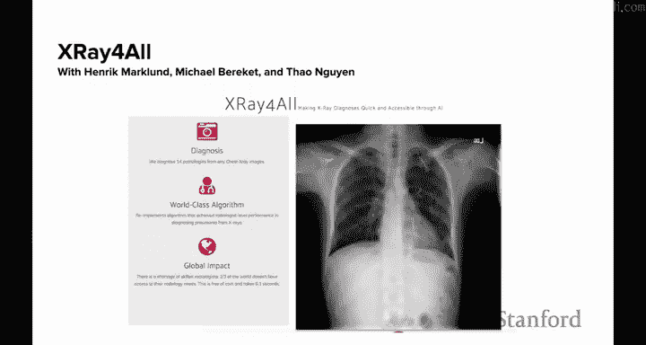

我们将模型的性能与心脏病专家进行对比。在F1分数（综合精确率和召回率）上，我们的模型超越了心脏病专家。分析错误案例发现，模型有时能纠正专家的误诊，例如将专家认为的良性心律正确识别为严重心律。

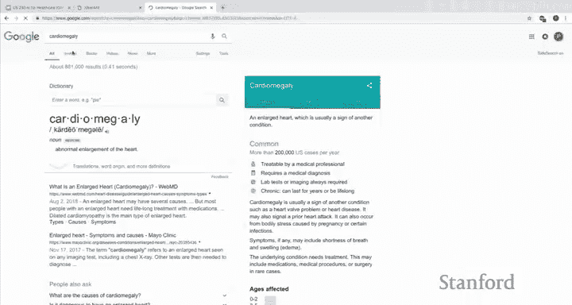

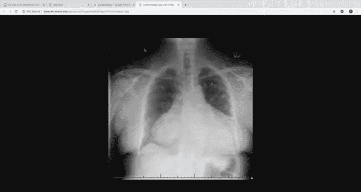

这项应用的意义在于，深度学习使得对患者的**连续监测**成为可能，这有助于我们更深入地了解疾病风险因素。

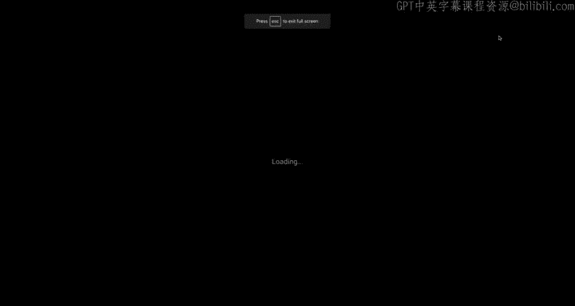

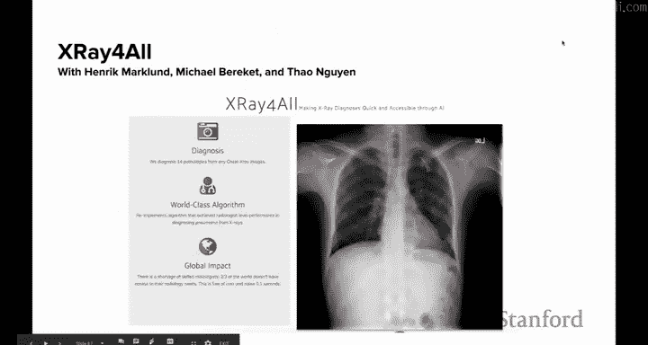

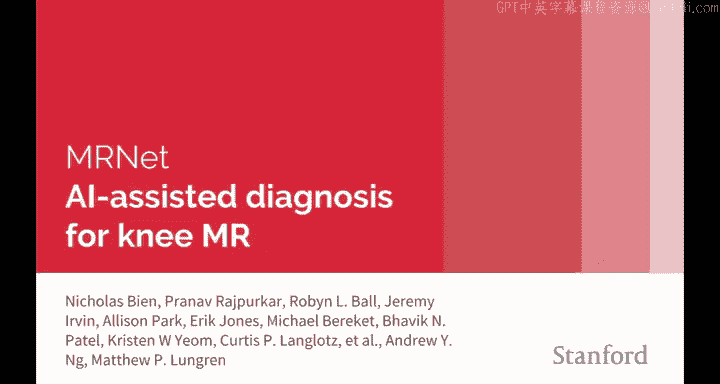

---

## 案例研究二：二维胸片肺炎检测 🫁

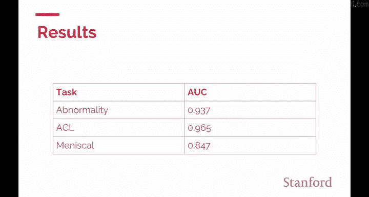

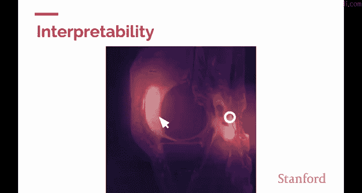

上一节我们探讨了一维时间序列信号的分析，本节中我们来看看二维图像分析：利用胸部X光片检测肺炎。

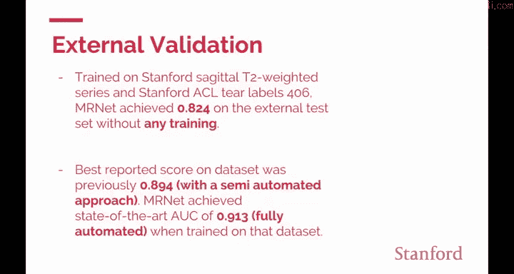

### 问题与方法

肺炎是一种影响数百万人的感染。胸部X光是全球最常用的影像学检查，每年进行约20亿次。肺炎在X光片上表现为密度增高区域（本该暗的地方变亮）。

我们的任务是：输入一张胸部X光图像，输出一个二元标签（0或1），表示是否存在肺炎。

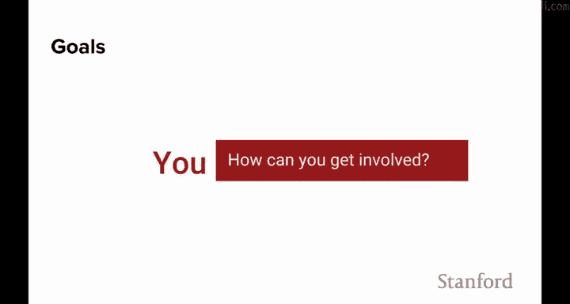

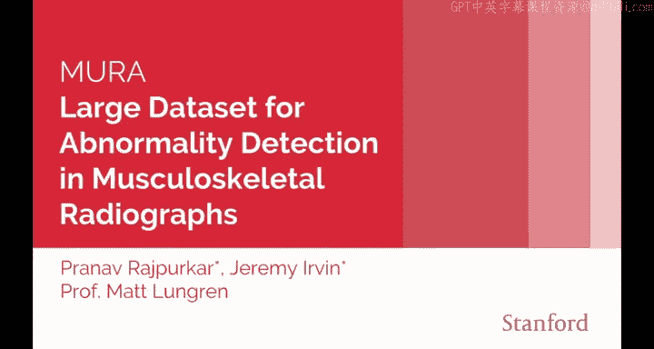

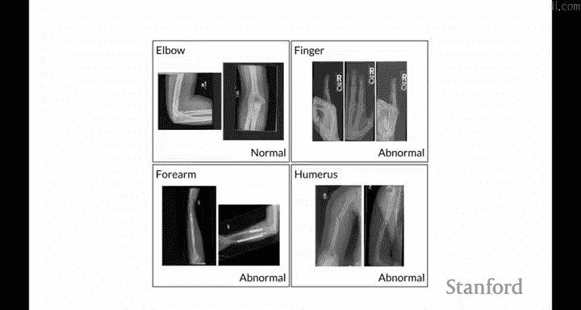

我们使用了一个在ImageNet上预训练的**二维卷积神经网络（2D CNN）**。具体架构是**DenseNet**，它将ResNet的快捷连接思想发挥到极致，将网络中的每一层都与其后续所有层直接连接，促进了特征重用，并减少了参数数量。

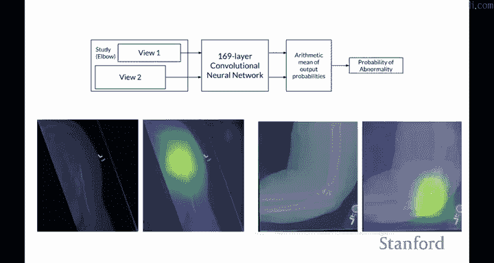

### 数据与评估策略

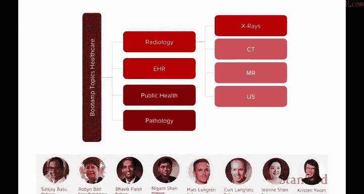

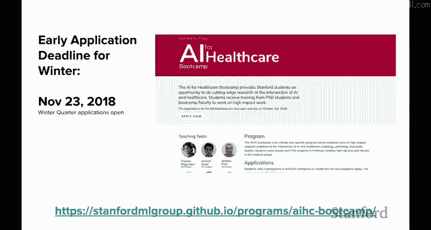

我们使用了美国国立卫生研究院（NIH）发布的一个包含10万张胸片的大型公共数据集。每张X光片通过自然语言处理系统读取放射科报告，被标注了最多14种不同的病理状态。

在医学影像中，通常缺乏绝对的“金标准”。因此，我们采用了一种对称的评估方案：将模型与四位放射科医生进行比较。我们轮流将其中一位医生视为“预测模型”，另一位视为“金标准”，计算F1分数，并对所有组合取平均。同样，也将模型视为“预测模型”与每位医生进行比较。结果显示，我们的模型在此任务上表现优于放射科医生的平均水平。

### 模型可解释性与应用

为了让临床医生信任模型的决策，可解释性至关重要。我们使用了**类激活映射（Class Activation Map， CAM）** 技术来生成热力图，高亮显示模型做出诊断所依据的图像区域。例如，对于肺炎病例，热力图会聚焦在肺部感染区域。

这项技术的应用有两个方向：
1.  **优化工作流程**：在发达国家，帮助放射科医生优先处理最需要关注的病例。
2.  **提升全球可及性**：世界卫生组织估计全球约三分之二人口无法获得影像诊断。我们开发了一个原型应用，允许用户上传X光片并获得初步诊断和热力图解释，旨在为医疗资源匮乏的地区提供支持。

---

## 案例研究三：三维膝关节MRI异常检测 🦵

上一节我们讨论了二维图像分析，本节中我们进入更复杂的三维领域：利用膝关节磁共振成像（MRI）检测异常。

### 问题与模型设计

膝关节MRI是评估膝关节疾病的标准方法。我们的目标是识别两种最常见的膝关节损伤：前交叉韧带（ACL）撕裂和半月板撕裂，并达到放射科医生的水平。

与二维图像不同，三维MRI可以从多个角度（矢状面、冠状面、轴状面）观察，并且有不同的成像序列。我们面临的是一个**多标签分类问题**（同一检查可能同时存在两种撕裂）。

我们的方法是为每个“视角-病理”对训练一个卷积神经网络，共计9个网络。每个CNN处理一个视角下的所有图像切片，提取特征并输出概率。最后，使用逻辑回归将这9个网络的输出概率结合起来，得到最终的异常概率、ACL撕裂概率和半月板撕裂概率。

### 数据与泛化能力

我们使用了斯坦福医学中心的1,400次MRI检查数据进行训练，并在120次检查上测试，以三位亚专科放射科医生的多数投票作为金标准。模型在各项任务上表现良好。

一个关键挑战是模型的**外部验证**，即模型在不同于训练数据分布的新数据上的表现。我们使用了一个来自克罗地亚医院的公开数据集进行测试，该数据在扫描仪型号、成像序列和机构上都与训练数据不同。未经任何微调的模型表现尚可，而经过微调后，模型性能超过了之前在该数据集上报告的最佳结果。这表明跨机构、跨国家的模型泛化仍然是一个开放的研究问题。

### 人机协作

我们进一步探索了模型与放射科医生协作的潜力。实验设置是让医生在同一组病例上间隔数周进行两次诊断，并观察在模型辅助下其表现是否提升。结果显示，协作显著提高了医生诊断ACL撕裂的特异性（即更准确地识别出没有撕裂的病例），这意味着可以减少不必要的手术随访。

---

## 如何参与AI+医疗健康领域 🚀

上一节我们通过三个案例深入了解了研究前沿，本节中我们来看看如果你对这个领域感兴趣，可以如何参与其中。

以下是两种主要的参与途径：

1.  **动手实践数据集**：我们的实验室发布了**MURA数据集**，这是一个大型的肌肉骨骼X光片数据集。任务是从多个视角判断X光片是否正常。这是一个练习构建和优化卷积神经网络（尤其是处理多视图数据）的绝佳机会。
    *   **数据**：包含不同身体部位（肩、肘、腕、手、髋、膝、踝、足）的X光片，每个部位有多个视角。
    *   **挑战**：设计决策包括是否为不同身体部位训练不同模型，以及如何有效地融合多视图信息。
    *   你可以在我们的网站（Stanford ML Group GitHub页面）上找到并下载这个数据集。

2.  **加入AI医疗健康训练营**：这是一个由我们实验室运行的为期两个季度的项目，为像CS230这样的课程学完的学生提供参与研究的机会。
    *   **内容**：学生接受实验室博士生和医学院教授的培训，参与结构化的研究项目。
    *   **领域**：项目涵盖放射学、电子健康记录、公共卫生和病理学等多个方向。
    *   **申请**：冬季训练营的申请现已开放，早期申请截止日期为11月23日。

---

## 总结

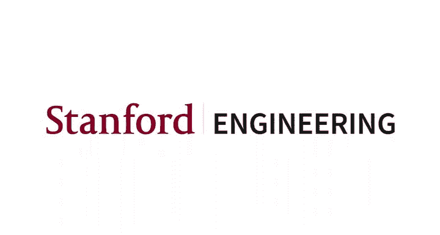

本节课中，我们一起学习了人工智能在医疗健康领域的广阔前景和具体应用。我们从问题框架出发，深入研究了三个案例：使用1D CNN检测心电图心律失常，使用2D CNN在胸片中诊断肺炎并提供可解释性，以及使用3D CNN在膝关节MRI中识别损伤并探索人机协作。最后，我们介绍了通过公开数据集和实践项目进入这一领域的方式。AI有潜力变革医疗健康，从提高诊断效率到扩大全球医疗可及性，而这正是技术向善的体现。