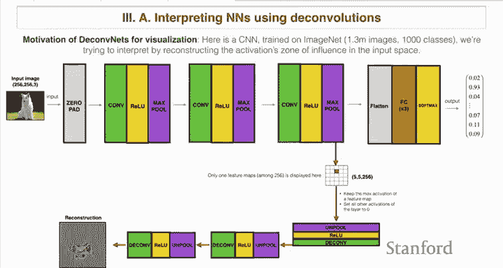
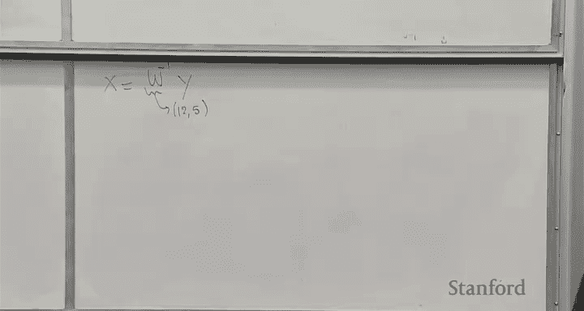
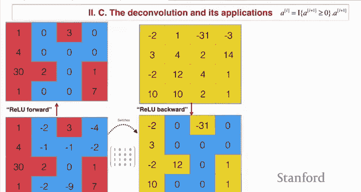

# 课程7：神经网络的可解释性 🧠

在本节课中，我们将学习如何解释和理解神经网络内部的决策过程。我们将从映射网络输出到输入空间的方法开始，然后深入探讨网络中间层的可视化技术，以揭示网络如何“看待”世界。

---

## 概述

到目前为止，我们已经学习了卷积神经网络及其在图像处理中的应用。我们接触了不同类型的层，如池化层和卷积层，以及从经典算法到Inception和ResNet的分类方法。我们还探讨了YOLO、Fast R-CNN等高级应用，以及人脸识别和神经风格迁移。

然而，许多神经网络的改进是基于试错法进行的。我们从科学的角度希望找到更有效的方法来改进网络，而不仅仅是依靠试错。因此，今天我们将重点学习如何通过理论、可视化和解释来理解神经网络。

首先，我们将介绍三种用于理解网络决策过程的方法：显著图、遮挡敏感性和类激活图。这些方法帮助我们理解，给定一个输出，网络的决策是基于输入空间的哪些部分。

随后，我们将更深入地研究网络的中间层，通过梯度上升、类模型可视化、数据集搜索和反卷积等方法，观察激活层、网络层乃至整个网络层面的情况。我们还将花一些时间讨论反卷积，这是一种有趣的数学运算，能帮助你从数学角度更好地理解卷积的工作原理。

如果时间允许，我们还将介绍一个有趣的应用——Deep Dream，它能生成非常酷的视觉效果。

---

## 第一部分：映射输出到输入空间

上一节我们回顾了卷积神经网络的基础知识。本节中，我们来看看如何将网络的输出决策映射回输入图像，以识别哪些输入部分对特定输出具有判别性。

以下是三种主要方法：

### 1. 显著图

显著图是一种快速可视化方法，用于显示网络在做出特定决策时关注了输入图像的哪些部分。

**核心思想**：给定一个输入图像和网络对某个类别（如“狗”）的预测分数，我们计算该分数相对于输入图像的梯度。梯度值大的像素位置，表明该像素对“狗”类别的分数有较大影响。

**公式**：
设 $S_c$ 为类别 $c$ 的分数（Softmax层之前的原始分数），$x$ 为输入图像。显著图 $M$ 通过计算梯度得到：
$$ M = \left| \frac{\partial S_c}{\partial x} \right| $$

**步骤**：
1.  前向传播图像，得到目标类别的分数 $S_c$。
2.  计算 $S_c$ 相对于输入像素 $x$ 的梯度。
3.  取梯度的绝对值，得到与输入图像同尺寸的显著图。
4.  可视化显著图，亮色区域表示对决策重要的区域。

在实践中，我们可以对显著图进行阈值处理，粗略定位目标物体，但通常有更好的分割方法。

### 2. 遮挡敏感性

遮挡敏感性是一种更精确但较慢的方法，用于验证网络是否关注了图像的正确区域。

**核心思想**：在输入图像上滑动一个灰色方块，遮挡不同区域，并观察网络对目标类别置信度的变化。置信度下降明显的区域，表明该区域对识别该类别至关重要。

**步骤**：
1.  选择目标类别（如“狗”）。
2.  在原始图像上放置一个灰色遮挡块。
3.  将遮挡后的图像输入网络，记录目标类别的输出分数。
4.  将遮挡块在图像上滑动（类似卷积操作），重复步骤3。
5.  根据每个位置遮挡后的类别分数，生成一个热力图。红色表示遮挡后分数高（网络仍自信），蓝色表示分数低（网络不自信）。
6.  热力图揭示了图像中对识别目标类别最重要的区域。

遮挡块越小，生成的概率图就越精确。有趣的是，有时遮挡掉无关信息（如图片中的人脸）反而会提高网络对目标类别（如狗）的置信度，因为网络不再被干扰信息迷惑。

### 3. 类激活图

类激活图是一种强大的技术，它表明即使仅在图像级别标签上训练的分类网络，也具有良好的定位能力。

**核心思想**：修改网络结构，用全局平均池化层替换最后的全连接层。通过分析最后一个卷积层的特征图与最终分类权重之间的关系，我们可以生成一个显示与特定类别最相关图像区域的热力图。

**关键步骤**：
1.  **网络结构调整**：将分类网络末端的“展平层 + 全连接层”替换为“全局平均池化层 + 单个全连接层（+ Softmax）”。全局平均池化对每个特征图的所有空间位置取平均值，得到一个数值。
2.  **计算类激活图**：对于目标类别 $c$，其分数 $S_c$ 可以表示为：
    $$ S_c = \sum_{k} w_k^c \cdot \frac{1}{N} \sum_{i,j} a_{ij}^k $$
    其中，$w_k^c$ 是连接第 $k$ 个特征图到类别 $c$ 的权重，$a_{ij}^k$ 是第 $k$ 个特征图在位置 $(i, j)$ 的激活值，$N$ 是空间位置总数。
    通过交换求和顺序，我们可以得到位置 $(i, j)$ 对类别 $c$ 的贡献：
    $$ M_c(i, j) = \sum_{k} w_k^c \cdot a_{ij}^k $$
3.  **上采样与可视化**：$M_c$ 是最后一个卷积层的空间尺寸。我们将其上采样到原始输入图像尺寸，并叠加在原始图像上，得到类激活图。图中亮区表示网络用于识别该类别的区域。

这种方法只需对网络进行微调，就能提供清晰的可视化结果，在医疗影像分析等领域非常有用。

---

## 第二部分：深入网络内部

上一节我们学习了如何理解网络基于输入做出的决策。本节中，我们将深入神经网络内部，探索网络中间层所学习到的表示，即网络如何“理解”像“狗”这样的概念。

### 1. 梯度上升与类模型可视化

这种方法旨在找到能够最大化网络内部某个神经元或某个类别分数的输入图像。

**核心思想**：定义一个优化目标，例如最大化某个类别 $c$ 的分数 $S_c$，同时添加正则化项（如L2正则化、高斯模糊）以确保生成的图像看起来更自然。然后通过梯度上升迭代更新一个随机初始化的图像。

**目标函数**：
$$ \text{Objective} = S_c(\text{image}) - \lambda \cdot \text{Regularization}(\text{image}) $$

**步骤**：
1.  初始化一个图像（可以是随机噪声）。
2.  前向传播，计算目标类别分数。
3.  计算目标函数相对于输入图像的梯度。
4.  使用梯度上升更新图像像素。
5.  重复步骤2-4多次。

生成图像展示了网络认为最能代表该类别（如“火烈鸟”）的视觉模式。有趣的是，这种方法可以应用于任何中间层的激活值，以可视化该神经元对什么特征敏感。

### 2. 数据集搜索

这是一种直观的方法，用于理解单个特征图（对应一个滤波器）检测到什么模式。

**核心思想**：在一个大型数据集（如验证集）上运行网络，对于指定的某个中间层特征图，找出哪些输入图像使得该特征图的平均激活值（或最大激活值）最高。

**步骤**：
1.  选择网络中某一层的某个特征图。
2.  将大量图像前向传播通过网络。
3.  记录使该特征图激活值最高的前N张图像。
4.  由于卷积网络的感受野，一个激活值只对应输入图像的一小部分区域。因此，我们展示的是激活区域对应的图像块（裁剪）。

通过观察这些顶级激活图像块，我们可以推断该特征图检测到的模式（如“条纹纹理”、“车轮”、“人脸”）。越浅的层，检测到的特征越简单（如边缘、颜色）；越深的层，检测到的特征越复杂、越抽象。

### 3. 反卷积网络

反卷积是一种上采样操作，在图像生成、语义分割和网络可视化中非常有用。它帮助我们理解卷积操作的逆过程。

**核心思想**：给定一个网络中间层的激活值（我们通常选择某个特征图中激活最强的位置，并将其他位置置零），我们希望通过一系列反向操作（近似逆操作）重建出导致该激活的输入图像区域。

**关键操作**：
*   **反池化**：对于最大池化，我们需要记录前向传播时最大值的位置（“开关”）。在反池化时，将值放回记录的位置，其他位置填零。
*   **反激活**：对于ReLU，在重建时，我们只传递正激活，而不进行反向传播中的梯度截断。这有助于重建对激活有积极贡献的特征。
*   **反卷积**：这是最核心的部分。在一定的假设（如滤波器权重正交）下，卷积的近似逆操作可以通过**转置滤波器权重**、**在输入中插入零（子像素上采样）**和**将步幅除以2**来实现。这使得上采样操作可以像标准卷积一样高效执行。

**可视化流程**：
1.  选择网络中某一层的特征图。
2.  找到该特征图中激活值最高的空间位置。
3.  将该特征图其他所有激活置零，只保留这个“亮点”。
4.  从该层开始，依次进行反池化、反激活和反卷积操作，直到回溯到输入像素空间。
5.  得到的结果是一个图像块，显示了导致原特征图那个特定位置高度激活的视觉模式。

通过应用这种方法到不同层的不同滤波器，我们可以可视化网络每一层学习到的特征层次：从第一层的边缘和颜色，到中间层的纹理和图案，再到深层的人脸、文字等复杂概念。

---

## 第三部分：应用与总结

### Deep Dream 🌌

Deep Dream 是一个将网络可视化技术用于艺术生成的有趣应用。

**核心思想**：选择网络中的一个“梦境层”。前向传播一张图像，然后**将该层的梯度直接设置为该层的激活值本身**。接着进行反向传播，并更新输入图像。这个过程放大了网络在该层已经轻微检测到的模式，经过多次迭代，这些模式在图像中变得夸张和梦幻，生成迷幻、艺术化的图像。

例如，如果网络认为某片云彩有点像狗，Deep Dream 会强化这个“狗”的特征，最终在云中生成一个清晰的狗头图案。

### 课程总结

本节课我们一起学习了多种理解和解释神经网络的技术：

1.  **理解网络决策依据**：我们学习了**显著图**、**遮挡敏感性**和**类激活图**，这些方法帮助我们回答“输入的哪部分导致了输出？”
2.  **探究神经元功能**：通过**梯度上升/类模型可视化**、**数据集搜索**和**反卷积重建**，我们可以理解网络中特定滤波器、神经元或层的作用。
3.  **验证网络关注点**：**遮挡敏感性**和**类激活图**能有效验证网络是否关注了正确的图像区域。
4.  **窥探网络的“世界观”**：**梯度上升**和**Deep Dream**让我们看到网络所学到的内部表征。
5.  **技术应用**：这些可视化技术不仅用于理解和调试模型（如检测“死亡”神经元），其底层方法（如反卷积）也直接应用于**语义分割**、**生成对抗网络**等任务中。

通过结合这些工具，我们能够打开神经网络的“黑箱”，获得对其内部工作机制的宝贵见解，从而以更科学、更直观的方式设计和改进深度学习模型。